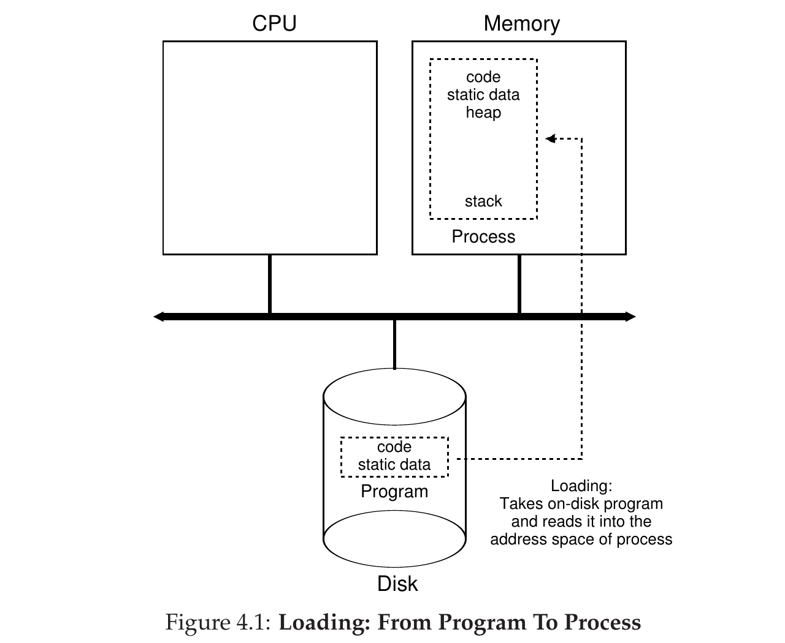
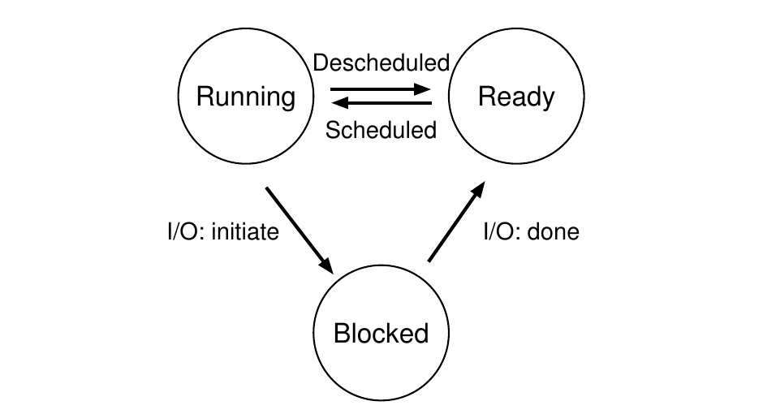

# 第 4 章 抽象：进程

> 英文原题：*The Abstraction: The Process*

本章我们讨论操作系统提供给用户的最基础抽象之一：**进程(process)**。按非正式的说法，进程的定义相当简单：它就是一个**正在运行的程序** [V+65,BH70]。程序本身是个没有生命的东西——它就是磁盘上的一堆指令（外加一些静态数据），安安静静地躺着，等着哪天派上用场。是操作系统把这些字节拿起来、让它们跑起来，才把程序变成了有用的东西。

你多半想同时跑不止一个程序。比如坐到你的台式机或笔记本前，你可能想开个浏览器、一个邮件客户端、一个游戏、一个音乐播放器，诸如此类。实际上，一个典型的系统看起来可能同时跑着几十个甚至上百个进程。这样做让系统变得好用，因为你永远不必操心 CPU 到底闲不闲——直接开程序就行了。于是就有了下面这个挑战：

!!! danger "问题核心"
    **如何营造出「有很多个 CPU」的假象？**

    物理 CPU 明明只有那么几个，操作系统怎样才能给人一种「CPU 取之不尽、用之不竭」的错觉？

操作系统靠**虚拟化 CPU** 来制造这个假象。它先跑一个进程，停下，再跑另一个，如此往复；于是明明只有一颗物理 CPU（或者几颗），操作系统也能营造出「存在许多虚拟 CPU」的假象。这种基础技术叫作 CPU 的**时间共享(time sharing)**，它让用户可以想开多少个并发进程就开多少个；代价则是性能——一旦 CPU 不得不被瓜分，每个进程都会跑得更慢。

要实现 CPU 虚拟化，而且要把它实现好，操作系统既需要一些底层机制，也需要一些高层智能。我们把底层机制称为**机制(mechanism)**；机制是实现某项功能所需的底层方法或协议。比如，我们后面会学到如何实现**上下文切换(context switch)**：它让操作系统能够在某颗 CPU 上停下正在跑的程序、改跑另一个。所有现代操作系统都在用这套时间共享机制。

!!! tip "提示"
    **使用时间共享（以及空间共享）**

    时间共享是操作系统用来共享资源的一种基础技术。让资源先被某个实体用一小会儿，再被另一个实体用一小会儿，如此往复，那么该资源（比如 CPU、或一条网络链路）就能被许多实体共享。与时间共享相对的是**空间共享(space sharing)**：资源被（在空间上）划分给想要使用它的各方。例如，磁盘空间天然就是一种空间共享的资源；一旦某个块被分给了一个文件，通常就不会再分给另一个文件，直到用户把原来的文件删掉。

在这些机制之上，还驻扎着操作系统的部分「智能」，表现为**策略(policy)**。策略是操作系统内部做某类决策的算法。举个例子：若有一堆程序都可能在 CPU 上跑，操作系统该跑哪一个？操作系统里的**调度策略(scheduling policy)** 会来做这个决定，它多半会参考历史信息（比如过去一分钟里哪个程序跑得更多？）、**负载(workload)** 知识（比如跑的都是些什么类型的程序？）以及性能指标（比如系统是要优化交互性能，还是吞吐量？）来拍板。

## 4.1 抽象：进程

操作系统为一个正在运行的程序提供的抽象，我们称之为**进程(process)**。如前所述，进程不过就是一个正在运行的程序；在任何一个瞬间，我们都可以清点这个进程在执行过程中访问或影响到的系统各部分，来给出一份关于它的「清单」。

因此，要弄清一个进程由什么构成，就得理解它的**机器状态(machine state)**：程序运行时能读、能改的东西。在任意时刻，机器的哪些部分对执行这个程序至关重要？

进程机器状态里一个显而易见的组成部分是它的**内存(memory)**。指令存在内存里，正在运行的程序读写的数据也存在内存里。所以，这个进程能够寻址的内存（叫作它的**地址空间(address space)**）就是进程的一部分。

**寄存器(register)** 也是进程机器状态的一部分；许多指令会显式地读取或更新寄存器，因此它们对进程的执行显然很重要。

注意，还有一些特别特殊的寄存器也属于这份机器状态。比如**程序计数器(program counter, PC)**（有时也叫**指令指针(instruction pointer, IP)**）告诉我们程序当前正在执行哪条指令；类似地，**栈指针(stack pointer)** 以及与之配合的**帧指针(frame pointer)** 用来管理栈，处理函数参数、局部变量和返回地址。

最后，程序往往还会访问持久化存储设备。这类 **I/O** 信息可能包括该进程当前打开的文件列表。

!!! tip "提示"
    **把策略与机制分开**

    在许多操作系统里，一条常见的设计范式是把高层**策略**与底层**机制**拆开 [L+75]。你可以把机制理解为回答系统里「**怎么做**」的问题——比如，操作系统是如何完成一次上下文切换的？而策略回答的是「**做哪个**」的问题——比如，操作系统此刻该运行哪个进程？把两者分开，改起策略来就不必重新琢磨机制，这本身就是一种模块化，也是一条通用的软件设计原则。

## 4.2 进程 API

虽然我们要到后面某一章才讨论真正的进程 API，这里先让大家大致了解：操作系统的接口里必须包含哪些东西。这些 API 以某种形式存在，任何一个现代操作系统上都有。

- **创建(Create)**：操作系统必须提供某种创建新进程的方法。当你在 shell 里敲一条命令，或者双击一个应用图标时，操作系统就会被调用，创建一个新进程来运行你指定的程序。
- **销毁(Destroy)**：既然有创建进程的接口，系统也要提供强行销毁进程的接口。当然，很多进程自己跑完就退了；可它们要是不退，用户可能就想把它们杀掉，所以一个能终止失控进程的接口相当有用。
- **等待(Wait)**：有时需要等某个进程停下，因此系统通常会提供某种等待接口。
- **其他控制(Miscellaneous Control)**：除了杀进程或等进程，有时还能做别的控制。比如，大多数操作系统都提供某种方法，让进程**挂起(suspend)**（暂时停下不跑），之后再**恢复(resume)**（继续跑）。
- **状态(Status)**：通常还会有一系列接口，用来获取某个进程的状态信息，比如它跑了多久、处于什么状态。

## 4.3 进程创建：再多说一点



*图 4.1：从程序到进程的加载过程。*

有一个谜题值得我们揭开一角：程序究竟是怎样变成进程的？具体来说，操作系统是怎样让一个程序跑起来的？进程创建到底是怎么发生的？

操作系统要跑一个程序，第一件事就是把它的**代码(code)** 和**静态数据(static data)**（比如已初始化的变量）**加载(load)** 进内存，放进该进程的地址空间。程序最初以某种**可执行格式(executable format)** 待在**磁盘(disk)** 上（在一些现代系统里则是基于闪存的 **SSD**）；因此，把程序与静态数据加载进内存的过程，就是操作系统从磁盘读取这些字节、再把它们放到内存某处（如图 4.1 所示）。

在早期（或简单）的操作系统里，加载是**急切地(eagerly)** 完成的，也就是在程序运行前一次性全加载完；现代操作系统则**惰性地(lazily)** 加载，也就是在程序执行过程中，用到哪块代码或数据才加载哪块。要真正搞懂惰性加载代码和数据是怎么运作的，你得先了解**分页(paging)** 和**交换(swapping)** 的机制——这些我们留到将来讲内存虚拟化时再谈。眼下只要记住：在运行任何东西之前，操作系统显然得先干点活，把程序的要紧部分从磁盘弄进内存。

代码和静态数据一旦载入内存，操作系统在运行进程之前还有几件事要做。它得为程序的**运行时栈(run-time stack)**（简称**栈(stack)**）分配一些内存。你多半已经知道，C 程序用栈来存局部变量、函数参数和返回地址；操作系统负责分配这块内存并交给进程。操作系统多半还会用参数初始化这个栈：具体地说，就是把 `main()` 函数的参数——也就是 `argc` 和 `argv` 数组——填进去。

操作系统可能还会为程序的**堆(heap)** 分配一些内存。在 C 程序里，堆用来存放显式请求、动态分配的数据；程序靠调用 `malloc()` 来申请这类空间，靠调用 `free()` 来显式释放。链表、哈希表、树以及其他有意思的数据结构都要靠堆。堆一开始很小；随着程序运行、通过 `malloc()` 这个库 API 索要更多内存，操作系统可能会介入，为进程多分配一些内存，好满足这些调用。

操作系统还会做一些别的初始化工作，尤其是与输入/输出(I/O)相关的。比如在 UNIX 系统里，每个进程默认都有三个打开的文件描述符，分别对应标准输入、标准输出和标准错误；这些**文件描述符(file descriptor)** 让程序能方便地从终端读输入、往屏幕打印输出。关于 I/O、文件描述符之类，我们会在本书第三部分讲持久化时细说。

把代码和静态数据载入内存、创建并初始化栈、再做完 I/O 设置之类的活之后，操作系统（终于）为程序执行搭好了舞台。于是它还剩最后一个任务：让程序从入口点——也就是 `main()`——开始跑。操作系统跳到 `main()` 例程（通过一套我们下一章讨论的特殊机制），把 CPU 的控制权交给这个新建的进程，程序就此开始了它的执行。

## 4.4 进程状态

现在我们对进程是什么有了些概念（虽然还会继续打磨这个认识），也大致知道它是怎么被创建的，接下来谈谈一个进程在某一时刻可能处于的不同状态。进程可以处于这些状态之一，这个想法源自早期的计算机系统 [DV66,V+65]。简单来说，进程可以处于三种状态之一：

- **运行(Running)**：处于运行态时，进程正在某个处理器上跑着。也就是说，它正在执行指令。
- **就绪(Ready)**：处于就绪态时，进程已经准备好运行，但由于某种原因，操作系统此刻选择不跑它。
- **阻塞(Blocked)**：处于阻塞态时，进程执行了某种操作，导致它在别的事件发生之前没法运行。一个常见的例子：进程向磁盘发起一次 I/O 请求后就会阻塞，于是别的进程就能用这个处理器了。



*图 4.2：进程的状态转换。*

如果把这些状态画成图，就得到图 4.2 的示意图。如图所示，进程可以在就绪态与运行态之间、由操作系统自行斟酌地来回搬动。从就绪变成运行，意味着这个进程被**调度(scheduled)** 了；从运行变成就绪，则意味着它被**取消调度(descheduled)** 了。进程一旦阻塞（比如发起一次 I/O 操作），操作系统就会让它一直阻塞下去，直到某个事件发生（比如 I/O 完成）；那时，进程重新回到就绪态（如果操作系统决定的话，也可能立刻又回到运行态）。

我们来看个例子，看看两个进程可能如何在这些状态之间来回切换。先想象有两个都只使用 CPU 的进程在跑（它们不做 I/O）。这种情况下，每个进程的状态轨迹可能如图 4.3 所示。

| 时间 | Process0 | Process1 | 备注 |
|---|---|---|---|
| 1 | Running | Ready | |
| 2 | Running | Ready | |
| 3 | Running | Ready | |
| 4 | Running | Ready | Process0 结束 |
| 5 | – | Running | |
| 6 | – | Running | |
| 7 | – | Running | |
| 8 | – | Running | Process1 结束 |

*图 4.3：跟踪进程状态——只用 CPU。*

再来看下一个例子：第一个进程跑了一阵之后发起一次 I/O。这时该进程被阻塞，把机会让给另一个进程。图 4.4 展示了这一场景的轨迹。

| 时间 | Process0 | Process1 | 备注 |
|---|---|---|---|
| 1 | Running | Ready | |
| 2 | Running | Ready | |
| 3 | Running | Ready | Process0 发起 I/O |
| 4 | Blocked | Running | Process0 阻塞，于是 Process1 运行 |
| 5 | Blocked | Running | |
| 6 | Blocked | Running | |
| 7 | Ready | Running | I/O 完成 |
| 8 | Ready | Running | Process1 结束 |
| 9 | Running | – | |
| 10 | Running | – | Process0 结束 |

*图 4.4：跟踪进程状态——CPU 与 I/O。*

更具体地说，Process0 发起一次 I/O 并阻塞，等它完成；进程会阻塞，比如从磁盘读取或等一个网络包到达时。操作系统发现 Process0 没用 CPU，就开始跑 Process1。在 Process1 跑的过程中，I/O 完成，把 Process0 移回就绪态。最后 Process1 跑完，Process0 得以运行，然后也结束了。

注意，即便在这个简单的例子里，操作系统也得做许多决策。首先，系统决定在 Process0 发起 I/O 的时候去跑 Process1；这么做让 CPU 保持忙碌，提高了资源利用率。其次，系统决定在 Process0 的 I/O 完成后不切回它；这个决定好不好，其实还说不准。你觉得呢？这类决策由操作系统的**调度器(scheduler)** 来做——这个话题我们后面几章再谈。

## 4.5 数据结构

操作系统也是一个程序，和任何程序一样，它有一些关键的数据结构来记录各种相关信息。比如说，为了跟踪每个进程的状态，操作系统多半会维护某种**进程列表(process list)**，囊括所有就绪的进程，再另外记点信息，用来跟踪当前正在跑的是哪个进程。操作系统还必须以某种方式跟踪阻塞的进程；当某个 I/O 事件完成时，操作系统要确保唤醒正确的进程、把它重新置为就绪。图 4.5 展示了 xv6 内核 [CK+08] 需要记录的每个进程的信息类型。Linux、Mac OS X、Windows 这些「真家伙」操作系统里也有类似的处理结构；不妨去翻一翻，看看它们复杂了多少。

从图中可以看到操作系统为每个进程记录的一些重要信息。**寄存器上下文(register context)** 会为一个被停下的进程保存其寄存器的内容。进程被停下时，它的寄存器会被存到这块内存位置；而把这些寄存器恢复（也就是把里面的值放回真正的物理寄存器），操作系统就能让这个进程接着跑。这套被称作**上下文切换(context switch)** 的技术，我们会在后面的章节里细讲。

```c
// xv6 会保存和恢复的寄存器，
// 用于停下进程、随后再让它继续跑
struct context {
    int eip;
    int esp;
    int ebx;
    int ecx;
    int edx;
    int esi;
    int edi;
    int ebp;
};

// 进程可能处于的不同状态
enum proc_state { UNUSED, EMBRYO, SLEEPING,
                  RUNNABLE, RUNNING, ZOMBIE };

// xv6 跟踪的每个进程的信息，
// 包括它的寄存器上下文和状态
struct proc {
    char *mem;                  // 进程内存的起始位置
    uint sz;                    // 进程内存的大小
    char *kstack;               // 内核栈的底部
                                // （用于该进程）
    enum proc_state state;      // 进程状态
    int pid;                    // 进程 ID
    struct proc *parent;        // 父进程
    void *chan;                 // 若非零，表示睡在 chan 上
    int killed;                 // 若非零，表示已被杀死
    struct file *ofile[NOFILE]; // 打开的文件
    struct inode *cwd;          // 当前目录
    struct context context;     // 在这里切换以运行进程
    struct trapframe *tf;       // 陷阱帧，
                                // 对应当前中断
};
```

*图 4.5：xv6 的 proc 结构。*

你还可以从图中看到，进程除了运行、就绪、阻塞之外，还能处于别的状态。有时系统会有一个**初始(initial)** 状态，进程在被创建时就处于其中。另外，进程还可能被放进一个**终止(final)** 状态：它已经退出，但还没被清理干净（在基于 UNIX 的系统里，这叫作**僵尸(zombie)** 状态¹）。这个终止状态很有用，因为它让别的进程（通常是创建它的**父进程(parent)**）得以查看该进程的返回码，看看这个刚结束的进程是否执行成功（在基于 UNIX 的系统里，程序成功完成任务时通常返回 0，否则返回非零）。等它彻底结束后，父进程会做一次最后的调用（比如 `wait()`），既等待子进程结束，也告诉操作系统：可以清理那些指向这个已经消亡的进程的相关数据结构了。

¹ 没错，就是僵尸状态。和真的僵尸一样，这些僵尸相对好杀；不过，通常还是建议换个别的处理方式。

!!! note "边栏：数据结构——进程列表"

    操作系统里塞满了各种重要的数据结构，我们会在本系列讲义里逐一讨论。**进程列表(process list)**（也叫**任务列表(task list)**）就是第一个这样的结构。它属于比较简单的一类，但毫无疑问，任何能同时运行多个程序的操作系统，都会有这么一个类似的结构，好跟踪系统里所有正在跑的程序。有时人们把存放单个进程信息的结构称作**进程控制块(Process Control Block, PCB)**——一个花哨的说法，其实就是一个装着某个进程信息的 C 结构体（有时也叫**进程描述符(process descriptor)**）。

!!! note "边栏：进程关键词"

    - **进程(process)** 是操作系统对「正在运行的程序」这一概念的主要抽象。在任意时刻，进程都可以用它的状态来描述：其地址空间里的内存内容、CPU 寄存器的内容（包括程序计数器和栈指针等），以及 I/O 相关信息（比如哪些打开的文件可读可写）。
    - **进程 API(process API)** 由程序可以发起的、与进程相关的调用组成。通常包括创建、销毁，以及其他有用的调用。
    - 进程存在于多种不同的**进程状态**之一，包括运行、就绪和阻塞。不同的事件（比如被调度或取消调度，或者等待某次 I/O 完成）会让进程在这些状态之间转换。
    - **进程列表**包含系统里所有进程的信息。每一项都放在所谓的**进程控制块(PCB)** 里——那其实就是一个装着某个特定进程信息的结构体。

## 4.6 小结

我们介绍了操作系统最基础的抽象：**进程**。它可以简单地看成是一个正在运行的程序。有了这幅概念图景，接下来我们就去啃硬骨头：实现进程所需的底层机制，以及智能地调度它们所需的高层策略。把机制和策略结合起来，我们就会逐步理解操作系统是如何虚拟化 CPU 的。

## 参考文献

- `[BH70]` “The Nucleus of a Multiprogramming System” by Per Brinch Hansen. *Communications of the ACM*, Volume 13:4, April 1970. ——这篇文章介绍了操作系统史上最早的微内核之一，名为 Nucleus。更小、更精简的系统这个想法，在操作系统历史里反复冒头；而这一切都始于 Brinch Hansen 这里所描述的工作。
- `[CK+08]` “The xv6 Operating System” by Russ Cox, Frans Kaashoek, Robert Morris, Nickolai Zeldovich. From: https://github.com/mit-pdos/xv6-public. ——世界上最酷的真实、小巧的操作系统。下载下来把玩一番，就能更深入地了解操作系统实际工作的细节。我们用的是较老的版本（2012-01-30-1-g1c41342），所以书中有些示例可能和最新源码对不上。
- `[DV66]` “Programming Semantics for Multiprogrammed Computations” by Jack B. Dennis, Earl C. Van Horn. *Communications of the ACM*, Volume 9, Number 3, March 1966. ——这篇文章定义了许多围绕构建多道程序设计系统的早期术语和概念。
- `[L+75]` “Policy/mechanism separation in Hydra” by R. Levin, E. Cohen, W. Corwin, F. Pollack, W. Wulf. SOSP ’75, Austin, Texas, November 1975. ——一篇早期论文，讲的是如何在名为 Hydra 的研究型操作系统里组织操作系统结构。虽然 Hydra 从未成为主流操作系统，但它的一些想法影响了操作系统设计者。
- `[V+65]` “Structure of the Multics Supervisor” by V.A. Vyssotsky, F. J. Corbato, R. M. Graham. Fall Joint Computer Conference, 1965. ——一篇关于 Multics 的早期论文，描述了我们在现代系统中见到的许多基本思想和术语。「计算作为一种公用事业」这一愿景背后的部分构想，终于在今天的云系统里变成了现实。

## 作业（模拟）

这个程序 `process-run.py` 让你观察进程状态如何随着程序运行而变化——程序要么使用 CPU（比如执行一条 add 指令），要么做 I/O（比如向磁盘发个请求然后等它完成）。详见 README。

### 问题

1. 用如下参数运行 `process-run.py`：`-l 5:100,5:100`。CPU 利用率应该是多少（也就是 CPU 处于使用状态的时间百分比）？你怎么知道的？用 `-c` 和 `-p` 参数看看你猜得对不对。
2. 现在用这些参数运行：`./process-run.py -l 4:100,1:0`。这些参数指定了一个有 4 条指令的进程（全都要用 CPU），以及另一个只发起一次 I/O 并等它完成的进程。两个进程都跑完要多久？用 `-c` 和 `-p` 看看你猜得对不对。
3. 调换两个进程的顺序：`./process-run.py -l 1:0,4:100`。现在发生了什么？顺序重要吗？为什么？（照例，用 `-c` 和 `-p` 看看你猜得对不对）
4. 下面探索其他一些参数。一个重要的参数是 `-S`，它决定了当某个进程发起 I/O 时系统如何反应。当它被设为 `SWITCH ON END` 时，系统在某个进程做 I/O 期间**不会**切换到另一个进程，而是会一直等到该进程彻底结束。运行下面两个进程（`-l 1:0,4:100 -c -S SWITCH ON END`）——一个做 I/O、一个做 CPU 工作——会发生什么？
5. 现在运行同样的进程，但把切换行为设为：只要有进程在**等待** I/O 就切到另一个进程（`-l 1:0,4:100 -c -S SWITCH ON IO`）。现在会发生什么？用 `-c` 和 `-p` 确认你猜得对。
6. 另一个重要行为是：一次 I/O 完成时该怎么办。设为 `-I IO RUN LATER` 时，一次 I/O 完成后，发起它的进程不一定会被立刻运行；相反，当时正在跑的那个进程会继续跑。运行这组进程会发生什么？（运行 `./process-run.py -l 3:0,5:100,5:100,5:100 -S SWITCH ON IO -I IO RUN LATER -c -p`）系统资源被有效利用了吗？
7. 现在运行同样的进程，但把 `-I IO RUN IMMEDIATE` 设上，它会立刻运行那个发起 I/O 的进程。这个行为有何不同？为什么让一个刚完成 I/O 的进程马上跑起来可能是个好主意？
8. 现在用一些随机生成的进程来跑：`-s 1 -l 3:50,3:50`、`-s 2 -l 3:50,3:50` 或 `-s 3 -l 3:50,3:50`。看看你能不能预测轨迹会怎样。用 `-I IO RUN IMMEDIATE` 和 `-I IO RUN LATER` 分别会发生什么？用 `-S SWITCH ON IO` 和 `-S SWITCH ON END` 又分别会发生什么？
