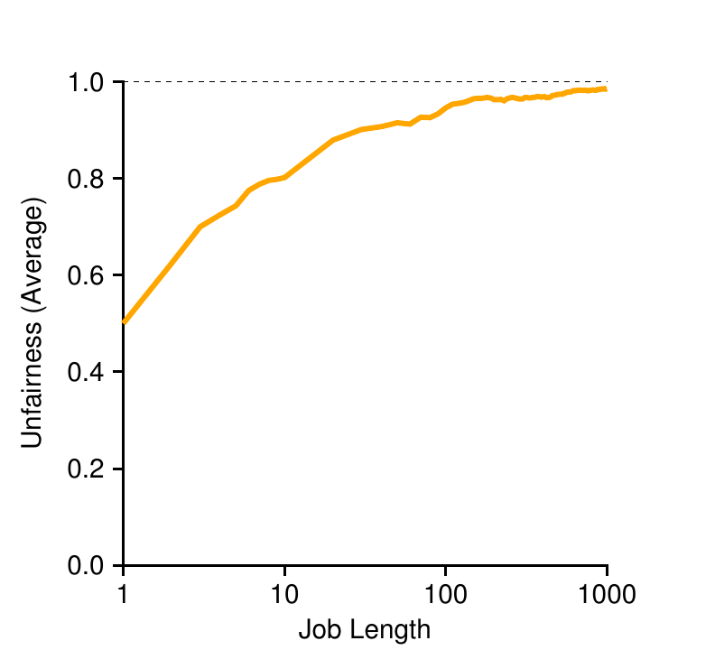

# 第 9 章 调度：比例份额

> 英文原题：*Scheduling: Proportional Share*

这一章，我们来看另一种调度器，叫做**比例份额(proportional-share)** 调度器，有时也叫**公平份额(fair-share)** 调度器。比例份额基于一个很简单的想法：与其优化周转时间或响应时间，调度器不如设法保证每个作业都拿到一定百分比的 CPU 时间。比例份额调度有一个绝佳的早期范例，出自 Waldspurger 和 Weihl 的研究 [WW94]，叫做**彩票调度(lottery scheduling)**；不过这个想法当然更老 [KL88]。基本思路相当简单：隔一阵子就抽一次彩，决定接下来该让哪个进程运行；那些应当更常运行的进程，就该拿到更多中奖机会。简单吧？接下来看细节！先看问题核心：

!!! danger "问题核心"
    **如何按比例共享 CPU？**

    我们该怎样设计一个调度器，让它按比例的方式共享 CPU？实现这一点的关键机制有哪些？它们效果如何？

## 9.1 基本概念：彩票代表你的份额

彩票调度背后的一个非常基本的概念，就是**彩票(ticket)**，它用来表示一个进程（或用户，或随便什么）应当获得的资源份额。一个进程持有彩票占全部彩票的百分比，就代表它在这项系统资源中占的份额。

看个例子。想象两个进程 A 和 B，进一步假设 A 有 75 张彩票，而 B 只有 25 张。那么，我们希望的是 A 拿到 75% 的 CPU，B 拿到剩下的 25%。

彩票调度通过隔一阵子抽一次彩（比如每个时间片抽一次），以概率方式（而非确定性方式）实现这一点。抽彩本身很直接：调度器必须知道总共有多少张彩票（我们的例子里是 100 张）。然后调度器选出一张中奖彩票，也就是 0 到 99 之间的一个数[^1]。假设 A 持有 0 到 74 号彩票，B 持有 75 到 99 号，那么中奖号码就直接决定了该运行 A 还是 B。接着调度器载入中奖进程的状态并运行它。

!!! tip "提示：善用随机性"
    彩票调度最漂亮的地方之一，就是它对随机性的运用。当你必须作决定时，采用这种随机方式往往稳妥又简单。

    相比更传统的决策方式，随机至少有三个优点。第一，随机常常能避开一些传统算法难以处理的古怪边界情况。比如，想想 LRU 替换策略（后面讲虚拟内存时会详细研究）；它虽然常常是个不错的替换算法，但在某些循环顺序访问的负载下会取得最差性能。随机则没有这种最坏情况。

    第二，随机还轻量，几乎不需要什么状态来跟踪各种选择。传统的公平份额算法要跟踪每个进程拿到多少 CPU，就得逐进程记账，而且每跑完一个进程都得更新。用随机来做，只需要最少的逐进程状态（比如每个进程有多少张彩票）。

    第三，随机可以很快。只要生成一个随机数很快，作决定也就快，因而随机可以用在许多要求速度的地方。当然，需求越快，随机就越倾向于**伪随机(pseudo-random)**。

这里是一段彩票调度器中奖号码的示例输出：

```text
63 85 70 39 76 17 29 41 36 39 10 99 68 83 63 62 43 0 49
```

由此得到的调度序列是：

```text
A A B A A A A A A A B A B A A A A B
```

从例子可以看出，彩票调度中随机性的运用带来的是"以概率方式逼近目标比例"，而没有任何保证。在上面的例子里，B 在 20 个时间片里只运行了 4 个（20%），而不是期望的 25%。不过，这两个作业竞争得越久，它们就越有可能达到期望的百分比。

[^1]: 计算机科学家总是从 0 开始数数。这在非计算机专业的人看来太奇怪了，以至于一些名人都不得不专门写文章解释我们为什么这么干 [D82]。

!!! tip "提示：用彩票表示份额"
    彩票（以及步长）调度设计中最强大（也最基本）的机制之一，就是彩票。在这些例子里，彩票用来表示一个进程占 CPU 的份额，但它的应用可以广泛得多。比如，在较新的虚拟机管理程序（hypervisor）内存管理研究中，Waldspurger 展示了如何用彩票来表示客户操作系统占内存的份额 [W02]。所以，如果你哪天需要一个机制来表示某种所有权比例，这个概念说不定就是……（等一下）……彩票。

## 9.2 彩票机制

彩票调度还提供了若干机制，可以用各种方式（有时还很有用）操纵彩票。其中之一是**彩票货币(ticket currency)** 的概念。货币允许一个持有若干彩票的用户，用自己任意选定的货币，把彩票分配给自己名下的各个作业；系统随后自动把这种货币换算成正确的全局值。

比如，假设用户 A 和用户 B 各自被给予 100 张彩票。用户 A 运行两个作业 A1 和 A2，在 A 的货币下给每个 500 张彩票（总共 1000 张）。用户 B 只运行 1 个作业，给它 10 张彩票（总共 10 张）。系统把 A1 和 A2 各自 500 张的 A 货币配额换算成全局货币下各 50 张；同样，B1 的 10 张换算成 100 张。随后在全局彩票货币（共 200 张）上抽彩，决定该运行哪个作业。

```text
用户 A -> 500（A 的货币）给 A1 -> 50（全局货币）
       -> 500（A 的货币）给 A2 -> 50（全局货币）
用户 B -> 10（B 的货币）给 B1 -> 100（全局货币）
```

另一个有用的机制是**彩票转让(ticket transfer)**。有了转让，一个进程可以临时把自己的彩票交给另一个进程。这个能力在客户端/服务器场景里特别有用：客户端进程向服务器发消息，请它代表自己干点活。为加快工作，客户端可以把彩票交给服务器，从而在服务器处理请求期间尽量提高服务器的性能。处理完后，服务器再把彩票转回客户端，一切照旧。

最后，**彩票通胀(ticket inflation)** 有时也是一种有用技术。通过通胀，一个进程可以临时提高或降低自己持有的彩票数量。当然，在进程彼此不信任的竞争场景里，这没什么意义：一个贪婪的进程可以给自己发海量彩票，独占整台机器。因此，通胀只适用于一组彼此信任的进程所组成的环境；在这种情况下，如果某个进程知道自己需要更多 CPU 时间，它就可以提高自己的彩票值，以此把这一需求反映给系统，而无需与其他任何进程通信。

## 9.3 实现

彩票调度最令人惊叹的地方，大概是它实现起来太简单了。你只需要一个不错的随机数生成器来选出中奖彩票、一个跟踪系统进程的数据结构（比如一个链表），以及彩票总数。

假设我们把进程放在一个链表里。下面是一个例子，由三个进程 A、B、C 组成，各自持有若干彩票。

```text
head -> Job:A  Tix:100 -> Job:B  Tix:50 -> Job:C  Tix:250 -> NULL
```

要作出调度决策，我们首先从彩票总数（400）中挑一个随机数（中奖号码）[^2]。假设我们挑到 300。然后我们只需遍历链表，用一个简单的计数器来帮助找到中奖者（图 9.1）。

```c
// counter：用来跟踪是否已经找到中奖者
int counter = 0;

// winner：调用某个随机数生成器得到一个值，
// 范围在 0 到总彩票数之间
int winner = getrandom(0, totaltickets);

// current：用它遍历作业链表
node_t *current = head;
while (current) {
    counter = counter + current->tickets;
    if (counter > winner)
        break; // 找到中奖者
    current = current->next;
}
// 'current' 就是中奖者：调度它……
```

*图 9.1：彩票调度的决策代码。*

代码遍历进程链表，把每张彩票值加到 counter 上，直到该值超过 winner。一旦超过，当前的链表元素就是中奖者。以中奖号码 300 为例，过程如下。首先，counter 加上 A 的彩票数变成 100；因为 100 小于 300，循环继续。接着 counter 更新为 150（加上 B 的彩票），仍小于 300，于是再次继续。最后，counter 更新为 400（显然大于 300），于是我们跳出循环，此时 current 指向 C（中奖者）。

[^2]: 出乎意料的是，正如 Björn Lindberg 指出的，要正确做到这一点并不容易；更多细节见 http://stackoverflow.com/questions/2509679/how-to-generate-a-random-number-from-within-a-range。

为了让这个过程最高效，通常最好把链表按彩票数从多到少排好序。排序不影响算法的正确性；但它一般能保证链表迭代次数最少，尤其是当少数几个进程持有大部分彩票时。

## 9.4 一个例子

为了让彩票调度的动态过程更好理解，我们这里对两个相互竞争的作业的完成时间做个简单研究，它们彩票数相同（都是 100），运行时间也相同（为 $R$，我们会让它变化）。

在这个场景里，我们希望两个作业大致同时完成，但出于彩票调度的随机性，有时一个作业会先于另一个完成。为量化这种差异，我们定义一个简单的不公平度指标 $U$，它就是第一个作业完成的时间除以第二个作业完成的时间。例如，若 $R = 10$，第一个作业在时刻 10 完成（第二个在时刻 20），则 $U = \frac{10}{20} = 0.5$。当两个作业几乎同时完成时，$U$ 会相当接近 1。在这个场景里，这正是我们的目标：完全公平的调度器会得到 $U = 1$。

图 9.2 画出了当两个作业的长度（$R$）从 1 变到 1000、进行三十次试验时，平均不公平度的变化（结果由本章末尾提供的模拟器生成）。从图中可以看到，当作业长度不太长时，平均不公平度可能相当严重。只有当作业运行了相当多的时间片之后，彩票调度器才接近期望的结果。



*图 9.2：彩票公平性研究。横轴为作业长度（1、10、100、1000），纵轴为平均不公平度（0.0～1.0），共三十次试验。*

## 9.5 如何分配彩票？

关于彩票调度，有一个我们还没解决的问题：如何给作业分配彩票？这个问题很棘手，因为系统的行为当然强烈依赖于彩票是如何分配的。一种做法是假定用户最清楚；这样的话，给每个用户发一定数量的彩票，用户就可以按自己的意愿把彩票分配给他们运行的任何作业。然而，这个方案等于没方案：它其实没告诉你该怎么做。于是，给定一组作业，"彩票分配问题"依然悬而未决。

## 9.6 为什么不用确定性方法？

你可能还会想：那为什么非要用随机性呢？如我们上面所见，随机性能带来一个简单（且近似正确）的调度器，但偶尔无法给出精确正确的比例，尤其在短时间尺度上。为此，Waldspurger 发明了**步长调度(stride scheduling)**，一个确定性的公平份额调度器 [W95]。

步长调度同样直接。系统中每个作业都有一个**步长(stride)**，它与该作业持有的彩票数成反比。在上面的例子里，作业 A、B、C 分别有 100、50、250 张彩票，我们可以用某个大数分别除以每个进程被分配的彩票数，算出各自的步长。例如，用 10,000 除以这些彩票值，就得到 A、B、C 的步长：100、200 和 40。我们把这个值叫做每个进程的步长；进程每运行一次，我们就用一个计数器（叫做它的 **pass 值(pass value)**）加上它的步长，以跟踪它的全局进度。

调度器随后用步长和 pass 值决定接下来该运行哪个进程。基本思路很简单：在任何时刻，挑当前 pass 值最小的进程运行；运行一个进程时，把它的 pass 计数器加上它的步长。Waldspurger 给出了一个伪代码实现 [W95]：

```text
curr = remove_min(queue);   // 挑选 pass 值最小的客户端
schedule(curr);             // 运行一个时间片
curr->pass += curr->stride; // 用步长更新 pass 值
insert(queue, curr);        // 把 curr 放回队列
```

在我们的例子里，我们从三个进程（A、B、C）开始，步长值分别为 100、200、40，pass 值初始都设为 0。因此一开始，任何一个进程都可能运行，因为它们的 pass 值同样低。假设我们挑中 A（随便挑；任何 pass 值同样低的进程都可以选）。A 运行；时间片结束后，我们把它的 pass 值更新为 100。接着运行 B，它的 pass 值随后被设为 200。最后运行 C，它的 pass 值增加到 40。此时，算法会挑最小的 pass 值，也就是 C 的，然后运行它，把它的 pass 更新为 80（记得 C 的步长是 40）。接着 C 会再次运行（仍是最小 pass 值），把它的 pass 提高到 120。现在轮到 A，更新其 pass 为 200（此时与 B 相等）。然后 C 再运行两次，pass 更新为 160，再是 200。此时，所有 pass 值再次相等，整个过程将反复进行，无穷无尽。图 9.3 跟踪了调度器随时间的行为。

| Pass(A)（stride=100） | Pass(B)（stride=200） | Pass(C)（stride=40） | 谁运行？ |
|---|---|---|---|
| 0 | 0 | 0 | A |
| 100 | 0 | 0 | B |
| 100 | 200 | 0 | C |
| 100 | 200 | 40 | C |
| 100 | 200 | 80 | C |
| 100 | 200 | 120 | A |
| 200 | 200 | 120 | C |
| 200 | 200 | 160 | C |
| 200 | 200 | 200 | … |

*图 9.3：步长调度：一次跟踪。*

从图中可以看到，C 运行了五次，A 两次，B 仅一次，恰好与它们 250、100、50 的彩票值成正比。彩票调度随时间以概率方式达到这些比例；步长调度则在每个调度周期结束时精确地达到它们。

所以你可能想问：既然步长调度这么精确，为什么还要用彩票调度？嗯，彩票调度有一个步长调度没有的好处：没有全局状态。想象一个新作业在我们上面步长调度的例子里中途进入；它的 pass 值该是多少？设为 0？如果这样，它会独占 CPU。用彩票调度，则没有逐进程的全局状态；我们只需加入一个带它自己彩票数的新进程，更新那个记录总彩票数的单一全局变量，然后继续。这样一来，彩票调度在合理地接纳新进程方面要容易得多。

## 9.7 Linux 完全公平调度器（CFS）

尽管公平份额调度有上述早期工作，Linux 目前的做法却用另一种方式达成了类似目标。这个调度器叫做**完全公平调度器(Completely Fair Scheduler, CFS)** [J09]，它实现了公平份额调度，但做得极其高效、可扩展。为达成效能目标，CFS 力求把花在调度决策上的时间压到极低，这既靠它本身的设计，也靠它巧妙地使用了非常适合该任务的数据结构。最近的研究表明，调度器的效率重要得出奇；具体来说，在一项对 Google 数据中心的研究中，Kanev 等人指出，即便经过激进优化，调度仍占数据中心总 CPU 时间的大约 5%。因此，尽可能降低这项开销，是现代调度器架构的一个关键目标。

### 基本运作

大多数调度器都基于固定时间片的概念，CFS 的运作则稍有不同。它的目标很简单：在所有竞争的进程之间，把一块 CPU 公平地均分。它通过一种简单的、基于计数的技术来实现，叫做**虚拟运行时(vruntime)**。

每当一个进程运行，它就会累积 vruntime。在最基本的情形下，每个进程的 vruntime 以相同速率增长，与物理（真实）时间成正比。当需要作调度决策时，CFS 会挑 vruntime 最小的进程来运行。

这引出一个问题：调度器怎么知道该在什么时候停掉当前运行的进程、去运行下一个？这里的矛盾很清楚：如果 CFS 切换得太频繁，公平性会提高，因为 CFS 能保证每个进程即便在极小的时间窗口内也拿到自己的 CPU 份额，但代价是性能（上下文切换太多）；如果 CFS 切换得没那么频繁，性能会提高（上下文切换减少），但代价是近期的公平性。

CFS 通过若干控制参数来管理这个矛盾。第一个是 `sched latency`。CFS 用这个值来决定一个进程在考虑切换之前应当运行多久（实际上动态地确定了它的时间片）。`sched latency` 的一个典型值是 48（毫秒）；CFS 用这个值除以正在 CPU 上运行的进程数（n）来确定一个进程的时间片，从而保证在这段时间内，CFS 会做到完全公平。

比如，如果有 n = 4 个进程在运行，CFS 用 `sched latency` 除以 n，得到每个进程的时间片为 12 ms。CFS 随后调度第一个作业并运行它，直到它用掉 12 ms 的（虚拟）运行时间，然后检查是否有 vruntime 更小的作业可以改为运行。这里确实有，于是 CFS 切换到另外三个作业之一，如此继续。图 9.4 展示了一个例子，其中四个作业（A、B、C、D）各自以这种方式运行两个时间片；其中两个（C、D）随后完成，剩下两个，它们再以轮转方式各运行 24 ms。

但如果运行的进程"太多"呢？那不会导致时间片太小、从而上下文切换太多吗？问得好！答案是：会。

为解决这个问题，CFS 增加了另一个参数 `min granularity`，通常设为像 6 ms 这样的值。CFS 绝不会把一个进程的时间片设得比这个值更小，从而确保不会在调度开销上花掉太多时间。

| 作业 | 运行时段（ms） |
|---|---|
| A | 0–12、48–60、96–120、144–168…… |
| B | 12–24、60–72、120–144、168–192…… |
| C | 24–36、72–84（随后完成） |
| D | 36–48、84–96（随后完成） |

*图 9.4：CFS 简单示例。*

比如，如果有十个进程在运行，我们原先的计算会用 `sched latency` 除以十来确定时间片（结果：4.8 ms）。然而，由于 `min granularity`，CFS 会把每个进程的时间片改为 6 ms。尽管在目标调度延迟（`sched latency`，48 ms）内 CFS 不会（完全）做到完美公平，但它会接近公平，同时仍保持很高的 CPU 效率。

注意，CFS 使用周期性的时钟中断，这意味着它只能在固定的时间间隔上作决策。这个中断触发得很频繁（比如每 1 ms 一次），让 CFS 有机会醒来，判断当前作业是否已运行到尽头。如果一个作业的时间片不是时钟中断间隔的整数倍，也没关系；CFS 会精确地跟踪 vruntime，这意味着长远来看，它最终会逼近理想的 CPU 共享。

### 权重（nice 值）

CFS 还支持对进程优先级的控制，让用户或管理员能给某些进程更高的 CPU 份额。它不是用彩票，而是通过一个经典的 UNIX 机制——进程的 **nice 级别(nice level)** 来实现。nice 参数可以为一个进程设在 -20 到 +19 之间，默认是 0。正的 nice 值意味着更低的优先级，负值意味着更高的优先级；当你太 nice 的时候，唉，你就是得不到那么多（调度）关注。

CFS 把每个进程的 nice 值映射为一个权重，如下所示：

```c
static const int prio_to_weight[40] = {
 /* -20 */ 88761, 71755, 56483, 46273, 36291,
 /* -15 */ 29154, 23254, 18705, 14949, 11916,
 /* -10 */  9548,  7620,  6100,  4904,  3906,
 /*  -5 */  3121,  2501,  1991,  1586,  1277,
 /*   0 */  1024,   820,   655,   526,   423,
 /*   5 */   335,   272,   215,   172,   137,
 /*  10 */   110,    87,    70,    56,    45,
 /*  15 */    36,    29,    23,    18,    15,
};
```

这些权重让我们能算出每个进程的有效时间片（像前面那样），但这次把它们的优先级差异也考虑进去。计算公式如下：

$$\text{time slice}_k = \frac{weight_k}{\sum_{i=0}^{n-1} weight_i} \cdot \text{sched latency} \tag{9.1}$$

我们举个例子看看它是怎么运作的。假设有两个作业 A 和 B。A 因为是我们最宝贵的作业，被赋予更高的优先级，nice 值为 -5；B 因为我们讨厌它[^3]，只有默认优先级（nice 值等于 0）。这意味着（查表）weight_A 为 3121，而 weight_B 为 1024。然后你去算每个作业的时间片，会发现 A 的时间片约为 `sched latency` 的 3/4（也就是 36 ms），B 约为 1/4（也就是 12 ms）。

除了把时间片计算一般化之外，CFS 计算 vruntime 的方式也必须调整。下面是新公式，它取进程 i 累积的实际运行时间（runtime_i），并按该进程的权重对其进行反向缩放。在我们的例子里，A 的 vruntime 将以 B 的三分之一的速率累积。

$$vruntime_i = vruntime_i + \frac{weight_0}{weight_i} \cdot runtime_i \tag{9.2}$$

上面权重表的构造有一个巧妙之处：当 nice 值之差恒定时，这张表保持 CPU 比例关系不变。比如，如果进程 A 的 nice 值是 5（不是 -5），进程 B 的 nice 值是 10（不是 0），CFS 会以与之前完全相同的方式调度它们。自己算一遍就知道为什么了。

[^3]: 是的，是的，我们这里是故意用错语法的，请别发勘误过来。为什么？嗯，只是对《指环王》和我们最爱的反英雄 Gollum 一个小小的致敬，没什么好大惊小怪的。

### 使用红黑树

CFS 的一个主要关注点是效率，如上所述。对调度器来说，效率有很多面，其中一面简单来说就是：当调度器必须找到下一个要运行的作业时，它应当尽可能快地做到。链表这样简单的数据结构无法扩展：现代系统有时由上千个进程组成，因此每隔几毫秒就在一条长链表里搜一遍是很浪费的。

CFS 通过把进程保存在一棵**红黑树(red-black tree)** 里来解决这个问题 [B72]。红黑树是众多平衡树类型之一；与简单的二叉树（在最坏的插入模式下会退化成近似链表的性能）不同，平衡树会多做一点工作来维持较低的深度，从而保证操作时间是**对数级**的（而不是**线性级**的）。

CFS 并不把所有进程都放在这个结构里；它只把正在运行（或可运行）的进程放在里面。如果一个进程去睡觉了（比如等待 I/O 完成，或等待一个网络包到达），它就会从树里被移除，另行跟踪。

看个例子会更清楚。假设有十个作业，它们的 vruntime 值如下：1、5、9、10、14、18、17、21、22、24。如果我们把这些作业放在一个有序链表里，找下一个要运行的作业很简单：去掉第一个元素就行。但是，把这个作业放回链表（按序）时，我们得扫描链表去找合适的插入位置，这是一个 O(n) 操作。任何查找也相当低效，平均同样要花线性时间。

把同样的值放进一棵红黑树，大多数操作都会更高效，如图 9.5 所示。进程在树里按 vruntime 排序，大多数操作（如插入和删除）都是对数时间的，即 O(log n)。当 n 达到数千时，对数效率明显比线性高。

| 节点 | 左子树 | 右子树 |
|---|---|---|
| 14 | 9 | 18 |
| 9 | 1 | 10 |
| 1 | — | 5 |
| 10 | — | — |
| 5 | — | — |
| 18 | 17 | 22 |
| 17 | — | — |
| 22 | 21 | 24 |
| 21 | — | — |
| 24 | — | — |

*图 9.5：CFS 红黑树。*

### 处理 I/O 与睡眠进程

挑选 vruntime 最小的进程来运行时，会遇到一个问题：那些长时间睡眠的作业。想象两个进程 A 和 B，其中一个（A）持续运行，另一个（B）已经睡了很长时间（比如 10 秒）。当 B 醒来时，它的 vruntime 会比 A 落后 10 秒，于是（如果我们不小心）B 会在接下来的 10 秒里独占 CPU 来追赶，实际上把 A 饿死。

CFS 的处理办法是在作业醒来时调整它的 vruntime。具体来说，CFS 把该作业的 vruntime 设为树中的最小值（记住，树里只包含正在运行的作业）[B+18]。这样一来，CFS 避免了饥饿，但并非没有代价：那些睡眠时间短的作业往往永远拿不到应得的 CPU 份额 [AC97]。

### CFS 的其他趣事

CFS 还有很多其他特性，多到在本书的这个位置讲不完。它包含了大量提升缓存性能的启发式方法，有高效处理多个 CPU 的策略（本书后面会讨论），能跨大组进程进行调度（而不是把每个进程当作独立个体），以及许多其他有趣特性。想了解更多，可以从 Bouron 等人的近期研究读起 [B+18]。

!!! tip "提示：适时使用高效的数据结构"
    很多情况下，链表就够用了。但也有很多情况下，它不够。知道在什么时候该用哪种数据结构，是优秀工程能力的标志。在我们这里讨论的场景里，早期调度器里那些简单链表在现代系统上就是干不好，尤其是在数据中心那些高负载的服务器上。这类系统包含数千个活跃进程；每隔几毫秒就在一条长链表里搜索、为每个核找下一个要运行的作业，会白白浪费宝贵的 CPU 周期。我们需要一个更好的结构，而 CFS 提供了一个：它加入了一棵优秀的红黑树实现。更一般地说，当你为正在构建的系统挑选数据结构时，要仔细考虑它的访问模式和使用的频率；理解了这些，你就能为手头的任务实现正确的结构。

## 9.8 小结

我们介绍了比例份额调度的概念，并简要讨论了三种做法：彩票调度、步长调度和 Linux 的完全公平调度器（CFS）。彩票调度用巧妙的方式运用随机性来达成比例份额；步长调度则以确定性方式做到。CFS 是本章讨论的唯一"真实"调度器，它有点像带动态时间片的加权轮转，但其设计目标是可扩展、在高负载下表现良好；据我们所知，它是如今存在的最广泛使用的公平份额调度器。

没有哪种调度器是万灵药，公平份额调度器也有它自己的一堆麻烦。一个问题是这样做法与 I/O 配合得不太好 [AC97]；如上所述，偶尔执行 I/O 的作业可能拿不到应得的 CPU 份额。另一个问题是，它们把彩票（或优先级）分配这个难题留给了你，也就是说，你怎么知道该给你的浏览器分配多少张彩票，或者该把你的文本编辑器设成什么 nice 值？其他通用调度器（比如我们之前讨论的 MLFQ，以及其他类似的 Linux 调度器）会自动处理这些问题，因而可能更容易部署。

好消息是，在很多领域里，这些问题并不是主要顾虑，比例份额调度器能被用得非常好。比如，在虚拟化数据中心（或云）里，你可能想把四分之一的 CPU 周期分给 Windows 虚拟机，其余的留给底层 Linux 安装，这时比例共享就既简单又有效。这个想法还能扩展到其他资源；关于如何在 VMWare 的 ESX Server 中按比例共享内存，详见 Waldspurger [W02]。

## 参考文献

[AC97] "Extending Proportional-Share Scheduling to a Network of Workstations" by Andrea C. Arpaci-Dusseau and David E. Culler. PDPTA'97, June 1997. 本书作者之一写的一篇论文，讲如何扩展比例份额调度，让它在集群环境里工作得更好。

[B+18] "The Battle of the Schedulers: FreeBSD ULE vs. Linux CFS" by J. Bouron, S. Chevalley, B. Lepers, W. Zwaenepoel, R. Gouicem, J. Lawall, G. Muller, J. Sopena. USENIX ATC '18, July 2018, Boston, Massachusetts. 一项近期且详细的工作，比较了 Linux CFS 与 FreeBSD 的调度器。文中还对每个调度器做了出色的综述。比较的结果：没有定论（有些情况下 CFS 更好，另一些情况下 ULE（BSD 的调度器）更好）。生活中有时就是没有简单的答案。

[B72] "Symmetric binary B-Trees: Data Structure And Maintenance Algorithms" by Rudolf Bayer. Acta Informatica, Volume 1, Number 4, December 1972. 一棵很酷的平衡树，很可能在你出生之前就被提出了。它是众多平衡树中的一种；想了解更多选项，去翻你的算法书吧！

[D82] "Why Numbering Should Start At Zero" by Edsger Dijkstra, August 1982. Available: http://www.cs.utexas.edu/users/EWD/ewd08xx/EWD831.PDF. 计算机科学先驱之一 E. Dijkstra 写的一则短记。在讲并发的那部分，我们还会经常听到这个人。眼下，先享受这则短记吧，里面有一句很能说明问题的引文："我的一位同事——不是计算机科学家——指责一些年轻的计算机科学家'迂腐'，因为他们从零开始编号。"这则短记解释了为什么这么做是合乎逻辑的。

[K+15] "Profiling A Warehouse-scale Computer" by S. Kanev, P. Ranganathan, J. P. Darago, K. Hazelwood, T. Moseley, G. Wei, D. Brooks. ISCA '15, June, 2015, Portland, Oregon. 一项引人入胜的研究，讲现代数据中心里的周期都花在了哪里——数据中心正日益成为大多数计算发生的地方。将近 20% 的 CPU 时间花在操作系统里，光调度器就占 5%！

[J09] "Inside The Linux 2.6 Completely Fair Scheduler" by M. Tim Jones. December 15, 2009. http://ostep.org/Citations/inside-cfs.pdf. 对早期 CFS 的一个简单综述。CFS 由 Ingo Molnar 在一阵短暂的创造力爆发中创造出来，产生了在 62 小时内开发完成的 100K 内核补丁。

[KL88] "A Fair Share Scheduler" by J. Kay and P. Lauder. CACM, Volume 31 Issue 1, January 1988. 公平份额调度器的一篇早期文献。

[WW94] "Lottery Scheduling: Flexible Proportional-Share Resource Management" by Carl A. Waldspurger and William E. Weihl. OSDI '94, November 1994. 彩票调度的里程碑论文，它让系统社区重新对调度、公平共享以及简单随机算法的力量燃起热情。

[W95] "Lottery and Stride Scheduling: Flexible Proportional-Share Resource Management" by Carl A. Waldspurger. Ph.D. Thesis, MIT, 1995. Waldspurger 的获奖博士论文，阐述了彩票调度和步长调度。如果你哪天打算写博士论文，你总该在身边放一个优秀的榜样，给自己一个努力的方向：这一篇就非常好。

[W02] "Memory Resource Management in VMware ESX Server" by Carl A. Waldspurger. OSDI '02, Boston, Massachusetts. 想了解 VMM（也就是虚拟机管理程序）里的内存管理，就读这篇论文。除了相对好读之外，文中还包含了许多关于这种新型 VMM 级内存管理的酷点子。

## 作业（模拟器）

这个程序 `lottery.py` 让你看到彩票调度器如何工作。细节见 README。

### 问题

1. 对含 3 个作业、随机种子分别为 1、2、3 的模拟，计算出解。
2. 现在用两个特定的作业运行：长度都是 10，但其中一个（作业 0）只有 1 张彩票，另一个（作业 1）有 100 张（例如 `-l 10:1,10:100`）。当彩票数如此悬殊时会发生什么？作业 0 有没有可能在作业 1 完成之前运行？多频繁？一般来说，这种彩票失衡会对彩票调度的行为产生什么影响？
3. 用两个长度为 100、彩票分配相同（都是 100）的作业运行时（`-l 100:100,100:100`），调度器有多不公平？用一些不同的随机种子运行，以确定（概率意义上的）答案；让不公平度由一个作业比另一个早完成多少来决定。
4. 当量子大小（`-q`）变大时，你对上一个问题的答案会如何变化？
5. 你能做出本章中那张图的一个版本吗？还有什么值得探索的？用步长调度器的话，图会是什么样？
