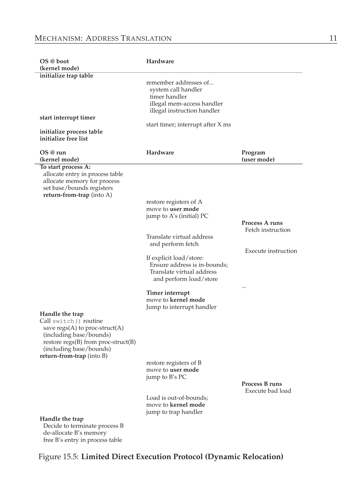

# 第 15 章 机制：地址转换

> 英文原题：*Mechanism: Address Translation*

在开发 CPU 虚拟化时，我们把注意力放在了一个通用机制上，叫做受限制的直接执行(limited direct execution, LDE)。LDE 背后的想法很简单：大多数时候，就让程序直接在硬件上跑；不过在某些关键时刻（比如进程发起系统调用、或者发生时钟中断时），得安排好让操作系统插手进来，确保"正确"的事情发生。于是，操作系统借助一点点硬件支持，尽量给正在跑的程序让路，以提供高效的虚拟化；但同时又在那些关键时刻插上一脚，确保自己始终掌控着硬件。效率和**控制(control)**，正是任何现代操作系统的两大目标。

在虚拟化内存时，我们会用一套相似的策略，既要效率、又要控制，同时提供想要的虚拟化。效率要求我们利用硬件支持——一开始会相当简陋（比如几个寄存器），但会长成相当复杂的模样（比如 TLB、页表支持等等，你往后就会看到）。控制则意味着操作系统要确保任何应用程序都只能访问自己的内存，别的免谈；因此，为了保护应用程序之间互不干扰、也保护操作系统不被应用程序祸害，这里同样得靠硬件帮忙。最后，虚拟内存系统还得再多给一点东西，那就是灵活性：具体来说，我们希望程序能随心所欲地使用自己的地址空间，这样系统才好编程。于是我们得到了这个更精确的问题核心：

!!! danger "问题核心"
    **如何高效又灵活地虚拟化内存**

    怎样才能构建出高效的内存虚拟化？怎样提供应用程序所需的灵活性？怎样掌控应用程序能访问哪些内存位置，从而确保应用程序的内存访问被恰当地限制？怎样才能把这一切都做得高效？

我们要用的通用技术，可以看成是"受限制的直接执行"这套总方针的一个补充，叫做基于硬件的地址转换(hardware-based address translation)，简称地址转换(address translation)。有了地址转换，硬件会把每一次内存访问（比如取指令、加载或存储）都转换一下，把指令给出的**虚拟地址(virtual address)** 变成所需信息真正所在的**物理地址(physical address)**。也就是说，在每一次内存引用上，硬件都会做一次地址转换，把应用程序的内存引用重定向到它在内存中的真实位置。

当然，光靠硬件是没法虚拟化内存的，它只提供高效完成这件事的底层机制。操作系统必须在关键时刻插手，把硬件设置好，好让正确的转换发生；因此它得管理内存，追踪哪些位置空闲、哪些在用，并在恰当的时候介入，把内存的使用牢牢管住。

这一切努力的目标，还是营造一个漂亮的幻觉：程序拥有自己的私有内存，自己的代码和数据就住在里面。而在这层虚拟现实背后，藏着一个丑陋的物理真相：趁着 CPU（或 CPU 们）在程序之间来回切换的功夫，其实有许多程序正在同时共享内存。通过虚拟化，操作系统（蹭着硬件的帮忙）把丑陋的机器现实，变成了一个有用、强大又易用的抽象。

## 15.1 假设

我们头几回尝试虚拟化内存，会做得非常简单，简单到近乎滑稽。尽管笑吧，笑个够；用不了多久，就轮到操作系统笑你了——等你试图搞懂 TLB、多级页表之类的技术奇迹的时候。不喜欢被操作系统嘲笑？那你恐怕没戏了；操作系统就是这么个脾气。

具体来说，眼下我们先假设用户的地址空间必须连续地放在物理内存里。为了简单起见，我们还会假设地址空间的大小不太大；具体地说，它小于物理内存的大小。最后，我们还假设每个地址空间的大小都完全一样。这些假设听起来不切实际？别担心，我们会一路把它们放宽，最终实现一个切合实际的内存虚拟化。

## 15.2 一个例子

为了更好地理解实现地址转换要做些什么、以及为什么需要这样一个机制，我们看个简单的例子。想象有一个进程，它的地址空间如图 15.1 所示。这里要研究的是下面这段短短的代码序列：它从内存里加载一个值，把它加 3，然后再存回内存。你可以想象这段代码用 C 语言写出来可能长这样：

```c
void func() {
    int x = 3000; // 多谢 Perry。
    x = x + 3;
    // 这一行就是我们关心的代码
    ...
}
```

编译器会把这一行代码翻译成汇编，大概长这样（x86 汇编）。在 Linux 上用 `objdump`、在 Mac 上用 `otool` 来反汇编：

```asm
128: movl 0x0(%ebx), %eax   ; 把 0+ebx 处的值加载到 eax
132: addl $0x03, %eax       ; 给 eax 寄存器加 3
135: movl %eax, 0x0(%ebx)   ; 把 eax 存回内存
```

这段代码片段相当直白；它假定 x 的地址已经放进了寄存器 `ebx`，然后用 `movl` 指令（"longword" 移动）把该地址处的值加载进通用寄存器 `eax`。下一条指令给 `eax` 加 3，最后一条指令把 `eax` 里的值存回内存中的同一位置。

在图 15.1 里，注意代码和数据在进程地址空间中各自是怎么摆放的：那三行指令的代码序列位于地址 128（在靠近顶部的代码区），而变量 x 的值位于地址 15 KB（在靠近底部的栈里）。图中 x 的初始值是 3000，就摆在栈上它的位置。这些指令运行起来时，从进程的角度看，发生了下面这些内存访问：

- 取地址 128 处的指令
- 执行这条指令（从地址 15 KB 加载）
- 取地址 132 处的指令
- 执行这条指令（没有内存引用）
- 取地址 135 处的指令
- 执行这条指令（存储到地址 15 KB）

```text
0KB     +------------------------------------------+
        | 128  movl 0x0(%ebx),%eax                 |
        | 132  addl 0x03, %eax                     |
        | 135  movl %eax,0x0(%ebx)                 |
1KB     +------------------------------------------+
        | Program Code                             |
2KB     +------------------------------------------+
3KB     +------------------------------------------+
        | Heap                                     |
4KB     +------------------------------------------+
        | (free)                                   |
14KB    +------------------------------------------+
        | 3000                                     |
15KB    +------------------------------------------+
        | Stack                                    |
16KB    +------------------------------------------+
```

*图 15.1：一个进程及其地址空间。*

从程序的角度看，它的地址空间从地址 0 开始，最大长到 16 KB；它产生的所有内存引用都应该落在这个范围内。可是要虚拟化内存，操作系统想把进程放到物理内存里的别处，不一定在地址 0。于是问题来了：我们怎样才能在内存里重定位这个进程，而过程对进程来说完全透明？当地址空间实际位于别的某个物理地址时，怎样营造出"虚拟地址空间从 0 开始"的幻觉？

```text
0KB     +------------------------------------------+
        | Operating System                         |
16KB    +------------------------------------------+
        | (free)                                   |
32KB    +------------------------------------------+
        | Code                                     |
        | Heap                                     |
        | (allocated but not in use)               |
        | Stack                                    |
        |                                          |
        |          Relocated Process               |
48KB    +------------------------------------------+
        | (free)                                   |
64KB    +------------------------------------------+
```

*图 15.2：物理内存中有一个被重定位的进程。*

等这个进程的地址空间被放进内存后，物理内存大致长什么样，一个例子见图 15.2。图中可以看到，操作系统自己占用了物理内存的第一块，而它把上面那个例子里进程重定位到了从物理地址 32 KB 开始的那一块。另外两块是空闲的（16 KB–32 KB 和 48 KB–64 KB）。

## 15.3 动态（基于硬件的）重定位

为了对基于硬件的地址转换有所理解，我们先聊聊它最早的形态。20 世纪 50 年代末，早期的分时机器上引入了一个简单的想法，叫做**基址加界限(base and bounds)**；这项技术也叫**动态重定位(dynamic relocation)**；这两个词我们换着用，意思是一样的 [SS74]。

具体来说，每个 CPU 里需要两个硬件寄存器：一个叫**基址寄存器(base register)**，另一个叫**界限寄存器(bounds register)**（有时也叫 limit register）。这对"基址加界限"组合，让我们能把地址空间放到物理内存里任何我们想要的地方，而且在这么做的时候，保证进程只能访问它自己的地址空间。

在这套机制下，每个程序在编写和编译时，都当作自己是从地址 0 加载的。可是当程序开始运行时，操作系统决定它该加载到物理内存的哪里，然后把基址寄存器设成那个值。在上面的例子里，操作系统决定把这个进程加载到物理地址 32 KB 处，于是把基址寄存器设成这个值。

进程一跑起来，就有意思了。现在，只要进程产生一次内存引用，处理器就会按下面的方式把它转换：

$$\text{物理地址} = \text{虚拟地址} + \text{base}$$

!!! note "边栏：基于软件的重定位"
    早年，硬件支持还没出现的时候，有些系统完全靠软件方法做一种粗糙的重定位。基本技术叫做**静态重定位(static relocation)**，其中有一款叫做**加载器(loader)** 的软件，会把一个即将运行的可执行文件拿过来，把里面的地址改写成物理内存中想要的偏移量。

    举个例子，如果一条指令是从地址 1000 加载到寄存器（比如 `movl 1000, %eax`），而这个程序的地址空间被加载到了从地址 3000 开始的地方（不是程序以为的 0），那么加载器就会改写这条指令，把每个地址都偏移 3000（比如 `movl 4000, %eax`）。这样一来，就完成了进程地址空间的一种简单静态重定位。

    不过，静态重定位有一堆问题。首先也最重要的是，它不提供保护，因为进程可以产生非法地址，从而非法访问别的进程、甚至操作系统的内存；一般来说，真正的保护很可能需要硬件支持 [WL+93]。另一个缺点是，一旦放好了，之后再想把地址空间重定位到别处就很难了 [M65]。

进程产生的每一次内存引用都是一个虚拟地址；硬件则把这个地址加上基址寄存器的内容，结果就是一个可以交给内存系统的物理地址。

为了更好地理解，我们来追踪一下执行一条指令时发生了什么。具体地，看我们前面那个序列里的一条指令：

```text
128: movl 0x0(%ebx), %eax
```

程序计数器(PC)被设成 128；硬件需要取这条指令时，先把它的值加上基址寄存器的值 32 KB（32768），得到物理地址 32896；然后硬件从那个物理地址取指令。接着，处理器开始执行这条指令。某个时刻，进程发起一次从虚拟地址 15 KB 加载的操作，处理器接过来，再次加上基址寄存器（32 KB），得到最终的物理地址 47 KB，于是取到了想要的内容。

把虚拟地址变成物理地址，正是我们所说的地址转换(address translation)；也就是说，硬件把进程以为自己在引用的那个虚拟地址，转换成数据真正所在的物理地址。因为这种地址重定位发生在运行时，而且进程开始跑之后我们还能搬动地址空间，所以这项技术常被称为动态重定位(dynamic relocation) [M65]。

!!! tip "提示：基于硬件的动态重定位"
    有了动态重定位，一点点硬件就能顶大用。具体说，用一个基址寄存器，把（程序产生的）虚拟地址转换成物理地址；再用一个界限（或 limit）寄存器，确保这些地址落在地址空间的范围内。两者合起来，提供了简单又高效的内存虚拟化。

    你可能会问：那个界限（limit）寄存器跑哪去了？毕竟这不是叫"基址加界限"吗？没错，正是如此。你可能已经猜到，界限寄存器就是来帮忙做保护的。具体说，处理器会先检查这次内存引用是不是在界限之内，确保它合法；在上面那个简单例子里，界限寄存器会一直设成 16 KB。如果进程产生了一个大于界限的虚拟地址，或者一个负的地址，CPU 就会抛出一个异常，进程多半会被终止。所以界限的作用，就是确保进程产生的所有地址都合法，都落在进程的"界限"之内。

    我们该说明一下，基址寄存器和界限寄存器是保存在芯片上的硬件结构（每个 CPU 一对）。有时人们把处理器里负责地址转换的那部分叫做**内存管理单元(memory management unit, MMU)**；随着我们开发更精细的内存管理技术，我们会往 MMU 里加更多电路。

    再顺便说一句界限寄存器的定义方式，它有两种。一种（就像上面那样）保存地址空间的大小，于是硬件先把虚拟地址和它比一比，再加基址。另一种保存地址空间末端的物理地址，于是硬件先加基址，再确保地址在界限之内。两种方式逻辑上等价；为了简单，我们通常假定用前一种。

### 示例转换

为了更详细地理解基于"基址加界限"的地址转换，我们看个例子。想象有一个地址空间大小为 4 KB（没错，小得不切实际）的进程，被加载到物理地址 16 KB 处。下面是一些地址转换的结果：

| 虚拟地址 | → | 物理地址 |
|---|---|---|
| 0 | → | 16 KB |
| 1 KB | → | 17 KB |
| 3000 | → | 19384 |
| 4400 | → | 故障（越界） |

从这个例子可以看出，你只要把基址加到虚拟地址上（虚拟地址可以正确地看作地址空间内的一个偏移量），就能得到最终的物理地址，简单得很。只有当虚拟地址"太大"或者为负时，结果才会出故障，触发一个异常。

!!! note "边栏：数据结构——空闲列表"
    操作系统必须追踪空闲内存里哪些部分没在用，这样才能把内存分配给进程。干这个活儿当然可以用很多不同的数据结构；最简单的（这里我们就假定这个）是**空闲列表(free list)**，它就是一个物理内存中当前未被使用的所有区间的列表。

## 15.4 硬件支持：小结

现在我们总结一下需要硬件提供哪些支持（另见图 15.3）。首先，正如 CPU 虚拟化那一章讨论的，我们需要两种不同的 CPU 模式。操作系统运行在**特权模式(privileged mode)**（也就是**内核态(kernel mode)**）下，可以访问整台机器；应用程序运行在**用户态(user mode)** 下，能做的事受到限制。用一个位（或许存在某种处理器状态字里）来指示 CPU 当前运行在哪种模式；在某些特殊场合（比如系统调用、或者别的异常或中断），CPU 会切换模式。

硬件还必须提供基址寄存器和界限寄存器本身；于是每个 CPU 都多了一对寄存器，属于该 CPU 内存管理单元(MMU)的一部分。当用户程序运行时，硬件会转换每一个地址，把用户程序产生的虚拟地址加上基址值。硬件还必须能检查地址是否合法，这靠界限寄存器和 CPU 内部的一些电路来完成。

硬件应当提供特殊指令来修改基址寄存器和界限寄存器，好让操作系统在不同进程运行时改变它们。这些指令是特权的；只有在内核（或特权）模式下才能修改这些寄存器。想象一下，要是用户进程能在运行时随意改基址寄存器，会闯出多大的祸[^1]。想吧！然后赶紧把这种黑暗念头从脑子里清出去，因为那是噩梦才有的恐怖素材。

最后，当用户程序试图非法访问内存（用了"越界"的地址）时，CPU 必须能产生异常；这种情况下，CPU 应当停止执行用户程序，并安排运行操作系统的"越界"异常处理程序。接着操作系统处理程序可以想好怎么应对，这种情形下多半是终止该进程。同样，如果用户程序试图修改（特权）基址寄存器和界限寄存器的值，CPU 应当抛出异常，运行"在用户态下试图执行特权操作"的处理程序。CPU 还必须提供一种方法，告诉它这些处理程序的位置；于是又需要几条特权指令。

[^1]: 除了"祸(havoc)"，还能"闯(wreak)"出别的什么吗？[W17]

**硬件需求(Hardware Requirements)**

| 需求 | 说明 |
|---|---|
| 特权模式 | 用于阻止用户态进程执行特权操作 |
| 基址/界限寄存器 | 每个 CPU 需要一对寄存器来支持地址转换和界限检查 |
| 转换虚拟地址并检查是否越界的能力 | 用来做转换和检查界限的电路；在这里相当简单 |
| 更新基址/界限的特权指令 | 操作系统必须能在让用户程序运行之前设置这些值 |
| 注册异常处理程序的特权指令 | 操作系统必须能告诉硬件，发生异常时运行哪段代码 |
| 产生异常的能力 | 当进程试图访问特权指令或越界内存时 |

*图 15.3：动态重定位：硬件需求。*

## 15.5 操作系统的问题

正如硬件提供了新特性来支持动态重定位，操作系统现在也有一些新问题必须处理；硬件支持加操作系统管理，合起来实现了一个简单的虚拟内存。具体来说，在几个关键时刻，操作系统必须插手，来实现我们这个"基址加界限"版本的虚拟内存。

第一，操作系统必须在创建进程时采取行动，在内存里为它的地址空间找地方。幸运的是，考虑到我们的假设——每个地址空间(a)都比物理内存小，(b)大小相同——这对操作系统来说相当容易；它可以干脆把物理内存看成一个槽(slot)数组，追踪每个槽是空闲还是占用。创建新进程时，操作系统得搜索一个数据结构（常称为空闲列表(free list)），给新的地址空间找地方，然后把它标记为已用。如果地址空间大小可变，日子就复杂多了，不过这个烦恼留到后面几章再说。

我们看个例子。在图 15.2 里，你能看到操作系统自己占用了物理内存的第一块，而它把上面例子里的进程重定位到了从物理地址 32 KB 开始的那一块。另外两块是空闲的（16 KB–32 KB 和 48 KB–64 KB）；因此，空闲列表应当由这两项组成。

第二，进程终止时（也就是它优雅退出、或者因为行为不端被强行杀掉时），操作系统必须做点工作，把它占的内存全部收回，供其他进程或操作系统使用。进程一终止，操作系统就把它的内存放回空闲列表，并按需清理相关的数据结构。

第三，发生上下文切换时，操作系统还必须执行一些额外的步骤。毕竟每个 CPU 上只有一对基址和界限寄存器，而它们的值对每个正在运行的程序都不一样，因为每个程序都被加载到内存中不同的物理地址。因此，操作系统在进程之间切换时，必须保存和恢复这对基址加界限值。具体来说，当操作系统决定停止运行某个进程时，它必须把基址寄存器和界限寄存器的值保存到内存里某个每进程结构中，比如进程结构(process structure)或进程控制块(PCB)。同样，当操作系统恢复运行某个进程（或第一次运行它）时，它必须把 CPU 上基址和界限的值设成这个进程的正确值。

我们该说明一下，当一个进程被停住（也就是没有在运行）时，操作系统可以相当容易地把地址空间从内存中的一个位置搬到另一个位置。要搬动一个进程的地址空间，操作系统先取消调度这个进程；然后，把地址空间从当前位置复制到新位置；最后，更新保存的基址寄存器（在进程结构里），让它指向新位置。当这个进程恢复时，它（新的）基址寄存器被恢复，它又开始运行，完全不知道自己的指令和数据现在已经在一个全新的内存位置上了。

第四，操作系统必须提供异常处理程序，也就是前面讨论的那些要被调用的函数；操作系统在启动时安装这些处理程序（通过特权指令）。举个例子，如果进程试图访问自己界限之外的内存，CPU 会抛出一个异常；当这样的异常出现时，操作系统必须准备好采取行动。操作系统常见的反应会带着点敌意：它多半会终止那个作乱的进程。操作系统应当高度保护自己运行所在的机器，因此对于试图访问它不该访问的内存、或执行它不该执行的指令的进程，它可没什么好脸色。拜拜了，行为不端的小进程；认识你真好。

图 15.5 用时间线的形式展示了硬件/操作系统交互的许多内容。图中展示了操作系统在启动时为了让机器可用做了些什么，然后展示当某个进程（进程 A）开始运行时会怎样；注意它的内存转换完全由硬件处理，操作系统并不插手。某个时刻发生了时钟中断，操作系统切换到进程 B，而 B 执行了一次"坏加载"（访问非法的内存地址）；这时操作系统必须插手，终止该进程，并通过释放 B 的内存、从进程表中删除它的表项来清理现场。从图里可以看出，我们仍然遵循"受限制的直接执行"的基本方针。大多数时候，操作系统只是把硬件恰当地设置好，就让进程直接在 CPU 上跑；只有当进程行为不端时，操作系统才不得不介入。

**操作系统需求(OS Requirements)**

| 需求 | 说明 |
|---|---|
| 内存管理 | 需要为新进程分配内存；从终止的进程收回内存；一般通过空闲列表管理内存 |
| 基址/界限管理 | 必须在上下文切换时正确设置基址/界限 |
| 异常处理 | 异常出现时要运行的代码；采取的行动多半是终止出错的进程 |

*图 15.4：动态重定位：操作系统职责。*



*图 15.5：受限制的直接执行协议（动态重定位）。*

## 15.6 小结

本章里，我们用一个虚拟内存里用到的具体机制扩展了"受限制的直接执行"这一概念，这个机制叫做地址转换。有了地址转换，操作系统能掌控进程的每一次内存访问，确保访问都落在地址空间的界限之内。这项技术高效的关键是硬件支持，它为每一次访问快速完成转换，把虚拟地址（进程眼中内存的样子）变成物理地址（内存真实的样子）。这一切都以对那个被重定位的进程透明的方式完成；进程根本不知道自己的内存引用正在被转换，于是成就了一个美妙的幻觉。

我们还见识了一种具体的虚拟化形式，叫做基址加界限(base and bounds)，或者叫动态重定位。基址加界限虚拟化相当高效，只需要多一点硬件逻辑，把基址加到虚拟地址上，并检查进程产生的地址是否越界。基址加界限还提供了保护；操作系统和硬件联手，确保没有进程能产生超出自己地址空间的内存引用。保护当然是操作系统最重要的目标之一；没有它，操作系统就没法控制机器（如果进程可以随意覆写内存，它们很容易干出些坏事，比如覆写陷阱表、接管整个系统）。

可惜，这种简单的动态重定位技术确实有效率问题。举个例子，如图 15.2 所示，那个被重定位的进程用着从 32 KB 到 48 KB 的物理内存；可是因为进程的栈和堆都不大，两者之间的所有空间就白白浪费了。这种浪费通常叫做**内部碎片(internal fragmentation)**，因为被分配的那个单元内部的空间没有全部用上（也就是被"碎片化"了），于是浪费掉了。在我们当前的做法里，尽管物理内存可能够再多放几个进程，我们现在却被限制为把地址空间放在一个固定大小的槽里，因此内部碎片会出现[^2]。于是，我们需要更精细的机械装置，好更好地利用物理内存、避免内部碎片。我们的第一次尝试，是对"基址加界限"稍作推广，叫做**分段(segmentation)**，下一章就会讨论。

[^2]: 另一种解法或许是在地址空间里放一个固定大小的栈，就在代码区正下方，再在它下面放一个可增长的堆。不过这会限制灵活性，让递归和深度嵌套的函数调用变得棘手，所以是我们希望避免的做法。

## 参考文献

- `[M65]` "On Dynamic Program Relocation" by W.C. McGee. *IBM Systems Journal*, Volume 4:3, 1965, pages 184–199. ——这篇论文很好地总结了动态重定位的早期工作，也讲了一些静态重定位的基础知识。
- `[P90]` "Relocating loader for MS-DOS .EXE executable files" by Kenneth D. A. Pillay. *Microprocessors & Microsystems archive*, Volume 14:7 (September 1990). ——一个 MS-DOS 可重定位加载器的例子。它不是第一个，但算是这类系统如何工作的一个相对现代的范例。
- `[SS74]` "The Protection of Information in Computer Systems" by J. Saltzer and M. Schroeder. CACM, July 1974. ——论文里写道："The concepts of base-and-bound register and hardware-interpreted descriptors appeared, apparently independently, between 1957 and 1959 on three projects with diverse goals. At M.I.T., McCarthy suggested the base-and-bound idea as part of the memory protection system necessary to make time-sharing feasible. IBM independently developed the base-and-bound register as a mechanism to permit reliable multiprogramming of the Stretch (7030) computer system. At Burroughs, R. Barton suggested that hardware-interpreted descriptors would provide direct support for the naming scope rules of higher level languages in the B5000 computer system." 我们是在 Mark Smotherman 那套很酷的历史网页 [S04] 上找到这段引文的；想看更多信息就去翻翻。
- `[S04]` "System Call Support" by Mark Smotherman. May 2004. people.cs.clemson.edu/˜mark/syscall.html. ——一份关于系统调用支持的精彩历史。Smotherman 还收集了中断等计算历史话题的早期资料。详见他的网页。
- `[WL+93]` "Efficient Software-based Fault Isolation" by Robert Wahbe, Steven Lucco, Thomas E. Anderson, Susan L. Graham. SOSP '93. ——一篇很棒的论文，讲怎样借助编译器支持来约束程序的内存引用，而无需硬件支持。这篇论文重新点燃了人们对内存引用隔离的软件技术的兴趣。
- `[W17]` Answer to footnote: "Is there anything other than havoc that can be wreaked?" by Waciuma Wanjohi. October 2017. ——惊人地，这位有进取心的读者通过 google 的 Ngram 查看工具找到了答案（网址：http://books.google.com/ngrams）。得益于 Wanjohi 先生，答案是："It's only since about 1970 that 'wreak havoc' has been more popular than 'wreak vengeance'. In the 1800s, the word wreak was almost always followed by 'his/their vengeance'." 看来，你一"闯(wreak)"就没好事，但至少现在"闯祸者"们有了些选择。

## 作业（模拟器）

程序 `relocation.py` 让你看到在带基址和界限寄存器的系统里，地址转换是怎样进行的。细节见 README。

### 问题

1. 用种子 1、2、3 运行，计算进程产生的每个虚拟地址是在界限之内还是之外。如果在之内，算出转换结果。
2. 用这些标志运行：`-s 0 -n 10`。要把界限寄存器（`-l`）设成什么值，才能确保产生的所有虚拟地址都在界限之内？
3. 用这些标志运行：`-s 1 -n 10 -l 100`。基址最大能设成多少，使得地址空间仍能完整地放进物理内存？
4. 把上面几个问题再跑一遍，但用更大的地址空间（`-a`）和物理内存（`-p`）。
5. 随机生成的虚拟地址中，有多大的比例是有效的（作为界限寄存器取值的函数）？用不同的随机种子运行，界限值从 0 一直取到地址空间的最大大小，画一张图。
