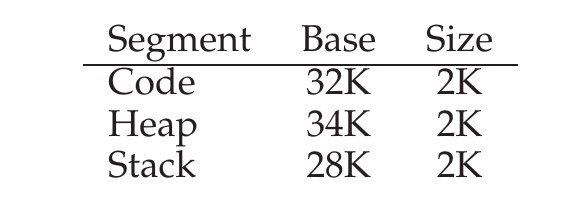
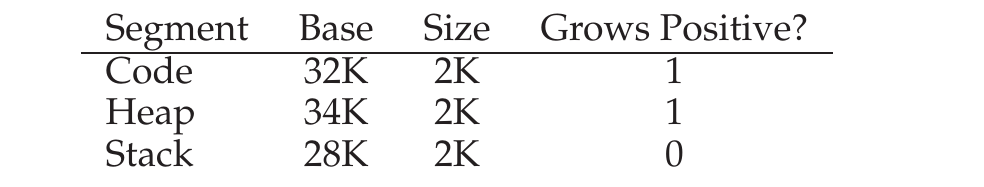

# 第 16 章 分段

> 英文原题：*Segmentation*

到目前为止，我们一直把每个进程的整个地址空间都塞进内存里。有了基址(base)和界限(bounds)寄存器，操作系统可以轻松地把进程重定位到物理内存的不同位置。不过，你可能已经注意到咱们这些地址空间有点蹊跷：在栈和堆的正中间，赫然空着一大块"空闲"空间。

从图 16.1 就能看出来，栈和堆之间那块空间虽然进程根本不用，可当我们把整个地址空间整体搬到物理内存某处时，它照样占着物理内存。所以，用一对基址/界限寄存器来虚拟化内存这种朴素做法，纯属浪费。更糟的是，当地址空间整个装不进内存时，程序跑起来会相当费劲；可见基址/界限并没有我们想的那么灵活。于是问题就来了：

!!! danger "问题核心"
    **如何支持大地址空间**

    当栈和堆之间（可能）存在大量空闲空间时，我们怎样支持一个大地址空间？注意，在我们的例子里，地址空间小得可怜（还是假装的），这点浪费似乎还不算太糟。可要是想象一个 32 位地址空间（4 GB 那么大），典型程序只会用掉几兆内存，却仍然要求整个地址空间都常驻内存。

## 16.1 分段：泛化的基址/界限

为了解决这个问题，一个想法诞生了，它叫做**分段(segmentation)**。这是个相当古老的想法，至少能追溯到 1960 年代初 [H61, G62]。思路很简单：我们的 MMU 里既然只放一对基址/界限，那为什么不给地址空间的每个逻辑**段(segment)** 各配一对呢？所谓段，就是地址空间里一段特定长度的连续区域；在我们那套标准的地址空间里，有三个逻辑上彼此不同的段：代码、栈和堆。分段让操作系统能把这三段分别放进物理内存的不同地方，从而避免用没用的虚拟地址空间把物理内存填满。

```text
      +---------------------------+
0KB   | Program Code              |
2KB   +---------------------------+
      | (free)                    |
4KB   +---------------------------+
      | Heap                      |
6KB   +---------------------------+
      |        |                  |
      |        v                  |
      |                           |
      |      (free)               |
      |                           |
      |                  ^        |
      |                  |        |
14KB  +---------------------------+
      | Stack                     |
16KB  +---------------------------+
```

*图 16.1：又一个地址空间。*

看个例子。假设要把图 16.1 里的地址空间塞进物理内存。给每段配上一对基址/界限后，我们就能把各段独立地放进物理内存。比如见图 16.2：那是一个 64KB 的物理内存，里面装着这三段（另外留了 16KB 给操作系统）。

```text
0KB   +---------------------------+
      | Operating System          |
16KB  +---------------------------+
      |                           |
      | (not in use)              |
      |                           |
28KB  +---------------------------+
      | Stack                     ^
30KB  +---------------------------+
      | (not in use)              |
32KB  +---------------------------+
      | Code                      |
34KB  +---------------------------+
      | Heap                      |
36KB  +---------------------------+
      |                           |
      | (not in use)              |
48KB  |                           |
      |                           |
64KB  +---------------------------+
```

*图 16.2：把各段放进物理内存。*

正如图中所示，只有真正用到的内存才会在物理内存里分到地方；于是那些带着大块未用空间的大地址空间（我们有时把它们叫做**稀疏地址空间(sparse address space)**）也就安顿得下了。

MMU 里支持分段所需的硬件结构，和你猜的一模一样：在这里，就是三对基址/界限寄存器。图 16.3 给出了上面那个例子的寄存器取值；每个界限寄存器保存着一个段的长度。



*图 16.3：段寄存器取值。*

从图里能看出，代码段放在物理地址 32KB 处，长度 2KB；堆段放在 34KB 处，长度也是 2KB。

我们用图 16.1 里的地址空间做个转换练习。假设要访问虚拟地址 100（它在代码段里）。当这次引用发生时（比方说，一次取指令），硬件会把基址加到该段内的偏移(offset)上（这里是 100），得到目标物理地址：100 + 32KB，也就是 32868。接着它会检查这个地址是否越界（100 小于 2KB），发现没越界，于是向物理内存地址 32868 发出这次引用。

!!! note "边栏：段错误（segmentation fault）"
    **段错误(segmentation fault)** 或**段违例(segmentation violation)** 这个说法，来自在分段机器上对非法地址的一次内存访问。搞笑的是，就算机器压根不支持分段，这个说法也照样流传至今。要不就是另一种不那么搞笑的版本——如果你死活想不明白自己的代码为什么老是报错的话。

现在来看堆里的一个地址，虚拟地址 4200（还是参考图 16.1）。要是我们直接拿虚拟地址 4200 加上堆的基址（34KB），得到物理地址 39016，这可不是正确的物理地址。我们要先做的，是取出它在堆里的偏移，也就是这个地址指的是该段里的哪几个字节。由于堆从虚拟地址 4KB（4096）开始，4200 的偏移其实是 4200 减去 4096，等于 104。再把这个偏移（104）加到基址寄存器的物理地址（34K）上，就得到了想要的结果：34920。

那要是我们试图访问一个非法地址，比如越过堆末尾的 7KB 呢？结果你能想象得到：硬件发现地址越界，于是陷入(trap)操作系统，多半就把这个闯祸的进程给终止了。现在你就知道那个让所有 C 程序员闻之色变的著名说法出自何处了：**段违例**，或者说**段错误**。

## 16.2 我们指的是哪一段？

进行转换时，硬件会用到段寄存器。它怎么知道一个地址是段内偏移、又是哪个段的偏移呢？一种常见做法——有时被称作**显式(explicit)** 方式——是根据虚拟地址最前面几位，把地址空间切成一个个段；VAX/VMS 系统用的就是这套技术 [LL82]。在上面那个例子里，我们有三个段，因此得用两位来完成这件事。如果用 14 位虚拟地址的头两位来选段，那么虚拟地址长这样：

```text
13 12 11 10  9  8  7  6  5  4  3  2  1  0
+-----+-----+-----+-----+-----+-----+-----+
|Segment|            Offset                 |
+-----+-----+-----+-----+-----+-----+-----+
```

于是在我们的例子里，如果头两位是 00，硬件就知道这个虚拟地址在代码段里，从而用代码段的基址/界限对把它重定位到正确的物理位置。如果头两位是 01，硬件就知道地址在堆里，于是改用堆的基址/界限。我们拿上面那个堆虚拟地址（4200）来转换一下，确保把这事儿说清楚。虚拟地址 4200 的二进制形式如下：

```text
13 12 11 10  9  8  7  6  5  4  3  2  1  0
 0  1  0  0  0  0  0  1  1  0  1  0  0  0
+-----+-----+-----+-----+-----+-----+-----+
|Segment|            Offset                 |
+-----+-----+-----+-----+-----+-----+-----+
```

从图里能看出，头两位（01）告诉硬件我们指的是哪个段。低 12 位是段内偏移：0000 0110 1000，也就是十六进制 0x068，或者十进制的 104。于是硬件干脆取头两位决定用哪个段寄存器，再取接下来的 12 位作为段内偏移。把基址寄存器加到偏移上，硬件就得到了最终的物理地址。注意，偏移还让界限检查变简单了：我们只要检查偏移是否小于界限就行；不小于，那地址就非法。所以，如果基址和界限是数组（每个段一项），硬件大概会这样算出目标物理地址：

```c
// 取出 14 位 VA 的头 2 位
Segment = (VirtualAddress & SEG_MASK) >> SEG_SHIFT
// 再取出偏移
Offset = VirtualAddress & OFFSET_MASK
if (Offset >= Bounds[Segment])
    RaiseException(PROTECTION_FAULT)
else
    PhysAddr = Base[Segment] + Offset
    Register = AccessMemory(PhysAddr)
```

在刚才那个例子里，我们可以把上面这些常量的值填进去。具体来说，`SEG_MASK` 会设成 0x3000，`SEG_SHIFT` 设成 12，`OFFSET_MASK` 设成 0xFFF。

你可能也注意到了：用头两位选段、而只有三个段（代码、堆、栈）时，地址空间里会有一整段用不上。因此，有些系统把代码放进和堆同一个段里，这样就只用一位来选择用哪个段 [LL82]。

硬件还有别的办法判断某个地址属于哪一段。在**隐式(implicit)** 方式里，硬件通过观察地址是怎么形成的来判断段。比如，如果地址是由程序计数器(PC) 生成的（也就是一次取指令），那地址就在代码段里；如果地址是基于栈或基址指针的，那它一定在栈段里；其他任何地址，就归堆段。

## 16.3 那栈呢？

到目前为止，我们漏掉了地址空间里一个重要部件：栈。在上面那张图里，栈被重定位到了物理地址 28KB，但有一个关键区别：它是**反着长的**。在物理内存里，它从 28KB 开始，向回长到 26KB，对应虚拟地址 16KB 到 14KB；转换过程也得跟着变个样。

我们首先需要一点额外的硬件支持。光有基址和界限值还不够，硬件还得知道段是朝哪个方向长的（譬如一个位，段朝正方向增长时置 1，朝负方向增长时置 0）。我们对硬件究竟跟踪哪些信息的更新视图，见图 16.4。



*图 16.4：段寄存器（支持负向增长）。*

硬件既然明白了段可以朝负方向增长，那它现在转换这类虚拟地址时就得稍微换个算法。我们拿一个栈的虚拟地址来转换一下，好把这个过程搞清楚。

这个例子里，假设我们要访问虚拟地址 15KB，它应该映射到物理地址 27KB。我们的虚拟地址写成二进制，是这样：11 1100 0000 0000（十六进制 0x3C00）。硬件用头两位（11）来指定段，接着我们手上就剩 3KB 的偏移。要得到正确的负偏移，我们得从 3KB 里减去该段的最大长度：在这个例子里，一个段最大可以是 4KB，所以正确的负偏移是 3KB 减 4KB，等于 -1KB。我们把这个负偏移（-1KB）加到基址（28KB）上，就得到正确的物理地址：27KB。界限检查可以通过确保负偏移的绝对值小于该段长度来计算。

## 16.4 对共享的支持

随着分段支持日益成熟，系统设计者很快意识到，只要再加一点硬件支持，就能捣鼓出新的效率花样。具体说，为了省内存，有时候在地址空间之间共享某些内存段是很有用的。尤其是代码共享，很常见，直到今天仍在系统里用着。

要支持共享，我们需要硬件提供一点额外支持，也就是**保护位(protection bit)**。基本的支持就是给每个段加几个位，标明程序能否读、能否写这个段，或者能否执行段内的代码。把代码段设成只读，同一段代码就能在多个进程之间共享，而不必担心破坏隔离；每个进程仍然以为自己在访问自己私有的内存，操作系统却在暗地里共享着这块进程改不了的内存，于是幻觉得以保全。

图 16.5 展示了硬件（和操作系统）额外跟踪的信息的一个例子。如你所见，代码段被设成读和执行，于是内存里同一个物理段就可以被映射进多个虚拟地址空间。


*图 16.5：段寄存器取值（带保护）。*

有了保护位，前面讲的硬件算法也得跟着改。除了检查虚拟地址是否越界，硬件还得检查某次访问是否被允许。如果用户进程试图写入一个只读段，或者从一个不可执行的段里取指令，硬件就该抛异常，让操作系统去收拾那个闯祸的进程。

## 16.5 细粒度与粗粒度分段

到目前为止，我们大多数例子关注的都是只有少数几个段（也就是代码、栈、堆）的系统；我们可以把这种分段看作**粗粒度(coarse-grained)** 的，因为它把地址空间切成了相对较大的粗块。然而，一些早期系统（比如 Multics [CV65, DD68]）更灵活，允许地址空间由大量较小的段组成，这叫做**细粒度(fine-grained)** 分段。

支持很多段需要更多硬件支持，例如在内存里存放某种**段表(segment table)**。这类段表通常支持创建数量极大的段，从而让系统能以比我们前面讨论过的更灵活的方式使用段。比如，像 Burroughs B5000 这样的早期机器就支持成千上万个段，并且期望编译器把代码和数据切分进不同的段，再由操作系统和硬件来支持 [RK68]。当时大家的想法是：有了细粒度分段，操作系统就能更好地了解哪些段在用、哪些没在用，从而更有效地利用主存。

## 16.6 操作系统的支持

现在你对分段是怎么工作的，应该有个基本概念了。系统运行过程中，地址空间的一块块被重定位进物理内存，因此比起"整个地址空间只用一对基址/界限"那种更简单的做法，这叫省下了海量的物理内存。具体说，栈和堆之间所有没用的空间都不必在物理内存里分配，于是我们能往物理内存里塞下更多的地址空间。

不过，分段也引出了不少新问题。我们先说说操作系统必须处理的新问题。第一个是老问题：上下文切换时操作系统该做什么？你到现在应该能猜个八九不离十：段寄存器必须保存和恢复。显然，每个进程都有自己的虚拟地址空间，操作系统必须确保再次让进程运行前，把这些寄存器正确设置好。

第二个、也是更重要的问题，是管理物理内存里的空闲空间。创建一个新地址空间时，操作系统得能为其各个段在物理内存中找到位置。以前我们假设每个地址空间大小都一样，于是物理内存可以看成一排排格子，进程往里面塞就是了。现在，每个进程有好几个段，而且每段大小可能都不一样。

```text
   Not Compacted                       Compacted
0KB +------------------+           0KB +------------------+
    | Operating System |               | Operating System |
16KB+------------------+          16KB +------------------+
    | (not in use)     |               |                  |
24KB+------------------+          24KB | Allocated        |
    | Allocated        |               |                  |
32KB+------------------+          32KB |                  |
    | (not in use)     |               |                  |
40KB+------------------+          40KB +------------------+
    | Allocated        |               |                  |
48KB+------------------+          48KB | (not in use)     |
    | (not in use)     |               |                  |
56KB+------------------+          56KB |                  |
    | Allocated        |               |                  |
64KB+------------------+          64KB +------------------+
```

*图 16.6：未压缩与压缩后的内存。*

由此引出的普遍问题是：物理内存很快就会塞满一个个空闲空间的小洞，让新段的分配、以及现有段的增长都变得困难。我们把这个毛病叫做**外部碎片(external fragmentation)** [R69]；见图 16.6（左）。

在那个例子里，来了一个进程，想分配一个 20KB 的段。此时有 24KB 空闲，但并不是一整块连续的（而是三块不连续的）。因此操作系统满足不了这个 20KB 的请求。

解决这问题的一个办法，是通过重排现有段来**压缩(compact)** 物理内存。比如，操作系统可以把正在运行的进程都停掉，把它们的数据拷到内存中一块连续区域，再修改它们的段寄存器值、指向新的物理位置，于是就有了很大一块连续空闲内存可用了。这样一来，操作系统就能让新的分配请求成功。然而，压缩的代价很高，因为拷贝段既费内存，一般也要耗掉相当多的处理器时间。压缩后物理内存的图示见图 16.6（右）。

更简单的办法是用一种空闲链表管理算法，尽量让大块连续内存保持可分配状态。人们提出的办法没有一千也有几百，既包括**最佳适配(best-fit)**（维护一张空闲空间列表，返回大小最接近请求的那块）、**最差适配(worst-fit)**、**首次适配(first-fit)** 这类经典算法，也包括**伙伴算法(buddy algorithm)** [K68] 这类更复杂的方案。如果你想多了解这类算法，Wilson 等人那篇出色的综述 [W+95] 是个很好的起点；或者你也可以等我们在后面某章里亲自讲一些基础。可惜的是，无论算法多聪明，外部碎片都依然存在；所以好算法也只能尽量把它压小。

!!! tip "提示：若有一千种方案，就无一称得上妙案"
    想最小化外部碎片的算法竟然有这么多，这恰恰说明了一个更深刻的道理：这个问题压根没有哪一种是"最好"的解法。于是我们只能凑合选个还算合理的方案，指望它够用。真正的唯一解（正如后面几章会看到的）是彻底绕开这个问题：永远不要按可变大小的块来分配内存。

## 16.7 小结

分段解决了不少问题，帮我们搭建出更有效的内存虚拟化。除了动态重定位，分段还能更好地支持稀疏地址空间，避免地址空间各个逻辑段之间可能出现的大量内存浪费。它也很快，因为分段所需的算术运算既简单又很适合硬件；转换的开销微乎其微。还有个附带的好处：代码共享。如果把代码放在一个单独的段里，这样的段就有可能被多个正在运行的程序共享。

不过，正如我们所学到的，在内存里分配可变大小的段会带来一些我们想克服的问题。第一个就是前面讨论过的外部碎片。因为段大小不一，空闲内存被切成了大小零碎的小块，于是满足一次内存分配请求可能变得很难。你可以试试聪明的算法 [W+95]，或者定期压缩内存，但这个问题是根本性的，很难躲开。

第二个、也许更重要的问题是，分段仍然不够灵活，撑不起我们那个完全泛化、稀疏的地址空间。举个例子，假如我们有一个很大但用得稀稀拉拉的堆，而且全都在一个逻辑段里，那么要访问它，整个堆都必须待在内存里。换句话说，如果我们对地址空间实际用法的模型，跟底层分段被设计来支持的方式对不上号，分段就运转不灵。于是我们得去找些新解法。准备好去找了吗？

## 参考文献

[CV65] "Introduction and Overview of the Multics System" by F. J. Corbato, V. A. Vyssotsky. Fall Joint Computer Conference, 1965. ——秋季联合计算机会议(Fall Joint Computer Conference)上介绍 Multics 的五篇论文之一；那天要是能当只趴在墙上的苍蝇、在屋里偷听就好了！

[DD68] "Virtual Memory, Processes, and Sharing in Multics" by Robert C. Daley and Jack B. Dennis. Communications of the ACM, Volume 11:5, May 1968. ——一篇关于如何在 Multics 中实现动态链接的早期论文，思路远远超前于它的时代。动态链接最终在大约 20 年后回到系统里，因为庞大的 X-windows 库非它不可。有人说，这些庞大的 X11 库就是 MIT 对早期 UNIX 版本砍掉动态链接支持的报复！

[G62] "Fact Segmentation" by M. N. Greenfield. Proceedings of the SJCC, Volume 21, May 1962. ——又一篇关于分段的早期论文；早到它压根没有引用任何其他工作。

[H61] "Program Organization and Record Keeping for Dynamic Storage" by A. W. Holt. Communications of the ACM, Volume 4:10, October 1961. ——一篇早得离谱、也难得要命的论文，讲分段及其一些用途。

[I09] "Intel 64 and IA-32 Architectures Software Developer's Manuals" by Intel. 2009. Available: http://www.intel.com/products/processor/manuals. ——不妨读读里面讲分段的部分（第 3a 卷第 3 章）；至少会让你有点头疼。

[K68] "The Art of Computer Programming: Volume I" by Donald Knuth. Addison-Wesley, 1968. ——Knuth 出名，不只是因为那几本早期的《计算机程序设计艺术》，还因为他那套排版系统 TeX——它至今仍是专业人士使用的强力排版工具，这本书本身正是用它排的。他那几本算法巨著，是今天许多计算机系统底层算法的绝佳早期参考。

[L83] "Hints for Computer Systems Design" by Butler Lampson. ACM Operating Systems Review, 15:5, October 1983. ——一座关于如何构建系统的智慧箴言宝库。一口气读不下来；像品好酒、或翻参考手册那样，一点一点吸收吧。

[LL82] "Virtual Memory Management in the VAX/VMS Operating System" by Henry M. Levy, Peter H. Lipman. IEEE Computer, Volume 15:3, March 1982. ——一套经典的内存管理系统，其设计里满是常识。我们会在后面某章里更详细地研究它。

[RK68] "Dynamic Storage Allocation Systems" by B. Randell and C.J. Kuehner. Communications of the ACM, Volume 11:5, May 1968. ——一篇不错的综述，讲分页和分段之间的差异，还夹带着对各类机器的历史讨论。

[R69] "A note on storage fragmentation and program segmentation" by Brian Randell. Communications of the ACM, Volume 12:7, July 1969. ——最早讨论碎片的论文之一。

[W+95] "Dynamic Storage Allocation: A Survey and Critical Review" by Paul R. Wilson, Mark S. Johnstone, Michael Neely, David Boles. International Workshop on Memory Management, Scotland, UK, September 1995. ——一篇关于内存分配器的精彩综述。

## 作业（模拟器）

这个程序让你亲眼看看在带分段的系统里，地址转换是如何进行的。细节见 README。

### 问题

1. 先用一个小地址空间来转换几个地址。下面是一组简单的参数，配了几个不同的随机种子；你能把这些地址转换出来吗？

   ```text
   segmentation.py -a 128 -p 512 -b 0 -l 20 -B 512 -L 20 -s 0
   segmentation.py -a 128 -p 512 -b 0 -l 20 -B 512 -L 20 -s 1
   segmentation.py -a 128 -p 512 -b 0 -l 20 -B 512 -L 20 -s 2
   ```

2. 现在，看看我们是不是真的搞懂了这个亲手搭起来的小地址空间（用上面问题里的参数）。段 0 里最高的合法虚拟地址是多少？段 1 里最低的合法虚拟地址呢？整个地址空间里，最低和最高的非法地址分别是多少？最后，你会怎么用 `-A` 标志运行 `segmentation.py`，来检验自己说得对不对？

3. 假设我们有一个 16 字节的小地址空间，位于 128 字节的物理内存里。要让模拟器对指定的地址流产生下面这样的转换结果——合法、合法、违例、……、违例、合法、合法——你得怎么设置基址和界限？假设参数如下：

   ```text
   segmentation.py -a 16 -p 128
   -A 0,1,2,3,4,5,6,7,8,9,10,11,12,13,14,15
   --b0 ? --l0 ? --b1 ? --l1 ?
   ```

4. 假设我们想出一道题，让随机生成的虚拟地址里大约 90% 是合法的（不触发段违例）。你该怎么配置模拟器才能做到？哪些参数对凑出这个结果是关键？

5. 你能不能让模拟器跑出所有虚拟地址都非法的情况？怎么做？
