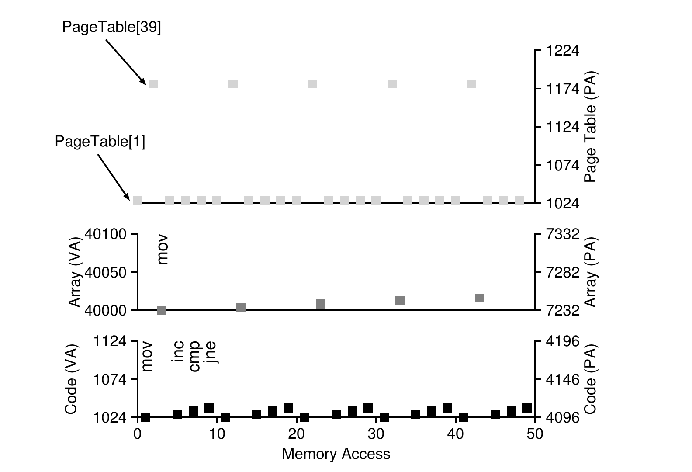

# 第 18 章 分页：介绍

> 英文原题：*Paging: Introduction*

人们常说，操作系统在解决几乎任何空间管理问题时，都会在两种思路里挑一种。第一种是把东西切成大小可变的块，就像我们在虚拟内存里见过的分段(segmentation)那样。可惜，这个方案有它天生的麻烦。尤其是，把一块空间划成大小不一的碎片之后，空间本身就会变得**碎片化(fragmented)**，于是随着时间推移，分配也变得越来越棘手。

所以，或许值得考虑第二种思路：把空间切成固定大小的块。在虚拟内存里，这个想法叫做**分页(paging)**，它最早可以追溯到一套又早又重要的系统——Atlas [KE+62, L78]。我们不再把进程的地址空间拆成若干个大小可变的逻辑段（比如代码、堆、栈），而是把它切成固定大小的单元，每一个都叫做一**页(page)**。相应地，我们把物理内存看作一组固定大小的槽位，叫做**帧(frame)**（也就是物理页框）；每个帧里可以装下一页虚拟内存。我们的挑战是：

!!! danger "问题核心"
    **如何用分页来虚拟化内存**

    我们怎样才能用分页来虚拟化内存，从而绕开分段带来的那些麻烦？基本技术有哪些？又怎样才能让这些技术跑得又省空间、又省时间？

## 18.1 一个简单例子与概述

为了把这个思路讲清楚，我们先用一个简单的例子来说明。图 18.1 展示了一个极小的地址空间，总共只有 64 字节，分成四个 16 字节的页（虚拟页 0、1、2、3）。真实的地址空间当然大得多，通常是 32 位、也就是 4GB 的地址空间，甚至 64 位[^1]；但在本书里，我们经常用这种小例子，好让它们更好消化。

[^1]: 64 位地址空间大得难以想象。打个比方也许有帮助：如果把 32 位地址空间看成一块网球场那么大，那么 64 位地址空间差不多有整个欧洲那么大（！）。

```text
0        +---------------------------+
         |                           |   (page 0 of the address space)
16       +---------------------------+
         |                           |   (page 1)
32       +---------------------------+
         |                           |   (page 2)
48       +---------------------------+
         |                           |   (page 3)
64       +---------------------------+
```

*图 18.1：一个简单的 64 字节地址空间。*

物理内存，如图 18.2 所示，同样由一堆固定大小的槽位组成，在这个例子里是八个帧（凑成 128 字节的物理内存，同样小得离谱）。从图里可以看到，虚拟地址空间的各个页被放到了物理内存中不同的位置；图中还显示操作系统自己也占了一部分物理内存。

```text
0        +---------------------------+   page frame 0 of physical memory
         |      reserved for OS      |
16       +---------------------------+   page frame 1
         |         (unused)          |
32       +---------------------------+   page frame 2
         |        page 3 of AS       |
48       +---------------------------+   page frame 3
         |        page 0 of AS       |
64       +---------------------------+   page frame 4
         |         (unused)          |
80       +---------------------------+   page frame 5
         |        page 2 of AS       |
96       +---------------------------+   page frame 6
         |         (unused)          |
112      +---------------------------+   page frame 7
         |        page 1 of AS       |
128      +---------------------------+
```

*图 18.2：一个 64 字节地址空间放进 128 字节的物理内存。*

分页，我们后面会看到，比之前那些方案有不少优点。大概最重要的改进是**灵活性(flexibility)**：一套成熟的分页方案能让系统有效地支撑地址空间这层抽象，不管进程怎么使用它的地址空间；比如，我们不会再对堆和栈往哪个方向长、怎么被使用这些事情做任何假设。

另一个优点是分页带来的空闲空间管理足够**简单(simplicity)**。比如，操作系统想把我们这个 64 字节的小地址空间放进八页的物理内存时，它只要找到四个空闲页就行；也许操作系统为此维护了一份所有空闲页的**空闲链表(free list)**，直接从上面抓走前四个空闲页。在这个例子里，操作系统把地址空间(AS)的虚拟页 0 放到物理帧 3，虚拟页 1 放到物理帧 7，页 2 放到帧 5，页 3 放到帧 2。帧 1、4、6 目前是空闲的。

为了记录地址空间里每个虚拟页落在物理内存的哪个位置，操作系统通常会维护一个每进程(per-process)的数据结构，叫做**页表(page table)**。页表的主要职责，是保存地址空间里每个虚拟页的**地址转换(address translation)**信息，从而让我们知道每个页到底住在物理内存的哪里。对上面这个简单例子（图 18.2）来说，页表就会有下面四个条目：(Virtual Page 0 → Physical Frame 3)、(VP 1 → PF 7)、(VP 2 → PF 5)、(VP 3 → PF 2)。

要记住，页表是一个每进程的数据结构（我们讨论的大多数页表结构都是每进程的；有个例外是**反向页表(inverted page table)**，我们以后会碰到）。如果上面这个例子里换另一个进程来跑，操作系统就得为它管理一张不同的页表，因为它的虚拟页显然会映射到不同的物理页（除非发生某些共享）。

现在，我们掌握的东西已经够做一个地址转换的例子了。设想那个拥有极小地址空间（64 字节）的进程正在做一次内存访问：

```text
movl <virtual address>, %eax
```

具体来说，我们把注意力放在这次显式加载上：把地址 `<virtual address>` 处的数据读进寄存器 `eax`（从而忽略前面必定已经发生过的取指令）。

要转换进程生成的这个虚拟地址，我们得先把它拆成两部分：**虚拟页号(virtual page number, VPN)**，以及页内**偏移(offset)**。在这个例子里，因为进程的虚拟地址空间是 64 字节，我们的虚拟地址总共需要 6 位（$2^6 = 64$）。于是，虚拟地址可以这样理解：

```text
Va5 Va4 Va3 Va2 Va1 Va0
```

在这个图里，Va5 是虚拟地址的最高位，Va0 是最低位。因为我们知道页大小（16 字节），可以进一步把虚拟地址划分如下：

```text
                VPN             offset
        +-----+-----+-----+-----+-----+-----+
        | Va5 | Va4 | Va3 | Va2 | Va1 | Va0 |
        +-----+-----+-----+-----+-----+-----+
```

在这个 64 字节的地址空间里页大小是 16 字节；因此我们需要能选出 4 个页，而地址最高的 2 位正好干这件事。于是我们就有了 2 位的虚拟页号(VPN)。剩下的位告诉我们想要页里的哪个字节，这里就是 4 位；我们称之为偏移(offset)。

当一个进程生成一个虚拟地址时，操作系统和硬件必须联手把它转换成一个有意义的物理地址。举个例子，假设上面那次加载访问的是虚拟地址 21：

```text
movl 21, %eax
```

把 “21” 写成二进制，得到 “010101”，于是我们可以端详这个虚拟地址，看它怎么拆成虚拟页号(VPN)和偏移：

```text
                VPN             offset
        +-----+-----+-----+-----+-----+-----+
        |  0  |  1  |  0  |  1  |  0  |  1  |
        +-----+-----+-----+-----+-----+-----+
```

于是，虚拟地址 “21” 落在虚拟页 “01”（也就是 1）的第 5 个字节（“0101”）上。有了虚拟页号，我们现在就能去索引页表，找到虚拟页 1 落在哪个物理帧里。在上面那张页表里，**物理帧号(physical frame number, PFN)**（有时也叫物理页号，physical page number 或 PPN）是 7（二进制 111）。于是，我们可以通过把 VPN 换成 PFN 来转换这个虚拟地址，然后向物理内存发起这次加载（图 18.3）。

注意偏移保持不变（也就是说不参与转换），因为偏移只告诉我们想要页里的哪个字节。我们最终的物理地址是 1110101（十进制 117），正好就是这次加载想要取数据的地方（图 18.2）。

```text
                VPN            offset
          +-----------+  +------------------+
Virtual   |  0  |  1  |  | 0 | 1 | 0 | 1    |
Address   +-----------+  +------------------+
               |
               v
        +----------------+
        |    Address     |
        |  Translation   |
        +----------------+
               |
               v
          +-----------+  +------------------+
Physical  | 1 | 1 | 1 |  | 0 | 1 | 0 | 1    |
Address   +-----------+  +------------------+
               PFN            offset
```

*图 18.3：地址转换过程。*

带着这个基本的全局认识，我们现在可以来问（并但愿能回答）几个你可能会有的关于分页的基本问题。比如，这些页表存在哪里？页表里典型的内容是什么，表又有多大？分页会不会把系统拖得（太）慢？这些以及其他吊人胃口的问题，下面的正文至少会回答一部分。接着往下读！

## 18.2 页表存在哪里？

页表可以变得非常巨大，比我们之前讨论过的那个小小的段表或基址/界限寄存器对大得多。举个例子，想象一个典型的 32 位地址空间，页大小 4KB。这个虚拟地址会拆成 20 位的 VPN 和 12 位的偏移（回想一下，1KB 的页大小需要 10 位，再加 2 位就是 4KB）。20 位的 VPN 意味着操作系统要为每个进程管理 $2^{20}$ 个转换（差不多一百万）；假设每个页表项(PTE) 需要 4 字节来存放物理转换信息加上其他有用的东西，那么每张页表就要占用惊人的 4MB 内存！这相当大。再想象有 100 个进程在跑：这意味着操作系统光是为了这些地址转换就得要 400MB 内存！哪怕在机器动辄几个 GB 内存的现代，把一大块内存就这么花在转换上，似乎也有点疯，对吧？至于 64 位地址空间下这种页表会有多大，我们想都不敢想；那会太吓人，说不定直接把你劝退了。

因为页表这么大，我们不会在 MMU 里为当前运行的进程保留任何特殊的片上硬件来存放页表。相反，我们把每个进程的页表存到内存的某个地方。眼下我们先假设页表就住在操作系统管理的物理内存里；后面我们会看到，操作系统自己的内存很大一部分也可以被虚拟化，因此页表可以存在操作系统的虚拟内存里（甚至被交换到磁盘上），但那样现在太让人迷糊，先不管它。图 18.4 就是一张存放在操作系统内存里的页表；看到里面那几条小小的转换了吗？

```text
0        +---------------------------+   page frame 0 of physical memory
         |  page table:              |
         |      3   7   5   2        |
16       +---------------------------+   page frame 1
         |         (unused)          |
32       +---------------------------+   page frame 2
         |        page 3 of AS       |
48       +---------------------------+   page frame 3
         |        page 0 of AS       |
64       +---------------------------+   page frame 4
         |         (unused)          |
80       +---------------------------+   page frame 5
         |        page 2 of AS       |
96       +---------------------------+   page frame 6
         |         (unused)          |
112      +---------------------------+   page frame 7
         |        page 1 of AS       |
128      +---------------------------+
```

*图 18.4：示例：存放在内核物理内存中的页表。*

## 18.3 页表里到底有什么？

我们来稍微聊聊页表的组织。页表就是一个数据结构，用来把虚拟地址（更准确地说，是虚拟页号）映射到物理地址（物理帧号）。因此，任何数据结构都能胜任。最简单的形式叫做**线性页表(linear page table)**，它就是一个数组。操作系统用虚拟页号(VPN)去索引这个数组，查那个下标处的**页表项(page-table entry, PTE)**，从而找到想要的物理帧号(PFN)。眼下我们先假设用这种简单的线性结构；后面的章节里，我们会用上更高级的数据结构，来帮忙解决分页的一些问题。

至于每个 PTE 的内容，里面有一些不同的位，值得我们多少了解一下。**有效位(valid bit)** 很常见，用来表示某个转换是否有效；比如，程序刚开始运行时，代码和堆会在地址空间的一端，栈在另一端。中间所有没用到的空间都会被标记为无效，如果进程试图访问这类内存，就会向操作系统触发一次陷入，操作系统多半会终止这个进程。因此，有效位对于支撑**稀疏(sparse)** 的地址空间至关重要：只要把地址空间里所有没用到的页标记为无效，我们就不必为这些页分配物理帧，从而省下大量内存。

我们还可能有一些**保护位(protection bit)**，表示这一页能不能读、能不能写、能不能执行。同样，以这些位不允许的方式访问某一页，会向操作系统触发一次陷入。

还有几个位也很重要，不过眼下我们不打算多谈。**存在位(present bit)** 表示这一页是在物理内存里还是在磁盘上（也就是它是否已经被**换出(swapped out)**）。等我们研究如何把地址空间的一部分交换到磁盘、以支撑比物理内存还大的地址空间时，会进一步理解这套机制；交换让操作系统能把不常用的页挪到磁盘上，从而腾出物理内存。**脏位(dirty bit)** 也很常见，表示页自从被载入内存以来是否被修改过。**引用位(reference bit)**（又叫访问位，accessed bit）有时用来跟踪一页是否被访问过，在判断哪些页很热门、因而应该留在内存里时很有用；这些信息在**页替换(page replacement)** 时至关重要，我们会在后续章节里非常详细地研究这个话题。

```text
 31                                12 11 10  9  8   7   6  5   4   3   2   1  0
+-----------------------------------+--+--+--+---+---+---+---+---+---+---+---+
|                PFN                | 未用 |G |PAT| D | A |PCD|PWT|U/S|R/W| P |
+-----------------------------------+--+--+--+---+---+---+---+---+---+---+---+
```

*图 18.5：一个 x86 页表项 (PTE)。*

图 18.5 展示了 x86 架构 [I09] 中一个页表项的例子。它包含一个存在位(P)；一个读/写位(R/W)，决定是否允许写这一页；一个用户/超级用户位(U/S)，决定用户态进程能否访问这一页；几个位(PWT、PCD、PAT 和 G)决定硬件对这些页的缓存行为；一个访问位(A)和一个脏位(D)；最后是**物理帧号(PFN)** 本身。

想了解 x86 分页支持的更多细节，去读 Intel 的架构手册 [I09]。不过提前警告一句：读这类手册虽然信息量很大（对那些要在操作系统里写代码来使用这类页表的人来说，也绝对是必须的），一开始却可能相当费劲。需要一点耐心，外加很大的求知欲。

## 18.4 分页：也太慢

页表放在内存里，我们已经知道它们可能太大。事实证明，它们还会拖慢速度。比如，看我们那条简单的指令：

```text
movl 21, %eax
```

再次，我们只考察对地址 21 的这次显式引用，不操心取指令。在这个例子里，我们假设硬件替我们完成转换。要取到想要的数据，系统必须先把虚拟地址（21）转换成正确的物理地址（117）。因此，在从地址 117 取数据之前，系统必须先从进程的页表里取出恰当的页表项，完成转换，然后才从物理内存里加载数据。

要做到这一点，硬件必须知道当前运行的进程页表在哪里。眼下我们假设有一个**页表基址寄存器(page-table base register)**，里面保存着页表起始位置的物理地址。为了找到想要的 PTE 的位置，硬件会执行下面这些运算：

$$\text{VPN} = (\text{VirtualAddress} \;\&\; \text{VPN\_MASK}) \gg \text{SHIFT}$$

$$\text{PTEAddr} = \text{PageTableBaseRegister} + (\text{VPN} \times \text{sizeof(PTE)})$$

在我们的例子里，`VPN_MASK` 会设成 0x30（十六进制的 30，也就是二进制 110000），它从完整的虚拟地址里把 VPN 那几位挑出来；`SHIFT` 设为 4（偏移的位数），这样我们就把 VPN 那几位挪下来，形成正确的整数虚拟页号。比如，虚拟地址 21（010101）经过掩码变成 010000；再经过移位变成 01，也就是虚拟页 1，正如所愿。然后我们拿这个值作为下标，去索引页表基址寄存器所指的那片 PTE 数组。

一旦知道了这个物理地址，硬件就能从内存里取出 PTE，提取出 PFN，再把它和虚拟地址里的偏移拼接起来，形成想要的物理地址。具体来说，你可以把 PFN 左移 `SHIFT` 位，再和偏移做按位或，像下面这样得到最终地址：

$$\text{offset} = \text{VirtualAddress} \;\&\; \text{OFFSET\_MASK}$$

$$\text{PhysAddr} = (\text{PFN} \ll \text{SHIFT}) \mid \text{offset}$$

```c
// 从虚拟地址中提取 VPN
VPN = (VirtualAddress & VPN_MASK) >> SHIFT

// 计算页表项 (PTE) 的地址
PTEAddr = PTBR + (VPN * sizeof(PTE))

// 取出 PTE
PTE = AccessMemory(PTEAddr)

// 检查进程是否有权访问该页
if (PTE.Valid == False)
    RaiseException(SEGMENTATION_FAULT)
else if (CanAccess(PTE.ProtectBits) == False)
    RaiseException(PROTECTION_FAULT)
else
    // 访问合法：构造物理地址并取出数据
    offset   = VirtualAddress & OFFSET_MASK
    PhysAddr = (PTE.PFN << PFN_SHIFT) | offset
    Register = AccessMemory(PhysAddr)
```

*图 18.6：用分页访问内存。*

最后，硬件就能从内存里取到想要的数据，放进寄存器 `eax`。程序这下成功地完成了一次从内存的加载！

总结一下，我们现在来描述每次内存引用时会发生什么的初始协议。图 18.6 展示了基本做法。对每一次内存引用（无论取指令，还是一次显式的加载或存储），分页都要求我们多做一次内存访问，好先从页表里取出转换信息。这活儿可不少！额外的内存访问代价高昂，在这个例子里很可能把进程拖慢一倍甚至更多。

现在你大概能看出，有两个真正的问题等着我们解决。如果不对硬件和软件都做精心设计，页表会让系统跑得太慢，还会吃掉太多内存。对内存虚拟化来说它看似是个了不起的方案，但这两个关键问题得先被攻克。

## 18.5 一次内存访问序列

收尾之前，我们从头到尾追一遍一个简单的内存访问例子，把使用分页时会产生的所有内存访问都展示出来。我们感兴趣的这段代码（C 语言，放在一个叫 `array.c` 的文件里）如下：

```c
int array[1000];
...
for (i = 0; i < 1000; i++)
    array[i] = 0;
```

我们用下面的命令编译并运行 `array.c`：

!!! note "边栏：数据结构——页表"
    现代操作系统的内存管理子系统中，最重要的数据结构之一就是**页表(page table)**。一般来说，页表保存虚拟地址到物理地址的**转换(virtual-to-physical address translations)**信息，从而让系统知道地址空间的每一页到底住在物理内存的哪里。因为每个地址空间都需要这样的转换，所以一般而言，系统里每个进程都有一张页表。页表的确切结构，要么由硬件决定（较老的系统），要么可以由操作系统更灵活地管理（现代系统）。

```console
prompt> gcc -o array array.c -Wall -O
prompt> ./array
```

当然，想真正弄明白这段代码（它只是把一个数组初始化）会产生哪些内存访问，我们还得多知道（或假设）一些事情。首先，我们得**反汇编(disassemble)** 生成的二进制文件（在 Linux 上用 `objdump`，在 Mac 上用 `otool`），看看循环里用了哪些汇编指令来初始化数组。下面是得到的汇编代码：

```text
1024 movl $0x0,(%edi,%eax,4)
1028 incl %eax
1032 cmpl $0x03e8,%eax
1036 jne 0x1024
```

这段代码，如果你懂一点 x86，其实相当好懂[^2]。第一条指令把数值零（写作 `$0x0`）写进数组所在位置对应的虚拟内存地址；这个地址是把 `%edi` 的内容加上 `%eax` 乘以四算出来的。于是，`%edi` 保存着数组的基地址，而 `%eax` 保存着数组下标（i）；我们乘以四是因为这是个整数数组，每个元素 4 字节。

[^2]: 这里我们做了点小弊，为了简单起见假设每条指令都是 4 字节；实际上 x86 指令是变长的。

第二条指令把 `%eax` 里的数组下标加一，第三条指令把这个寄存器的内容和十六进制的 0x03e8（也就是十进制的 1000）比较。如果比较显示两个值还不相等（这正是 `jne` 指令所测试的），第四条指令就跳回循环开头。

要理解这个指令序列会产生哪些内存访问（无论是虚拟层面还是物理层面），我们得对这段代码和数组在虚拟内存里的位置，以及页表的内容和位置，作一些假设。

在这个例子里，我们假设虚拟地址空间大小为 64KB（小得不现实）。同时假设页大小为 1KB。

我们现在只需要知道页表的内容，以及它在物理内存里的位置。假设我们有一张线性（基于数组的）页表，它位于物理地址 1KB（1024）处。

至于它的内容，这个例子里我们只需操心少数几个被映射的虚拟页。首先是代码所在的那个虚拟页。因为页大小是 1KB，虚拟地址 1024 落在虚拟地址空间的第二页上（VPN=1，因为 VPN=0 是第一页）。假设这个虚拟页映射到物理帧 4（VPN 1 → PFN 4）。

接着是数组本身。它的大小是 4000 字节（1000 个整数），我们假设它位于虚拟地址 40000 到 44000（不含最后一个字节）。这个十进制范围对应的虚拟页是 VPN=39 … VPN=42。因此我们需要为这些页建立映射。假设例子里的虚拟到物理映射为：(VPN 39 → PFN 7)、(VPN 40 → PFN 8)、(VPN 41 → PFN 9)、(VPN 42 → PFN 10)。

现在我们准备好追踪程序的内存引用了。程序运行时，每次取指令都会产生两次内存引用：一次访问页表，找出指令所在的物理帧；另一次访问指令本身，把它取进 CPU 处理。此外，`mov` 指令还带来一次显式的内存引用；这又要先多一次页表访问（把数组的虚拟地址转换成正确的物理地址），然后才是数组访问本身。



*图 18.7：一条虚拟（及物理）内存访问轨迹。*

整个过程，就前五次循环迭代而言，描绘在图 18.7 里。最底下那张图用黑色在纵轴上表示指令的内存引用（左边是虚拟地址，右边是实际的物理地址）；中间那张图用深灰色表示数组访问（同样左虚右实）；最后，最上面那张图用浅灰色表示页表的内存访问（只有物理地址，因为这个例子里的页表就住在物理内存里）。整个追踪的横轴表示循环前五次迭代里的内存访问；每轮循环有 10 次内存访问，包括四次取指令、一次显式的内存更新，以及五次页表访问——用来转换那四次取指和一次显式更新。

看看你能不能看懂这张可视化里冒出来的那些规律。尤其是，当循环越过前五次迭代继续跑下去时，什么会发生变化？会有哪些新的内存位置被访问到？你能想明白吗？

这还只是最简单的例子（区区几行 C 代码），可你也许已经能感觉到，想弄懂真实应用程序的实际内存行为有多复杂了。别担心：情况肯定只会更糟，因为我们马上要引入的那些机制，只会让这套本就复杂的机器雪上加霜。抱歉啦[^3]！

[^3]: 我们其实并不真的抱歉。但我们为“并不真的抱歉”这件事感到抱歉，如果你能理解这个逻辑的话。

## 18.6 小结

我们引入了分页的概念，作为虚拟化内存这一挑战的一个解法。分页相比此前的方案（比如分段）有很多优点。第一，它不会导致**外部碎片(external fragmentation)**，因为分页（按设计）把内存分成固定大小的单元。第二，它相当灵活，支持虚拟地址空间的稀疏使用。

然而，不仔细地实现分页支持，会导致机器变慢（多出许多访问页表的内存访问），还会浪费内存（内存里塞满页表，而不是有用的应用数据）。因此我们得再动动脑筋，想出一套不仅能用、而且好用的分页系统。幸运的是，接下来两章会告诉我们怎么做。

## 参考文献

- `[KE+62]` "One-level Storage System" by T. Kilburn, D.B.G. Edwards, M.J. Lanigan, F.H. Sumner. IRE Trans. EC-11, 2, 1962. Reprinted in Bell and Newell, "Computer Structures: Readings and Examples". McGraw-Hill, New York, 1971. ——Atlas 率先提出了把内存划分成固定大小页的想法，从很多意义上说，它是我们在现代计算机系统里所见到的内存管理思想的早期形态。
- `[I09]` "Intel 64 and IA-32 Architectures Software Developer's Manuals" Intel, 2009. Available: http://www.intel.com/products/processor/manuals. ——尤其要留意 "Volume 3A: System Programming Guide Part 1" 和 "Volume 3B: System Programming Guide Part 2" 这两卷。
- `[L78]` "The Manchester Mark I and Atlas: A Historical Perspective" by S. H. Lavington. Communications of the ACM, Volume 21:1, January 1978. ——这篇论文精彩地回顾了几套重要计算机系统的研发史。我们美国人有时会忘记，这些新想法里有不少其实来自海外。

## 作业（模拟器）

这次作业里，你会用一个简单的程序，名叫 `paging-linear-translate.py`，来检验自己是否搞懂了线性页表下简单的虚拟到物理地址转换是怎么工作的。细节见 README。

### 问题

1. 在做任何转换之前，我们先借助模拟器来研究一下，给定不同参数时线性页表的大小会怎么变。请在不同的参数下计算线性页表的大小。下面是一些建议的输入；用 `-v` 标志，你能看到有多少页表项被填上了。首先，理解线性页表大小如何随地址空间增长而变化：

    ```console
    paging-linear-translate.py -P 1k -a 1m -p 512m -v -n 0
    paging-linear-translate.py -P 1k -a 2m -p 512m -v -n 0
    paging-linear-translate.py -P 1k -a 4m -p 512m -v -n 0
    ```

    然后，理解线性页表大小如何随页大小增长而变化：

    ```console
    paging-linear-translate.py -P 1k -a 1m -p 512m -v -n 0
    paging-linear-translate.py -P 2k -a 1m -p 512m -v -n 0
    paging-linear-translate.py -P 4k -a 1m -p 512m -v -n 0
    ```

    在运行这些之前，先想一想预期的趋势。当地址空间增长时，页表大小应该怎样变化？当页大小增长时呢？我们为什么一般不该直接用特别大的页？

2. 现在来做一些转换。先从小例子开始，用 `-u` 标志改变分配给地址空间的页数。例如：

    ```console
    paging-linear-translate.py -P 1k -a 16k -p 32k -v -u 0
    paging-linear-translate.py -P 1k -a 16k -p 32k -v -u 25
    paging-linear-translate.py -P 1k -a 16k -p 32k -v -u 50
    paging-linear-translate.py -P 1k -a 16k -p 32k -v -u 75
    paging-linear-translate.py -P 1k -a 16k -p 32k -v -u 100
    ```

    当你提高每个地址空间中被分配的页所占的百分比时，会发生什么？

3. 现在换几个不同的随机种子，再用几组不同的（有时相当离谱的）地址空间参数，来点变化：

    ```console
    paging-linear-translate.py -P 8 -a 32 -p 1024 -v -s 1
    paging-linear-translate.py -P 8k -a 32k -p 1m -v -s 2
    paging-linear-translate.py -P 1m -a 256m -p 512m -v -s 3
    ```

    这些参数组合里哪些是不现实的？为什么？

4. 用这个程序再试一些别的问题。你能找到这个程序不再能正常工作的边界吗？比如，如果地址空间大小比物理内存还大，会发生什么？
