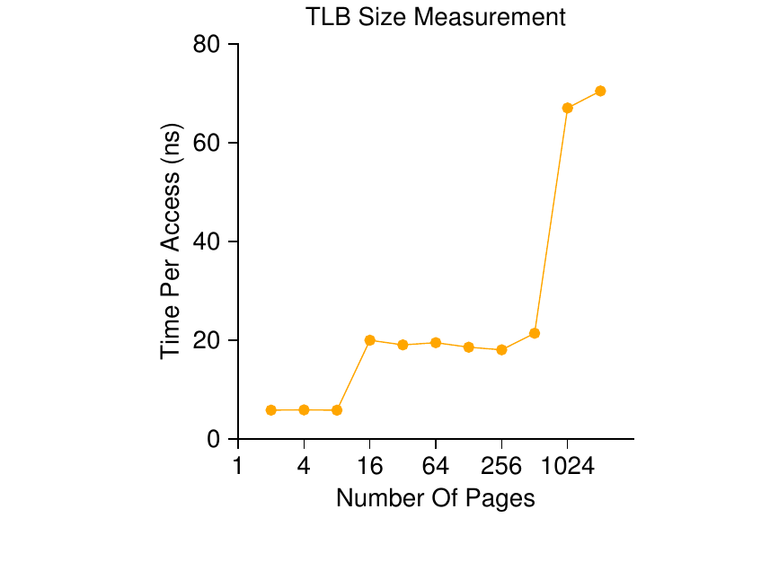

# 第 19 章 分页：快速地址转换（TLB）

> 英文原题：*Paging: Faster Translations (TLBs)*

把分页当作支撑虚拟内存的核心机制，会带来很高的性能开销。地址空间被切成一个个固定大小的小单元（也就是页），分页就得维护海量的映射信息。这些映射信息一般存在物理内存里，于是逻辑上，程序每生成一个虚拟地址，分页都要求额外做一次内存查找。每次取指令、或每次显式的加载/存储之前，都要先跑到内存里去取转换信息，这慢得简直没法接受。于是问题来了：

!!! danger "问题核心"
    **如何加速地址转换**

    我们怎样才能加快地址转换，并从根本上避免分页似乎必然带来的那次额外内存访问？需要哪些硬件支持？操作系统又要参与多少？

想变快，操作系统通常得找人帮忙。而帮手往往是操作系统的老朋友：硬件。为了加速地址转换，我们要加上一个东西——因为历史原因 [CP78]，它叫**转换检测缓冲区(translation-lookaside buffer)**，或简称 TLB [CG68, C95]。TLB 是芯片**内存管理单元(memory-management unit, MMU)** 的一部分，说白了就是一份针对常用虚拟地址到物理地址转换的硬件**缓存(cache)**；所以，更贴切的名字应该是"地址转换缓存"。每次访问虚拟内存时，硬件先查 TLB，看看里面是否已经缓存了想要的转换；如果有，转换就直接（飞快地）完成，根本不用去翻页表（页表里什么转换都有）。正因为 TLB 对性能的影响巨大，可以说正是它让虚拟内存变得可行 [C95]。

```c
 1 VPN = (VirtualAddress & VPN_MASK) >> SHIFT
 2 (Success, TlbEntry) = TLB_Lookup(VPN)
 3 if (Success == True)                    // TLB Hit
 4     if (CanAccess(TlbEntry.ProtectBits) == True)
 5         Offset   = VirtualAddress & OFFSET_MASK
 6         PhysAddr = (TlbEntry.PFN << SHIFT) | Offset
 7         Register = AccessMemory(PhysAddr)
 8     else
 9         RaiseException(PROTECTION_FAULT)
10 else                                    // TLB Miss
11     PTEAddr = PTBR + (VPN * sizeof(PTE))
12     PTE = AccessMemory(PTEAddr)
13     if (PTE.Valid == False)
14         RaiseException(SEGMENTATION_FAULT)
15     else if (CanAccess(PTE.ProtectBits) == False)
16         RaiseException(PROTECTION_FAULT)
17     else
18         TLB_Insert(VPN, PTE.PFN, PTE.ProtectBits)
19         RetryInstruction()
```

*图 19.1：TLB 控制流算法。*

## 19.1 TLB 基本算法

图 19.1 大致勾勒了硬件会如何处理一次虚拟地址转换，这里假设用的是简单的**线性页表(linear page table)**（也就是页表就是一个数组），以及一个**硬件管理的 TLB(hardware-managed TLB)**（即页表访问的大部分活儿由硬件包办；细节下面再讲）。

硬件遵循的算法是这样的：先从虚拟地址里抽出**虚拟页号(virtual page number, VPN)**（图 19.1 第 1 行），再检查 TLB 里有没有这个 VPN 对应的转换（第 2 行）。有，就是一次 **TLB 命中(TLB hit)**，说明 TLB 里存着这条转换。成了！接下来从对应的 TLB 项里取出**物理帧号(physical frame number, PFN)**，拼到原虚拟地址的偏移上，构成想要的物理地址(physical address, PA)，然后访问内存（第 5～7 行）——前提是保护检查没失败（第 4 行）。

如果 CPU 在 TLB 里没找到这条转换（一次 **TLB 缺失(TLB miss)**），那就还得多干点活。在这个例子里，硬件去访问页表来找出转换（第 11～12 行）；再假设进程生成的这次虚拟内存引用合法、可访问（第 13、15 行），就用这条转换去更新 TLB（第 18 行）。这一串动作代价不小，主要是因为访问页表要多做一次内存引用（第 12 行）。最后，TLB 一更新，硬件就重试那条指令；这回在 TLB 里能找到转换了，内存引用也就飞快地处理完。

TLB 和所有缓存一样，都建立在一个前提上：**多数情况下转换都能在缓存里找到（也就是命中）**。真这样，额外的开销就很小，因为 TLB 就趴在处理核心边上，而且被设计得极快。一旦缺失，分页的高昂代价就来了：必须访问页表去找转换，于是多出一次（页表更复杂时，是更多次）内存引用。要是缺失频繁发生，程序多半会明显变慢；相较于大多数 CPU 指令，内存访问本来就贵，而 TLB 缺失还会带来更多内存访问。所以，我们巴不得能躲多远躲多远的 TLB 缺失。

## 19.2 示例：访问一个数组

为了把 TLB 的运作讲清楚，我们来看一条简单的虚拟地址访问序列，看看 TLB 怎么帮它提速。这个例子里，假设内存里有一个 10 个 4 字节整数的数组，从虚拟地址 100 开始。再假设我们有个小小的 8 位虚拟地址空间，页大小 16 字节；于是，一个虚拟地址就拆成一个 4 位的 VPN（总共 16 个虚拟页）和一个 4 位的偏移（每页 16 字节）。

图 19.2 展示了这个数组如何在系统的 16 个 16 字节页上铺开。可以看到，数组的第一项（a[0]）从 (VPN=06, offset=04) 开始；这一页上只塞得下 3 个 4 字节整数。数组接着铺到下一页（VPN=07），接下来四项（a[3] … a[6]）在那儿。最后，这个 10 项数组的末尾三项（a[7] … a[9]）落在地址空间再下一页（VPN=08）上。

| VPN | 偏移 00 | 偏移 04 | 偏移 08 | 偏移 12 |
|---|---|---|---|---|
| 00～05 | | | | |
| 06 | | a[0] | a[1] | a[2] |
| 07 | a[3] | a[4] | a[5] | a[6] |
| 08 | a[7] | a[8] | a[9] | |
| 09～15 | | | | |

*图 19.2：示例：一个极小地址空间里的数组。*

再来看一个挨个访问数组元素的小循环，用 C 写差不多是这样：

```c
int sum = 0;
for (i = 0; i < 10; i++) {
    sum += a[i];
}
```

为简单起见，我们假装这个循环只产生对数组的内存访问（忽略变量 i 和 sum，以及指令本身）。第一次访问数组元素（a[0]）时，CPU 会看到一次发往虚拟地址 100 的加载。硬件从中抽出 VPN（VPN=06），拿它去 TLB 里查有没有有效的转换。假设这是程序第一次访问这个数组，结果就是一次 TLB 缺失。

下一次访问的是 a[1]，好消息来了：TLB 命中！因为数组第二个元素紧挨着第一个，住在同一页上；既然访问第一个元素时已经加载过这一页，这条转换早就被塞进 TLB 了。于是命中。访问 a[2] 也差不多（又一次命中），因为它同样和 a[0]、a[1] 在同一页。

可惜，程序访问 a[3] 时，又碰上一次 TLB 缺失。不过同样的道理，接下来的几项（a[4] … a[6]）都会在 TLB 里命中，因为它们全都住在内存的同一页上。最后，访问 a[7] 带来最后一次 TLB 缺失。硬件再次去翻页表，搞清这个虚拟页在物理内存里的位置，并相应地更新 TLB。最后两次访问（a[8] 和 a[9]）就沾了这次 TLB 更新的光；硬件去 TLB 里查它们的转换时，又连着命中两次。

我们把十次数组访问期间的 TLB 活动总结一下：缺失、命中、命中、缺失、命中、命中、命中、缺失、命中、命中。于是我们的 **TLB 命中率(hit rate)**——命中次数除以总访问次数——是 70%。这不算高（我们想要的是逼近 100% 的命中率），但它非零，这一点也许会让你意外。尽管这是程序头一回访问这个数组，TLB 却靠着**空间局部性(spatial locality)** 提升了性能。数组元素被紧密地塞进页里（也就是它们在空间上彼此挨着），所以一页上只有第一次访问某个元素时才会 TLB 缺失。

也要注意页大小在这个例子里扮演的角色。如果页大小

!!! tip "提示：尽量利用缓存"
    缓存是计算机系统里最根本的性能技术之一，被一次又一次用来让"常见情况变快" [HP06]。硬件缓存背后的想法，就是利用指令和数据引用里的局部性。局部性通常有两类：**时间局部性(temporal locality)** 和**空间局部性(spatial locality)**。时间局部性说的是，一条最近被访问过的指令或数据，很可能在不久的将来又被访问。想想循环变量或循环里的指令，它们会随时间被反复访问。空间局部性说的是，如果一个程序访问了地址 $x$ 处的内存，它很可能很快访问 $x$ 附近的地址。想象你在流式遍历某个数组，访问完一个元素接着访问下一个。当然，这些性质取决于程序的具体特点，所以它们不是什么铁律，更像经验法则。

    硬件缓存——无论缓存的是指令、数据，还是地址转换（比如我们的 TLB）——都靠把内存的副本放在又小又快的片上存储器里来利用局部性。处理器不必跑到（慢）内存里满足一个请求，它可以先看看缓存里有没有一个就近的副本；有的话，就能飞快地访问它（几个 CPU 周期），省下访问内存那笔高昂的时间（好几纳秒）。

    你也许会想：既然缓存（比如 TLB）这么棒，干嘛不干脆把缓存做大，把数据全塞进去？可惜，这正是我们撞上物理定律之类更根本规律的地方。想要缓存快，它就必须小，因为光速之类的物理限制会开始起作用。任何大缓存按定义就是慢的，于是也就失去了意义。所以，我们只能凑合着用又小又快的缓存；剩下的问题是，怎样最好地利用它们来提升性能。

当初只是翻倍（32 字节，而不是 16），数组访问的缺失还会更少。由于典型页大小更接近 4KB，这类密集的、基于数组的访问能取得极好的 TLB 性能，每访问一页只碰上一次缺失。

关于 TLB 性能还有最后一点：如果这个循环结束后没多久，程序又去访问这个数组，我们多半会看到更好的结果——前提是 TLB 够大，能把需要的转换都缓存下来：命中、命中、命中、命中、命中、命中、命中、命中、命中、命中。这种情况下，TLB 命中率会很高，靠的是**时间局部性**，也就是在时间上很快地重复引用同一批内存项。和任何缓存一样，TLB 的成败同时依赖空间局部性和时间局部性，而这两者都是程序属性。如果你关心的程序表现出这种局部性（很多程序都如此），TLB 命中率多半会很高。

## 19.3 谁来处理 TLB 缺失？

有个问题必须回答：谁处理 TLB 缺失？可能有两种答案：硬件，或者软件（操作系统）。早年间，硬件的指令集很复杂（有时叫 CISC，即复杂指令集计算机），而造硬件的人又不太信任那些狡猾的操作系统人。于是硬件全权处理 TLB 缺失。为了做到这一点，硬件必须确切知道页表在内存里的位置（通过一个**页表基址寄存器(page-table base register)**，就是图 19.1 第 11 行用到的那个），还得知道页表的确切格式；一旦缺失，硬件就"遍历"页表，找到正确的页表项，抽出想要的转换，用这条转换更新 TLB，然后重试这条指令。采用硬件管理 TLB 的"老"架构一个例子是 Intel x86 架构，它用一套固定的多级页表（细节见下一章）；当前页表由 CR3 寄存器指向 [I09]。

更现代的架构（比如 MIPS R10k [H93] 或 Sun 的 SPARC v9 [WG00]，两者都是 RISC，即精简指令集计算机）用的是所谓的**软件管理的 TLB(software-managed TLB)**。TLB 缺失时，硬件只是抛出一个异常（图 19.3 第 11 行），暂停当前指令流，把特权级提升到内核态，然后跳到一个陷阱处理程序。你大概猜得到，这个陷阱处理程序就是操作系统里的一段代码，专门为处理 TLB 缺失而写。它一跑起来，就去页表里查转换，用特殊的"特权"指令更新 TLB，再从陷阱返回；这时硬件重试那条指令（结果就 TLB 命中了）。

```c
 1 VPN = (VirtualAddress & VPN_MASK) >> SHIFT
 2 (Success, TlbEntry) = TLB_Lookup(VPN)
 3 if (Success == True)
 4     // TLB Hit
 5     if (CanAccess(TlbEntry.ProtectBits) == True)
 6         Offset   = VirtualAddress & OFFSET_MASK
 7         PhysAddr = (TlbEntry.PFN << SHIFT) | Offset
 8         Register = AccessMemory(PhysAddr)
 9     else
10         RaiseException(PROTECTION_FAULT)
11 else
12     // TLB Miss
13     RaiseException(TLB_MISS)
```

*图 19.3：TLB 控制流算法（由操作系统处理）。*

有几个重要细节要聊聊。第一，从陷阱返回的指令，得和之前服务系统调用时的那个"从陷阱返回"略有不同。后一种情况，从陷阱返回应当在陷入操作系统那条指令的**下一条**继续执行，就像从过程调用返回会回到调用之后紧接着的那条指令一样。前一种情况，从 TLB 缺失处理陷阱返回时，硬件必须从**引发陷阱的那条指令**重新开始执行；这样重试，就能让指令再跑一遍，这一次终于 TLB 命中。所以，取决于陷阱或异常是怎么引发的，硬件在陷入操作系统时必须保存不同的 PC，才能在将来正确恢复。

!!! note "边栏：RISC 对 CISC"
    20 世纪 80 年代，计算机体系结构界打过一场大战。一边是 CISC 阵营，代表复杂指令集计算(Complex Instruction Set Computing)；另一边是 RISC，代表精简指令集计算(Reduced Instruction Set Computing) [PS81]。RISC 一方由伯克利的 David Patterson 和斯坦福的 John Hennessy 挂帅（他们也是几本名著的合著者 [HP06]），不过后来 John Cocke 因为在 RISC 上最早的工作，拿到了图灵奖 [CM00]。CISC 指令集里的指令往往特别多，每条指令也相对强大。比如，你可能会看到一条字符串拷贝指令，接受两个指针和一个长度，把字节从源拷到目的地。CISC 背后的想法是：指令应当是高层原语，好让汇编语言本身更好用，也让代码更紧凑。

    RISC 指令集恰恰相反。RISC 背后的一个关键观察是：指令集其实是编译器的目标，而所有编译器真正想要的，只是一小撮简单原语，好用来生成高性能代码。于是 RISC 的拥趸主张：把硬件里能砍的都砍掉（尤其是微码），让剩下的部分简单、统一、快速。

    早年 RISC 芯片影响巨大，因为它们明显更快 [BC91]；论文写了一堆；公司也开了几家（比如 MIPS 和 Sun）。可随着时间推移，Intel 这样的 CISC 厂商把许多 RISC 技术揉进了自家处理器的核心，比如加上早期流水级，把复杂指令转换成微指令，再以 RISC 式的方式处理。这些创新，加上每块芯片上越来越多的晶体管，让 CISC 保持了竞争力。到头来，这场争论平息了，今天两种处理器都能做得很能打。

第二，运行 TLB 缺失处理代码时，操作系统得格外小心，别搞出一条 TLB 缺失的无限连锁反应。解决办法不少；比如，你可以把 TLB 缺失处理程序放在物理内存里（在那里它没有被映射，也不受地址转换管辖），或者在 TLB 里预留一些槽位给永远有效的转换，再把其中一些固定转换槽位留给处理程序代码本身；这些"钉死"的转换永远在 TLB 里命中。

软件管理方案的最大优势是**灵活性(flexibility)**：操作系统想用什么数据结构来实现页表都行，不用改硬件。另一个优势是**简单性(simplicity)**，从 TLB 控制流就能看出来（图 19.3 第 11 行，对比图 19.1 第 11～19 行）。缺失时硬件几乎不干活：抛个异常，让操作系统的 TLB 缺失处理程序去收尾就行。

!!! note "边栏：TLB 有效位 ≠ 页表有效位"
    一个常见的错误，是把 TLB 里的有效位和页表里的有效位搞混。在页表里，当一个**页表项(page-table entry, PTE)** 被标为无效，意思是这个页还没被进程分配，一个正常工作的程序不该去访问它。访问无效页时，通常的反应是陷入操作系统，操作系统则会把这个进程干掉。

    而 TLB 的有效位，说的只是某个 TLB 项里有没有一条有效的转换。比如系统启动时，每个 TLB 项的一个常见初始状态就是被设成无效，因为那里还没缓存任何地址转换。等虚拟内存启用、程序开始运行并访问自己的虚拟地址空间，TLB 慢慢被填满，有效的项很快就把 TLB 占满了。

    在做上下文切换时，TLB 有效位也相当有用，下面还会细说。把所有 TLB 项都设成无效，系统就能确保即将运行的进程不会不小心用上前一个进程的虚拟到物理转换。

## 19.4 TLB 里有什么？

我们来更仔细地看看硬件 TLB 的内容。一个典型的 TLB 可能有 32、64 或 128 个项，并且是所谓的**全相联(fully associative)**。说白了，就是任何一条给定的转换可以放在 TLB 里的任何位置，硬件会并行搜索整个 TLB，找出想要的转换。一个 TLB 项可能长这样：

```text
+--------+--------+------------+
|  VPN   |  PFN   | other bits |
+--------+--------+------------+
```

注意每个项里 VPN 和 PFN 都在，因为一条转换可能落在这些位置里的任意一处（从硬件角度说，TLB 是一种**全相联缓存**）。硬件并行搜索各个项，看看有没有匹配。

更有意思的是那些"其他位"。比如，TLB 通常有一个**有效位(valid bit)**，说明这个项里是否存着一条有效的转换。常见的还有**保护位(protection bit)**，决定一页可以怎么被访问（跟页表里一样）。比如，代码页可能被标成可读可执行，而堆页可能被标成可读写。可能还有几个别的字段，包括**地址空间标识符(address-space identifier)**、一个**脏位(dirty bit)**，等等；更多信息见下文。

## 19.5 TLB 问题：上下文切换

有了 TLB，在进程（也就是地址空间）之间切换时，一些新问题冒了出来。具体来说，TLB 里装的是只对当前运行进程有效的虚拟到物理转换；这些转换对其他进程没有意义。因此，从一个进程切到另一个进程时，硬件或操作系统（或两者）都必须小心，确保即将运行的进程不会不小心用上前一个进程留下的转换。

要更好地理解这个情形，看个例子。进程 P1 运行时，它假定 TLB 里缓存的转换对它有效，也就是来自 P1 的页表。假设这个例子里 P1 的第 10 个虚拟页映射到物理帧 100。再假设还有一个进程 P2，操作系统很快可能决定做一次上下文切换去运行它。这里假设 P2 的第 10 个虚拟页映射到物理帧 170。如果两个进程的项都在 TLB 里，TLB 的内容会是：

| VPN | PFN | valid | prot |
|---|---|---|---|
| 10 | 100 | 1 | rwx |
| — | — | 0 | — |
| 10 | 170 | 1 | rwx |
| — | — | 0 | — |

上面这张 TLB 里，问题明摆着：VPN 10 到底翻译成 PFN 100（P1）还是 PFN 170（P2），硬件分不清哪个项是哪个进程的。于是，为了让 TLB 正确而高效地支撑多进程的虚拟化，我们还得再做点事。而这就引出一个问题核心：

!!! danger "问题核心"
    **上下文切换时如何管理 TLB 内容**

    进程之间切换时，TLB 里属于上一个进程的那些转换，对即将运行的进程毫无意义。硬件或操作系统该怎么做才能解决这个问题？

这个问题有好几种可能的解法。一种做法是上下文切换时干脆**清空(flush)** TLB，在运行下一个进程之前把它腾干净。在基于软件的系统里，这可以用一条显式的（也是特权的）硬件指令完成；对硬件管理的 TLB，可以在页表基址寄存器被改变时触发清空（注意，操作系统在上下文切换时无论如何都得改 PTBR）。不管哪种情况，清空操作无非就是把所有有效位设成 0，也就是把 TLB 的内容抹掉。

每次上下文切换都清空 TLB，现在我们有了一个能用的方案：进程再也不会不小心在 TLB 里撞上错误的转换。但代价是有的：每个进程每次运行，触碰自己的数据和代码页时，都得经历一连串 TLB 缺失。如果操作系统频繁地在进程间切换，这笔开销可能很高。

为了减少这份开销，有些系统加了硬件支持，让 TLB 能在上下文切换之间被共享。具体来说，一些硬件系统在 TLB 里提供了一个**地址空间标识符(address space identifier, ASID)** 字段。你可以把 ASID 想成**进程标识符(process identifier, PID)**，只不过它通常位数更少（比如 ASID 8 位，而 PID 32 位）。

把我们上面那个 TLB 例子拿来，加上 ASID，就明显看得出进程可以轻松共享 TLB：只要一个 ASID 字段，就能把本来一模一样的转换区分开。下面是加了 ASID 字段之后 TLB 的样子：

| VPN | PFN | valid | prot | ASID |
|---|---|---|---|---|
| 10 | 100 | 1 | rwx | 1 |
| — | — | 0 | — | — |
| 10 | 170 | 1 | rwx | 2 |
| — | — | 0 | — | — |

于是有了地址空间标识符，TLB 就能同时装下来自不同进程的转换，而不会混淆。当然，硬件还得知道当前跑的是哪个进程才能做转换，因此操作系统必须在上下文切换时，把某个特权寄存器设成当前进程的 ASID。

顺带一提，你可能还想到另一种两个 TLB 项特别相似的情形。这个例子里，有两个不同进程、两个不同的 VPN，却指向同一个物理页：

| VPN | PFN | valid | prot | ASID |
|---|---|---|---|---|
| 10 | 101 | 1 | r-x | 1 |
| — | — | 0 | — | — |
| 50 | 101 | 1 | r-x | 2 |
| — | — | 0 | — | — |

这种情形可能出现在两个进程共享某一页的时候（比如一个代码页）。上面的例子里，进程 1 和进程 2 共享物理页 101；P1 把这个页映射到自己地址空间的第 10 页，P2 则映射到第 50 页。共享代码页（在可执行文件或共享库里）很有用，因为它减少了占用的物理页数量，从而降低内存开销。

## 19.6 问题：替换策略

和任何缓存一样，TLB 也得考虑一个问题：**缓存替换(cache replacement)**。具体来说，往 TLB 里装入新项时，我们得替换掉一个旧项，于是问题来了：换哪一个？

!!! danger "问题核心"
    **如何设计 TLB 替换策略**

    往 TLB 里加新项时，该替换掉哪个 TLB 项？目标当然是让缺失率最低（或者说命中率最高），从而提升性能。

等我们研究把页换到磁盘上的问题时，会详细琢磨这类策略；这里先简单点几个典型的。一种常见做法是换出**最近最少使用(least-recently-used, LRU)** 的项。LRU 试图利用内存访问序列里的局部性，它假定一个最近没被用过的项是个不错的淘汰候选。另一种典型做法是用**随机(random)** 策略，随机换掉一个 TLB 映射。这种策略的好处是简单，还能避开一些边角情况；比如当一个程序在 $n+1$ 个页上循环、而 TLB 大小为 $n$ 时，像 LRU 这样"合理"的策略表现得相当不讲道理——这种情况下 LRU 每次访问都缺失，而随机反而好得多。

## 19.7 一个真实的 TLB 项

最后，我们简单看看一个真实的 TLB。这个例子来自 MIPS R4000 [H93]，一个使用软件管理 TLB 的现代系统；图 19.4 展示了一个略微简化过的 MIPS TLB 项。

MIPS R4000 支持 32 位地址空间、4KB 页大小。于是，我们预期典型虚拟地址里是 20 位 VPN 和 12 位偏移。可你在 TLB 里看到，VPN 只有 19 位；原来，用户地址只会来自地址空间的一半（另一半留给内核），因此只需要 19 位 VPN。VPN 翻译成最多 24 位的**物理帧号(PFN)**，因此能支持最大 64GB 的（物理）主存（$2^{24}$ 个 4KB 页）。


*图 19.4：一个 MIPS TLB 项。*

MIPS TLB 里还有几个有趣的位。我们看到一个**全局位(G)**，用于进程间全局共享的页。因此，如果全局位置位，ASID 就被忽略。我们还看到 8 位的 ASID，操作系统可以用它区分不同的地址空间（如上所述）。给你留个问题：如果同时运行超过 256（$2^8$）个进程，操作系统该怎么办？最后，我们看到 3 个**一致性(Coherence, C)** 位，决定硬件如何缓存一个页（有点超出本书范围）；一个**脏位(dirty bit)**，页被写过时置位（之后会看到它的用处）；一个**有效位(valid bit)**，告诉硬件这一项里是否存在有效的转换。还有一个**页掩码(page mask)** 字段（图里没画出来），支持多种页大小；以后会看到为什么更大的页可能有用。最后，64 位里有几位没用上（图里标成灰色）。

MIPS 的 TLB 通常有 32 或 64 个这样的项，大多数在进程运行时被用户进程用到。不过有少数留给操作系统。操作系统可以设置一个 **wired 寄存器**，告诉硬件要为操作系统预留多少个 TLB 槽位；操作系统把这些预留映射用在自己关键时期需要访问的代码和数据上——那些时候要是来个 TLB 缺失就麻烦了（比如在 TLB 缺失处理程序里）。

因为 MIPS TLB 是软件管理的，所以得有指令来更新它。MIPS 提供了四条这样的指令：`TLBP`，探测 TLB 里有没有某条特定的转换；`TLBR`，把一个 TLB 项的内容读进寄存器；`TLBWI`，替换某个指定的 TLB 项；`TLBWR`，随机替换一个 TLB 项。操作系统用这些指令来管理 TLB 的内容。当然，这些指令是特权指令这一点至关重要；想象一下，如果用户进程能修改 TLB 的内容会怎样（提示：几乎什么都干得出来——接管整台机器、运行它自己的恶意"操作系统"，甚至让太阳消失）。

!!! tip "提示：RAM 并不总是 RAM（Culler 定律）"
    **随机访问存储器(random-access memory, RAM)** 这个名字，暗示你可以像访问 RAM 的随便哪一部分一样快地访问另一部分。一般来说这么想 RAM 是好的，可由于 TLB 之类的硬件/操作系统特性，访问内存的某一页可能会很贵，尤其当这一页目前没被你的 TLB 映射时。所以，有句实现上的提示值得永远记着：**RAM 并不总是 RAM**。有时候，随机地访问你的地址空间，尤其当访问的页数超过了 TLB 覆盖范围时，会导致严重的性能惩罚。因为我们的一位顾问 David Culler 过去总把 TLB 指为许多性能问题的根源，我们就以他的名字命名这条定律：Culler 定律。

## 19.8 小结

我们已经看到硬件如何帮我们加速地址转换。提供一个专门的、片上小 TLB 作为地址转换缓存，大多数内存引用就有望不用访问主存里的页表。于是，在常见情况下，程序的性能几乎就像内存根本没被虚拟化一样——对一个操作系统来说，这是了不起的成就，也绝对是现代系统里使用分页的前提。

不过，TLB 并不能让世上每个程序都春风得意。尤其是，如果一个程序在短时间内访问的页数超过了 TLB 装得下的页数，它就会产生大量 TLB 缺失，跑起来慢得多。我们把这个现象叫做**超出 TLB 覆盖范围(exceeding the TLB coverage)**，对某些程序来说这可能是个大麻烦。一个解法（下一章会讲）是支持更大的页大小；把关键数据结构映射到程序地址空间里由大页覆盖的区域，就能提升 TLB 的有效覆盖范围。对更大页的支持，常常被数据库管理系统(DBMS)这类程序利用——它们有些数据结构又大又是随机访问的。

还有一个值得提的 TLB 问题：TLB 访问很容易成为 CPU 流水线的瓶颈，尤其是在所谓的**物理索引缓存(physically-indexed cache)** 下。用这种缓存时，地址转换必须先完成，缓存才能被访问，这会把速度拖慢不少。因为这个潜在问题，人们研究过各种聪明的办法，用虚拟地址直接访问缓存，从而在缓存命中时省掉昂贵的转换步骤。这种**虚拟索引缓存(virtually-indexed cache)** 解决了一些性能问题，但也给硬件设计引入了新麻烦。更多细节见 Wiggins 那篇优秀的综述 [W03]。

## 参考文献

[BC91] "Performance from Architecture: Comparing a RISC and a CISC with Similar Hardware Organization" by D. Bhandarkar and Douglas W. Clark. Communications of the ACM, September 1991. —— 对 RISC 和 CISC 做了一次精彩又公正的比较。结论是：在相似的硬件上，RISC 的性能大约好三倍。

[CM00] "The evolution of RISC technology at IBM" by John Cocke, V. Markstein. IBM Journal of Research and Development, 44:1/2. —— 总结了 IBM 801 背后的思想和研究，很多人认为它是第一颗真正的 RISC 微处理器。

[C95] "The Core of the Black Canyon Computer Corporation" by John Couleur. IEEE Annals of History of Computing, 17:4, 1995. —— 在这篇迷人的历史札记里，Couleur 讲了他 1964 年在 GE 工作时如何发明了 TLB，以及由此意外促成的、与 MIT Project MAC 那帮人的合作。

[CG68] "Shared-access Data Processing System" by John F. Couleur, Edward L. Glaser. Patent 3412382, November 1968. —— 这份专利里包含了用相联存储器存放地址转换的想法。据 Couleur 说，这个想法诞生于 1964 年。

[CP78] "The architecture of the IBM System/370" by R.P. Case, A. Padegs. Communications of the ACM. 21:1, 73-96, January 1978. —— 也许是第一篇使用"转换检测缓冲区"这个术语的论文。名字来源于缓存在历史上的叫法：曼彻斯特大学开发 Atlas 系统的人把它叫做 lookaside buffer；存放地址转换的缓存，于是就成了 translation lookaside buffer。尽管 lookaside buffer 这个说法后来失宠了，TLB 却似乎无论什么原因都留了下来。

[H93] "MIPS R4000 Microprocessor User's Manual" by Joe Heinrich. Prentice-Hall, June 1993. Available: http://cag.csail.mit.edu/raw/documents/R4400_Uman_book_Ed2.pdf —— 一本手册，而且出奇地好读。是吗？

[HP06] "Computer Architecture: A Quantitative Approach" by John Hennessy and David Patterson. Morgan-Kaufmann, 2006. —— 一本讲计算机体系结构的好书。我们对经典的第一版情有独钟。

[I09] "Intel 64 and IA-32 Architectures Software Developer's Manuals" by Intel, 2009. Available: http://www.intel.com/products/processor/manuals. —— 尤其要留意 "Volume 3A: System Programming Guide" 第一部分和 "Volume 3B: System Programming Guide Part 2"。

[PS81] "RISC-I: A Reduced Instruction Set VLSI Computer" by D.A. Patterson and C.H. Sequin. ISCA '81, Minneapolis, May 1981. —— 引入 RISC 这个词、并掀起为提升性能而简化计算机芯片研究狂潮的那篇论文。

[SB92] "CPU Performance Evaluation and Execution Time Prediction Using Narrow Spectrum Benchmarking" by Rafael H. Saavedra-Barrera. EECS Department, University of California, Berkeley. Technical Report No. UCB/CSD-92-684, February 1992. —— 一篇出色的博士论文，讲的是如何把应用拆成若干组成部分、并知道每部分的代价，从而预测执行时间。这项工作里最有趣的东西，大概是那个测量缓存层次结构细节的工具（第 5 章有描述）。务必看看里面那些绝妙的图。

[W03] "A Survey on the Interaction Between Caching, Translation and Protection" by Adam Wiggins. University of New South Wales TR UNSW-CSE-TR-0321, August, 2003. —— 一篇极好的综述，讲 TLB 如何与 CPU 流水线的其他部分（也就是硬件缓存）互动。

[WG00] "The SPARC Architecture Manual: Version 9" by David L. Weaver and Tom Germond. SPARC International, San Jose, California, September 2000. Available: www.sparc.org/standards/SPARCV9.pdf —— 又一本手册。我打赌你本来指望用一篇更有意思的引用给这章收尾。

## 作业（测量）

这次作业里，你要测量 TLB 的大小，以及访问它的代价。思路来自 Saavedra-Barrera 的工作 [SB92]，他发明了一种简单又漂亮的方法，用一个极其简单的用户级程序就能测出缓存层次结构的方方面面。想了解更多细节，去读他的论文。

基本想法是：在一个大的数据结构（比如一个数组）里访问若干个页，并给这些访问计时。举个例子，假设某台机器的 TLB 大小碰巧是 4（这非常小，但用来讨论正合适）。如果你写个程序只碰 4 个或更少的页，每次访问都应该是 TLB 命中，因而相对较快。可一旦你碰 5 个或更多页，还在循环里反复地碰，每次访问的代价就会突然跳到一次 TLB 缺失的水平。

把数组遍历一遍的基本代码应该长这样：

```c
int jump = PAGESIZE / sizeof(int);
for (i = 0; i < NUMPAGES * jump; i += jump) {
    a[i] += 1;
}
```

这个循环里，数组 a 每一页更新一个整数，页数最多到 NUMPAGES 指定的那么多。把这样的循环反复计时（比如在外层再套一个循环跑上几亿次，或者跑到够几秒钟为止），你就能测出每次访问平均要多久。随着 NUMPAGES 增大，去找代价的跳跃点，你就能大致判断出第一级 TLB 有多大、是否存在第二级 TLB（如果有，又有多大），从而对 TLB 命中/缺失如何影响性能有个不错的直观感受。

### TLB 大小测量

图 19.5 展示了随着循环里访问的页数增加，每次访问的平均时间如何变化。



*图 19.5：探明 TLB 的大小与缺失代价。*

从图里可以看到，只访问少数几页（8 页或更少）时，平均访问时间大约是 5 纳秒。访问 16 页或更多时，突然跳到每次约 20 纳秒。最后一次代价跳跃出现在约 1024 页处，这时每次访问要花约 70 纳秒。从这些数据可以推断，系统有一个两级 TLB 层次结构；第一级相当小（大概能装 8 到 16 个项）；第二级更大但更慢（大约能装 512 个项）。第一级 TLB 命中和缺失之间的整体差距相当大，大约十四倍。TLB 性能很要紧！

### 问题

1. 计时嘛，你得用个计时器（比如 `gettimeofday()`）。这种计时器有多精确？一个操作得持续多久，你才能精确地给它计时？（这会帮你确定在一个循环里得把一次页访问重复多少次，才能成功计时。）

2. 写一个程序，叫 `tlb.c`，大致测出访问每一页的代价。程序的输入应当是：要触碰的页数，以及试验次数。

3. 现在用你顺手的脚本语言（csh、python 等等）写个脚本，来跑这个程序，同时让访问的页数从 1 变化到几千，也许每次迭代翻一倍。在不同机器上跑跑这个脚本，收集一些数据。要得到可靠的测量，需要多少次试验？

4. 接着，把结果画成图，画得像上面那张一样。用一个好用的工具，比如 ploticus，甚至 zplot。可视化通常让数据好消化得多；你觉得这是为什么？

5. 有个要当心的地方是编译器优化。编译器会做各种聪明事，包括删掉那些递增了某个值、而程序后面又没人用这个值的循环。你怎么确保编译器不会把上面那个主循环从你的 TLB 大小估算程序里删掉？

6. 另一个要当心的地方是：如今大多数系统都带多个 CPU，而每个 CPU 当然都有自己的 TLB 层次结构。要想真正测得准，你得让代码只跑在一个 CPU 上，而不是任调度器把它从一个 CPU 甩到另一个。你怎么做到这一点？（提示：到 Google 上查查 "pinning a thread" 找点线索。）如果你不这么做，代码从一个 CPU 挪到另一个，会怎样？

7. 还可能冒出来的一个问题是初始化。如果你在访问数组 a 之前不先初始化它，第一次访问它会非常昂贵，因为初始访问有按需清零(demand zeroing)之类的开销。这会影响你的代码和计时吗？你能做点什么来抵消这些潜在开销？
