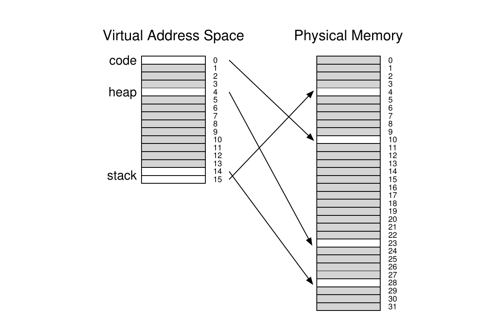
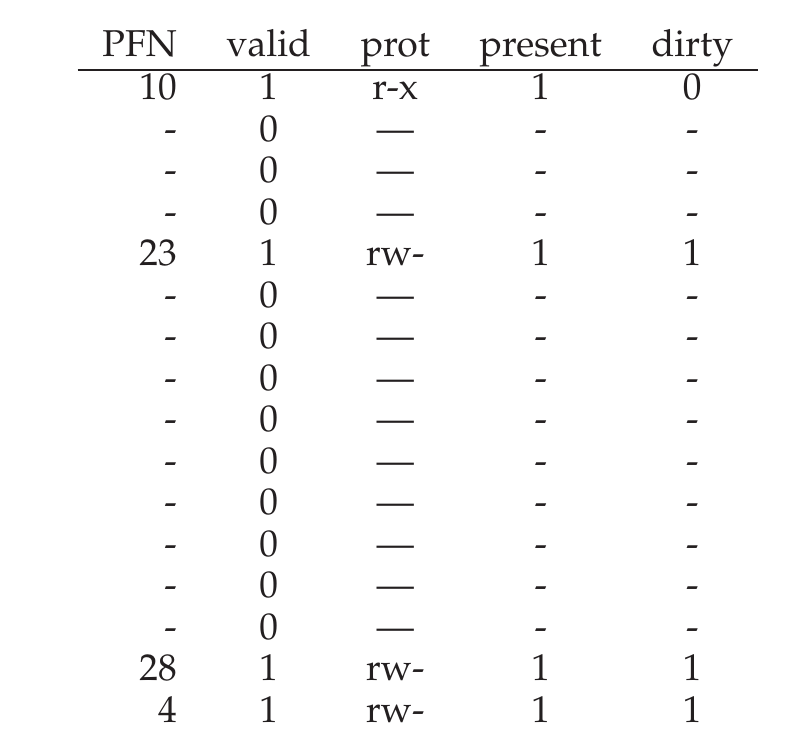
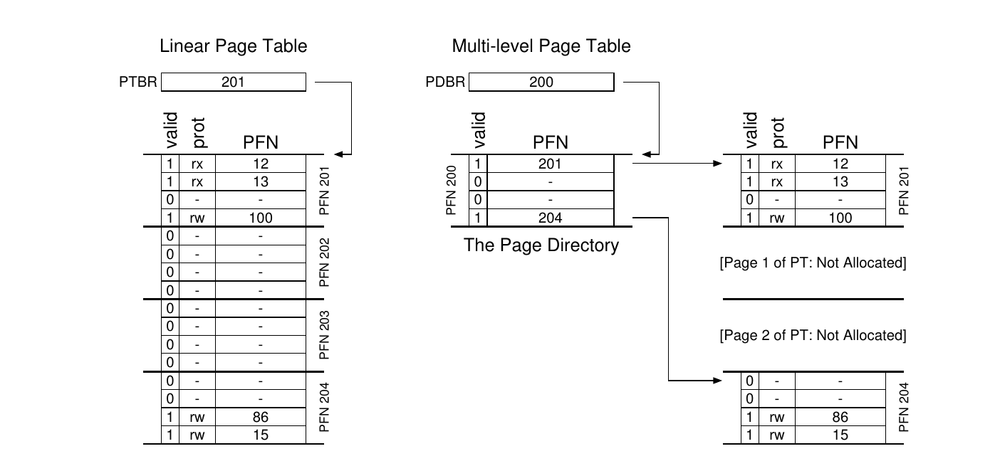
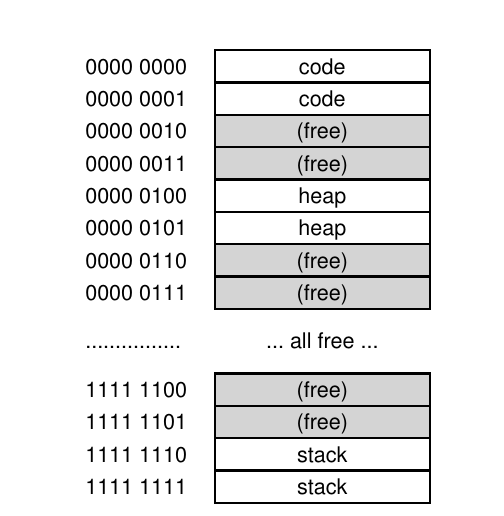
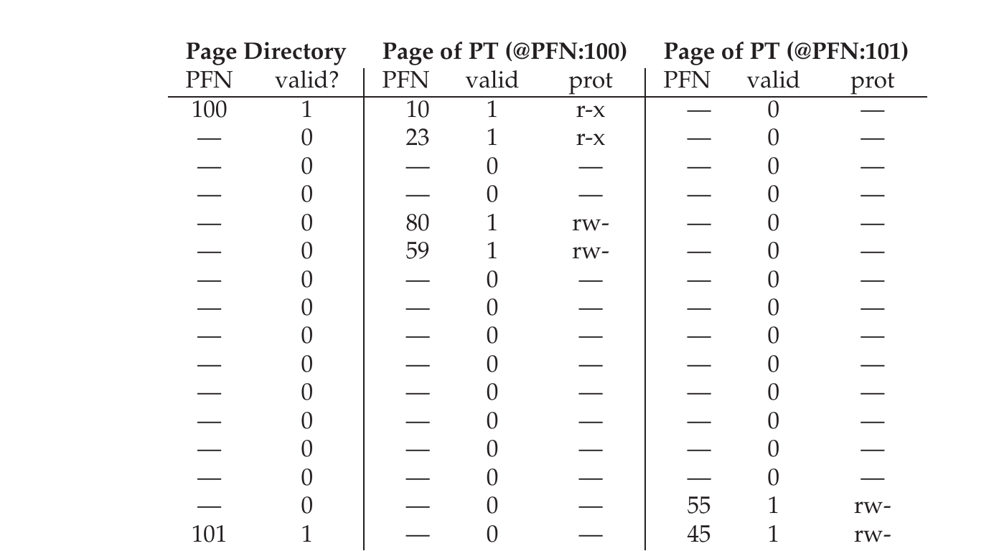

# 第 20 章 分页：较小的表

> 英文原题：*Paging: Smaller Tables*

分页引出的第二个麻烦，现在该摆上台面了：页表(page table)太大，吃内存太狠。我们还是从线性页表(linear page table)说起吧。你应该还记得[^1]，线性页表个头不小。再假设一个 32 位地址空间（$2^{32}$ 字节），页大小 4KB（$2^{12}$ 字节），每个页表项(page table entry, PTE) 4 字节。这样一个地址空间里大概有一百万个虚拟页（$\frac{2^{32}}{2^{12}}=2^{20}$）；再乘以页表项的大小，你瞧，我们的页表足足有 4MB。别忘了：系统里**每个进程**通常都有一张页表！要是有上百个活跃进程（现代系统上可不少见），光是页表就得吃掉几百兆内存！所以，我们得找些法子把这个沉重的包袱卸下来。这类技巧还不少，咱们这就开干。不过在动手之前，先看问题核心：

!!! danger "问题核心"
    **如何让页表变小？**

    简单的、基于数组的页表（通常叫线性页表）太大了，在典型系统上占的内存多到离谱。怎样才能把页表做小？关键思路有哪些？这些新数据结构又会带来哪些低效问题？

## 20.1 简单办法：更大的页

把页表做小，有个简单法子：用更大的页。还是那个 32 位地址空间，这次改成 16KB 的页。这样就有 18 位的 VPN 加 14 位的偏移量。假设每个 PTE 还是 4 字节，那么线性页表里就有 $2^{18}$ 个表项，整张表 1MB，缩小到了原来的四分之一（不奇怪，页大小翻了四倍，页表就缩小四倍，正好对应）。

不过，这招的大毛病是：大页会在每页内部造成浪费，也就是所谓的内部碎片(internal fragmentation)（浪费发生在分配单元**内部**）。结果应用程序分配了整页，却只用了其中一星半点，内存很快就被这些超大页塞满。所以，大多数系统在常见情况下用的页都偏小：4KB（x86 就是这样）或 8KB（SPARCv9 如此）。唉，我们的问题没法这么轻易地解决。

!!! note "边栏：多种页大小"
    顺便说一句，注意现在很多架构（比如 MIPS、SPARC、x86-64）都支持多种页大小。通常用小的（4KB 或 8KB）页。但如果某个"聪明"的应用程序提出请求，它可以为地址空间的某个特定区域使用单独的一个大页（比如 4MB）——这样一来，应用就能把一份高频使用（且体积大）的数据结构放进大页里，同时只占用一个 TLB 表项。这种大页用法在数据库管理系统和其他高端商业应用里很常见。不过，多种页大小的主要理由并不是省页表空间，而是减轻 TLB 的压力，让程序能访问更多地址空间而不至于频繁 TLB 缺失。然而，正如研究者们指出的 [N+02]，使用多种页大小会让操作系统的虚拟内存管理器明显复杂得多，所以有时最简单的大页用法，干脆就是直接向应用导出新接口，让它们自己申请大页。

## 20.2 混合方法：分页与分段

生活中你要是碰上两种都挺合理、又各不相同的做法，就该琢磨琢磨把它们结合起来，看看能不能两头的好处都占上。这种结合我们叫**混合(hybrid)**。比如说，巧克力或者纯花生酱，单吃哪个都不如把两者合起来做成那款可爱的混合体——Reese's 花生酱巧克力杯 [M28]——对吧？

多年前 Multics 的缔造者（尤其是 Jack Dennis）在构建 Multics 虚拟内存系统 [M07] 时就撞上了这么个点子。具体说，Dennis 想到把分页和分段结合起来，好把页表的内存开销降下来。我们细看一下典型的线性页表，就明白这为什么可能管用。假设有个地址空间，其中堆和栈用到的部分都很小。为了举例，我们用一个很小的 16KB 地址空间，页大小 1KB（图 20.1）；这个地址空间的页表见图 20.2。



*图 20.1：一个页大小为 1KB 的 16KB 地址空间。*

这个例子假设：唯一的代码页（VPN 0）映射到物理页 10，唯一的堆页（VPN 4）映射到物理页 23，地址空间另一头的两个栈页（VPN 14 和 15）分别映射到物理页 28 和 4。从图里能看到，页表大部分都没用到，塞满了无效表项。太浪费了！而这还只是一个 16KB 的迷你地址空间。想象一下 32 位地址空间的页表，里面得浪费多少空间！算了，别想这种事，太瘆人了。



*图 20.2：16KB 地址空间的页表。*

于是我们的混合方法就是：与其为整个进程地址空间搞一张页表，为什么不给每个逻辑段各来一张？在这个例子里，我们就会有三种页表，分别对应地址空间的代码、堆和栈。

现在回想一下分段：我们有个 base 寄存器，告诉我们每个段在物理内存的哪儿；还有个 bound（或 limit）寄存器，告诉我们那个段的大小。在混合方案里，这些结构仍然待在 MMU 里；只不过 base 不再指向段本身，而是保存那个段对应页表的物理地址。bounds 寄存器则用来标记页表的末尾（也就是它有多少个有效页）。

我们做个小例子说清楚。假设一个 32 位虚拟地址空间，页大小 4KB，地址空间切成四个段。这个例子里我们只用三个：代码、堆、栈各一个。

要判断一个地址属于哪个段，我们看地址空间的最高两位。假设 `00` 是未使用的段，`01` 给代码，`10` 给堆，`11` 给栈。于是虚拟地址长这样：

```text
  31 30 │ 29 28 27 26 25 24 23 22 21 20 19 18 17 16 15 14 13 12 │ 11 10 9 8 7 6 5 4 3 2 1 0
  └─Seg─┘└────────────────────────── VPN ──────────────────────┘└──────── Offset ─────────┘
```

硬件里假设就有三对 base/bounds，分别对应代码、堆、栈。进程运行时，每个段的 base 寄存器里放着该段线性页表的物理地址；于是系统里每个进程现在都关联着三张页表。上下文切换时，这些寄存器必须更新，以反映新运行进程的页表位置。

TLB 缺失时（假设是硬件管理的 TLB，即由硬件负责处理 TLB 缺失），硬件用段位(SN)来决定该用哪对 base/bounds。然后硬件取出其中的物理地址，按下面方式与 VPN 结合，形成页表项(PTE)的地址：

```c
SN             = (VirtualAddress & SEG_MASK) >> SN_SHIFT
VPN            = (VirtualAddress & VPN_MASK) >> VPN_SHIFT
AddressOfPTE   = Base[SN] + (VPN * sizeof(PTE))
```

这段代码看着应该眼熟；它和前面线性页表那儿几乎一模一样。唯一的区别，当然就是用三个段 base 寄存器里的某一个，代替了单一的页表 base 寄存器。

混合方案的关键区别在于：每个段都有一个 bounds 寄存器；每个 bounds 寄存器保存该段中最大有效页的值。比如，如果代码段用了头三页（0、1、2），那代码段页表只分配三个表项，bounds 寄存器就设为 3；访问超出段末尾的内存会触发异常，很可能导致进程被终止。这样一来，相比线性页表，我们的混合方法省下了可观的内存；栈和堆之间那些未分配的页不再占用页表空间（就为了让它们标记为无效而占地方）。

!!! tip "提示：善用混合"
    手里有两个都好、看起来还相互对立的点子时，你总该想想能不能把它们合成一个混合体，把两边的好处都拿到。举个例子，杂交玉米品种就比任何天然品种都更抗造。当然啦，不是所有杂交都是好主意；看看 Zeedonk（也叫 Zonkey），斑马和驴的杂交产物。要是你不信有这种生物，去查查，准备好惊掉下巴吧。

不过，你大概也注意到了，这法子不是没毛病。首先，它还是得用分段；我们前面讨论过，分段没那么灵活，因为它假设了地址空间的一种特定使用模式；比如说有个很大但用得稀稀拉拉的堆，我们照样会剩下一堆页表浪费。其次，这种混合做法会让外部碎片(external fragmentation)重新冒头。内存大部分还是按页大小管理的，可页表现在大小任意（是 PTE 的整数倍）。于是要在内存里给页表找空闲地方就更麻烦了。因为这些原因，人们继续寻找实现小页表的更好办法。

## 20.3 多级页表

另一种思路不依赖分段，却冲着同一个问题去：怎么把页表里那些无效区域统统干掉，而不是让它们赖在内存里？这套方法我们叫**多级页表(multi-level page table)**，它把线性页表变成了一棵树那样。这办法太管用了，许多现代系统都用它（比如 x86 [BOH10]）。下面就细细道来。

多级页表背后的基本思路很简单。第一步，把页表切成页大小的单元；然后，如果页表项(PTE)的整页都无效，那这一页页表干脆就不分配了。要记录页表的某一页是否有效（有效的话，它在内存哪儿），用一个新结构，叫**页目录(page directory)**。于是页目录要么告诉你页表的某一页在哪儿，要么告诉你那一页页表里全是无效页。图 20.3 给了一个例子。图的左边是经典的线性页表；哪怕地址空间中段大部分区域都无效，我们仍然得为那些区域留出页表空间（也就是页表中间那两页）。右边是多级页表。页目录只把两页页表标为有效（最头和最尾）；于是页表里只有那两页驻留内存。这样一来，你就能看出多级表在做啥的一个直观方式：它就是把线性页表的某些部分变没（把那些帧释放出来给别人用），并用页目录记录页表里哪些页被分配了。



*图 20.3：线性页表（左）与多级页表（右）。*

在简单的两级表里，页目录每一项对应页表的一页。它由若干**页目录项(page directory entry, PDE)** 组成。一个 PDE（至少）有一个有效位和一个物理帧号(PFN)，跟 PTE 差不多。不过，如前所述，这个有效位的含义略有不同：如果 PDE 有效，意味着它（通过 PFN）指向的那页页表里，至少有一个页是有效的，也就是这页里至少有一个 PTE 的有效位为 1。如果 PDE 无效（也就是等于 0），那 PDE 剩下的部分就未定义。

多级页表相比我们此前见过的方案，有几个明显的好处。首先，也许最明显的是：多级表分配的页表空间与你实际用到的地址空间量成正比；所以它通常很紧凑，能支撑稀疏地址空间。其次，如果构造得仔细，页表的每一部分都能整整齐齐地装进一页，内存管理因此更省事；操作系统要分配或扩充页表时，直接抓下一个空闲页就行。拿它跟简单的（非分页的）线性页表[^2] 对比一下：后者就是个按 VPN 索引的 PTE 数组；这种结构要求整张线性页表在物理内存里连续存放。对一张大页表（比如 4MB）来说，找这么大一块未用的连续空闲物理内存可不容易。有了多级结构，我们通过页目录加了一层间接，页目录指向页表的各个片段；这层间接让我们能把页表的页放到物理内存里的任意位置。

!!! tip "提示：理解时间-空间权衡"
    构建数据结构时，总该考虑一下构造上的时间-空间权衡。通常，你想让对某个数据结构的访问更快，就得为这结构付出更多空间的代价。

要注意，多级表是有代价的；TLB 缺失时，得从内存里加载两次才能拿到正确的转换信息（一次读页目录，一次读 PTE 本身），而线性页表只要加载一次。所以，多级表就是时间-空间权衡的一个小小例子。我们想要更小的表（也确实得到了），但不是白来的；虽然在常见情形（TLB 命中）下性能显然一样，但 TLB 缺失时，这张更小的表要付出更高的代价。

另一个明显缺点是复杂度。不管页表查找（在 TLB 缺失时）是硬件还是操作系统来管，做起来都比简单的线性页表查找更费劲。我们常常愿意为了提升性能、减少开销而增加复杂度；在多级表这个例子里，我们把页表查找搞复杂，是为了省下宝贵的内存。

### 一个详细的多级示例

为了更好理解多级页表背后的思路，我们来举个例子。想象一个 16KB 的小地址空间，页大小 64 字节。这样我们就有 14 位的虚拟地址空间，其中 8 位是 VPN，6 位是偏移量。线性页表会有 $2^8$（256）个表项，哪怕地址空间里只用了一小部分。图 20.4 给出了这样一个地址空间的例子。



*图 20.4：一个页大小为 64 字节的 16KB 地址空间。*

在这个例子里，虚拟页 0 和 1 归代码，虚拟页 4 和 5 归堆，虚拟页 254 和 255 归栈；地址空间其余的页都没用到。

要为这个地址空间建一张两级页表，我们从完整的线性页表出发，把它切成页大小的单元。记得吗，我们的整张表（在这个例子里）有 256 个表项；假设每个 PTE 4 字节。那么页表就是 1KB（$256 \times 4$ 字节）。既然页大小是 64 字节，这 1KB 的页表就能分成 16 个 64 字节的页；每页能装 16 个 PTE。

现在要搞懂的是，怎么拿一个 VPN 先索引页目录、再索引页表的那一页。记住两者都是表项数组；所以我们只要想清楚怎么用 VPN 的各个片段拼出各自的索引就行。

先索引页目录。这个例子里我们的页表很小：256 个表项，摊在 16 页上。页目录每页页表要一个表项；所以它有 16 个表项。于是我们需要 VPN 的 4 个位来索引目录；我们用 VPN 最高的 4 位，如下所示：

```text
              VPN (8 位)                        offset (6 位)
  13  12  11  10 │  9   8   7   6       5   4   3   2   1   0
  └── 页目录索引 (4 位) ──┘└─ VPN 剩余位 ─┘└────── 偏移量 ──────┘
```

一旦从 VPN 里抽出页目录索引（简称 PDIndex），就能用一个简单计算找到页目录项(PDE)的地址：$PDEAddr = PageDirBase + (PDIndex \times sizeof(PDE))$。这样就得到了页目录，接下来我们查看它，以继续推进转换。

如果页目录项被标为无效，我们就知道这次访问无效，于是抛异常。但如果 PDE 有效，就还有活儿要干。具体说，现在得从这个页目录项指向的那页页表里取出页表项(PTE)。要找这个 PTE，我们得用 VPN 剩下的位来索引页表的那一部分：

```text
              VPN (8 位)                        offset (6 位)
  13  12  11  10 │  9   8   7   6       5   4   3   2   1   0
  └─页目录索引─┘ └─ 页表索引 ─┘└────── 偏移量 ──────┘
```

这个页表索引（简称 PTIndex）随后可用来索引页表本身，给出 PTE 的地址：$PTEAddr = (PDE.PFN \ll SHIFT) + (PTIndex \times sizeof(PTE))$。

注意，从页目录项拿到的物理帧号(PFN)必须先左移到位，才能和页表索引拼起来，形成 PTE 的地址。

为了验证这一切是否说得通，我们接着用一些真实数值填一张多级页表，并转换一个虚拟地址。先从这个例子的页目录开始（图 20.5 左侧）。图中能看到，每个页目录项(PDE)描述了地址空间页表某一页的情况。在这个例子里，地址空间里有两个有效区域（一头一尾），中间是一堆无效映射。

在物理页 100（页表第 0 页的物理帧号）里，存着页表前 16 个 VPN 的头一页、共 16 个页表项。这一部分页表的内容见图 20.5（中间部分）。



*图 20.5：一个页目录，以及页表的一些片段。*

这一页页表包含前 16 个 VPN 的映射；在我们的例子里，VPN 0 和 1 有效（代码段），4 和 5 也有效（堆）。所以表里存着这些页的映射信息。其余表项都标为无效。

页表的另一个有效页在 PFN 101 里。这一页包含地址空间最后 16 个 VPN 的映射；细节见图 20.5（右侧）。

例子里，VPN 254 和 255（栈）有有效映射。希望大家能从例子里看出，用多级索引结构能省下多少空间。这个例子里，我们没有为线性页表分配全部 16 页，而只分配了 3 页：1 页给页目录，2 页给有有效映射的那些页表片段。对更大的（32 位或 64 位）地址空间，省下的量显然会更大。

最后，用这些信息做一次转换。这里有个地址，指向 VPN 254 的第 0 个字节：`0x3F80`，二进制是 `11 1111 1000 0000`。

记得我们会用 VPN 最高的 4 位来索引页目录。于是 `1111` 会选中上面页目录的最后一项（第 15 项，如果你从第 0 项数起）。它指向位于地址 101 的一个有效页表页。接着用 VPN 接下来的 4 位（`1110`）索引那页页表，找到想要的 PTE。`1110` 是那页的倒数第二项（第 14 项），告诉我们虚拟地址空间的第 254 页映射到物理页 55。把 PFN=55（十六进制 `0x37`）与偏移量 `000000` 拼接起来，我们就能拼出想要的物理地址，向内存系统发出请求：

$$PhysAddr = (PTE.PFN \ll SHIFT) + offset = 00\,1101\,1100\,0000 = \texttt{0x0DC0}$$

现在你应该对如何用页目录指向页表的各页、从而构造两级页表有了些概念。可惜，活还没干完。接下来要讨论的是，有时候两级页表还不够！

### 超过两级

到目前我们的例子里，都假设多级页表只有两级：一个页目录，然后是页表的各个片段。有些情况下，可以（确实也需要）用更深的树。

拿个简单例子说明为什么更深的多级表有用。这个例子里，假设我们有个 30 位的虚拟地址空间，页很小（512 字节）。那么虚拟地址就有 21 位的虚页号部分和 9 位的偏移量。

记住我们构造多级页表的目标：让页表的每一片都装进单独一页。到目前我们只考虑了页表本身；可要是页目录也变得太大，怎么办？

要确定多级表需要几级才能让页表的所有片段都装进一页，我们先算出每页能装多少个页表项。页大小 512 字节，假设 PTE 4 字节，你应该能看出一页能装 128 个 PTE。当我们索引页表的某一页时，就能得出需要 VPN 最低的 7 位（$\log_2 128$）作为索引：

```text
                               VPN                                         offset
  29 28 27 26 25 24 23 22 21 20 19 18 17 16 15 14 13 12 11 10 9 8 │ 7 6 5 4 3 2 1 0
  └──────────────────── 页目录索引 (14 位) ──────────────────────┘└─页表索引─┘└─偏移量(9位)─┘
```

从上面的图里你也许还注意到，剩给（庞大的）页目录多少位：14 位。如果页目录有 $2^{14}$ 个表项，它就不是占一页，而是占 128 页，于是我们"让多级页表每一片都装进一页"的目标就泡汤了。

为补救，我们再建一层树：把页目录本身切分成多页，然后在它上面再加一个页目录，指向页目录的那些页。于是虚拟地址可以这样切：

```text
                               VPN                                         offset
  29 28 27 26 25 24 23 22 21 20 19 18 17 16 15 14 │ 13 12 11 10 9 8 7 │ 6 5 4 3 2 1 0
  └──── 页目录索引 0 (7 位) ────┘└─ 页目录索引 1 (7 位) ─┘└ 页表索引 ┘└── 偏移量 (9 位) ──┘
```

现在，索引上层页目录时，我们用虚拟地址最高的那些位（图中 PD Index 0）；用这个索引从顶层页目录取出页目录项。如果有效，就把顶层 PDE 里的物理帧号与 VPN 的下一部分（PD Index 1）结合起来，去查第二级页目录。最后，如果仍有效，就用页表索引与第二级 PDE 里的地址拼出 PTE 地址。呼！这么多活儿，全都只是为了在多级表里查一次东西。

### 转换过程：别忘了 TLB

为了总结用两级页表做地址转换的整个过程，我们再次以算法形式给出控制流（图 20.6）。这张图画的是每次内存引用时，硬件里发生的事（假设是硬件管理的 TLB）。

```c
 1   VPN = (VirtualAddress & VPN_MASK) >> SHIFT
 2   (Success, TlbEntry) = TLB_Lookup(VPN)
 3   if (Success == True)          // TLB 命中
 4       if (CanAccess(TlbEntry.ProtectBits) == True)
 5           Offset   = VirtualAddress & OFFSET_MASK
 6           PhysAddr = (TlbEntry.PFN << SHIFT) | Offset
 7           Register = AccessMemory(PhysAddr)
 8       else
 9           RaiseException(PROTECTION_FAULT)
10   else                          // TLB 缺失
11       // 首先取页目录项
12       PDIndex = (VPN & PD_MASK) >> PD_SHIFT
13       PDEAddr = PDBR + (PDIndex * sizeof(PDE))
14       PDE     = AccessMemory(PDEAddr)
15       if (PDE.Valid == False)
16           RaiseException(SEGMENTATION_FAULT)
17       else
18           // PDE 有效：现在从页表取 PTE
19           PTIndex = (VPN & PT_MASK) >> PT_SHIFT
20           PTEAddr = (PDE.PFN << SHIFT) + (PTIndex * sizeof(PTE))
21           PTE     = AccessMemory(PTEAddr)
22           if (PTE.Valid == False)
23               RaiseException(SEGMENTATION_FAULT)
24           else if (CanAccess(PTE.ProtectBits) == False)
25               RaiseException(PROTECTION_FAULT)
26           else
27               TLB_Insert(VPN, PTE.PFN, PTE.ProtectBits)
28               RetryInstruction()
```

*图 20.6：多级页表的控制流。*

从图里可以看到，在发生任何复杂多级页表访问之前，硬件先检查 TLB；一旦命中，就直接拼出物理地址，根本不碰页表，和从前一样。只有在 TLB 缺失时，硬件才需要做完整的多级查找。在这条路径上，你能看到传统两级页表带来的代价：为了找到一次有效转换，要多做两次额外的内存访问。

## 20.4 反向页表

页表世界里，还有一种省空间省得更极端的东西，叫**反向页表(inverted page table)**。这里，我们不是搞很多页表（系统里每个进程一张），而是只保留一张页表，系统里每个物理页对应一个表项。表项告诉我们：哪个进程在用这个页，以及那个进程的哪个虚拟页映射到这个物理页。

现在要找到正确的表项，就得在这个数据结构里搜。线性扫描代价太高，所以通常会在底层结构之上建一张哈希表来加速查找。PowerPC 就是采用这种架构的一个例子 [JM98]。

更一般地说，反向页表印证了我们从一开始就说的：页表不过是数据结构。你可以拿数据结构玩出各种花样——做小、做大、变慢、变快。多级页表和反向页表，只是人们能玩的众多招法里的两个例子罢了。

## 20.5 把页表换出到磁盘

最后，我们放宽最后一个假设。到目前为止，我们都假设页表住在操作系统拥有的物理内存里。可是，就算我们已经使出这么多招数来缩小页表，它们仍有可能大到无法一次性全塞进内存。因此，有些系统把这类页表放进了内核虚拟内存，从而允许系统在内存吃紧时，把其中一些页表换到磁盘上。等我们更详细地弄懂如何把页换进换出内存之后，会在后面某一章（也就是 VAX/VMS 的案例研究）里再细讲这个话题。

## 20.6 小结

我们现在看到了真实的页表是怎么造出来的；它们不一定是简单的线性数组，而是更复杂的数据结构。这类表呈现的权衡在于时间和空间——表越大，TLB 缺失的响应越快，反过来也一样——所以到底选哪种结构，很大程度上取决于具体环境的约束。在一个内存吃紧的系统里（很多老系统就是如此），小结构才合理；而在一个内存还算宽裕、工作负载又活跃地用到大量页的系统里，一张更大、能加速 TLB 缺失的表，也许才是对的选择。有了软件管理的 TLB，整个数据结构的世界向操作系统创新者（提示：就是你）敞开了大门。你能想出什么新结构？它们解决什么问题？睡前想想这些问题吧，做那些只有操作系统开发者才敢做的大梦。

## 参考文献

- `[BOH10]` "Computer Systems: A Programmer's Perspective" by Randal E. Bryant and David R. O'Hallaron. Addison-Wesley, 2010. ——我们至今没找到关于多级页表的好的一手文献。不过 Bryant 和 O'Hallaron 这本出色的教材深入讲了 x86 的细节，而 x86 至少是个早期用过这种结构的系统。这本书本身也值得拥有。
- `[JM98]` "Virtual Memory: Issues of Implementation" by Bruce Jacob, Trevor Mudge. IEEE Computer, June 1998. ——一篇很棒的综述，讲了好些不同系统及其虚拟化内存的思路。关于 x86、PowerPC、MIPS 以及其他架构的细节多得很。
- `[LL82]` "Virtual Memory Management in the VAX/VMS Operating System" by Hank Levy, P. Lipman. IEEE Computer, Vol. 15, No. 3, March 1982. ——一篇极好的论文，讲的是一套经典操作系统 VMS 里真实的虚拟内存管理器。它好到——真的——几章之后我们会拿它来复习目前为止学过的所有虚拟内存知识。
- `[M28]` "Reese's Peanut Butter Cups" by Mars Candy Corporation. Published at stores near you. ——据说这款美味点心是 1928 年由 Harry Burnett Reese 发明的，他以前是个奶农，还给一位名叫 Milton S. Hershey 的人当过发货工头。至少维基百科是这么说的。若真如此，Hershey 和 Reese 大概恨透了彼此——任何两个巧克力大亨都该这样。
- `[N+02]` "Practical, Transparent Operating System Support for Superpages" by Juan Navarro, Sitaram Iyer, Peter Druschel, Alan Cox. OSDI '02, Boston, Massachusetts, October 2002. ——一篇不错的论文，展示了要把大页（也就是超级页）纳入现代操作系统，你得把哪些细节都弄对。可惜，没你想的那么容易。
- `[M07]` "Multics: History" Available: http://www.multicians.org/history.html. ——这个了不起的网站提供了大量关于 Multics 系统的历史资料，而 Multics 无疑是操作系统史上影响最深远的系统之一。书中引用了其中的一句话："MIT 的 Jack Dennis 为 Multics 的初创贡献了极具影响力的架构思想，尤其是把分页与分段结合起来的想法。"（出自第 1.2.1 节）

## 作业（模拟器）

这个小而有趣的作业，检验你是否搞懂了多级页表怎么工作。没错，对于上一句里"有趣"这个词的用法，是有争议的。程序名叫——也许毫不意外——`paging-multilevel-translate.py`；细节见 README。

### 问题

1. 用线性页表时，只要一个寄存器就能定位页表（假设 TLB 缺失时由硬件查找）。要定位一张两级页表，你需要几个寄存器？三级表呢？
2. 用模拟器，给定随机种子 0、1、2 执行地址转换，并用 `-c` 参数检查你的答案。每次查找需要多少次内存引用？
3. 基于你对缓存(cache)工作方式的了解，你认为对页表的内存引用在缓存里会表现如何？它们会导致大量缓存命中（因而访问很快？）还是大量缺失（因而访问很慢？）？

[^1]: 其实你也许根本不记得；分页这摊子事是不是越来越失控了？话虽如此，在扑向解决方案之前，永远要先确保你搞懂了要解决的问题；真的，只要你吃透了问题，往往自己就能推出答案。这里的问题应该很清楚：简单的线性（基于数组）页表太大了。

[^2]: 这里我们作了些假设，即所有页表都完完整整地待在物理内存里（也就是说没有换到磁盘上）；这个假设很快就放宽。
