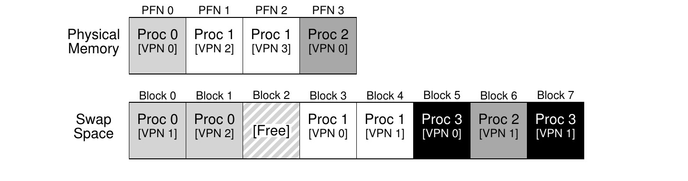

# 第 21 章 超越物理内存：机制

> 英文原题：*Beyond Physical Memory: Mechanisms*

到目前为止，我们假设地址空间小得不切实际，而且能整个塞进物理内存。事实上，我们一直假设每个运行进程的每个地址空间都装得进内存。现在，我们要放宽这些大假设，假定我们希望同时支持许多个又大又并发的地址空间。

要做到这一点，内存层次结构里得再加一层。到现在为止，我们都假定所有页都待在物理内存里。可是要支持大地址空间，操作系统就得有个地方，把地址空间里当前不那么吃香的部分先搁起来。一般来说，这种地方的特点是：容量比内存大；也正因如此，它通常更慢（要是它更快，我们干脆拿它当内存使不就得了？）。在现代系统里，这个角色通常由硬盘(hard disk drive)来扮演。于是在我们的内存层次里，又大又慢的硬盘坐镇最底层，内存则紧挨在它上面。于是，问题核心来了：

!!! danger "问题核心"
    **操作系统如何超越物理内存？**

    操作系统怎样才能利用一个更大、更慢的设备，透明地提供"拥有巨大虚拟地址空间"的假象？

你可能会问：我们为什么想给一个进程支持这么大的单个地址空间？答案还是那两个字——方便。有了大地址空间，你就不用操心内存里到底还有没有地方放程序的数据结构；你只管自然地写程序，需要多少内存就分配多少。这是操作系统提供的一记强力幻术，让你的日子好过太多。不客气！作为对比，看看那些用内存覆盖(memory overlay)的老系统：程序员得在需要的时候，手动把代码或数据搬进搬出内存 [D97]。想象一下那是什么体验：每调用一个函数、每访问一份数据之前，你都得先把对应代码或数据捣鼓到内存里；噁，别提了！

!!! note "边栏：存储技术"
    I/O 设备到底怎么干活，我们后面会讲得更深入（见讲 I/O 设备的那一章）。所以，稍安勿躁！而且，那个更慢的设备不一定非得是硬盘，也可以是更现代的东西，比如基于闪存的固态硬盘(SSD)。这些我们也会聊到。眼下你只需要假设，我们有一块又大又相对慢的设备，能帮我们撑起"一个超级大的虚拟内存、甚至比物理内存本身还大"的假象。

不只是单个进程——有了交换空间，操作系统就能为多个并发运行的进程撑起大虚拟内存的假象。多道程序设计(multiprogramming)（"同时"跑多个程序，以更好地利用机器）的发明，几乎必然要求具备把一些页换出的能力，因为早期机器显然无法同时装下所有进程需要的全部页。于是，多道程序设计和易用性这两股力量合在一起，就让我们想要支持"用比物理可用内存更多的内存"。这是所有现代虚拟内存系统都会做的事；现在，我们就来把它学明白。

## 21.1 交换空间

我们要做的第一件事，是在磁盘上留出一块空间，用来来回搬运页面。在操作系统里，我们一般把这种空间叫做**交换空间(swap space)**，因为我们把页从内存**换出(swap out)**到它那里，又从它那里**换入(swap in)**到内存。于是我们干脆假设，操作系统能以页为单位读写交换空间。要做到这一点，操作系统得记住某个页的磁盘地址。

交换空间的大小很重要，因为归根结底，它决定了系统在某一时刻最多能使用多少个内存页。为简单起见，我们暂且假设它非常大。

在下面这个小例子（图 21.1）里，你能看到一个 4 页物理内存配 8 页交换空间的小场面。例子里，三个进程（Proc 0、Proc 1 和 Proc 2）正在积极地共用物理内存；不过它们仨各自只有一部分有效页在内存里，其余的都在磁盘上的交换空间里。第四个进程（Proc 3）的所有页都被换出到磁盘了，因此它显然当前没在运行。交换空间还剩一块空闲。哪怕只看这个小例子，也希望你能看出：用上交换空间，系统就能假装自己的内存比实际的更大。



*图 21.1：物理内存与交换空间。*

需要提醒一句：交换空间并不是磁盘上唯一用来堆放交换流量的地方。比如，假设你在跑一个程序二进制文件（例如 `ls`，或者你自己编译的 `main` 程序）。这个二进制文件里的代码页最初就在磁盘上；程序运行时，它们被载入内存（要么在程序开始执行时一次性全部载入，要么像现代系统那样，用到哪页就载入哪页）。可是，如果系统需要腾出物理内存来满足其他需求，它就能放心地把这些代码页占的内存空间回收复用——因为它知道，之后还能从文件系统里那个磁盘上的二进制文件重新换入。

## 21.2 存在位

现在磁盘上有地方了，我们还需要在系统更上层加点机构，来支持页面的换入换出。为简单起见，我们假设系统用的是硬件管理的 TLB。

先回忆一下访问内存时会发生什么。运行中的进程会产生虚拟内存引用（取指令或访问数据），而在这种情形下，硬件负责把它们转换成物理地址，然后才从内存里取出想要的数据。

还记得吗，硬件先从虚拟地址里抽出 VPN，拿它去 TLB 里比对（TLB 命中）；一旦命中，就生成对应的物理地址，并从内存里取出数据。这应该就是最常见的情况了，毕竟它快（不需要额外的内存访问）。

如果 VPN 在 TLB 里找不到（也就是 TLB 缺失），硬件就（用页表基址寄存器(page table base register)）定位内存中的页表，再用 VPN 当索引，查这个页对应的页表项(PTE)。这一页要是有效、而且就在物理内存里，硬件就从 PTE 里取出 PFN，塞进 TLB，然后重试那条指令，这一次就能 TLB 命中了；到目前为止，一切安好。

可是，如果想让页能被交换到磁盘，我们就得再加更多机构。具体说，硬件查 PTE 时，可能发现这一页并不在物理内存里。硬件（在软件管理 TLB 的做法里则是操作系统）判断这件事，靠的是每个页表项里新加的一位信息，叫做**存在位(present bit)**。存在位若置 1，表示该页就在物理内存里，一切照上面走；若置 0，表示该页不在内存，而是存在磁盘上的某处。访问一个不在物理内存里的页，这种行为通常称为**缺页(page fault)**。

!!! note "边栏：交换术语以及其他一些事"
    虚拟内存系统里的术语可能会有点混乱，还会因机器和操作系统而异。比如说，缺页(page fault)更宽泛地讲，可以指任何一次查页表却引发了某种故障的引用：它可能包含我们这里讨论的这类故障（也就是页不在场的故障），但有时也会指非法内存访问。说真的，把一个毫无疑问合法的访问（访问一个已经映射进进程虚拟地址空间、只是当时不在物理内存里的页）叫做"fault（故障）"，本身就挺别扭；按理说，它该叫"page miss（页缺失）"才对。可人们平常说一个程序"在缺页(page faulting)"时，意思往往是它在访问自己虚拟地址空间里被操作系统换出到磁盘的那部分。

    我们猜，这种行为之所以被叫做"fault"，跟操作系统里处理它的那套机构有关。当某件不寻常的事发生，也就是硬件不知道怎么处理的状况出现时，硬件干脆把控制权交给操作系统，指望它能收拾局面。在这里，进程想访问的一页从内存里不见了；硬件能做的唯一一件事，就是抛出一个异常，然后由操作系统接手。因为这跟进程干了件非法的事时发生的状况一模一样，所以我们会把这种行为称作"fault"，大概也就不奇怪了。

一旦发生缺页，操作系统就被调用起来去服务这次缺页。一段特定的代码，叫做**缺页处理程序(page-fault handler)**，会运行起来，必须把这次缺页处理妥当，正如我们下面要讲的。

## 21.3 缺页

回想一下，处理 TLB 缺失时有两类系统：硬件管理的 TLB（硬件自己去查页表找所需的转换），以及软件管理的 TLB（操作系统来查）。无论哪一类，只要一页不在场，操作系统就被推上前台去处理缺页。名字起得很贴切的 OS 缺页处理程序运行起来，决定该怎么办。几乎所有系统都用软件处理缺页；哪怕是硬件管理的 TLB，硬件也信任操作系统去管好这件重要的差事。

如果一页不在场、而且已经被换到了磁盘，操作系统就得把这一页换入内存，才能服务这次缺页。于是问题来了：操作系统怎么知道该去哪儿找想要的那一页？在很多系统里，页表就是存这类信息的天然场所。所以，操作系统可以拿 PTE 里平时用来存数据（比如该页的 PFN）的那些位，改存磁盘地址。当操作系统收到某个页的缺页时，它就去 PTE 里找这个地址，然后向磁盘发请求，把这一页取回内存。

!!! note "边栏：为什么硬件不处理缺页"
    我们从 TLB 的经验里知道，硬件设计者特别不愿意把什么事都交给操作系统去做。那为什么他们却信任操作系统去处理缺页呢？主要就这么几条理由。第一，到磁盘的缺页很慢；哪怕操作系统处理一次缺页要花很久、执行一大堆指令，磁盘操作本身传统上实在太慢了，以至于跑软件那点额外开销微不足道。第二，要能处理缺页，硬件就得懂交换空间、懂怎么向磁盘发 I/O，还有一大堆它目前知之甚少的细节。所以，出于性能和简单这两方面考虑，缺页由操作系统来处理，就连硬件那帮人也能乐得清闲。

等磁盘 I/O 完成，操作系统就更新页表，把这一页标记为在场，更新页表项(PTE)的 PFN 字段，记录下这个新取回来的页落在内存的哪里，然后重试那条指令。这一次重试可能又造成一次 TLB 缺失，那就再服务一次，把转换信息写进 TLB（也可以在处理缺页时就顺手更新 TLB，省掉这步）。最后，再重启一次就能在 TLB 里找到转换信息，于是从转换后的物理地址处取出想要的数据或指令。

注意，在 I/O 进行期间，进程会处于阻塞状态。于是，在缺页被服务的同时，操作系统就能自由地去运行其他就绪进程。因为 I/O 很贵，把一个进程的 I/O（缺页）和另一个进程的执行重叠起来，又是多道程序设计系统更充分利用硬件的一种办法。

## 21.4 内存满了怎么办？

在上面描述的过程里，你可能注意到，我们假定有大量空闲内存，足以从交换空间换入一页。当然，情况未必如此；内存可能已经满了（或快满了）。于是操作系统也许想先换出一页或几页，为它即将引入的新页腾地方。挑选一页踢出去、也就是替换掉的过程，叫做**页替换策略(page-replacement policy)**。

事实证明，人们在打造好的页替换策略上花了不少心思，因为踢错了页会让程序性能付出惨重代价。做错决定，可能让一个程序以硬盘般的速度运行，而不是内存般的速度；以当前的技术水平，这意味着程序可能慢上 1 万倍乃至 10 万倍。所以，这种策略值得我们花点工夫仔细研究；而下一章要做的，恰恰就是这个。眼下，只要明白存在这么一种策略、它建立在本文描述的这些机制之上，就足够了。

## 21.5 缺页控制流

有了这些知识打底，我们现在可以大致勾画出访问内存的完整控制流。换句话说，当有人问你"程序从内存取数据时到底发生了什么？"，你心里应该对各条不同的可能路径都相当有数了。更多细节见图 21.2 和图 21.3 的控制流；前者展示硬件在转换期间做了什么，后者展示操作系统在缺页时做了什么。

从图 21.2 的硬件控制流图里，注意在 TLB 缺失时，现在有三种重要情况要弄明白。第一，这一页既在场又有效（第 18～21 行）；这种情况下，TLB 缺失处理程序直接从 PTE 里抓出 PFN，重试指令（这回就 TLB 命中了），然后像前面（讲过很多遍那样）继续下去。第二种情况（第 22～23 行），必须运行缺页处理程序；尽管这一页对进程来说访问是合法的（毕竟它有效），但它不在物理内存里。第三（也是最后一种），访问的可能是无效页，比如程序里的一个 bug 造成的（第 13～14 行）。这种情况下，PTE 里其他位都无关紧要了；硬件把这次非法访问陷入，操作系统陷阱处理程序运行，多半就把惹事的进程给终结了。

从图 21.3 的软件控制流里，我们能看出操作系统大致要做些什么来服务一次缺页。第一，操作系统得给这个即将被换入的页找一个物理帧落脚；要是找不到这样的页，我们就得等替换算法跑一遍，把一些页踢出内存，从而在这里腾出可用的空位。

```c
 1  VPN = (VirtualAddress & VPN_MASK) >> SHIFT
 2  (Success, TlbEntry) = TLB_Lookup(VPN)
 3  if (Success == True)                  // TLB 命中
 4      if (CanAccess(TlbEntry.ProtectBits) == True)
 5          Offset   = VirtualAddress & OFFSET_MASK
 6          PhysAddr = (TlbEntry.PFN << SHIFT) | Offset
 7          Register = AccessMemory(PhysAddr)
 8      else
 9          RaiseException(PROTECTION_FAULT)
10  else                                  // TLB 缺失
11      PTEAddr = PTBR + (VPN * sizeof(PTE))
12      PTE = AccessMemory(PTEAddr)
13      if (PTE.Valid == False)
14          RaiseException(SEGMENTATION_FAULT)
15      else
16          if (CanAccess(PTE.ProtectBits) == False)
17              RaiseException(PROTECTION_FAULT)
18          else if (PTE.Present == True)
19              // 假设是硬件管理的 TLB
20              TLB_Insert(VPN, PTE.PFN, PTE.ProtectBits)
21              RetryInstruction()
22          else if (PTE.Present == False)
23              RaiseException(PAGE_FAULT)
```

*图 21.2：缺页控制流算法（硬件）。*

有了物理帧在手，处理程序接着向交换空间发出读页的 I/O 请求。最后，这个慢吞吞的操作完成后，操作系统更新页表并重试那条指令。重试会造成一次 TLB 缺失，再重试一次就 TLB 命中，到这一步硬件就能访问到想要的东西了。

```c
1  PFN = FindFreePhysicalPage()
2  if (PFN == -1)                  // 没找到空闲页
3      PFN = EvictPage()           // 运行页替换算法
4  DiskRead(PTE.DiskAddr, PFN)     // 睡眠（等待 I/O）
5  PTE.present = True              // 用 present 位
6  PTE.PFN     = PFN               // 和转换信息 (PFN) 更新页表
7  RetryInstruction()              // 重试指令
```

*图 21.3：缺页控制流算法（软件）。*

## 21.6 替换究竟何时发生

到目前为止，我们描述替换的方式，都假定操作系统一直等到内存全部占满，才去替换（驱逐）一页，给别人腾地方。你能想象，这有点不切实际；操作系统有很多理由更主动地留一小块内存空闲着。

为了留一点内存空闲，大多数操作系统因此设有某种**高水位线(high watermark, HW)** 和**低水位线(low watermark, LW)**，用来帮忙决定什么时候开始从内存里驱逐页。它这样工作：当操作系统发现有可用的页少于 LW 个时，一个负责释放内存的后台线程就运行起来。这个线程驱逐页面，直到可用页数达到 HW。这个后台线程有时叫做**交换守护进程(swap daemon)** 或**页守护进程(page daemon)**[^1]，随后就去睡觉了，心满意足——它为运行进程和操作系统腾出了一些内存。

通过一次做掉一批替换，新的性能优化也就成了可能。比如，很多系统会把一批页**聚集(cluster)** 或归组，一次性写出到交换分区，从而提高磁盘效率 [LL82]；等我们后面更详细地讨论磁盘时会看到，这种聚集能减少磁盘的寻道和旋转开销，因而明显提升性能。

为了配合这个后台分页线程，图 21.3 的控制流该稍微改一改；算法不再直接执行替换，而是先简单检查有没有可用的空闲页。如果没有，它就通知后台分页线程"需要空闲页"；等线程腾出一些页后，再唤醒原来的线程，后者就能把想换入的页读进来，继续干活。

[^1]: "daemon"这个词，通常读作"demon"，是个老词，指一个在后台干有用的事的线程或进程。事实证明（又一次！）这个词的源头是 Multics [CS94]。

!!! tip "提示：在后台干活"
    手头有活要干时，把它放到后台去做往往是个好主意，既能提高效率，又便于把操作归组。操作系统经常在后台干活；比如，很多系统先把文件写入缓存在内存里，之后才真正把数据写到磁盘。这样做可能有诸多好处：提升磁盘效率，因为磁盘这下可能一次收到多笔写入，从而更好地调度它们；改善写入延迟，因为应用会觉得写入很快就完成了；有可能减少工作量，因为这些写入也许根本不必落到磁盘（比如文件被删了）；还能更好地利用空闲时间，因为后台工作可以在系统其他时候闲着的时候去做，从而更充分地利用硬件 [G+95]。

## 21.7 小结

在这个简短的章节里，我们引入了"访问比系统里物理存在的更多内存"这一概念。要做到这一点，页表结构里需要更多复杂度：必须包含某种存在位，来告诉我们这一页是否在内存里。不在时，操作系统的缺页处理程序运行起来服务这次缺页，从而安排把想要的页从磁盘搬到内存，也许得先替换掉内存里的某些页，为那些即将换入的页腾地方。

重要的是（也惊人地！）要记住，这些动作全都对进程透明地发生。对进程而言，它不过是在访问自己私有的、连续的虚拟内存。而在幕后，页被放在物理内存中任意的（不连续的）位置，有时它们甚至压根不在内存里，需要从磁盘取回。我们希望常见情况下内存访问是快的，但在某些情形下，服务一次访问得动用多次磁盘操作；像执行一条指令这样简单的事，在最坏情况下，也可能要花上好几毫秒才能完成。

## 参考文献

- `[CS94]` "Take Our Word For It" by F. Corbato, R. Steinberg. www.takeourword.com/TOW146 (Page 4). Richard Steinberg writes: "Someone has asked me the origin of the word daemon as it applies to computing. Best I can tell based on my research, the word was first used by people on your team at Project MAC using the IBM 7094 in 1963." Professor Corbato replies: "Our use of the word daemon was inspired by the Maxwell's daemon of physics and thermodynamics (my background is in physics). Maxwell's daemon was an imaginary agent which helped sort molecules of different speeds and worked tirelessly in the background. We fancifully began to use the word daemon to describe background processes which worked tirelessly to perform system chores."
- `[D97]` "Before Memory Was Virtual" by Peter Denning. In the Beginning: Recollections of Software Pioneers, Wiley, November 1997. —— 虚拟内存和工作集的先驱之一写的一篇精彩历史文章。
- `[G+95]` "Idleness is not sloth" by Richard Golding, Peter Bosch, Carl Staelin, Tim Sullivan, John Wilkes. USENIX ATC '95, New Orleans, Louisiana. —— 一篇有趣又好读的讨论，讲系统里如何更好地利用空闲时间，例子给得不少。
- `[LL82]` "Virtual Memory Management in the VAX/VMS Operating System" by Hank Levy, P. Lipman. IEEE Computer, Vol. 15, No. 3, March 1982. —— 这篇不是最早用页聚集的地方，但它清楚又简洁地讲明白了这种机制是怎么运作的。我们可真是频繁引用这篇论文啊！

## 作业（测量）

这次作业给你介绍一个新工具 `vmstat`，以及怎样用它来理解内存、CPU 和 I/O 的使用情况。在动手做下面的练习和问题之前，先读一读配套的 README，再看一看 `mem.c` 里的代码。

### 问题

1. 首先，打开两个连到同一台机器的独立终端，这样你就能在一个窗口里跑东西，同时观察另一个窗口。现在，在一个窗口里运行 `vmstat 1`，它每秒显示一次机器使用情况的统计。读一读手册页、配套的 README 以及任何你需要的信息，好理解它的输出。让这个窗口在下面所有练习期间一直跑着 `vmstat`。接下来，我们运行 `mem.c`，但只用很少的内存。键入 `./mem 1`（只使用 1 MB 内存）就能做到。运行 `mem` 时，CPU 使用情况统计有什么变化？user time 那一列的数字说得通吗？同时运行多个 `mem` 实例时，又会怎样变化？

2. 现在我们来观察运行 `mem` 时的一些内存统计。我们重点关注两列：`swpd`（使用的虚拟内存量）和 `free`（空闲内存量）。运行 `./mem 1024`（分配 1024 MB），观察这些值怎么变。然后杀掉这个正在运行的程序（键入 control-c），再观察这些值怎么变。你注意到这些值有什么特点？特别是，程序退出时 `free` 列怎么变？`mem` 退出时，空闲内存增加的量符合预期吗？

3. 接着我们看交换列（`si` 和 `so`），它们表示磁盘上交换进出的量有多大。当然，要激活这些列，你得用大内存跑 `mem`。首先，检查你 Linux 系统上有多少空闲内存（比如键入 `cat /proc/meminfo`；想了解 `/proc` 文件系统以及你能在那儿找到哪些信息，键入 `man proc`）。`/proc/meminfo` 最前面几条之一就是你系统的内存总量。假设大概是 8 GB；那么先运行 `mem 4000`（约 4 GB），观察 swap in/out 两列。它们给过非零值吗？然后用 5000、6000 等等再试。当程序进入第二个循环（以及之后的循环）时，这些值相比第一个循环有什么变化？在第二、第三以及后续循环里，总共换入换出了多少数据？（这些数字说得通吗？）

4. 做和上面一样的实验，但这次观察其他统计量（比如 CPU 利用率和块 I/O 统计）。运行 `mem` 时它们怎么变？

5. 现在我们来考察性能。给 `mem` 挑一个能舒舒服服装进内存的输入（比如系统内存是 8 GB 的话，就选 4000）。loop 0 要跑多久（以及之后的 loop 1、loop 2 等等）？现在挑一个明显超出内存大小的规模（同样假设 8 GB，就选 12000）。这里各个循环要跑多久？带宽数字对比如何？不停交换，和把一切都舒舒服服装进内存，性能差多少？你能画一张图吗——x 轴是 `mem` 使用的内存大小，y 轴是访问这些内存的带宽？最后，在"一切都装得进内存"和"装不进"两种情况下，第一个循环的性能相比后续循环如何？

6. 交换空间不是无限的。你可以用带 `-s` 标志的 `swapon` 工具查看有多少交换空间可用。如果你用越来越大的值运行 `mem`，超出交换空间看起来的可用量，会发生什么？内存分配在哪个点失败？

7. 最后，如果你比较进阶，可以用 `swapon` 和 `swapoff` 把你的系统配置成使用不同的交换设备。读一读手册页了解细节。如果你能接触到不同的硬件，看看交换到一块经典硬盘、一块基于闪存的 SSD，甚至一个 RAID 阵列时，交换性能会怎么变。较新的设备能把交换性能提升多少？你能多接近内存的性能？
