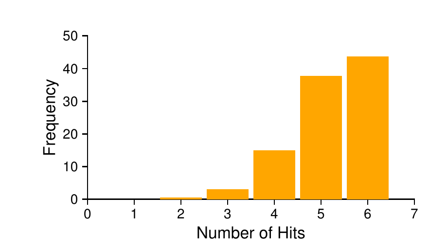
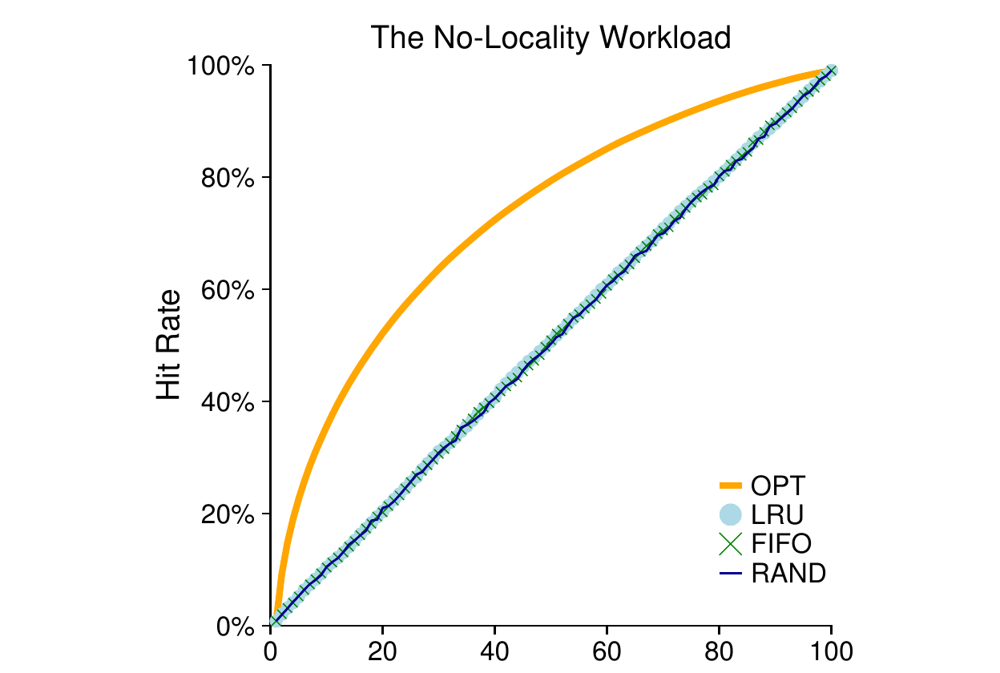
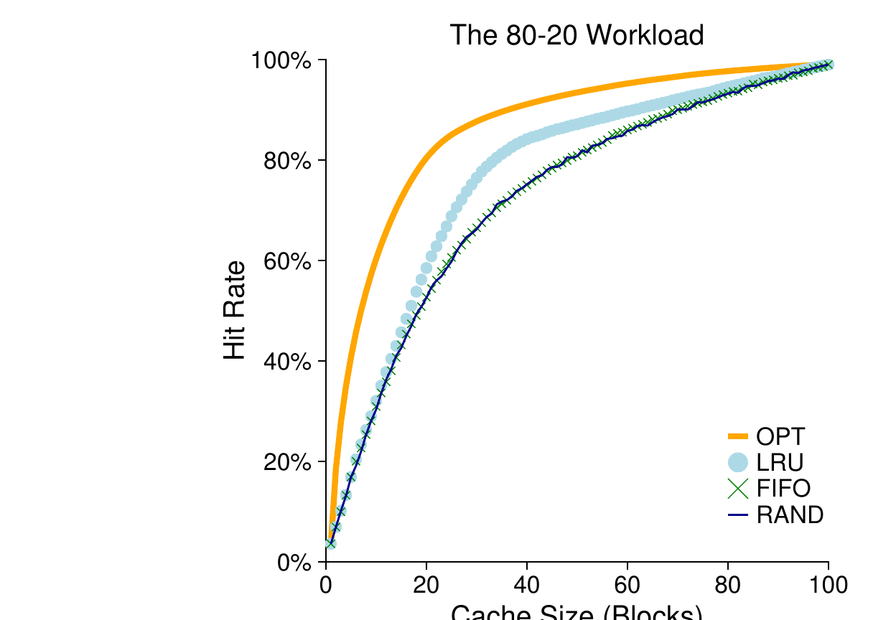
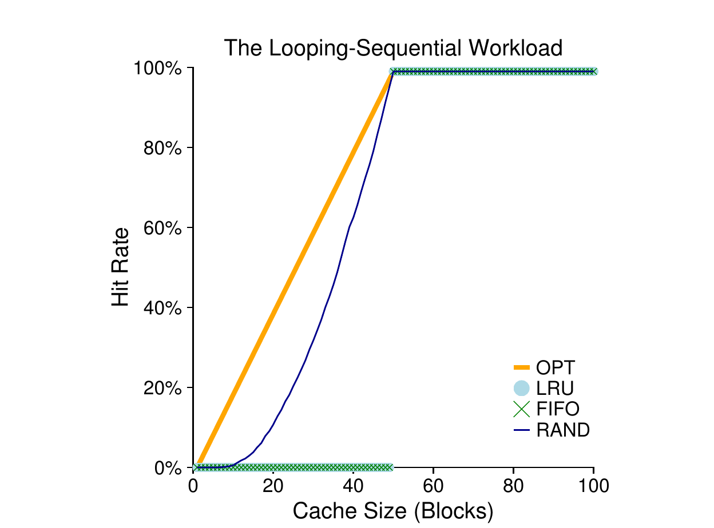
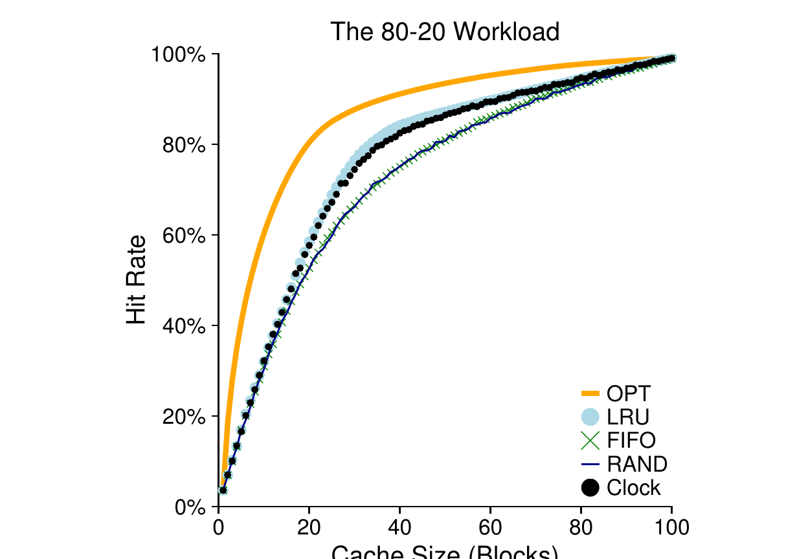

# 第 22 章 超越物理内存：策略

> 英文原题：*Beyond Physical Memory: Policies*

在虚拟内存管理器里，空闲内存充足的时候，日子过得可滋润了。缺页(page fault)一发生，你从空闲页链表(free-page list)上摘下一个空闲页，分配给触发缺页的那一页。嘿，操作系统，恭喜你！又搞定一桩。

可惜，空闲内存一少，事情就变得有意思多了。这时候，**内存压力(memory pressure)**会逼着操作系统把一些页**换出(paging out)**，好给正在活跃使用的页腾地方。决定该**驱逐(evict)**哪一页（或哪几页），就是操作系统**替换策略(replacement policy)**的活儿；在历史上，这可是早年虚拟内存系统做的最重要的决策之一——毕竟老机器物理内存少得可怜。退一步说，这也是一组足够有意思、值得多了解一点的策略。于是，我们的问题来了：

!!! danger "问题核心"
    **如何决定淘汰哪一页**

    操作系统怎样才能决定从内存里驱逐哪一页（或哪几页）？这个决策由系统的替换策略做出；它通常遵循一些通用原则（下面会讨论），同时也会带上若干微调，来避开那些边界情况下的怪异行为。

## 22.1 缓存管理

在深入讲策略之前，我们先把要解决的问题再描述得细一点。既然主存(main memory)只装着系统里所有页的一个子集，那么把它看作系统里各虚拟内存页的一级**缓存(cache)**，是完全说得通的。于是，为这个缓存挑选替换策略，目标就是让**缓存缺失(cache miss)**的次数最少，也就是把"必须从磁盘取页"的次数压到最低。换个说法，也可以把目标看成让**缓存命中(cache hit)**的次数最多，也就是"被访问的页正好在内存里"的次数最多。

知道了命中和缺失的次数，我们就能算出程序的**平均内存访问时间(average memory access time, AMAT)**（这是计算机体系结构专家为硬件缓存算的指标 [HP06]）。具体来说，有了这些值，程序的平均内存访问时间可以这样算：

$$AMAT = T_M + (P_{Miss} \cdot T_D) \tag{22.1}$$

其中 $T_M$ 表示访问内存的开销，$T_D$ 表示访问磁盘的开销，$P_{Miss}$ 是"在缓存里找不到数据"（也就是缺失）的概率；$P_{Miss}$ 从 0.0 变到 1.0，有时我们也用缺失率百分比而不是概率（比如 10% 的缺失率意味着 $P_{Miss} = 0.10$）。注意，访问内存的这笔开销你永远要付；可一旦缺页，你还得额外掏出一笔从磁盘取数据的开销。

举个例子，想象一台地址空间（小得可怜）的机器：4KB，页大小 256 字节。这样，一个虚拟地址就分成两部分：4 位的 VPN（最高位）和一个 8 位的偏移(offset)（最低位）。于是，这个例子里一个进程总共能访问 $2^4$、也就是 16 个虚拟页。在这个例子里，进程产生下面这些内存引用（也就是虚拟地址）：0x000、0x100、0x200、0x300、0x400、0x500、0x600、0x700、0x800、0x900。这些虚拟地址指向地址空间前十个页每一页的第一个字节（页号就是每个虚拟地址的最高位十六进制数字）。

再假设，除了虚拟页 3，其他所有页都已经在内存里。那么，我们这串内存引用会依次遇到这样的行为：命中、命中、命中、缺失、命中、命中、命中、命中、命中、命中。我们可以算出**命中率(hit rate)**（在内存里找到的引用所占百分比）：90%，因为 10 次引用里有 9 次在内存里。缺失率则是 10%（$P_{Miss} = 0.1$）。一般地，$P_{Hit} + P_{Miss} = 1.0$：命中率加缺失率正好是 100%。

要算 AMAT，我们得知道访问内存的开销和访问磁盘的开销。假设访问内存的开销（$T_M$）大约是 100 纳秒，访问磁盘的开销（$T_D$）大约是 10 毫秒，那么 AMAT 就是 $100ns + 0.1 \cdot 10ms$，也就是 $100ns + 1ms$，即 1.0001 毫秒，差不多 1 毫秒。可要是命中率换成 99.9%（$P_{Miss} = 0.001$），结果就大不一样了：AMAT 是 10.1 微秒，差不多快了 100 倍。当命中率逼近 100%，AMAT 就逼近 100 纳秒。

可惜，从这个例子里你能看到，现代系统里磁盘访问的开销实在太高了，哪怕缺失率极小，也会很快主导程序运行的整体 AMAT。显然，我们要么尽量避免缺失，要么就只能慢吞吞地按磁盘的速度跑。帮助改善这一点的办法之一，就是精心设计一个聪明的策略——现在我们这就来做。

## 22.2 最优替换策略

要更好地理解某个替换策略干得怎么样，拿它和理论上的最佳策略比一比，是很有用的。事实证明，这样的**最优(optimal)** 策略很多年前就被 Belady 提出来了 [B66]（他当年管它叫 MIN）。最优替换策略能让缺失总数最少。Belady 证明了：一种简单（但很不幸，实现起来巨难）的做法——驱逐"将来最晚才会被访问"的那一页——是最优的，能带来尽可能少的缓存缺失。

!!! tip "提示：与最优解比较很有用"
    虽然最优策略不太实用、不能真正拿来用，但作为仿真或其他研究里的一个比较基准，它有用得离谱。孤立地说"你那套花哨的新算法命中率有 80%"没啥意义；但要是说"最优能到 82%（所以你新方法已经很接近最优了）"，结果就更有意义，也更有参照。因此，在你做的任何研究里，知道了最优值是多少，你就能做更好的比较，看清还有多少改进空间，也清楚什么时候可以收手——因为它已经足够接近理想了 [AD03]。

希望你领会了最优策略背后的直觉。这么想吧：既然总得扔掉某一页，那为什么不扔掉"从现在起最晚才需要"的那一页呢？这么做，你实际上是在说：缓存里其他所有页都比那一页更重要。这个道理成立的原因很简单：你会在用到最晚的那一页之前，先用上其他所有页。

我们用一个简单例子走一遍，看看最优策略是怎么做决策的。假设一个程序访问下面这串虚拟页：0、1、2、0、1、3、0、3、1、2、1。图 22.1 展示了最优策略的行为，假设缓存能装三页。

在图中，你能看到这些动作。不出所料，前三次访问都缺失，因为缓存一开始是空的；这种缺失有时叫**冷启动缺失(cold-start miss)**（或**强制缺失(compulsory miss)**）。接着我们又访问了页 0 和页 1，两次都命中。最后，又撞上一次缺失（访问页 3），可这回缓存满了，必须来一次替换！于是问题来了：该替换哪一页？用最优策略，我们考察缓存里每一页（0、1、2）的未来，发现 0 马上就要被访问，1 稍晚一点，而 2 被访问的时间最晚。于是最优策略的选择很轻松：驱逐页 2，缓存里剩下 0、1、3。接下来三次引用都命中，但之后轮到页 2 时，我们早就把它赶走了，于是又吃一次缺失。

这里最优策略再次考察缓存里每一页（0、1、3）的未来，发现只要不驱逐页 1（它马上要被访问），就没问题。例子里展示的是驱逐页 3，其实选 0 也行。最后，我们命中页 1，这次追踪就结束了。

| 访问 | 命中？ | 驱逐 | 缓存状态 |
|---|---|---|---|
| 0 | 缺失 | | 0 |
| 1 | 缺失 | | 0, 1 |
| 2 | 缺失 | | 0, 1, 2 |
| 0 | 命中 | | 0, 1, 2 |
| 1 | 命中 | | 0, 1, 2 |
| 3 | 缺失 | 2 | 0, 1, 3 |
| 0 | 命中 | | 0, 1, 3 |
| 3 | 命中 | | 0, 1, 3 |
| 1 | 命中 | | 0, 1, 3 |
| 2 | 缺失 | 3 | 0, 1, 2 |
| 1 | 命中 | | 0, 1, 2 |

*图 22.1：追踪最优策略。*

我们还能算出这个缓存的命中率：6 次命中、5 次缺失，命中率是 $\frac{Hits}{Hits+Misses}$，也就是 $\frac{6}{6+5}$，约 54.5%。你还可以算"扣掉强制缺失后的命中率"（也就是忽略每个页的第一次缺失），结果是 85.7%。

可惜，就像我们之前研究调度策略时看到的那样，未来通常并不已知；你没法为通用操作系统造出最优策略[^1]。因此，在开发一个真能落地的策略时，我们得把注意力放在那些"另想办法决定驱逐谁"的做法上。于是，最优策略就只当个比较基准，用来衡量我们离"完美"还差多远。

!!! note "边栏：缓存缺失的类型"
    在计算机体系结构圈子里，体系结构专家有时喜欢按成因给缺失分类，分成三类：强制缺失、容量缺失和冲突缺失，有时也叫"三 C" [H87]。**强制缺失(compulsory miss)**（或冷启动缺失 [EF78]）之所以发生，是因为缓存一开始是空的、而这是对某项的第一次引用；与此相对，**容量缺失(capacity miss)** 之所以发生，是因为缓存空间用光了，必须驱逐一项才能把新项带进来。第三类缺失（**冲突缺失(conflict miss)**）出现在硬件里，源于"某一项能放在硬件缓存的哪个位置"存在限制，这跟所谓的组相联(set-associativity)有关；它不会出现在操作系统的页缓存里，因为这种缓存永远是全相联(fully-associative)的，也就是说，一页放在内存的哪个位置毫无限制。细节见 H&P [HP06]。

## 22.3 一个简单策略：FIFO

许多早期系统不去碰"如何逼近最优"这个复杂问题，而是采用了非常简单的替换策略。比如，有些系统用 **FIFO（先入先出，first-in, first-out）** 替换，页进入系统时就直接排进一个队列；发生替换时，站在队尾（也就是"最先入"）的那一页被驱逐。FIFO 有一个巨大的优点：实现起来相当简单。

我们来看看 FIFO 在那串著名的示例引用上表现如何（图 22.2）。追踪还是从对页 0、1、2 的三次强制缺失开始，接着 0 和 1 都命中。然后引用页 3，造成一次缺失；用 FIFO 的话，替换决策很简单：挑那个"最早进来的"页（图里的缓存状态按 FIFO 顺序排列，最先入的页在最左边），也就是页 0。可惜，我们下一次访问的偏偏就是页 0，又造成一次缺失和一次替换（这次换掉页 1）。接着我们命中页 3，但访问 1 和 2 时都缺失，最后命中页 3。

| 访问 | 命中？ | 驱逐 | 缓存状态 |
|---|---|---|---|
| 0 | 缺失 | | 队首→ 0 |
| 1 | 缺失 | | 队首→ 0, 1 |
| 2 | 缺失 | | 队首→ 0, 1, 2 |
| 0 | 命中 | | 队首→ 0, 1, 2 |
| 1 | 命中 | | 队首→ 0, 1, 2 |
| 3 | 缺失 | 0 | 队首→ 1, 2, 3 |
| 0 | 缺失 | 1 | 队首→ 2, 3, 0 |
| 3 | 命中 | | 队首→ 2, 3, 0 |
| 1 | 缺失 | 2 | 队首→ 3, 0, 1 |
| 2 | 缺失 | 3 | 队首→ 0, 1, 2 |
| 1 | 命中 | | 队首→ 0, 1, 2 |

*图 22.2：追踪 FIFO 策略。*

拿 FIFO 和最优比，FIFO 明显更差：命中率 36.4%（扣掉强制缺失后是 57.1%）。FIFO 根本判断不出一页的重要性：哪怕页 0 已经被访问过好几次，FIFO 照样把它踢出去，就因为它是第一个被带进内存的。

!!! note "边栏：Belady 异常"
    Belady（就是提出最优策略那位）和同事发现过一串表现有点出乎意料的内存引用序列 [BNS69]。那串引用是：1、2、3、4、1、2、5、1、2、3、4、5。他们研究的替换策略是 FIFO。有意思的地方在于：当缓存大小从 3 页变成 4 页时，命中率会怎么变？

    一般你会觉得，缓存变大，命中率应该上升（变得更好）。可在这个例子里，用 FIFO 反而更差了！自己动手算算命中和缺失就明白了。这种古怪行为一般被称作 **Belady 异常(Belady's Anomaly)**（他的合著者对此很是恼火）。

    别的策略，比如 LRU，就没这个毛病。你能猜到为什么吗？原来，LRU 具备所谓的**栈属性(stack property)** [M+70]。具备这个性质的算法，大小为 $N+1$ 的缓存天然就包含大小为 $N$ 的缓存里的内容。于是，增大缓存，命中率要么不变、要么变好。FIFO 和随机（Random）就明摆着不满足栈属性，因此容易出这种反常行为。

## 22.4 另一个简单策略：随机

还有一个类似的替换策略叫随机(Random)，它在内存吃紧时随便挑一页来替换。随机的性质跟 FIFO 差不多：实现简单，但它真的没打算在"驱逐哪些页"上动多少脑筋。我们来看看随机在那串著名示例引用上表现如何（见图 22.3）。

当然，随机表现如何，完全看它运气好不好。在上面这个例子里，随机比 FIFO 稍好一点，比最优稍差一点。其实，我们可以把随机实验跑上几千遍，看看它总体上到底行不行。图 22.4 展示了随机在 10,000 次试验里各命中多少次，每次用不同的随机种子。正如你所见，有时候（略多于 40% 的时候）随机和最优一样好，在这串示例上能拿到 6 次命中；有时候则差得多，只有 2 次命中甚至更少。随机行不行，全看抽签的运气。

| 访问 | 命中？ | 驱逐 | 缓存状态 |
|---|---|---|---|
| 0 | 缺失 | | 0 |
| 1 | 缺失 | | 0, 1 |
| 2 | 缺失 | | 0, 1, 2 |
| 0 | 命中 | | 0, 1, 2 |
| 1 | 命中 | | 0, 1, 2 |
| 3 | 缺失 | 0 | 1, 2, 3 |
| 0 | 缺失 | 1 | 2, 3, 0 |
| 3 | 命中 | | 2, 3, 0 |
| 1 | 缺失 | 3 | 2, 0, 1 |
| 2 | 命中 | | 2, 0, 1 |
| 1 | 命中 | | 2, 0, 1 |

*图 22.3：追踪随机策略。*

图 22.4 是随机在 10,000 次试验里命中次数的分布，横轴是命中次数，纵轴是频率（次数）：

*图 22.4：随机策略在 10,000 次试验中的表现。*

## 22.5 利用历史：LRU

可惜，任何像 FIFO 或者随机这么简单的东西，都很可能有个通病：它可能踢掉一个重要页面，也就是马上就要被再次引用的那页。FIFO 踢的是最早被带进来的页；要是那页碰巧压着重要的代码或数据结构，那它照样被扔出去，哪怕它很快又会被换进来。于是，FIFO、随机之类都很难逼近最优；得有点更聪明的东西才行。

跟我们在调度策略里做的一样，想更准地猜未来，我们又一次倚仗过去——把历史当作向导。比如，一个程序最近访问过某页，那它很可能在不远的将来还要再访问它。

替换策略能用的一类历史信息是**频率(frequency)**；要是一页被访问过很多次，也许就不该换掉它，因为它显然有点价值。更常用的一页属性是它的**新近程度(recency of access)**；一页越是被最近访问过，也许就越可能被再次访问。这一族策略基于人们所称的**局部性原理(principle of locality)** [D70]，说白了，它不过是对程序及其行为的一种观察。这个原理讲得很直白：程序往往相当频繁地访问某些代码序列（比如一个循环）和数据结构（比如循环访问的某个数组）；因此我们应当借助历史来判断哪些页重要，并在需要驱逐的时候把这些页留在内存里。

于是一族简单的、基于历史的算法就诞生了。**最不经常使用(Least-Frequently-Used, LFU)** 策略在必须驱逐时换掉使用频率最低的那页。类似的，**最近最少使用(Least-Recently-Used, LRU)** 策略换掉最久没被使用的那页。这些算法好记得很：一旦你知道名字，你就知道它干啥——对一个名字来说，这是极好的品质。

要更好地理解 LRU，我们来看看 LRU 在那串示例引用上表现如何。

!!! note "边栏：局部性的类型"
    程序往往表现出两种局部性。第一种叫**空间局部性(spatial locality)**，意思是：如果访问了页 $P$，那么它附近的页（比如 $P-1$ 或 $P+1$）也很可能被访问。第二种叫**时间局部性(temporal locality)**，意思是：最近访问过的页，很可能在不远的将来又被访问。正是对这两类局部性存在的假设，在硬件系统的缓存层级里扮演着重要角色——硬件为此部署了多层指令缓存、数据缓存和地址转换缓存，好在局部性存在时让程序跑得快。

    当然，这个常被称作局部性原理的东西，并不是所有程序都必须遵守的硬性规矩。事实上，有些程序访问内存（或磁盘）的方式相当随机，其访问序列里没什么局部性、甚至完全没有。因此，虽然在设计任何缓存（硬件或软件）时，把局部性记在心上都是好事，但它并不保证一定成功。它更像一条启发式经验，在计算机系统设计里往往确实管用。

图 22.5 给出了结果。从图里可以看到，LRU 如何利用历史，做得比随机、FIFO 这些"无状态"策略更好。例子里，LRU 在第一次不得不替换时驱逐了页 2，因为 0 和 1 更晚才被访问过；接着它替换了页 0，因为 1 和 3 更晚才被访问过。两次决策都基于历史，而且事后证明都对了，接下来的引用因此都是命中。于是，在这个例子里，LRU 表现到不能再好，性能追平了最优[^2]。

| 访问 | 命中？ | 驱逐 | 缓存状态 |
|---|---|---|---|
| 0 | 缺失 | | LRU→ 0 |
| 1 | 缺失 | | LRU→ 0, 1 |
| 2 | 缺失 | | LRU→ 0, 1, 2 |
| 0 | 命中 | | LRU→ 1, 2, 0 |
| 1 | 命中 | | LRU→ 2, 0, 1 |
| 3 | 缺失 | 2 | LRU→ 0, 1, 3 |
| 0 | 命中 | | LRU→ 1, 3, 0 |
| 3 | 命中 | | LRU→ 1, 0, 3 |
| 1 | 命中 | | LRU→ 0, 3, 1 |
| 2 | 缺失 | 0 | LRU→ 3, 1, 2 |
| 1 | 命中 | | LRU→ 3, 2, 1 |

*图 22.5：追踪 LRU 策略。*

我们也该提一句，这些算法都有反过来的版本：**最经常使用(Most-Frequently-Used, MFU)** 和 **最近最常使用(Most-Recently-Used, MRU)**。大多数情况下（不是全部！）这些策略都不太行，因为它们无视了大多数程序表现出的局部性——本该拥抱它，却把它扔一边。

## 22.6 负载示例

我们再看几个例子，好更清楚地理解某些策略的行为。这一节我们要考察比小追踪序列更复杂的负载(workload)。不过这几种负载也是大幅简化过的；更严谨的研究应该用真实应用的内存访问序列。

我们的第一个负载没有局部性，也就是说，每次引用都落在"被访问页集合"里的一个随机页上。在这个简单例子里，负载会随着时间访问 100 个不同的页，随机挑下一个要引用的页；总体上访问 10,000 次。实验中，我们把缓存大小从很小（1 页）一直变到足够装下所有不同的页（100 页），好看看每个策略在整段缓存大小范围内的表现。

*图 22.6：无局部性负载。*

图 22.6 画出了最优、LRU、随机和 FIFO 的实验结果。图的纵轴是各策略取得的命中率；横轴按上面说的方式变化缓存大小。

从这张图我们能得出若干结论。第一，当负载没有局部性时，用哪个现实策略其实关系不大；LRU、FIFO 和随机表现完全一样，命中率完全由缓存大小决定。第二，当缓存大到足以装下整个负载时，用哪个策略也无所谓；当所有被引用的块都能装进缓存时，所有策略（连随机也算）都收敛到 100% 命中率。最后，你能看到最优明显比现实策略强出一截：如果真能偷看一眼未来，替换会做得好得多。

下一个要考察的负载叫"80-20"负载，它表现出局部性：80% 的引用落在 20% 的页（"热"页）上，剩下的 20% 引用落在另外 80% 的页（"冷"页）上。我们的负载里同样是总共 100 个不同的页；于是"热"页大部分时间都被引用，"冷"页则是剩下的部分。图 22.7 展示了各策略在这个负载上的表现。

*图 22.7：80-20 负载。*

从图里可以看到，随机和 FIFO 都还过得去，但 LRU 更好，因为它更可能把热页攥在手里；这些页过去被频繁引用，将来也很可能再被引用。最优则再次胜出，说明 LRU 掌握的历史信息并不完美。

现在你可能会犯嘀咕：LRU 相对随机和 FIFO 的这点提升，真有那么大意义吗？答案照旧是"看情况"。如果每次缺失都很昂贵（这并不罕见），那么命中率哪怕只提升一点点（缺失率稍微降一点），对性能都可能有巨大影响。可要是缺失没那么贵，那 LRU 能带来的好处当然也就没那么重要了。

我们再看最后一个负载。我们管它叫"循环顺序"负载：按顺序引用 50 个页，从 0 开始，然后 1、……直到页 49，接着循环重复这些访问，总共对 50 个不同的页访问 10,000 次。图 22.8 的最后一张图画出了各策略在这个负载下的行为。

*图 22.8：循环负载。*

这个负载在许多应用里都很常见（包括数据库这类重要的商业应用 [CD85]），对 LRU 和 FIFO 来说都是最坏情况。这两个算法在循环顺序负载下会踢掉较老的页；很不巧，由于负载的循环特性，这些较老的页会比策略们偏爱保留的页更早被访问到。事实上，哪怕缓存大到 49 页，面对 50 页的循环顺序负载，命中率也是 0%。有意思的是，随机明显表现更好，虽不算逼近最优，但至少拿到非零的命中率。看来随机还真有些不错的性质；其中一条就是不搞那些古怪的边界行为。

## 22.7 实现历史类算法

如你所见，像 LRU 这样的算法通常比 FIFO、随机这类简单策略干得好，后者可能把重要的页扔出去。可惜，基于历史的策略给我们抛来一个新难题：该怎么实现它们？

拿 LRU 举例。要完美实现它，得做一大堆活儿。具体来说，每次页访问（也就是每次内存访问，不管是取指令，还是加载或存储），我们都必须更新某个数据结构，把这一页挪到链表最前面（也就是 MRU 那一端）。相比之下，FIFO 的页链表只在页被驱逐（把最先入的页摘掉）或新页加入链表（加到末尾端）时才被碰一碰。要跟踪哪些页最久没用、哪些最近用过，系统就得在**每一次内存引用**上做点记账工作。显然，稍不留神，这种记账就会把性能大幅拖垮。

能帮忙加速的一个办法，是加点硬件支持。比如，机器可以在每次页访问时更新内存里的一个时间字段（例如，这字段可以放在每进程页表里，也可以就放在内存里某个单独的数组里，每个物理页对应一个条目）。这样，页被访问时，硬件就把时间字段设成当前时间。等要替换时，操作系统只要扫描系统里所有时间字段，找出最近最少使用的那页就行了。

!!! danger "问题核心"
    **如何实现 LRU 替换策略**

    既然实现完美的 LRU 代价高昂，我们能不能用某种方式去近似它，同时仍然得到想要的行为？

## 22.8 近似 LRU

事实证明，答案是肯定的：从计算开销的角度看，近似 LRU 更可行，许多现代系统也确实这么干。这个思路需要一点硬件支持，形式就是**使用位(use bit)**（有时也叫**引用位(reference bit)**）；它最早出现在第一个采用分页的系统——Atlas 一级存储 [KE+62] 里。系统里每一页对应一个使用位，这些位住在内存某处（比如可以放在每进程页表里，也可以就放在某个数组里）。只要一页被引用（也就是被读或被写），硬件就把它的使用位设成 1。不过硬件从不负责清位（也就是置 0），那是操作系统的活儿。

操作系统怎么用使用位来近似 LRU 呢？办法可以有很多，而**时钟算法(clock algorithm)** [C69] 给出了一个简单的做法。想象把系统里所有页排成一个环状链表，一根**时钟指针(clock hand)** 一开始指向某一页（指向哪页其实无所谓）。当必须替换时，操作系统检查当前指向的页 P 的使用位是 1 还是 0。如果是 1，说明页 P 最近被用过，不是替换的好人选。于是把 P 的使用位清 0，并把时钟指针推进到下一页（$P+1$）。算法继续下去，直到找到一个使用位为 0 的页——说明这页最近没用过（或者，最坏情况下所有页都用过，我们已经扫过了整圈，把所有的位都清掉了）。

注意，这不是用使用位来近似 LRU 的唯一办法。事实上，任何"周期性清空使用位、再根据使用位是 1 还是 0 来区分该替换哪些页"的做法都行。Corbato 的时钟算法只是早期的一个做法，它取得了一些成功，还有个不错的特点：不用一遍遍扫遍整个内存去找一个没被用过的页。

!!! note "译注"
    与图 22.7 类似，这里直接使用原书截图。

*图 22.9：带时钟算法的 80-20 负载。*

图 22.9 展示了时钟算法某个变体的行为。这个变体在替换时随机扫描各页；遇到引用位为 1 的页，就把该位清掉（置 0）；遇到引用位为 0 的页，就选它当牺牲者。如你所见，它虽然做不到完美 LRU 那么好，但比那些完全不考虑历史的做法要好。

## 22.9 考虑脏页

对时钟算法还有一处常见的小改动（同样由 Corbato 最早提出 [C69]）：额外考虑一页在内存期间有没有被修改过。理由在于：如果一页被改过、也就是**脏(dirty)** 了，那驱逐它时必须把它写回磁盘，这很贵。如果它没被改过（也就是**干净(clean)**），驱逐就是免费的：那个物理帧直接拿去干别的就行，不用额外的 I/O。于是，有些虚拟内存系统更愿意驱逐干净的页，而不是脏页。

为了支持这个行为，硬件应当包含一个**修改位(modified bit)**（也就是**脏位(dirty bit)**）。只要一页被写入，这位就被置上，从而可以纳入页替换算法。比如时钟算法可以改成：先扫"既没用过又干净"的页来驱逐；找不到的话，再考虑"没用过但是脏"的页，以此类推。

## 22.10 其他 VM 策略

页替换并不是虚拟内存子系统采用的唯一策略（虽说它可能最重要）。比如，操作系统还得决定**什么时候**把一页带进内存。这个策略有时叫**页选择策略(page selection policy)**（Denning 当年就是这么叫的 [D70]），它给了操作系统一些不同的选择。

对大多数页来说，操作系统干脆用**按需分页(demand paging)**，也就是页被访问时才把它带进内存——名副其实的"按需"。当然，操作系统也可以猜某一页即将被用到，从而提前把它带进来；这种行为叫**预取(prefetching)**，只有当成功的把握比较大时才该这么干。比如，有些系统会假设：如果代码页 P 被带进内存，那么代码页 $P+1$ 很可能马上也会被访问，于是也该被带进内存。

还有一个策略决定操作系统如何把页写回磁盘。当然，它们可以简单地一页一页写；可许多系统宁愿把一批待写的页先在内存里攒起来，再用一次（更高效的）写操作把它们一起写到磁盘。这种行为通常叫**聚簇(clustering)**，或者干脆就叫写的**分组(grouping)**；它之所以有效，是因为磁盘驱动器的天性——一次大的写比很多次小的写更高效。

## 22.11 抖动

收尾之前，我们还有最后一个问题要处理：当内存就是被超额订购(oversubscribed)了、一组运行进程的内存需求干脆超过了可用的物理内存时，操作系统该怎么办？这种情况下，系统会不停地换页，这种状态有时叫**抖动(thrashing)** [D70]。

一些早期操作系统有一套相当精巧的机制，既能检测、又能应对抖动。比如，给定一组进程，系统可以决定不去运行其中一部分进程，希望缩小后的进程集合的工作集(working set)（也就是它们正在活跃使用的那批页）能装进内存，从而能往前推进。这种做法一般叫**准入控制(admission control)**，它的主张是：有时候少干点活把它干好，比试图一口气全干、结果全干砸要强——这种局面我们在现实生活里、也在现代计算机系统里（很遗憾）经常撞见。

有些当代系统对内存过载采取了更狠的做法。比如，某些版本的 Linux 在内存超额时会运行一个**内存不足杀手(out-of-memory killer)**；这个守护进程挑一个吃内存大户的进程，把它干掉，用毫不含蓄的方式把内存降下来。虽说这招在减轻内存压力上挺成功，却可能惹出麻烦——比如，它要是把 X server 干掉了，那么所有需要显示的应用就全都歇菜了。

## 22.12 小结

我们介绍了一堆页替换（以及别的）策略，它们是所有现代操作系统虚拟内存子系统的一部分。现代系统会给时钟这类直白的 LRU 近似加点微调；比如，**抗扫描性(scan resistance)** 是许多现代算法（比如 ARC [MM03]）的重要一环。抗扫描的算法通常长得像 LRU，但也试图避开 LRU 的最坏情况——就是我们在循环顺序负载里见到的那个。于是，页替换算法的演化仍在继续。

不过，很多时候这类算法的重要性已经下降了，因为内存访问和磁盘访问的时间差距越拉越大。既然换页到磁盘这么贵，频繁换页的开销就高得让人吃不消。于是，对付过度换页的最佳方案往往是个简单得（在智力上令人不爽）的办法：买更多内存。

[^1]: 要是你能做到，请告诉我们！咱们可以一起发财。再不济，也能像那些"发现"冷聚变的科学家一样，被广泛唾弃和嘲笑 [FP89]。

[^2]: 好吧，结果是我们"烹饪"（编造）出来的。但有时候，为了说明一个道理，烹饪也在所难免。

## 参考文献

[AD03] “Run-Time Adaptation in River” by Remzi H. Arpaci-Dusseau. ACM TOCS, 21:1, February 2003. 这是本书作者之一关于一个名为 River 的系统的博士论文工作总结；在里边，他明白了"与理想做法作比较"是系统设计者的一项重要技巧。

[B66] “A Study of Replacement Algorithms for Virtual-Storage Computer” by Laszlo A. Belady. IBM Systems Journal 5(2): 78-101, 1966. 这篇论文给出了计算某个策略最优行为的简单办法（MIN 算法）。

[BNS69] “An Anomaly in Space-time Characteristics of Certain Programs Running in a Paging Machine” by L. A. Belady, R. A. Nelson, G. S. Shedler. Communications of the ACM, 12:6, June 1969. 提出了那串小小的内存引用序列，也就是所谓的 Belady 异常。不知道 Nelson 和 Shedler 对这个名字作何感想？

[CD85] “An Evaluation of Buffer Management Strategies for Relational Database Systems” by Hong-Tai Chou, David J. DeWitt. VLDB ’85, Stockholm, Sweden, August 1985. 一篇著名的数据库论文，讲在若干常见数据库访问模式下该用哪些不同的缓冲策略。更普适的一课是：你要是对某个负载有所了解，就能量身定制策略，干得比操作系统里通常那些通用策略更好。

[C69] “A Paging Experiment with the Multics System” by F.J. Corbato. Included in a Festschrift published in honor of Prof. P.M. Morse. MIT Press, Cambridge, MA, 1969. 时钟算法的原始出处（而且很难找！），不过它并非使用位的最早应用。感谢 MIT 的 H. Balakrishnan 帮我们挖出了这篇论文。

[D70] “Virtual Memory” by Peter J. Denning. Computing Surveys, Vol. 2, No. 3, September 1970. Denning 关于虚拟内存系统的早期、且非常著名的综述。

[EF78] “Cold-start vs. Warm-start Miss Ratios” by Malcolm C. Easton, Ronald Fagin. Communications of the ACM, 21:10, October 1978. 一篇很好地讨论了冷启动缺失与热启动缺失的文献。

[FP89] “Electrochemically Induced Nuclear Fusion of Deuterium” by Martin Fleischmann, Stanley Pons. Journal of Electroanalytical Chemistry, Volume 26, Number 2, Part 1, April, 1989. 那篇著名的论文，本该给世界带来一场革命：只要几个装着水、再丢点金属进去的罐子，就能几乎无限地发电。可惜，Pons 和 Fleischmann 发表（并大张旗鼓宣传）的结果根本无法复现，于是这两位本意良好的科学家名声扫地（当然，还被人嘲笑）。唯一真正为这个结果高兴的人大概是 Marvin Hawkins——他参与了这项工作，名字却不在论文上，反倒因此躲过了一场 20 世纪最大的科学乌龙。

[HP06] “Computer Architecture: A Quantitative Approach” by John Hennessy and David Patterson. Morgan-Kaufmann, 2006. 一本精彩的计算机体系结构专著。去读它！

[H87] “Aspects of Cache Memory and Instruction Buffer Performance” by Mark D. Hill. Ph.D. Dissertation, U.C. Berkeley, 1987. Mark Hill 在其博士论文里提出了"三 C"，后来因被收入 H&P [HP06] 而广为流行。书中的原话是：“我发现，把缺失……按成因直觉地分成三个组成部分，很有用（第 49 页）。”

[KE+62] “One-level Storage System” by T. Kilburn, D.B.G. Edwards, M.J. Lanigan, F.H. Sumner. IRE Trans. EC-11:2, 1962. 虽说 Atlas 有使用位，但它的页数非常少，因此"在大内存里扫描使用位"这个问题，作者们并没有解决。

[M+70] “Evaluation Techniques for Storage Hierarchies” by R. L. Mattson, J. Gecsei, D. R. Slutz, I. L. Traiger. IBM Systems Journal, Volume 9:2, 1970. 一篇主要讲如何高效仿真缓存层级的论文；就此而言它无疑是经典，它对各种替换算法某些性质的出色讨论同样是经典。你能想明白，栈属性为什么可能对"一次性仿真许多不同大小的缓存"有用吗？

[MM03] “ARC: A Self-Tuning, Low Overhead Replacement Cache” by Nimrod Megiddo and Dharmendra S. Modha. FAST 2003, February 2003, San Jose, California. 一篇关于替换算法的优秀现代论文，其中提出了一个新策略 ARC，如今已被一些系统采用。它在 2014 年的 FAST ’14 会议上，被存储系统社区评为"经得起时间考验(Test of Time)"奖得主。

## 作业（模拟器）

这个模拟器 `paging-policy.py` 让你可以摆弄各种不同的页替换策略。细节见 README。

### 问题

1. 用下面这些参数生成随机地址：`-s 0 -n 10`、`-s 1 -n 10` 和 `-s 2 -n 10`。把策略依次从 FIFO 换成 LRU、再换成 OPT。算出上述地址序列里每次访问是命中还是缺失。
2. 对大小为 5 的缓存，分别为下面每个策略生成最坏情况的地址引用序列：FIFO、LRU 和 MRU（最坏情况的引用序列会造成尽可能多的缺失）。对于这些最坏情况的引用序列，缓存要大到什么程度才能让性能显著改善、逼近 OPT？
3. 生成一段随机轨迹（用 `python` 或 `perl`）。你预期不同策略在这样的轨迹上会表现如何？
4. 现在生成一段带一些局部性的轨迹。你要怎样才能生成这样的轨迹？LRU 在它上面表现如何？LRU 比 RAND 好多少？CLOCK 表现如何？用不同数量的时钟位（clock bits）的 CLOCK 又如何？
5. 用一个像 `valgrind` 这样的程序来给真实应用插桩，生成一段虚拟页引用序列。比如，运行 `valgrind --tool=lackey --trace-mem=yes ls` 会输出程序 `ls` 所做的几乎每一次指令引用和数据引用的完整轨迹。要想让上面那个模拟器用得上它，你得先把每个虚拟内存引用转换成虚拟页号引用（做法是掩掉偏移、再把剩下的位往右移）。为了满足应用轨迹里很大一部分请求，缓存得有多大？画出它的工作集随缓存大小增大而变化的曲线。
