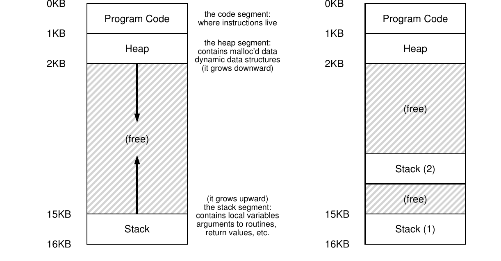

# 第 26 章 并发：介绍

> 英文原题：*Concurrency: An Introduction*

到目前为止，我们已经见识了操作系统提供的几种基本抽象。我们看到，操作系统怎样把一个物理 CPU 变成多个虚拟 CPU，让多个程序看起来像在同时运行；也看到它怎样为每个进程营造出一大片私有虚拟内存的假象。地址空间(address space)这个抽象，让每个程序都以为内存归自己独享，实际上操作系统却在物理内存（有时还有磁盘）上偷偷复用着各个地址空间。

本章要为一个正在运行的进程引入一种新抽象：**线程(thread)**。过去，我们把程序看成只有一个执行点——只有一个程序计数器(PC)，处理器从那里取指并执行。多线程程序却有不止一个执行点：它有多个 PC，各自都在取指并执行。换个角度看，每条线程很像一个独立进程，只有一处关键区别：它们共享同一个地址空间，因此能访问同一份数据。

单条线程的状态也与进程十分相似。它有 PC，记录程序正在从哪儿取指；还有一套私有寄存器用于计算。因此，假如两条线程在同一个处理器上运行，从 T1 切换到 T2 时也必须做上下文切换：先保存 T1 的寄存器状态，再恢复 T2 的寄存器状态。过去，我们把进程状态保存到进程控制块(PCB)；现在，则需要一个或多个**线程控制块(thread control block, TCB)** 保存进程中每条线程的状态。不过，线程切换和进程切换有个重大区别：地址空间保持不变，也就是说不需要更换当前使用的页表。

线程与进程的另一个重大区别在于栈。经典进程——现在可以叫单线程进程(single-threaded process)了——只有一个栈，通常位于地址空间底部（图 26.1 左）。多线程进程中的每条线程都独立运行，也都可能调用各种例程来完成自己的工作，因此每条线程都得有自己的栈（图 26.1 右）。



*图 26.1：单线程与多线程地址空间。*

图中，两条线程的栈散布在进程地址空间里。因此，分配在栈上的变量、参数、返回值，以及其他压进栈里的东西，都会放进有时所谓的**线程局部存储(thread-local storage)**——也就是相应线程自己的栈。

你大概也看出来了：这把原本漂漂亮亮的地址空间布局搅得一团糟。以前，栈和堆可以各自增长，只有地址空间耗尽时才会撞车；现在可没这么舒坦。幸好，栈通常不必太大（大量使用递归的程序除外），所以一般问题不大。

## 26.1 为什么要用线程？

在深入线程细节，以及编写多线程程序可能遇到的麻烦之前，先回答一个更简单的问题：为什么非要用线程不可？

至少有两大理由。第一很直接：**并行(parallelism)**。假设你写了一个程序，要对巨大的数组做运算，比如把两个大数组相加，或给数组中的每个元素加上某个值。在单处理器上，老老实实逐项计算就完了；可在多处理器系统上，你可以让各个处理器分别承担一部分工作，大幅加快速度。把普通的单线程程序改造成能在多个 CPU 上完成这类工作的程序，叫作**并行化(parallelization)**；每个 CPU 使用一条线程，是现代硬件上让程序跑得更快的一种自然且典型的办法。

第二个理由更微妙：避免缓慢 I/O 阻塞程序进展。设想程序要执行不同类型的 I/O：等待发送或接收消息，等待显式的磁盘 I/O 完成，甚至隐式地等待一次缺页处理结束。程序也许不想干等，而想继续做点别的——用 CPU 计算，或发出更多 I/O 请求。线程正是避免卡死的自然办法：当一条线程阻塞等待 I/O 时，CPU 调度器可以切换到其他已就绪、能干正事的线程。多道程序设计让不同程序的进程把 I/O 与其他活动重叠起来；线程则在同一个程序内部做到这一点。因此，许多现代服务器应用（Web 服务器、数据库管理系统等）都使用线程。

当然，上述两种场景也可以用多个进程实现。但线程共享地址空间，数据共享十分方便，自然更适合构造这类程序。若任务在逻辑上彼此独立，几乎不需要共享内存数据结构，进程才是更稳妥的选择。

## 26.2 示例：创建线程

来看看细节。假设要创建两条线程，各自做一项独立工作：打印“A”或“B”。代码如下：

```c linenums="1"
#include <stdio.h>
#include <assert.h>
#include <pthread.h>
#include "common.h"
#include "common_threads.h"

void *mythread(void *arg) {
    printf("%s\n", (char *) arg);
    return NULL;
}

int
main(int argc, char *argv[]) {
    pthread_t p1, p2;
    int rc;
    printf("main: begin\n");
    Pthread_create(&p1, NULL, mythread, "A");
    Pthread_create(&p2, NULL, mythread, "B");
    // join 等待线程结束
    Pthread_join(p1, NULL);
    Pthread_join(p2, NULL);
    printf("main: end\n");
    return 0;
}
```

*图 26.2：简单的线程创建代码（`t0.c`）。*

主程序创建两条线程，两者都运行 `mythread()`，只是参数不同（字符串 `A` 或 `B`）。线程一创建出来，可能立刻开始运行——这全看调度器当时的心情；也可能先进入“就绪”而非“运行”状态。多处理器上，两条线程甚至可能同时运行，不过眼下先别操心这个。

创建 T1 和 T2 后，主线程调用两次 `pthread_join()`，分别等待指定线程结束。这保证 T1 和 T2 都完成后，主线程才继续打印 `main: end` 并退出。整个过程中一共用到三条线程：主线程、T1 和 T2。

下面是三种可能的执行次序。时间从上往下推进：

| 主线程 | T1 | T2 |
|---|---|---|
| 开始；打印 `main: begin`；创建 T1、T2；等待 T1 |  |  |
|  | 运行；打印 `A`；返回 |  |
| 等待 T2 |  | 运行；打印 `B`；返回 |
| 打印 `main: end` |  |  |

*图 26.3：线程执行轨迹（1）。*

| 主线程 | T1 | T2 |
|---|---|---|
| 开始；打印 `main: begin`；创建 T1 |  |  |
|  | 运行；打印 `A`；返回 |  |
| 创建 T2 |  | 运行；打印 `B`；返回 |
| 等待 T1（立即返回，T1 已完成）；等待 T2（立即返回，T2 已完成）；打印 `main: end` |  |  |

*图 26.4：线程执行轨迹（2）。*

| 主线程 | T1 | T2 |
|---|---|---|
| 开始；打印 `main: begin`；创建 T1、T2 |  |  |
|  |  | 运行；打印 `B`；返回 |
| 等待 T1 | 运行；打印 `A`；返回 |  |
| 等待 T2（立即返回，T2 已完成）；打印 `main: end` |  |  |

*图 26.5：线程执行轨迹（3）。*

给定同一串指令，可能的次序其实多得很，全看调度器每一刻挑哪条线程运行。先创建的线程并不保证先运行，图 26.5 里 T2 就抢在 T1 前面大显身手。

线程创建有点像函数调用；区别在于，普通调用会先执行函数，再返回调用者，而创建线程会为被调用例程生成一条新的执行流。它独立于调用者运行，可能在创建调用返回前就开跑，也可能晚得多。下一步轮到谁由操作系统调度器决定；它大概采用了某种讲道理的算法，可某个具体时刻究竟谁会运行，依旧很难预料。

你也看到了，线程会把生活搞复杂：光判断谁何时运行就够费劲了！没有并发，计算机本来就不算好懂；有了并发，事情只会更糟。糟得多。

## 26.3 为什么会更糟：共享数据

前面的例子展示了怎样创建线程，以及调度器如何让它们按不同次序运行，却没有展示线程访问共享数据时会怎样互动。下面让两条线程更新同一个全局共享变量：

```c linenums="1"
#include <stdio.h>
#include <pthread.h>
#include "common.h"
#include "common_threads.h"

static volatile int counter = 0;

//
// mythread()
//
// 在循环中反复给 counter 加 1
// 不，这当然不是给计数器加 10,000,000 的正常写法，
// 但它能把问题展示得很清楚。
//
void *mythread(void *arg) {
    printf("%s: begin\n", (char *) arg);
    int i;
    for (i = 0; i < 1e7; i++) {
        counter = counter + 1;
    }
    printf("%s: done\n", (char *) arg);
    return NULL;
}

//
// main()
//
// 只负责启动两条线程（pthread_create），
// 然后等待它们结束（pthread_join）
//
int main(int argc, char *argv[]) {
    pthread_t p1, p2;
    printf("main: begin (counter = %d)\n", counter);
    Pthread_create(&p1, NULL, mythread, "A");
    Pthread_create(&p2, NULL, mythread, "B");

    // join 等待线程结束
    Pthread_join(p1, NULL);
    Pthread_join(p2, NULL);
    printf("main: done with both (counter = %d)\n", counter);
    return 0;
}
```

*图 26.6：共享数据：坏了（`t1.c`）。*

这里有几点值得说明。第一，按照 Stevens 的建议 [SR05]，我们把线程创建和等待例程包了一层，失败时直接退出。对这么简单的程序，至少要知道出错了；至于聪明地恢复，就免了。因此 `Pthread_create()` 调用真正的 `pthread_create()`，检查返回码是否为 0，否则打印消息并退出。

第二，我们没有为两条工作线程写两套函数，而是共用同一段代码，只传入不同字符串，让它们在消息前打印不同字母。

最后，也是最重要的一点：每条工作线程都在循环中给共享变量 `counter` 加 1，一共加一千万次。因此，期望的最终结果是 20,000,000。

编译并运行。有时候，一切看起来很正常：

```console
prompt> gcc -o main main.c -Wall -pthread
prompt> ./main
main: begin (counter = 0)
A: begin
B: begin
A: done
B: done
main: done with both (counter = 20000000)
```

可惜，即使只用一个处理器，也不一定得到正确答案。有时结果是 `19345221`，再跑一次又可能变成 `19221041`。不但每次都错，还错得各不相同！教授以前告诉你计算机是确定性的，难道一直在骗你？（倒吸一口凉气）

!!! tip "提示：了解并使用你的工具"
    要不断学习那些能帮你编写、调试和理解计算机系统的新工具。这里可以用**反汇编器(disassembler)** 查看可执行文件由哪些汇编指令组成。例如，在 Linux 上运行：

    ```console
    prompt> objdump -d main
    ```

    它会列出程序的全部指令；若编译时加了 `-g`，符号信息会让结果尤其清楚。`objdump` 只是你该掌握的众多工具之一；调试器 `gdb`、内存分析器 `valgrind` 或 `purify`，乃至编译器本身，都值得花时间熟悉。工具用得越溜，系统才能造得越好。

## 26.4 问题的核心：不受控制的调度

要理解问题为何发生，必须看看编译器为 `counter = counter + 1` 生成了什么代码。在 x86 上，它可能是：

```asm
mov 0x8049a1c, %eax
add $0x1, %eax
mov %eax, 0x8049a1c
```

假设 `counter` 位于地址 `0x8049a1c`。第一条 `mov` 把该地址的值装入 `eax`；`add` 给 `eax` 加 1；最后一条 `mov` 再把 `eax` 写回原地址。

设 `counter` 初值为 50。T1 先读取它，于是自己的 `eax=50`；再加 1，得到 `eax=51`。偏偏这时，时钟中断来了。操作系统把 T1 的 PC、寄存器（包括 `eax`）等状态保存进 TCB，然后选中 T2 运行。

T2 进入同一段代码，也把 `counter` 读入自己的 `eax`。别忘了，线程运行时拥有自己的私有寄存器；上下文切换代码靠保存与恢复来虚拟化它们。此时内存里的 `counter` 仍是 50，所以 T2 也得到 `eax=50`。T2 接着加 1，再把 51 写回 `counter`。

又一次上下文切换后，T1 恢复运行。它先前已经完成读取和加法，自己的 `eax` 还是 51，于是最后一条 `mov` 又把 51 写回内存。结果，加一操作明明执行了两次，从 50 出发却只得到 51；正确答案本应是 52。

若把三条指令装在地址 100 开始的位置，详细轨迹如下（x86 指令长度不固定，所以两条 `mov` 占 5 字节，`add` 占 3 字节）：

| 操作系统 / 线程 | 指令执行后 PC | `%eax` | `counter` |
|---|---:|---:|---:|
| T1：进入临界区前 | 100 | 0 | 50 |
| T1：`mov 0x8049a1c, %eax` | 105 | 50 | 50 |
| T1：`add $0x1, %eax` | 108 | 51 | 50 |
| 中断：保存 T1，恢复 T2 | 100 | 0 | 50 |
| T2：`mov 0x8049a1c, %eax` | 105 | 50 | 50 |
| T2：`add $0x1, %eax` | 108 | 51 | 50 |
| T2：`mov %eax, 0x8049a1c` | 113 | 51 | 51 |
| 中断：保存 T2，恢复 T1 | 108 | 51 | 51 |
| T1：`mov %eax, 0x8049a1c` | 113 | 51 | 51 |

*图 26.7：近距离观察这个问题。*

这里发生的叫作**竞争条件(race condition)**，更具体地说是**数据竞争(data race)**：结果取决于代码执行的时机。运气不好，在要命的位置发生上下文切换，就会得到错误结果；不同次运行还可能给出不同答案。这样的计算不再是我们熟悉的确定性计算，而是**不确定的(indeterminate)**：事先不知道输出，且每次运行很可能都不同。

会因多条线程同时执行而出现竞争条件的代码，叫作**临界区(critical section)**。临界区会访问共享变量（更一般地说，共享资源），不能让多条线程同时执行。

我们真正需要的是**互斥(mutual exclusion)**：当一条线程正在临界区内执行时，其他线程不得进入。顺带一提，这一带的术语几乎都出自并发领域先驱、图灵奖得主 Edsger Dijkstra；他 1968 年的论文“Cooperating Sequential Processes”[D68] 对问题做了清晰得惊人的阐述。本部分还会不断遇见他。

## 26.5 对原子性的渴望

一种解法，是让指令更强大：一步完成我们想做的全部事情，从而不给不合时宜的中断留下机会。例如，假想有这么一条超级指令：

```asm
memory-add 0x8049a1c, $0x1
```

它直接给某个内存位置加上一个值，而且硬件保证它**原子地(atomically)** 执行。中断发生时，这条指令要么完全没运行，要么已经全部完成，不存在中间状态。硬件有时真美妙，对吧？

这里，“原子地”就是“作为一个整体”，也就是“全有或全无”。我们希望前面那三条指令也能作为一个整体执行。如果真有单条指令完成它，问题就解决了；但一般情况下不会这么走运。假如我们正在构造一棵并发 B 树，难道真要硬件提供“原子更新 B 树”指令？至少在神志正常的指令集里，大概不会。

!!! tip "提示：使用原子操作"
    原子操作是构建计算机系统最强大的底层技术之一，从计算机体系结构、并发代码，到文件系统、数据库管理系统，甚至分布式系统 [L+93]，处处都能见到它。

    把一系列动作变成原子操作，可以用“全有或全无”概括：你组合起来的所有动作，要么看起来全都发生了，要么一个都没发生，外界看不到中间状态。把许多动作组合成一个原子动作，有时叫作**事务(transaction)**；数据库和事务处理领域对它研究得极为深入 [GR92]。

    在并发部分，我们会用同步原语把短指令序列变成原子执行块。但原子性的舞台远不止于此。例如，文件系统会用日志(journaling)或写时复制(copy-on-write)让磁盘状态发生原子转换，这对系统故障时仍能正确工作至关重要。现在听不懂没关系，后面的章节会让它豁然开朗。

因此，我们会向硬件索取少数几条有用指令，再在它们之上构建一套通用的**同步原语(synchronization primitive)**。把硬件支持和操作系统的帮助结合起来，就能让多线程代码以同步、受控的方式访问临界区；即使并发执行险象环生，也能稳定产出正确结果。很酷，对吧？

这正是本部分要研究的问题。它精彩，也很难，理应让你脑壳疼上一阵。要是一点不疼，那就是还没弄懂！继续琢磨，直到开始头疼，你就知道方向对了。然后歇一会儿——我们也不想让你疼得太厉害。

!!! danger "问题核心：怎样支持同步"
    为构建有用的同步原语，硬件需要提供什么支持？操作系统又要提供什么？怎样正确且高效地构建这些原语？程序又该如何使用它们，得到想要的结果？

## 26.6 另一个问题：等待其他线程

到目前为止，本章仿佛只存在一种线程互动：访问共享变量，以及临界区对原子性的需求。其实还有一种常见互动：一条线程必须等另一条线程完成某个动作，才能继续。比如进程发起磁盘 I/O 后会睡眠；I/O 完成时，必须把它从梦乡里叫醒，让它继续执行。

接下来的章节不仅会研究怎样构建支持原子性的同步原语，还会研究怎样支持这种在多线程程序里随处可见的睡眠/唤醒互动。现在不懂没关系！读到条件变量那一章就会懂了。到那时还不懂，那就不太妙了——请把那一章再读一遍（再一遍），直到明白为止。

## 26.7 总结：为什么要在操作系统课里讲？

收尾之前，你可能还在问：为什么操作系统课要学这些？一个词就能回答：历史。操作系统是最早的并发程序，许多技术最初都是为它发明的。后来多线程进程出现，应用程序员才也不得不操心这些事。

例如，假设两个进程都调用 `write()`，想把数据追加到同一个文件末尾。为此，它们都得分配新块，在文件的 inode 中记录块的位置，还要更新文件大小（另外还有些工作，第三部分会讲）。中断可能随时发生，因此更新这些共享结构——如分配位图、文件 inode——的代码都是临界区。从中断被引入的第一天起，操作系统设计者就必须担心怎样更新内部结构；一次来得不是时候的中断，会引发前面讲过的所有麻烦。毫不意外，页表、进程列表、文件系统结构，以及几乎所有内核数据结构，都必须配合恰当的同步原语，小心访问，才能正确工作。

!!! note "边栏：关键并发术语"
    下面四个术语对并发代码至关重要，值得单独拎出来。更多细节可参见 Dijkstra 的早期工作 [D65, D68]。

    - **临界区(critical section)**：访问共享资源（通常是变量或数据结构）的一段代码。
    - **竞争条件(race condition)**（或数据竞争 [NM92]）：多条执行线程差不多同时进入临界区，都试图更新共享数据结构，导致令人意外、甚至并不想要的结果。
    - **不确定程序(indeterminate program)**：含有一个或多个竞争条件；程序输出随每次运行而变化，取决于各线程何时运行，因此结果不是计算机系统通常应有的确定结果。
    - 为避免这些问题，线程应使用某种**互斥原语(mutual exclusion primitive)**，保证每次只有一条线程能进入临界区，避开竞争，得到确定的程序输出。

## 参考文献

- [D65] “Solution of a problem in concurrent programming control” by E. W. Dijkstra. *Communications of the ACM*, 8(9):569, September 1965. 通常被认为是 Dijkstra 首次阐述互斥问题及其解法的论文。不过那套解法并未广泛使用；后续章节会看到，还需要更先进的硬件和操作系统支持。
- [D68] “Cooperating sequential processes” by Edsger W. Dijkstra. 1968. Available at: <http://www.cs.utexas.edu/users/EWD/ewd01xx/EWD123.PDF>. Dijkstra 晚年任职的得克萨斯大学保存了数量惊人的旧论文、笔记和思考。许多奠基性工作更早完成于 Eindhoven 的 Technische Hogeschool（THE），包括这篇著名论文；它几乎勾勒出了编写多线程程序必须考虑的一切。Dijkstra 当时参与的操作系统也以学校命名，叫“THE”操作系统——读作三个字母 T、H、E，可不是英语单词“the”。
- [GR92] *Transaction Processing: Concepts and Techniques* by Jim Gray and Andreas Reuter. Morgan Kaufmann, September 1992. 事务处理领域的圣经，由传奇人物 Jim Gray 执笔，也被看作他把数据库管理系统知识一股脑倒出来的“脑内备份”。Gray 后来不幸离世，许多人失去了一位朋友和伟大导师，本书作者也在其中；他们读研时有幸与他交流。
- [L+93] *Atomic Transactions* by Nancy Lynch, Michael Merritt, William Weihl, Alan Fekete. Morgan Kaufmann, August 1993. 介绍分布式系统原子事务理论与实践的好书；对有些人也许略显形式化，但好料很多。
- [NM92] “What Are Race Conditions? Some Issues and Formalizations” by Robert H. B. Netzer and Barton P. Miller. *ACM Letters on Programming Languages and Systems*, 1(1), March 1992. 出色地讨论了并发程序中的各类竞争。本章和随后几章聚焦数据竞争，之后还会扩展到更一般的竞争。
- [SR05] *Advanced Programming in the UNIX Environment* by W. Richard Stevens and Stephen A. Rago. Addison-Wesley, 2005. 我们说过很多遍了：买下它，每晚睡前一点点读。这样不但能更快睡着，更重要的是，还能一点点成长为严肃的 UNIX 程序员。

## 作业（模拟器）

程序 `x86.py` 可以展示不同的线程交错怎样引发或避开竞争条件。先阅读 `README` 了解用法，再回答下列问题。

1. 阅读并理解简单程序 `loop.s`。运行 `./x86.py -p loop.s -t 1 -i 100 -R dx`：这指定一条线程，每 100 条指令中断一次，并跟踪寄存器 `%dx`。运行中 `%dx` 会是什么值？用 `-c` 检查答案；左侧答案表示右侧指令执行后的寄存器（或内存）值。
2. 换一组参数：`./x86.py -p loop.s -t 2 -i 100 -a dx=3,dx=3 -R dx`。这里有两条线程，并把各自的 `%dx` 初始化为 3。它们会看到哪些值？用 `-c` 检查。多线程是否影响你的计算？代码中存在竞争吗？
3. 运行 `./x86.py -p loop.s -t 2 -i 3 -r -a dx=3,dx=3 -R dx`。这让中断间隔变得短而随机；换用不同随机种子（`-s`）观察不同交错。中断频率改变了什么吗？
4. 换到程序 `looping-race-nolock.s`，它访问地址 2000 处的共享变量，我们叫它 `value`。先用单线程确认理解：`./x86.py -p looping-race-nolock.s -t 1 -M 2000`。运行期间 `value`（即内存地址 2000）是什么值？用 `-c` 检查。
5. 增加循环次数和线程：`./x86.py -p looping-race-nolock.s -t 2 -a bx=3 -M 2000`。为什么每条线程循环三次？`value` 的最终值是多少？
6. 使用随机中断间隔运行 `./x86.py -p looping-race-nolock.s -t 2 -M 2000 -i 4 -r -s 0`，并更换随机种子（`-s 1`、`-s 2` 等）。观察线程交错，你能判断 `value` 的最终值吗？中断时机重要吗？它可以安全地发生在哪里，又不能发生在哪里？换句话说，临界区究竟是哪一段？
7. 再看固定中断间隔：`./x86.py -p looping-race-nolock.s -a bx=1 -t 2 -M 2000 -i 1`。共享变量 `value` 的最终值是多少？把参数改为 `-i 2`、`-i 3` 等又如何？哪些间隔会给出“正确”答案？
8. 增加循环次数（如设 `-a bx=100`）重做上题。哪些中断间隔（`-i`）会得到正确结果？哪些结果出乎意料？
9. 最后看 `wait-for-me.s`。运行 `./x86.py -p wait-for-me.s -a ax=1,ax=0 -R ax -M 2000`：线程 0 的 `%ax` 设为 1，线程 1 的设为 0，同时观察 `%ax` 和内存地址 2000。代码应该怎样运行？线程如何使用地址 2000 处的值？最终值是多少？
10. 对调输入：`./x86.py -p wait-for-me.s -a ax=0,ax=1 -R ax -M 2000`。两条线程表现如何？线程 0 在干什么？改变中断间隔（如 `-i 1000`，或改用随机间隔）会怎样改变执行轨迹？程序是否高效利用了 CPU？
