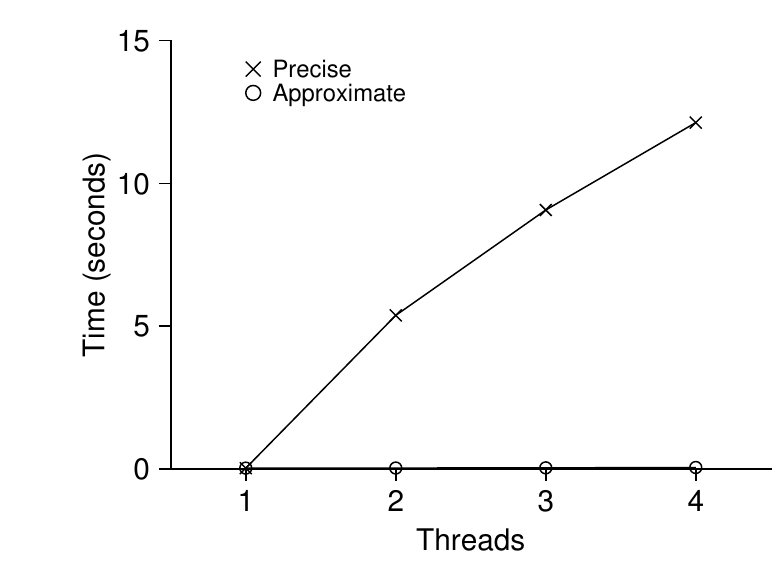
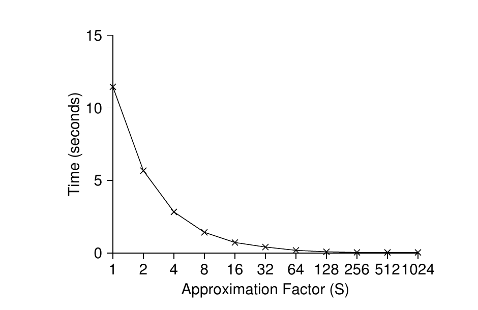
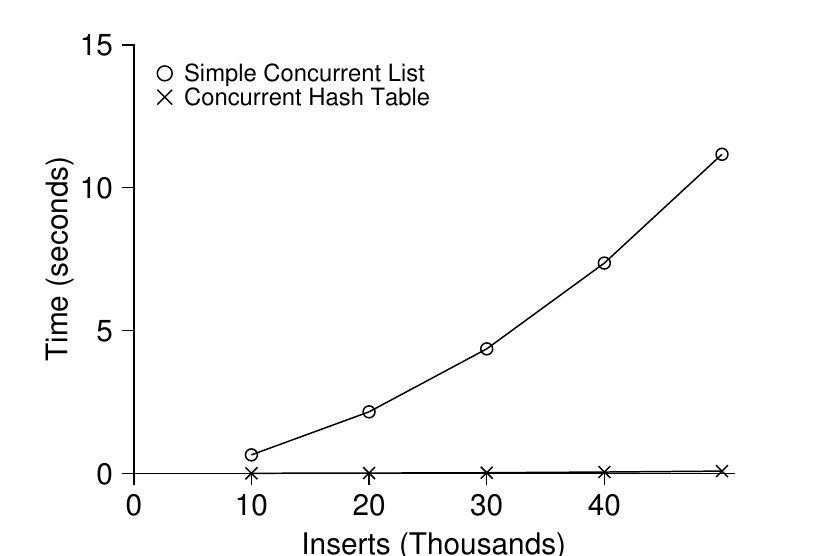

# 第 29 章 基于锁的并发数据结构

> 英文原题：*Lock-based Concurrent Data Structures*

在告别锁之前，我们先看看怎样把锁用到几种常见数据结构里。给数据结构加锁，让线程能够安全使用它，就使该结构成为**线程安全(thread-safe)** 的。不过，锁究竟怎样添加，同时决定了数据结构的正确性和性能。

!!! danger "问题核心：怎样给数据结构加锁"
    面对一个具体的数据结构，该怎样添加锁，让它正确工作？又怎样加锁，才能让多条线程同时访问并取得高性能？

我们不可能覆盖所有数据结构和并发化方法；这个领域研究多年，论文成千上万。本章只希望介绍必要的思考方式，进一步探索可参考 Moir 和 Shavit 的优秀综述 [MS04]。

## 29.1 并发计数器

计数器大概是最简单的数据结构之一，应用广泛，接口也简单。先看一个没有并发保护的版本：

```c linenums="1"
typedef struct __counter_t {
    int value;
} counter_t;

void init(counter_t *c) {
    c->value = 0;
}

void increment(counter_t *c) {
    c->value++;
}

void decrement(counter_t *c) {
    c->value--;
}

int get(counter_t *c) {
    return c->value;
}
```

*图 29.1：没有锁的计数器。*

### 简单，却不可扩展

未同步的计数器简单得不能再简单。怎样让它线程安全？最直接的办法是加一把锁：

```c linenums="1"
typedef struct __counter_t {
    int             value;
    pthread_mutex_t lock;
} counter_t;

void init(counter_t *c) {
    c->value = 0;
    Pthread_mutex_init(&c->lock, NULL);
}

void increment(counter_t *c) {
    Pthread_mutex_lock(&c->lock);
    c->value++;
    Pthread_mutex_unlock(&c->lock);
}

void decrement(counter_t *c) {
    Pthread_mutex_lock(&c->lock);
    c->value--;
    Pthread_mutex_unlock(&c->lock);
}

int get(counter_t *c) {
    Pthread_mutex_lock(&c->lock);
    int rc = c->value;
    Pthread_mutex_unlock(&c->lock);
    return rc;
}
```

*图 29.2：带锁的计数器。*

这个并发计数器简单而正确，也体现了最基础并发数据结构的通用模式：凡是操纵数据结构的例程，进入时拿同一把锁，返回时释放。它很像用**管程(monitor)** [BH73] 构建的数据结构——调用对象方法时自动加锁，返回时自动解锁。

可正确不等于快。若数据结构太慢，不能满足于加一把大锁；如果它本来就不慢，那就大功告成，简单办法能用时没必要整花活。

为测量简单方案的开销，让每条线程把共享计数器更新一百万次，并把活动线程数从 1 增至 4。实验机器是一台配有四个 2.7 GHz Intel i5 CPU 的 iMac。



*图 29.3：传统计数器与近似计数器的性能。*

图中上方“Precise”曲线说明，同步计数器的扩展性很糟：单线程完成一百万次更新只需约 0.03 秒，两条线程各更新一百万次却要超过 5 秒，线程越多越惨。理想状态下，多处理器上的多条线程应和单处理器上的单线程一样快；更多工作并行完成，总耗时不增加，这叫**完美扩展(perfect scaling)**。

### 可扩展计数

研究者多年来一直在琢磨可扩展计数器 [MS04]。它确实很重要：操作系统性能研究显示，缺少可扩展计数会让 Linux 的一些负载在多核机器上遇到严重扩展性问题 [B+10]。

这里介绍一种**近似计数器(approximate counter)** [C06]。它用多个局部物理计数器表示一个逻辑计数器——每个 CPU 核一个——外加一个全局计数器；每个局部计数器各有一把锁，全局计数器也有一把锁[^1]。

[^1]: 之所以还需要局部锁，是因为假定每个核上可能有多条线程。如果每个核始终只有一条线程，就不需要局部锁。

线程递增时，只更新当前核心的局部计数器，并用对应局部锁同步。不同 CPU 上的线程互不争抢，因此更新可以扩展。为了让全局值别落后太远，局部值会周期性地转移到全局计数器：拿全局锁，把局部值加进去，再把局部计数清零。

转移频率由阈值 $S$ 决定。$S$ 越小，行为越接近不可扩展的精确计数器；$S$ 越大，扩展性越好，但全局值可能离真实值越远。若想得到精确值，可以按固定次序获取全部局部锁和全局锁，以免死锁，但这样不可扩展。

阈值为 5、四个局部计数器的执行轨迹如下；时间向下推进：

| 时间 | L1 | L2 | L3 | L4 | G |
|---:|---:|---:|---:|---:|---:|
| 0 | 0 | 0 | 0 | 0 | 0 |
| 1 | 0 | 0 | 1 | 1 | 0 |
| 2 | 1 | 0 | 2 | 1 | 0 |
| 3 | 2 | 0 | 3 | 1 | 0 |
| 4 | 3 | 0 | 3 | 2 | 0 |
| 5 | 4 | 1 | 3 | 3 | 0 |
| 6 | 5→0 | 1 | 3 | 4 | 5（来自 L1） |
| 7 | 0 | 2 | 4 | 5→0 | 10（来自 L4） |

*图 29.4：近似计数器执行轨迹。*

图 29.3 下方“Approximate”曲线使用 $S=1024$。四个处理器更新四百万次，耗时几乎不比单处理器更新一百万次更高，性能极佳。

```c linenums="1"
typedef struct __counter_t {
    int             global;               // 全局计数
    pthread_mutex_t glock;                // 全局锁
    int             local[NUMCPUS];       // 局部计数（每个 CPU 一个）
    pthread_mutex_t llock[NUMCPUS];       // ……以及对应的锁
    int             threshold;            // 更新频率
} counter_t;

// 初始化：记录阈值，初始化锁、全部局部计数和全局计数
void init(counter_t *c, int threshold) {
    c->threshold = threshold;
    c->global = 0;
    pthread_mutex_init(&c->glock, NULL);
    int i;
    for (i = 0; i < NUMCPUS; i++) {
        c->local[i] = 0;
        pthread_mutex_init(&c->llock[i], NULL);
    }
}

// 更新：通常只拿局部锁，更新局部值；
// 当局部计数达到 threshold 时，拿全局锁并转移局部值
void update(counter_t *c, int threadID, int amt) {
    int cpu = threadID % NUMCPUS;
    pthread_mutex_lock(&c->llock[cpu]);
    c->local[cpu] += amt;                 // 假定 amt > 0
    if (c->local[cpu] >= c->threshold) { // 转移到全局计数
        pthread_mutex_lock(&c->glock);
        c->global += c->local[cpu];
        pthread_mutex_unlock(&c->glock);
        c->local[cpu] = 0;
    }
    pthread_mutex_unlock(&c->llock[cpu]);
}

// 获取：只返回全局值（可能并不完全准确）
int get(counter_t *c) {
    pthread_mutex_lock(&c->glock);
    int val = c->global;
    pthread_mutex_unlock(&c->glock);
    return val; // 只是近似值！
}
```

*图 29.5：近似计数器实现。*



*图 29.6：近似计数器的扩展性。*

图 29.6 展示阈值 $S$ 的影响：$S$ 小，性能差但全局值准确；$S$ 大，性能优秀，但全局值最多落后“CPU 数量乘以 $S$”。这正是近似计数器提供的精度/性能权衡。

## 29.2 并发链表

再看复杂一点的链表。为简单起见，只实现并发插入和查找，把删除等操作留给读者。

```c linenums="1"
// 基本节点结构
typedef struct __node_t {
    int             key;
    struct __node_t *next;
} node_t;

// 基本链表结构（每条链表一个）
typedef struct __list_t {
    node_t          *head;
    pthread_mutex_t lock;
} list_t;

void List_Init(list_t *L) {
    L->head = NULL;
    pthread_mutex_init(&L->lock, NULL);
}

int List_Insert(list_t *L, int key) {
    pthread_mutex_lock(&L->lock);
    node_t *new = malloc(sizeof(node_t));
    if (new == NULL) {
        perror("malloc");
        pthread_mutex_unlock(&L->lock);
        return -1; // 失败
    }
    new->key = key;
    new->next = L->head;
    L->head   = new;
    pthread_mutex_unlock(&L->lock);
    return 0; // 成功
}

int List_Lookup(list_t *L, int key) {
    pthread_mutex_lock(&L->lock);
    node_t *curr = L->head;
    while (curr) {
        if (curr->key == key) {
            pthread_mutex_unlock(&L->lock);
            return 0; // 成功
        }
        curr = curr->next;
    }
    pthread_mutex_unlock(&L->lock);
    return -1; // 失败
}
```

*图 29.7：并发链表。*

代码在插入例程入口拿锁，退出时放锁。麻烦出现在 `malloc()` 偶尔失败时：失败路径也必须先解锁。这类异常控制流很容易出错；对 Linux 内核补丁的研究发现，近 40% 的 bug 藏在这种很少走到的路径上 [L+13]。这也促成了作者团队的一项研究：从 Linux 文件系统中移除所有内存分配失败路径，使系统更加健壮 [S+11]。

稍作重排，可以让锁只围住真正的临界区，并让查找共用一个退出路径：

```c linenums="1"
void List_Init(list_t *L) {
    L->head = NULL;
    pthread_mutex_init(&L->lock, NULL);
}

void List_Insert(list_t *L, int key) {
    // 这里不需要同步
    node_t *new = malloc(sizeof(node_t));
    if (new == NULL) {
        perror("malloc");
        return;
    }
    new->key = key;

    // 只锁住临界区
    pthread_mutex_lock(&L->lock);
    new->next = L->head;
    L->head   = new;
    pthread_mutex_unlock(&L->lock);
}

int List_Lookup(list_t *L, int key) {
    int rv = -1;
    pthread_mutex_lock(&L->lock);
    node_t *curr = L->head;
    while (curr) {
        if (curr->key == key) {
            rv = 0;
            break;
        }
        curr = curr->next;
    }
    pthread_mutex_unlock(&L->lock);
    return rv; // 成功和失败都走这里
}
```

*图 29.8：重写后的并发链表。*

假定 `malloc()` 本身线程安全，分配节点无需持有链表锁；只有更新共享链表时才需要。查找也只在一个出口解锁，减少加锁/解锁点，降低忘记解锁之类的出错概率。

### 让链表扩展

单锁链表依旧扩展性不佳。一种提高并发度的技术叫**逐手加锁(hand-over-hand locking)**，也叫**锁耦合(lock coupling)** [MS04]：不给整条链表一把锁，而给每个节点一把；遍历时先拿下一节点的锁，再释放当前节点的锁，像一只手交给另一只手。

概念上很合理，多次遍历可以并发进行；实践中却很难打败单锁方案，因为遍历每个节点都加锁、解锁，开销太大。即使链表很长、线程很多，额外并发往往也不如拿一把锁、完成操作、再放锁来得快。也许每隔若干节点换一次锁的混合方案值得研究。

!!! tip "提示：并发更多，不一定更快"
    如果方案增加大量开销——例如反复加锁、解锁——更高并发度也可能毫无意义。简单方案通常很好，尤其当昂贵例程调用得少时。更多锁和更高复杂度反而可能拖垮你。

    真正判断只有一个办法：把两种方案都实现出来——简单但并发少，复杂但并发多——然后测量。性能没法作弊：你的点子要么更快，要么不快。

!!! tip "提示：警惕锁与控制流"
    不论并发代码还是普通代码，都要警惕会导致函数返回、退出或因错误停止执行的控制流变化。许多函数一开始就拿锁、分配内存或改变状态；出错返回前必须撤销全部状态，非常容易漏掉。最好从结构上尽量减少这种模式。

## 29.3 并发队列

让数据结构支持并发的标准方法你已经会了：加一把大锁。队列就不再演示这种写法，直接看 Michael 和 Scott 设计的并发度更高的队列 [MS98]：

```c linenums="1"
typedef struct __node_t {
    int              value;
    struct __node_t *next;
} node_t;

typedef struct __queue_t {
    node_t          *head;
    node_t          *tail;
    pthread_mutex_t headLock;
    pthread_mutex_t tailLock;
} queue_t;

void Queue_Init(queue_t *q) {
    node_t *tmp = malloc(sizeof(node_t));
    tmp->next = NULL;
    q->head = q->tail = tmp;
    pthread_mutex_init(&q->headLock, NULL);
    pthread_mutex_init(&q->tailLock, NULL);
}

void Queue_Enqueue(queue_t *q, int value) {
    node_t *tmp = malloc(sizeof(node_t));
    assert(tmp != NULL);
    tmp->value = value;
    tmp->next = NULL;

    pthread_mutex_lock(&q->tailLock);
    q->tail->next = tmp;
    q->tail = tmp;
    pthread_mutex_unlock(&q->tailLock);
}

int Queue_Dequeue(queue_t *q, int *value) {
    pthread_mutex_lock(&q->headLock);
    node_t *tmp = q->head;
    node_t *newHead = tmp->next;
    if (newHead == NULL) {
        pthread_mutex_unlock(&q->headLock);
        return -1; // 队列为空
    }
    *value = newHead->value;
    q->head = newHead;
    pthread_mutex_unlock(&q->headLock);
    free(tmp);
    return 0;
}
```

*图 29.9：Michael 和 Scott 的并发队列。*

它有两把锁，一把保护队头，一把保护队尾，使入队和出队能够并发；常见情况下，入队只碰尾锁，出队只碰头锁。另一个诀窍是在初始化时分配一个**哑节点(dummy node)**，把队头和队尾操作分离开来。认真读代码，最好亲手输入、运行和测量，才能真正吃透。

多线程应用经常用队列，但只有锁的队列通常还不够：队列为空或过满时，线程应该等待。下一章会用条件变量构造完整的有界队列，敬请留意！

## 29.4 并发哈希表

最后看一种简单、通用、极常见的并发数据结构：哈希表。这里不处理扩容——那需要再多费点工夫，就留作练习吧（抱歉！）。

```c linenums="1"
#define BUCKETS (101)

typedef struct __hash_t {
    list_t lists[BUCKETS];
} hash_t;

void Hash_Init(hash_t *H) {
    int i;
    for (i = 0; i < BUCKETS; i++) {
        List_Init(&H->lists[i]);
    }
}

int Hash_Insert(hash_t *H, int key) {
    int bucket = key % BUCKETS;
    return List_Insert(&H->lists[bucket], key);
}

int Hash_Lookup(hash_t *H, int key) {
    int bucket = key % BUCKETS;
    return List_Lookup(&H->lists[bucket], key);
}
```

*图 29.10：并发哈希表。*

它直接建立在前面的并发链表上，却表现极佳。秘诀是不给整个结构只配一把锁，而让每个哈希桶——也就是每条链表——拥有自己的锁，从而容纳许多并发操作。



*图 29.11：哈希表的扩展性。*

图 29.11 比较了四条线程各做一万至五万次并发更新时，哈希表和单锁链表的性能。简单并发哈希表扩展得漂亮极了，链表却完全不行。

!!! tip "提示：避免过早优化（Knuth 定律）"
    构建并发数据结构时，先用最基础的办法：一把大锁提供同步访问。这样更容易得到正确实现；若确实发现性能问题，再精炼它，只在必要时加速。Knuth 的名言是：“过早优化是万恶之源。”

    Sun OS、Linux 等许多操作系统刚转向多处理器时都只有一把锁。Linux 甚至给它起了名字：**大内核锁(big kernel lock, BKL)**。这套简单办法多年都很好；直到多 CPU 成为常态，内核一次只准一条线程活动才成了瓶颈。Linux 采用直截了当的办法：一把换成多把。Sun 更激进：从头打造把并发融入根基的新系统 Solaris。详情可读 Linux 和 Solaris 内核著作 [BC05, MM00]。

## 29.5 小结

本章抽样介绍了计数器、链表、队列和无处不在的哈希表。沿途得到几条重要教训：控制流变化附近要小心加锁与解锁；并发度更高并不保证性能更好；性能问题应在真正出现后再修。最后一点——避免过早优化——对任何看重性能的开发者都至关重要：若优化不能改善应用整体性能，把某个东西做得更快毫无价值。

高性能数据结构的世界，本章只挠破一点表皮。更多资料和出处见 Moir 与 Shavit 的综述 [MS04]。若对 B 树等其他结构感兴趣，数据库课程是最佳去处；若想研究完全不用传统锁的**非阻塞数据结构(non-blocking data structure)**，后面常见并发 bug 一章会浅尝一点，但坦白说，这本身是一大片知识领域，本书容不下。感兴趣就自己继续挖吧！

## 参考文献

- [B+10] “An Analysis of Linux Scalability to Many Cores” by Silas Boyd-Wickizer et al. OSDI '10, Vancouver, October 2010. 研究 Linux 多核性能及一些简单解法的佳作，其中用“宽松计数器”解决可扩展计数问题。
- [BH73] *Operating System Principles* by Per Brinch Hansen. Prentice-Hall, 1973. <http://portal.acm.org/citation.cfm?id=540365>. 最早的操作系统著作之一，远超时代，并引入管程这一并发原语。
- [BC05] *Understanding the Linux Kernel (Third Edition)* by Daniel P. Bovet and Marco Cesati. O'Reilly Media, November 2005. Linux 内核经典著作，你应该读。
- [C06] “The Search For Fast, Scalable Counters” by Jonathan Corbet. February 1, 2006. <https://lwn.net/Articles/170003>. LWN 有许多 Linux 最新进展的好文章；这篇简述可扩展近似计数。
- [L+13] “A Study of Linux File System Evolution” by Lanyue Lu et al. FAST '13, San Jose, February 2013. 作者团队研究了近十年 Linux 文件系统的每一个补丁，发现很多有趣结果；可怜的研究生 Lanyue Lu 得逐个手工阅读。
- [MS98] “Nonblocking Algorithms and Preemption-safe Locking on Multiprogrammed Shared-memory Multiprocessors” by M. Michael and M. Scott. *Journal of Parallel and Distributed Computing*, 51(1), 1998. Scott 教授及其学生长期站在并发算法和数据结构研究前沿。
- [MS04] “Concurrent Data Structures” by Mark Moir and Nir Shavit. In *Handbook of Data Structures and Applications*, Chapman and Hall/CRC Press, 2004. <http://www.cs.tau.ac.il/~shanir/concurrent-data-structures.pdf>. 篇幅不长却相当全面；虽因年代缺少部分新成果，依旧极实用。
- [MM00] *Solaris Internals: Core Kernel Architecture* by Jim Mauro and Richard McDougall. Prentice Hall, October 2000. Solaris 经典著作；如果想学点 Linux 之外的东西，也该读。
- [S+11] “Making the Common Case the Only Case with Anticipatory Memory Allocation” by Swaminathan Sundararaman et al. FAST '11, San Jose, February 2011. 通过预先分配所有潜在需要的内存，移除内核深层存储路径里可能失败的分配调用。

## 作业（代码）

本作业练习编写并发代码并测量性能。造出高性能代码是一项关键本领，值得在这里积累一点经验。

1. 重做本章测量。用 `gettimeofday()` 计时：它有多准？最小能测多短的间隔？先摸清它，后面每题都要用。也可研究其他计时器，例如 x86 的 `rdtsc` 周期计数器。
2. 构建简单并发计数器。随着线程数增加，测量多次递增所需时间。系统有多少 CPU？这个数量影响结果吗？
3. 构建宽松计数器，改变线程数和阈值测量性能。结果与本章一致吗？
4. 先阅读 [MS04]，再实现逐手加锁链表并测量性能。它什么时候胜过本章的普通链表？
5. 选择一种喜欢的、有点意思的数据结构，比如 B 树。先用单锁等简单策略实现，测量并发线程增加时的性能。
6. 再为它设计更有意思的锁策略，实现并测量。与直截了当的单锁方案相比如何？
