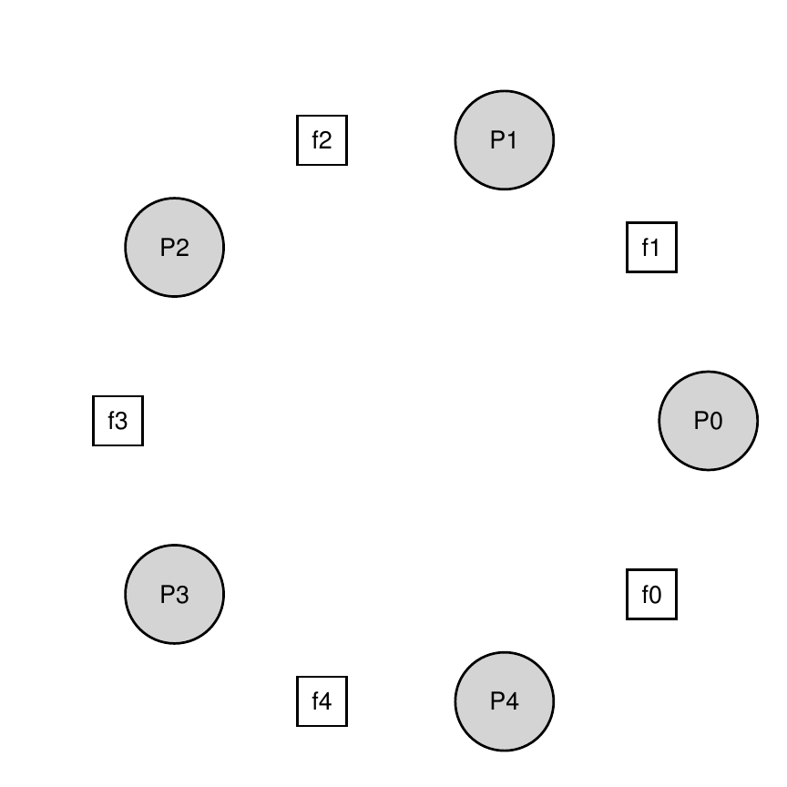

# 第 31 章 信号量

> 英文原题：*Semaphores*

要解决广泛而有趣的并发问题，锁与条件变量都不可少。Edsger Dijkstra 很早就意识到了这一点。他不仅提出了著名的最短路径算法 [D59]，写过《Go To Statement Considered Harmful》[D68a]，还引入了一种能够统一处理同步问题的原语：**信号量(semaphore)** [D68b, D72]。正如本章将看到的，信号量既能当锁，也能承担条件变量的作用。

!!! danger "问题核心：怎样使用信号量"
    怎样用信号量取代锁和条件变量？信号量怎样定义？什么是二值信号量？用锁和条件变量实现信号量是否容易？反过来用信号量实现锁和条件变量呢？

## 31.1 信号量：定义

信号量是一个带整数值的对象，可以用两个例程操纵。POSIX 把它们称为 `sem_wait()` 与 `sem_post()`。信号量的初值决定其行为，所以使用前必须先初始化：

```c linenums="1"
#include <semaphore.h>
sem_t s;
sem_init(&s, 0, 1);
```

*图 31.1：初始化信号量。*

这里声明信号量 `s`，并用第三个参数把它初始化为 1。第二个参数在本章始终为 0，表示信号量由同一进程里的线程共享；若要跨进程同步，则应查阅手册并使用另一种设置。

两个操作的语义如下。暂且假定它们内部的动作都是原子的：

```c linenums="1"
int sem_wait(sem_t *s) {
    把信号量 s 的值减 1；
    若 s 的值为负，则等待；
}

int sem_post(sem_t *s) {
    把信号量 s 的值加 1；
    若有一个或多个线程正在等待，唤醒其中一个；
}
```

*图 31.2：信号量 `wait` 与 `post` 的定义。*

`sem_wait()` 要么立刻返回——调用前的值至少为 1——要么挂起调用者，等待将来的 `post`；多个线程可以同时排队。`sem_post()` 不等待任何条件，只增加计数，并在有等待者时唤醒一个。Dijkstra 的原始定义还有一个有用的不变量：值为负时，其绝对值等于等待线程数。

历史上，Dijkstra 把 `sem_wait()` 称为 `P()`，把 `sem_post()` 称为 `V()`。`P` 来自荷兰语 *prolaag*（“尝试”与“减少”的缩合），`V` 来自 *verhoog*（“增加”）；也有人称它们为 down 与 up。

## 31.2 二值信号量（锁）

信号量的第一个用途就是锁：

```c linenums="1"
sem_t m;
sem_init(&m, 0, X); // X 应该是多少？

sem_wait(&m);
// 临界区
sem_post(&m);
```

*图 31.3：二值信号量（也就是锁）。*

这里 `X` 应为 1。第一条线程执行 `wait` 后，计数从 1 变成 0，得以进入临界区；离开时执行 `post`，恢复为 1。

| 信号量值 | 线程 0 |
| ---: | --- |
| 1 | — |
| 1 | 调用 `sem_wait()` |
| 0 | `sem_wait()` 返回 |
| 0 | 执行临界区 |
| 0 | 调用 `sem_post()` |
| 1 | `sem_post()` 返回 |

*图 31.4：一条线程使用信号量的执行轨迹。*

若线程 0 持有锁时线程 1 调用 `wait`，值会从 0 降到 -1，线程 1 睡眠。线程 0 执行 `post` 后，值回到 0并唤醒线程 1；线程 1 最终释放时再把值恢复到 1。

| 值 | 线程 0（状态） | 线程 1（状态） |
| ---: | --- | --- |
| 1 | 调用 `sem_wait()`（运行） | 就绪 |
| 0 | `sem_wait()` 返回，进入临界区（运行） | 就绪 |
| 0 | 被中断（就绪） | 调用 `sem_wait()`（运行） |
| -1 | 就绪 | 递减后睡眠 |
| -1 | 临界区结束，调用 `sem_post()`（运行） | 睡眠 |
| 0 | 增加信号量并唤醒线程 1（运行） | 就绪 |
| 0 | 就绪 | `sem_wait()` 返回，进入临界区（运行） |
| 1 | 就绪 | 调用 `sem_post()` 并返回（运行） |

*图 31.5：两条线程使用信号量的执行轨迹。*

锁只有“持有”和“未持有”两种状态，因此以这种方式使用的信号量叫作**二值信号量(binary semaphore)**。若只需要二值行为，其实现可以比通用信号量简单。

## 31.3 用信号量排序

信号量也能规定并发程序中事件的先后次序：一条线程等待事件，另一条线程完成事件后发信号。这与前一章用条件变量排序很相似。

```c linenums="1"
sem_t s;

void *child(void *arg) {
    printf("child\n");
    sem_post(&s); // 发信号：子线程结束
    return NULL;
}

int main(int argc, char *argv[]) {
    sem_init(&s, 0, X); // X 应该是多少？
    printf("parent: begin\n");
    pthread_t c;
    Pthread_create(&c, NULL, child, NULL);
    sem_wait(&s);       // 在这里等待子线程
    printf("parent: end\n");
    return 0;
}
```

*图 31.6：父线程等待子线程。*

这里初值必须是 0，且两种调度顺序都正确：

| 值 | 父线程（状态） | 子线程（状态） |
| ---: | --- | --- |
| 0 | 创建子线程（运行） | 就绪 |
| -1 | 调用 `sem_wait()`，递减后睡眠 | 就绪 |
| -1 | 睡眠 | 运行并调用 `sem_post()` |
| 0 | 被唤醒、就绪 | `sem_post()` 返回 |
| 0 | `sem_wait()` 返回（运行） | 就绪 |

*图 31.7：父线程等待子线程的执行轨迹（情形 1：父线程先等待）。*

| 值 | 父线程（状态） | 子线程（状态） |
| ---: | --- | --- |
| 0 | 创建子线程，随后被中断（就绪） | 运行 |
| 1 | 就绪 | 调用 `sem_post()`，无人可唤醒 |
| 1 | 恢复运行，调用 `sem_wait()` | 就绪 |
| 0 | 递减，保持运行；`sem_wait()` 返回 | 就绪 |

*图 31.8：父线程等待子线程的执行轨迹（情形 2：子线程先结束）。*

父线程先运行时会睡眠，直到子线程把它唤醒；子线程先运行时会留下值 1，父线程稍后消费这个信号而不必睡眠。

## 31.4 生产者—消费者（有界缓冲区）问题

前一章详细讨论了**生产者—消费者问题(producer/consumer problem)**，也叫**有界缓冲区问题(bounded-buffer problem)**。先回顾环形缓冲区：

```c linenums="1"
int buffer[MAX];
int fill = 0;
int use = 0;

void put(int value) {
    buffer[fill] = value;    // F1
    fill = (fill + 1) % MAX; // F2
}

int get() {
    int tmp = buffer[use];      // G1
    use = (use + 1) % MAX;      // G2
    return tmp;
}
```

*图 31.9：`put` 与 `get` 例程。*

### 第一次尝试

用 `empty` 表示空槽数，用 `full` 表示满槽数：

```c linenums="1"
sem_t empty, full;

void *producer(void *arg) {
    for (int i = 0; i < loops; i++) {
        sem_wait(&empty); // P1
        put(i);           // P2
        sem_post(&full);  // P3
    }
}

void *consumer(void *arg) {
    int tmp = 0;
    while (tmp != -1) {
        sem_wait(&full);  // C1
        tmp = get();      // C2
        sem_post(&empty); // C3
        printf("%d\n", tmp);
    }
}

int main(int argc, char *argv[]) {
    // ...
    sem_init(&empty, 0, MAX); // 开始时 MAX 个槽为空
    sem_init(&full, 0, 0);    // 开始时 0 个槽为满
    // ...
}
```

*图 31.10：加入 `full` 与 `empty` 条件。*

当 `MAX=1` 时，这套方案奏效：空缓冲区会让消费者阻塞；生产者放入数据并 `post(full)` 后唤醒消费者；在数据取走前，生产者再次循环又会阻塞在 `empty` 上。

然而 `MAX>1` 且存在多个生产者或消费者时，`put()` 和 `get()` 内部会产生竞争。例如生产者 Pa 在 `fill=0` 时写入但尚未递增 `fill` 就被中断，Pb 随后也写 `buffer[0]`，覆盖了 Pa 的数据。容量信号量只保证“有空位/有数据”，并没有保护缓冲区索引。

### 加入互斥——错误版本

```c linenums="1"
sem_t empty, full, mutex;

void *producer(void *arg) {
    for (int i = 0; i < loops; i++) {
        sem_wait(&mutex); // P0（新增）
        sem_wait(&empty); // P1
        put(i);           // P2
        sem_post(&full);  // P3
        sem_post(&mutex); // P4（新增）
    }
}

void *consumer(void *arg) {
    for (int i = 0; i < loops; i++) {
        sem_wait(&mutex); // C0（新增）
        sem_wait(&full);  // C1
        int tmp = get();  // C2
        sem_post(&empty); // C3
        sem_post(&mutex); // C4（新增）
        printf("%d\n", tmp);
    }
}

int main(int argc, char *argv[]) {
    sem_init(&empty, 0, MAX);
    sem_init(&full, 0, 0);
    sem_init(&mutex, 0, 1); // 二值信号量充当锁
}
```

*图 31.11：加入互斥（错误版本）。*

把锁套在整个操作外会死锁：消费者先拿到 `mutex`，然后因 `full=0` 睡眠，却仍持有锁；本来能生产数据并发出 `full` 信号的生产者，又阻塞在 `mutex` 上。二者循环等待。

### 最终可用的方案

解法是缩小锁的范围：在等待资源信号量时不持有 `mutex`，只用它保护 `put()` 或 `get()` 的临界区。

```c linenums="1"
sem_t empty, full, mutex;

void *producer(void *arg) {
    for (int i = 0; i < loops; i++) {
        sem_wait(&empty); // P1
        sem_wait(&mutex); // P1.5
        put(i);           // P2
        sem_post(&mutex); // P2.5
        sem_post(&full);  // P3
    }
}

void *consumer(void *arg) {
    for (int i = 0; i < loops; i++) {
        sem_wait(&full);  // C1
        sem_wait(&mutex); // C1.5
        int tmp = get();  // C2
        sem_post(&mutex); // C2.5
        sem_post(&empty); // C3
        printf("%d\n", tmp);
    }
}

int main(int argc, char *argv[]) {
    sem_init(&empty, 0, MAX);
    sem_init(&full, 0, 0);
    sem_init(&mutex, 0, 1);
}
```

*图 31.12：加入互斥（正确版本）。*

这就是简单而实用的有界缓冲区模式。

## 31.5 读写锁

某些数据结构操作需要不同强度的锁。例如链表插入会修改状态，必须独占；查找只读，只要没有插入进行，多条查找就可以并发。**读写锁(reader-writer lock)** [CHP71] 正是为此而生。

```c linenums="1"
typedef struct _rwlock_t {
    sem_t lock;      // 二值信号量（基本锁）
    sem_t writelock; // 允许一个写者或多个读者
    int readers;     // 临界区中的读者数
} rwlock_t;

void rwlock_init(rwlock_t *rw) {
    rw->readers = 0;
    sem_init(&rw->lock, 0, 1);
    sem_init(&rw->writelock, 0, 1);
}

void rwlock_acquire_readlock(rwlock_t *rw) {
    sem_wait(&rw->lock);
    rw->readers++;
    if (rw->readers == 1)
        sem_wait(&rw->writelock); // 第一个读者取得写锁
    sem_post(&rw->lock);
}

void rwlock_release_readlock(rwlock_t *rw) {
    sem_wait(&rw->lock);
    rw->readers--;
    if (rw->readers == 0)
        sem_post(&rw->writelock); // 最后一个读者释放写锁
    sem_post(&rw->lock);
}

void rwlock_acquire_writelock(rwlock_t *rw) {
    sem_wait(&rw->writelock);
}

void rwlock_release_writelock(rwlock_t *rw) {
    sem_post(&rw->writelock);
}
```

*图 31.13：简单的读写锁。*

第一个读者取得 `writelock`，最后一个读者释放它；其间其他读者可以进入，而写者必须等所有读者离开。这个方案正确，却不公平：新读者源源不断地进入时，写者可能**饥饿(starvation)**。更复杂的实现可以在写者开始等待后阻止新读者进入，但额外开销可能使读写锁还不如简单而快速的普通锁 [CB08]。

!!! tip "提示：简单而笨拙可能更好（Hill 定律）"
    不要低估简单方案。自旋锁容易实现且速度快；听起来很漂亮的读写锁却很复杂，而复杂往往意味着慢。Mark Hill 研究 CPU 缓存时发现，简单的直接映射缓存胜过精巧的组相联设计，并总结为：“大而笨拙更好。”因此，先试最简单的办法。

## 31.6 哲学家就餐问题

Dijkstra 提出并解决的著名问题之一是**哲学家就餐问题(dining philosophers problem)** [D71]。五位哲学家围桌而坐，相邻两人之间有一把叉子，共五把。哲学家有时思考，不需要叉子；有时进餐，必须同时拿到左右两把叉子。



*图 31.14：哲学家就餐问题。*

每位哲学家的基本循环是：

```c
while (1) {
    think();
    getforks();
    eat();
    putforks();
}
```

目标是实现 `getforks()` 与 `putforks()`：不死锁、不让任何哲学家永远挨饿，并尽可能提高并发度。使用如下辅助函数和五个初值为 1 的信号量：

```c
int left(int p)  { return p; }
int right(int p) { return (p + 1) % 5; }
sem_t forks[5];
```

第一次尝试是先拿左叉，再拿右叉：

```c linenums="1"
void getforks() {
    sem_wait(&forks[left(p)]);
    sem_wait(&forks[right(p)]);
}

void putforks() {
    sem_post(&forks[left(p)]);
    sem_post(&forks[right(p)]);
}
```

*图 31.15：`getforks()` 与 `putforks()` 例程。*

这个看似自然的方案会死锁：若五个人都先拿到左叉，每个人都会永远等另一人手里的右叉。

最简单的修复是让至少一人改变拿叉顺序。让编号最高的哲学家 4 先拿右叉，其余人仍先拿左叉：

```c linenums="1"
void getforks() {
    if (p == 4) {
        sem_wait(&forks[right(p)]);
        sem_wait(&forks[left(p)]);
    } else {
        sem_wait(&forks[left(p)]);
        sem_wait(&forks[right(p)]);
    }
}
```

这样便不可能出现每个人各持一把叉子、又在等待下一把叉子的环；循环依赖被打破。还有香烟吸烟者、睡眠理发师等许多“著名”问题，都很适合练习并发推理 [D08]。

## 31.7 怎样实现信号量

最后用低层的锁与条件变量实现自己的信号量——这里戏称为 **Zemaphore**：

```c linenums="1"
typedef struct __Zem_t {
    int value;
    pthread_cond_t cond;
    pthread_mutex_t lock;
} Zem_t;

// 只能由一条线程调用
void Zem_init(Zem_t *s, int value) {
    s->value = value;
    Cond_init(&s->cond);
    Mutex_init(&s->lock);
}

void Zem_wait(Zem_t *s) {
    Mutex_lock(&s->lock);
    while (s->value <= 0)
        Cond_wait(&s->cond, &s->lock);
    s->value--;
    Mutex_unlock(&s->lock);
}

void Zem_post(Zem_t *s) {
    Mutex_lock(&s->lock);
    s->value++;
    Cond_signal(&s->cond);
    Mutex_unlock(&s->lock);
}
```

*图 31.16：用锁和条件变量实现 Zemaphore。*

实现只需要一把锁、一个条件变量和一个记录值的状态变量。它与 Dijkstra 的纯信号量有一点微妙差异：负值不再表示等待线程数；事实上，这个实现的值绝不会低于 0。这样更容易实现，也与当时的 Linux 实现相符。

反过来用信号量实现条件变量要棘手得多。一群经验丰富的 Windows 并发程序员曾尝试这样做，结果产生了许多 bug [B04]。

!!! tip "提示：谨慎泛化"
    泛化能把一个好思想扩展到更大范围，但也要记住 Lampson 的警告：“不要泛化；泛化通常是错的。”信号量可以被看成锁与条件变量的泛化，可若在它之上实现条件变量如此困难，这种泛化也未必像想象中那样普适。

## 31.8 小结

信号量是编写并发程序的强大而灵活的原语。有些程序员因其简洁和用途广泛，只用信号量而不用锁与条件变量。本章只介绍了几个经典问题及其解法；Downey 的免费著作 [D08] 还收录了许多谜题。真正成为并发专家需要多年练习，课堂之外的持续学习必不可少。

## 参考文献

- [B04] “Implementing Condition Variables with Semaphores” by Andrew Birrell. December 2004. 讲述在信号量上实现条件变量究竟有多难，以及一群资深并发程序员犯过哪些错误。
- [CB08] “Real-world Concurrency” by Bryan Cantrill and Jeff Bonwick. *ACM Queue*, 6(5), September 2008. Sun 内核开发者讨论真实并发代码中的问题。
- [CHP71] “Concurrent Control with Readers and Writers” by P. J. Courtois, F. Heymans, and D. L. Parnas. *Communications of the ACM*, 14(10), October 1971. 提出读者—写者问题及简单解法。
- [D59] “A Note on Two Problems in Connexion with Graphs” by E. W. Dijkstra. *Numerische Mathematik* 1, 269–271, 1959.
- [D68a] “Go-to Statement Considered Harmful” by E. W. Dijkstra. *CACM*, 11(3), March 1968. 常被视为软件工程领域的开端之一。
- [D68b] “The Structure of the THE Multiprogramming System” by E. W. Dijkstra. *CACM*, 11(5), 1968. 很早便强调系统研究的智识价值与分层模块化。
- [D72] “Information Streams Sharing a Finite Buffer” by E. W. Dijkstra. *Information Processing Letters* 1, 1972.
- [D08] *The Little Book of Semaphores* by Allen B. Downey. <http://greenteapress.com/semaphores/>. 免费且包含大量信号量练习。
- [D71] “Hierarchical Ordering of Sequential Processes” by E. W. Dijkstra. 其中提出了包括哲学家就餐在内的多个并发问题。
- [GR92] *Transaction Processing: Concepts and Techniques* by Jim Gray and Andreas Reuter. Morgan Kaufmann, September 1992.
- [H87] “Aspects of Cache Memory and Instruction Buffer Performance” by Mark D. Hill. Ph.D. dissertation, U.C. Berkeley, 1987.
- [L83] “Hints for Computer Systems Design” by Butler Lampson. *ACM Operating Systems Review*, 15(5), October 1983.

## 作业（代码）

本作业用信号量解决若干经典并发问题，许多题目取自 Downey 的 *The Little Book of Semaphores*。Linux 可用原生信号量；macOS 若没有相应支持，可以先按本章办法用锁和条件变量实现一个。

1. 实现并测试正文中的 fork/join 问题。即使答案已经给出，亲手输入仍值得；给子线程加入 `sleep(1)`，确认父线程确实会等待。详见 `fork-join.c`。
2. 研究会合(rendezvous)问题：两条线程即将进入会合点，任一线程都不能在另一条进入前离开。考虑使用两个信号量，详见 `rendezvous.c`。
3. 实现通用屏障同步。顺序代码中有 P1 和 P2 两点；二者之间的屏障保证所有线程都执行 P1 后，才有线程执行 P2。假定线程总数 N 已知，且全部 N 条线程都会进入屏障。可能需要两个信号量和若干计数变量，详见 `barrier.c`。
4. 实现读者—写者问题的第一版，暂不考虑饥饿。加入 `sleep()` 展示行为，并证明饥饿确实可能发生。详见 `reader-writer.c`。
5. 再解决一次读者—写者问题，这次避免饥饿。怎样保证所有读者和写者最终都能前进？详见 `reader-writer-nostarve.c`。
6. 用信号量构造无饥饿互斥锁，使每条试图取得锁的线程最终都能成功。详见 `mutex-nostarve.c`。
7. 喜欢这些问题吗？Downey 的免费著作里还有更多。别忘了享受编程。
