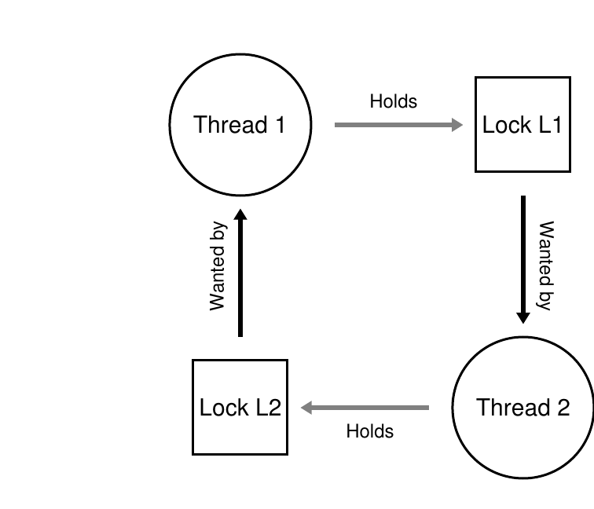

# 第 32 章 常见并发问题

> 英文原题：*Common Concurrency Problems*

研究人员多年间投入了大量精力研究并发 bug。早期工作多聚焦于**死锁(deadlock)** [C+71]；较新的工作则研究其他常见的非死锁 bug。本章从真实代码库抽取一些例子，看看实际中该提防哪些问题。

!!! danger "问题核心：怎样处理常见并发 bug"
    并发 bug 往往遵循几种常见模式。了解该寻找什么，是写出更健壮、更正确的并发代码的第一步。

## 32.1 存在哪些类型的 bug？

复杂并发程序里究竟会出现哪些 bug？Lu 等人 [L+08] 细致分析了 MySQL、Apache、Mozilla 和 OpenOffice 四个成熟开源项目里已经发现并修复的并发 bug，把开发者的修复工作转化成了定量分析：

| 应用 | 用途 | 非死锁 | 死锁 |
| --- | --- | ---: | ---: |
| MySQL | 数据库服务器 | 14 | 9 |
| Apache | Web 服务器 | 13 | 4 |
| Mozilla | Web 浏览器 | 41 | 16 |
| OpenOffice | 办公套件 | 6 | 2 |
| **合计** |  | **74** | **31** |

*图 32.1：现代应用中的 bug。*

共 105 个 bug，其中 74 个不是死锁，31 个是死锁。接下来先借助研究中的实例讨论非死锁 bug，再看如何预防、避免或处理死锁。

## 32.2 非死锁 bug

Lu 等人发现，非死锁 bug 主要有两类：**原子性违反(atomicity violation)** 与**顺序违反(order violation)**。

### 原子性违反

下面是 MySQL 中的一个简化实例：

```c linenums="1"
// 线程 1
if (thd->proc_info) {
    // ...
    fputs(thd->proc_info, ...);
    // ...
}

// 线程 2
thd->proc_info = NULL;
```

线程 1 检查指针非空后，可能在调用 `fputs()` 前被中断；线程 2 乘隙把指针设为 `NULL`，线程 1 恢复后便会解引用空指针而崩溃。

Lu 等人的正式定义是：多个内存访问之间期望的可串行性遭到破坏——某段代码本应原子执行，运行时却没有强制其原子性。这里，“检查非空”与“使用该指针”之间存在未被保证的原子性假设。

常见修复方式是给共享变量的所有访问加同一把锁：

```c linenums="1"
pthread_mutex_t proc_info_lock = PTHREAD_MUTEX_INITIALIZER;

// 线程 1
pthread_mutex_lock(&proc_info_lock);
if (thd->proc_info) {
    // ...
    fputs(thd->proc_info, ...);
    // ...
}
pthread_mutex_unlock(&proc_info_lock);

// 线程 2
pthread_mutex_lock(&proc_info_lock);
thd->proc_info = NULL;
pthread_mutex_unlock(&proc_info_lock);
```

访问这个字段的其他代码也必须遵守同一加锁规则。

### 顺序违反

另一个实例来自 Mozilla：

```c linenums="1"
// 线程 1
void init() {
    // ...
    mThread = PR_CreateThread(mMain, ...);
    // ...
}

// 线程 2
void mMain(...) {
    // ...
    mState = mThread->State;
    // ...
}
```

线程 2 假定 `mThread` 已初始化，但它可能一创建就运行，此时线程 1 尚未来得及把 `PR_CreateThread()` 的返回值赋给 `mThread`。若初值为 `NULL`，会空指针解引用；否则甚至可能访问任意内存。

顺序违反是指两个或两组内存访问之间期望的顺序被颠倒：A 应总在 B 前执行，但运行时没有强制这种顺序。可用条件变量或信号量显式建立顺序：

```c linenums="1"
pthread_mutex_t mtLock = PTHREAD_MUTEX_INITIALIZER;
pthread_cond_t mtCond = PTHREAD_COND_INITIALIZER;
int mtInit = 0;

// 线程 1
void init() {
    // ...
    mThread = PR_CreateThread(mMain, ...);

    // 通知：线程对象已经创建
    pthread_mutex_lock(&mtLock);
    mtInit = 1;
    pthread_cond_signal(&mtCond);
    pthread_mutex_unlock(&mtLock);
    // ...
}

// 线程 2
void mMain(...) {
    // 等待线程对象初始化
    pthread_mutex_lock(&mtLock);
    while (mtInit == 0)
        pthread_cond_wait(&mtCond, &mtLock);
    pthread_mutex_unlock(&mtLock);

    mState = mThread->State;
    // ...
}
```

线程 2 若先运行，就等待状态变化；若后运行，则看到 `mtInit==1` 并继续。也许可以直接用 `mThread` 充当状态变量，这里另设变量只是为了清晰。

研究中 97% 的非死锁 bug 都属于原子性违反或顺序违反。识别这两种模式既能帮助程序员防错，也能指导自动检查工具。不过真实 bug 未必都像示例一样容易修复，有些需要深入理解程序并重组大量代码或数据结构。

## 32.3 死锁 bug

采用复杂加锁协议的并发系统还会遇到经典问题：死锁。设线程 1 持有 L1、等待 L2；线程 2 持有 L2、等待 L1：

```c
线程 1：                       线程 2：
pthread_mutex_lock(L1);        pthread_mutex_lock(L2);
pthread_mutex_lock(L2);        pthread_mutex_lock(L1);
```

这段代码并非每次都死锁，但若线程 1 拿到 L1 后切换到线程 2，而线程 2 拿到 L2 后又请求 L1，二者便互相等待。



*图 32.2：死锁依赖图。*

图中的环表示死锁。

!!! danger "问题核心：怎样对付死锁"
    怎样构造系统来预防、避免，或至少检测死锁并从中恢复？死锁在今天的系统里仍是真实问题吗？

### 死锁为什么会发生？

简单死锁似乎容易避免：所有线程按同一顺序拿锁即可。但大型代码库里，组件之间会形成复杂依赖。例如虚拟内存系统为了从磁盘换入一块内容而访问文件系统，文件系统又可能为了容纳所读数据而向虚拟内存系统申请页面。自然出现的环形依赖让加锁策略必须格外谨慎。

另一个原因是封装。模块化要求隐藏实现细节，却与加锁并不协调 [J+08]。例如 Java `Vector` 的操作：

```cpp
Vector v1, v2;
v1.AddAll(v2);
```

为了线程安全，`AddAll()` 内部必须取得 `v1` 和 `v2` 的锁。若它按 `v1`、`v2` 的顺序拿锁，另一线程又几乎同时调用 `v2.AddAll(v1)`，调用者看不到的实现细节便制造了死锁机会。

### 死锁的四个条件

死锁出现必须同时满足四个条件 [C+71]：

1. **互斥(mutual exclusion)**：线程独占所需资源，例如取得一把锁。
2. **持有并等待(hold-and-wait)**：线程持有已经分配的资源，同时等待其他资源。
3. **不可抢占(no preemption)**：不能强行从持有资源的线程手中拿走资源。
4. **循环等待(circular wait)**：存在一个线程环，环中每条线程持有下一条线程正在请求的一个或多个资源。

任一条件不成立，死锁就不可能发生。因此，预防策略的思路是逐一破坏这些条件。

### 预防：打破循环等待

最实用且常用的方法，是给拿锁建立**全序(total ordering)**。若只有 L1 和 L2，就规定永远先拿 L1，再拿 L2。复杂系统也可采用偏序；Linux 内存映射代码曾列出十组获取顺序，从“`i_mutex` 先于 `i_mmap_mutex`”到多把锁的长链 [T+94]。

全序或偏序必须被仔细设计和严格遵守，一个疏忽便足以引发死锁，而且设计者需要深刻理解各例程之间的调用关系。

!!! tip "提示：用锁地址强制锁顺序"
    若函数 `do_something(mutex_t *m1, mutex_t *m2)` 必须拿两把锁，仅仅规定“先参数 1”并不安全：两条线程可能分别以 `(L1,L2)` 和 `(L2,L1)` 调用。可以统一按地址从高到低（或从低到高）拿锁：

    ```c
    if (m1 > m2) {
        pthread_mutex_lock(m1);
        pthread_mutex_lock(m2);
    } else {
        pthread_mutex_lock(m2);
        pthread_mutex_lock(m1);
    }
    // 假定 m1 != m2
    ```

    无论参数次序如何，实际取锁顺序始终一致。

### 预防：打破持有并等待

可以原子地一次取得所有锁：

```c linenums="1"
pthread_mutex_lock(prevention);   // 开始取得锁
pthread_mutex_lock(L1);
pthread_mutex_lock(L2);
// ...
pthread_mutex_unlock(prevention); // 结束
```

全局的 `prevention` 锁保证拿锁过程不会与别的线程交错。代价也很明显：每条线程都必须遵守协议；调用例程前必须知道它内部需要哪些锁，破坏了封装；锁又会早于实际需要时取得，降低并发度。

### 预防：打破不可抢占

`pthread_mutex_trylock()` 在锁可用时取得它并返回成功，否则立刻报错。借助它，一条线程拿不到第二把锁时可以主动放弃第一把再重试：

```c linenums="1"
top:
    pthread_mutex_lock(L1);
    if (pthread_mutex_trylock(L2) != 0) {
        pthread_mutex_unlock(L1);
        goto top;
    }
```

即使另一线程按 L2、L1 的相反顺序尝试，也不会死锁。不过会出现**活锁(livelock)**：两条线程可能一再同时取得一把、同时失败、同时释放，始终忙碌却毫无进展。重试前加入随机延迟能降低持续碰撞的概率。

这种方案仍受封装困扰：若锁藏在被调用例程里，“退回开头”很难实现；若途中还取得了内存等其他资源，重试前也必须全部释放。它不是真正强夺别人的锁，而是让线程优雅地“抢占”自己对锁的所有权。

### 预防：打破互斥

最后一种方法是彻底不用互斥锁。Herlihy 提出利用强大的硬件原子指令构造**无锁(lock-free)** 乃至**无等待(wait-free)** 数据结构 [H91, H93]。例如比较并交换：

```c linenums="1"
int CompareAndSwap(int *address, int expected, int new) {
    if (*address == expected) {
        *address = new;
        return 1; // 成功
    }
    return 0;     // 失败
}
```

用它实现原子递增：

```c linenums="1"
void AtomicIncrement(int *value, int amount) {
    do {
        int old = *value;
    } while (CompareAndSwap(value, old, old + amount) == 0);
}
```

操作反复尝试把旧值替换为新值，不取得锁，因此不会死锁，尽管仍可能活锁。

普通的链表头插入存在竞争：

```c linenums="1"
void insert(int value) {
    node_t *n = malloc(sizeof(node_t));
    assert(n != NULL);
    n->value = value;
    n->next = head;
    head = n;
}
```

传统方案只给真正访问共享表头的部分加锁；节点分配和初始化仍在锁外，以缩短临界区：

```c linenums="1"
void insert(int value) {
    node_t *n = malloc(sizeof(node_t));
    assert(n != NULL);
    n->value = value;
    pthread_mutex_lock(listlock);
    n->next = head;
    head = n;
    pthread_mutex_unlock(listlock);
}
```

也可以用比较并交换实现无锁头插：

```c linenums="1"
void insert(int value) {
    node_t *n = malloc(sizeof(node_t));
    assert(n != NULL);
    n->value = value;
    do {
        n->next = head;
    } while (CompareAndSwap(&head, n->next, n) == 0);
}
```

若别的线程抢先换了表头，比较并交换失败，本线程读取新表头后重试。完整支持插入、删除和查找的无锁链表远比这个片段复杂，可继续阅读 [H01, H91, H93]。

### 通过调度避免死锁

**死锁避免(deadlock avoidance)** 不去破坏四个条件，而是预先掌握各线程可能需要哪些锁，再安排不会死锁的调度。

假设两颗 CPU 上要运行 T1～T4，资源需求如下：

| 锁 | T1 | T2 | T3 | T4 |
| --- | --- | --- | --- | --- |
| L1 | 是 | 是 | 否 | 否 |
| L2 | 是 | 是 | 是 | 否 |

只要不让 T1 与 T2 同时运行，就能保证没有死锁；T3 只拿一把锁，可以与二者之一重叠：

```text
CPU 1:  T3 ────── T4 ──────
CPU 2:       T1 ────── T2 ──────
```

若 T1、T2、T3 都要 L1 与 L2：

| 锁 | T1 | T2 | T3 | T4 |
| --- | --- | --- | --- | --- |
| L1 | 是 | 是 | 是 | 否 |
| L2 | 是 | 是 | 是 | 否 |

保守调度可能把前三条线程全放在同一 CPU 上串行执行：

```text
CPU 1:      T4 ──────
CPU 2:  T1 ────── T2 ────── T3 ──────
```

这保证安全，却大幅延长完成时间。Dijkstra 的银行家算法 [D64] 是著名实例，但这类办法通常只适用于能预知全部任务和锁需求的受限环境，例如嵌入式系统；它还可能牺牲大量并发性，因此不是通用方案。

### 检测并恢复

最后一种策略是容许死锁偶尔发生，检测到后再处理。若操作系统一年才冻结一次，重启也许就是务实选择。

许多数据库系统会定期构造资源图并检查环。发现死锁后可以中止或重启相关工作；若还要修复复杂数据结构，则可能需要人工介入。数据库并发、死锁与恢复的更多细节见 [B+87, K87]。

!!! tip "提示：不必永远做到完美（Tom West 定律）"
    Tom West 的工程格言是：“并非每件值得做的事都值得做好。”若坏事极少发生且代价很小，不应花费巨大精力预防；航天飞机爆炸这类高代价风险当然另当别论。工程总受期限和现实约束，必须判断哪些部分现在要做好、哪些可以留待以后；这种判断只能来自经验与投入。

## 32.4 小结

并发程序中的非死锁 bug 很常见，但往往较易修复：原子性违反让本应一起执行的指令序列被拆开，顺序违反则没有强制两条线程之间所需的先后关系。

死锁与并发本身一样古老。实践中最好的办法通常是小心设计并严格遵守取锁顺序，从源头预防。无等待数据结构也很有前景，已经进入 Linux 等常用库和关键系统；但它们缺乏通用性，设计新结构又非常复杂，因而应用范围有限。

也许更好的方向是新的并发编程模型。例如 Google 的 MapReduce [GD02] 让程序员无需任何锁便能描述某类并行计算。锁天生棘手，除非确实需要，也许应尽量避免。

## 参考文献

- [B+87] *Concurrency Control and Recovery in Database Systems* by Philip A. Bernstein, Vassos Hadzilacos, and Nathan Goodman. Addison-Wesley, 1987. 数据库并发控制的经典著作。
- [C+71] “System Deadlocks” by E. G. Coffman, M. J. Elphick, and A. Shoshani. *ACM Computing Surveys*, 3(2), June 1971. 概括死锁条件与应对办法的经典论文。
- [D64] “Een algorithme ter voorkoming van de dodelijke omarming” by Edsger Dijkstra. 1964. <http://www.cs.utexas.edu/users/EWD/ewd01xx/EWD108.PDF>. Dijkstra 当时称死锁为“致命拥抱”。
- [GD02] “MapReduce: Simplified Data Processing on Large Clusters” by Sanjay Ghemawat and Jeff Dean. OSDI '04, San Francisco, October 2004.
- [H01] “A Pragmatic Implementation of Non-blocking Linked-lists” by Tim Harris. DISC, 2001. 展示不用锁构造并发链表的困难。
- [H91] “Wait-free Synchronization” by Maurice Herlihy. *ACM TOPLAS*, 13(1), January 1991. 无等待并发编程的开创性工作。
- [H93] “A Methodology for Implementing Highly Concurrent Data Objects” by Maurice Herlihy. *ACM TOPLAS*, 15(5), November 1993. 无锁与无等待结构综述。
- [J+08] “Deadlock Immunity: Enabling Systems To Defend Against Deadlocks” by Horatiu Jula et al. OSDI '08, San Diego, December 2008.
- [K81] *The Soul of a New Machine* by Tracy Kidder. Back Bay Books, 2000（1980 年版本重印）。记录 Tom West 团队制造“新机器”的经典著作。
- [K87] “Deadlock Detection in Distributed Databases” by Edgar Knapp. *ACM Computing Surveys*, 19(4), December 1987.
- [L+08] “Learning from Mistakes — A Comprehensive Study on Real World Concurrency Bug Characteristics” by Shan Lu et al. ASPLOS '08, Seattle, March 2008. 本章所依据的真实软件并发 bug 深入研究。
- [T+94] “Linux File Memory Map Code” by Linus Torvalds et al. Linux 内存映射代码展示了真实系统中复杂的锁顺序。

## 作业（代码）

本作业研究会死锁或避免死锁的真实代码。各版本对应简化向量 `add()` 中不同的死锁避免策略，公共基础代码与程序细节见 `README`。

1. 阅读 `vector-deadlock.c`、`main-common.c` 及相关文件，理解程序与关键选项。运行 `./vector-deadlock -n 2 -l 1 -v`：两条线程各执行一次向量加法，并输出详细信息。解释输出，并观察每次运行有何变化。
2. 加上 `-d`，把循环次数 `-l` 从 1 调大。会发生什么？代码是否总会死锁？
3. 改变线程数 `-n` 会怎样影响结果？是否存在能够保证不死锁的 `-n` 值？
4. 阅读 `vector-global-order.c`。它怎样避免死锁？当源向量和目标向量相同时，为什么 `vector_add()` 里必须有特殊处理？
5. 用 `-t -n 2 -l 100000 -d` 运行。完成要多久？增加循环数或线程数时，总时间怎样变化？
6. 打开并行选项 `-p` 会怎样？各线程分别操作不同向量与共同操作同一组向量相比，预期性能如何变化？
7. 阅读 `vector-try-wait.c`。第一次 `pthread_mutex_trylock()` 是否真的需要？运行并与全局顺序方案比较速度；线程数增加时，代码统计的重试次数怎样变化？
8. 阅读 `vector-avoid-hold-and-wait.c`。这个方案的主要问题是什么？分别在启用和不启用 `-p` 时，它与其他版本相比表现如何？
9. 阅读完全不用锁的 `vector-nolock.c`。它与其他版本提供完全相同的语义吗？为什么？
10. 比较无锁版本与其他版本的性能：既测试线程操作同一对向量（无 `-p`），也测试各线程操作不同向量（`-p`）。无锁版本表现如何？
