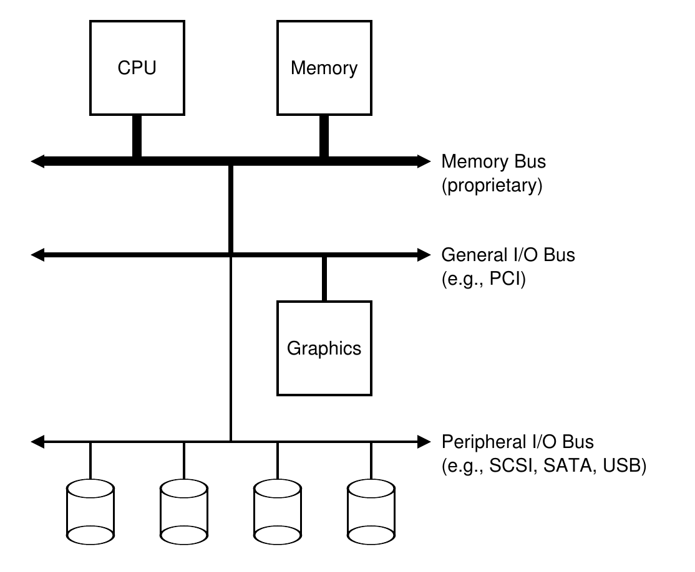
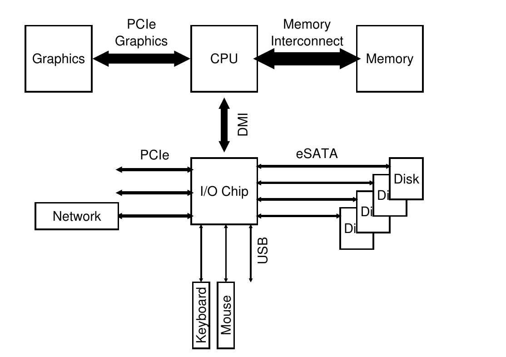
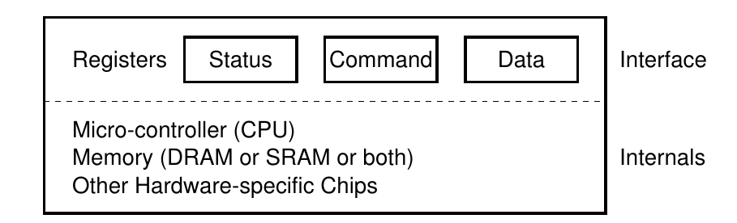
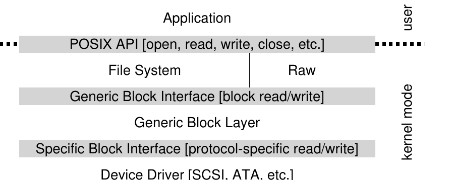

# 第 36 章 I/O 设备

> 英文原题：*I/O Devices*

在深入本书这一部分的主角——持久化——之前，我们先介绍输入/输出设备，也就是 **I/O 设备(I/O device)**，并看看操作系统怎样与它交互。I/O 对计算机系统当然至关重要。想象一个没有输入的程序：它每次都产生同样的结果；再想象一个没有输出的程序：那它跑起来究竟图什么？计算机系统要想有点意思，输入和输出缺一不可。

!!! danger "问题核心：怎样把 I/O 集成进系统"
    应该怎样把 I/O 集成进系统？有哪些通用机制？怎样让它们高效工作？

## 36.1 系统体系结构

先看一张典型系统的“经典”结构图（图 36.1）。单颗 CPU 通过某种内存总线或互连连接主存。一部分设备挂在通用 I/O 总线上；现代系统中，这通常是 PCI 或它的某种变体，显卡和其他高性能 I/O 设备可能就在这里。再往下则是一条或多条外设总线(peripheral bus)，例如 SCSI、SATA 或 USB，用来连接磁盘、鼠标、键盘等较慢的设备。



*图 36.1：典型系统体系结构。*

你也许会问：为什么非要分成这种层次结构？简单说，是物理规律和成本使然。总线越快，允许的长度通常越短，所以高性能内存总线没有多少空间给各式设备插进来；设计高性能总线本身也很昂贵。于是系统设计者采用分层方案：显卡等高性能部件离 CPU 更近，低性能部件放得更远。磁盘等慢设备挂在外设总线上的好处很多，其中之一便是可以接入大量设备。

现代系统越来越多地使用专用芯片组和更快的点对点互连。图 36.2 粗略展示了 Intel Z270 芯片组 [H17]。CPU 与内存系统连接最紧密，同时用高性能链路连接显卡和显示器，以便玩游戏（噢，多么可怕！）以及运行其他图形密集型应用。



*图 36.2：现代系统体系结构。*

CPU 通过 Intel 专有的直接媒体接口(Direct Media Interface, DMI)连接 I/O 芯片，其余设备再经不同互连连到这块芯片。右侧的一块或多块硬盘通过 eSATA 接口连接；从 ATA（AT Attachment，名字来自它为 IBM PC AT 提供连接），到 SATA（Serial ATA），再到 eSATA（external SATA），存储接口几十年来一路演进，每一步都在提高性能，以跟上现代存储设备的脚步。

I/O 芯片下方是若干 USB（Universal Serial Bus）连接，图中接着键盘和鼠标。许多现代系统也确实用 USB 连接这些低性能设备。左侧则可通过 PCIe（Peripheral Component Interconnect Express）连接其他高性能设备。图中接的是网络接口；NVMe 持久化存储等高性能存储设备也经常连在这里。

## 36.2 标准设备

下面看一个标准化的设备模型——它不是某种真实设备，只是帮助我们理解高效设备交互需要哪些机制。图 36.3 表明，一个设备有两个重要组成部分。

第一部分是它呈现给系统其他部分的硬件接口(hardware interface)。软件要有接口，硬件同样要提供接口，让系统软件可以控制它。因此，每种设备都规定了完成常规交互所需的接口和协议。

第二部分是设备的内部结构。它取决于具体实现，负责实现设备向系统呈现的抽象。非常简单的设备可能只有一两块芯片；复杂设备则会带一颗简单的 CPU、一些通用内存和其他设备专用芯片。例如，现代 RAID 控制器的固件(firmware)可能有几十万行，专门用来实现设备功能。



*图 36.3：标准设备。*

## 36.3 标准协议

图中的简化设备接口由三类设备寄存器(device register)组成：读取**状态寄存器**可以查看设备现状；写入**命令寄存器**可以要求设备执行任务；**数据寄存器**则用于向设备发送数据或从中取回数据。操作系统读写这些寄存器，便能控制设备行为。

下面是一段典型协议，展示操作系统怎样请设备替它办事：

```c
while (STATUS == BUSY)
    ; // 等到设备不再忙碌
write data to DATA register
write command to COMMAND register
    // 这会启动设备并执行命令
while (STATUS == BUSY)
    ; // 等到设备完成请求
```

协议分四步。第一，操作系统反复读取状态寄存器，等设备准备好接收命令；这叫**轮询(polling)**，说白了就是一遍遍问设备“你好了没”。第二，操作系统把数据写入数据寄存器。若设备是磁盘，传输一个 4 KB 磁盘块可能需要多次写入。像这里这样由主 CPU 参与搬运数据，称为**程序控制 I/O(programmed I/O, PIO)**。第三，操作系统写命令寄存器，告诉设备数据已经就位，可以开工。第四，操作系统再次循环轮询，等待设备完成；结束后还可能读取错误码，判断操作成功还是失败。

这种协议简单而且能用，但也不怎么省心。最明显的问题是轮询太浪费：CPU 把大量时间花在等待一个可能很慢的设备上，本来完全可以切换到另一个就绪进程，提高 CPU 利用率。

!!! danger "问题核心：怎样避免轮询开销"
    操作系统怎样在不频繁轮询的情况下检查设备状态，从而降低管理设备所需的 CPU 开销？

## 36.4 用中断降低 CPU 开销

工程师很早便找到了改进办法：使用我们已经见过的**中断(interrupt)**。操作系统不再反复轮询，而是发出请求，让调用进程睡眠，再上下文切换到其他任务。设备终于完成操作时，会触发硬件中断，使 CPU 跳转到预定的**中断服务程序(interrupt service routine, ISR)**，也就是中断处理程序。处理程序完成请求——例如读取数据和错误码——并唤醒等待 I/O 的进程，后者便可继续执行。

中断让计算与 I/O 得以重叠，这是提高利用率的关键。没有中断时，时间线大致如下；`p` 表示 CPU 正在轮询：

| 资源 | 时间线 |
|---|---|
| CPU | `1 1 1 1 1 p p p p p 1 1 1 1 1` |
| 磁盘 | `          1 1 1 1 1          ` |

进程 1 先在 CPU 上运行一阵，然后向磁盘发出读取请求。系统只能原地打转，反复读取设备状态，直到磁盘完成 I/O，进程 1 才能继续。

改用中断并让工作重叠后，时间线变成：

| 资源 | 时间线 |
|---|---|
| CPU | `1 1 1 1 1 2 2 2 2 2 1 1 1 1 1` |
| 磁盘 | `          1 1 1 1 1          ` |

磁盘替进程 1 服务时，操作系统让进程 2 使用 CPU。磁盘完成后发出中断，操作系统唤醒并重新运行进程 1。中间这一段里，CPU 和磁盘都没闲着。

!!! tip "中断不一定胜过 PIO"
    中断虽然能让计算与 I/O 重叠，却只对慢设备真正划算。设备很快时，中断处理和上下文切换的成本可能超过收益。中断洪泛还可能把系统拖入活锁 [MR96]；此时轮询反而能让操作系统更好地控制调度。

若设备很快，第一次轮询通常就会发现任务已经完成，此时切换进程、处理中断再切回来，反而更慢。若设备很慢，中断通常更合适。若设备速度未知，或时快时慢，可以采用两阶段混合方案：先轮询一小会儿；若设备还没完成，再改用中断。两边的便宜都想占，没准真能占到。

网络是另一个不能迷信中断的场景 [MR96]。大量入站分组各自触发中断，可能让操作系统陷入活锁：它只顾处理中断，始终没有机会运行用户进程来真正服务请求。比如某个 Web 服务器突然登上 Hacker News 榜首，流量一下爆棚 [H18]。这时偶尔轮询，先让 Web 服务器处理一批请求，再回头检查新分组，反而更可控。

另一项优化叫**中断合并(interrupt coalescing)**。设备需要发中断时先稍等一下；等待期间其他请求也可能完成，于是多次中断可以合并成一次，降低处理开销。当然，等太久会增加请求延迟——系统里熟悉得不能再熟悉的取舍。Ahmad 等人对此有很好的综述 [A+11]。

## 36.5 用 DMA 提高数据搬运效率

标准协议还有一个问题。用 PIO 向设备传输大块数据时，CPU 又被一项机械活儿缠住了：它得亲手一个字一个字地搬数据，白白浪费本可用于运行其他进程的时间。

| 资源 | 时间线 |
|---|---|
| CPU | `1 1 1 1 1 c c c 2 2 2 2 2 1 1` |
| 磁盘 | `                1 1 1 1 1    ` |

进程 1 要把数据写入磁盘，CPU 先显式地把数据从内存复制到设备，图中以 `c` 表示。复制结束后磁盘 I/O 才开始，CPU 终于能去做别的事。

!!! danger "问题核心：怎样降低 PIO 开销"
    使用 PIO 时，CPU 花了太多时间亲手在设备之间搬数据。怎样卸下这项工作，让 CPU 得到更有效的利用？

答案是**直接内存访问(Direct Memory Access, DMA)**。DMA 引擎是系统中的专用设备，可以在几乎不需要 CPU 干预的情况下，安排设备与主存之间的数据传输。

以向设备发送数据为例，操作系统只需告诉 DMA 引擎：数据在内存中的什么位置、要复制多少、目标设备是哪一个。此后操作系统便可去做其他工作。DMA 完成时，控制器触发中断，通知操作系统传输已经结束。

| 资源 | 时间线 |
|---|---|
| CPU | `1 1 1 1 1 2 2 2 2 2 2 2 2 1 1` |
| DMA | `          c c c                    ` |
| 磁盘 | `                1 1 1 1 1          ` |

数据复制现在由 DMA 控制器承担。CPU 腾出手来运行进程 2，于是进程 1 恢复之前，进程 2 能获得更多 CPU 时间。

## 36.6 与设备交互的方法

我们已经了解了 I/O 效率问题，却还没真正说明操作系统怎样同设备说话。

!!! danger "问题核心：怎样与设备通信"
    硬件应该怎样同设备通信？需要显式的专用指令吗？还是另有办法？

设备通信主要形成了两种方法。较早的一种——IBM 大型机多年使用的方案——是提供显式 I/O 指令。操作系统通过这些指令向指定设备寄存器发送数据，从而实现前面描述的协议。

例如，x86 的 `in` 和 `out` 指令可以与设备通信。调用者指定装有数据的寄存器以及代表设备的特定端口，执行指令即可完成操作。这些通常是特权指令：设备由操作系统控制，只有操作系统能直接同它们通信。想象一下任何程序都能随便读写磁盘的景象——一如既往，天下大乱；用户程序随手便能借这个漏洞接管整台机器。

第二种方法叫**内存映射 I/O(memory-mapped I/O)**。硬件让设备寄存器表现得像内存位置。操作系统要访问某个寄存器，只需向相应地址发出加载或存储操作，硬件会把它路由到设备而非主存。

两种方法并没有谁占据压倒性优势。内存映射方案的好处是不需要增加新指令；如今两者仍都在使用。

## 36.7 把设备装进操作系统：设备驱动程序

最后一个问题是，设备接口各不相同，操作系统却希望尽量保持通用。以文件系统为例，我们希望同一个文件系统能运行在 SCSI 磁盘、IDE 磁盘、USB 闪存盘等设备之上，而不用知道每种设备究竟怎样发出读写请求。

!!! danger "问题核心：怎样构建与设备无关的操作系统"
    怎样让操作系统的大部分代码与具体设备无关，把设备交互细节藏在主要子系统之外？

答案又是那门古老的手艺：抽象。在操作系统最底层，必须有一段软件彻底了解某种设备怎样工作；它叫作**设备驱动程序(device driver)**，负责把所有设备交互细节封装起来。

Linux 文件系统的软件栈大致如图 36.4。文件系统以及更上层的应用完全不必知道自己面对哪一类磁盘，只需向**通用块层(generic block layer)**发出块读写请求。通用块层把请求送到正确的设备驱动程序，再由驱动处理具体细节。图虽简化，却清楚展示了怎样把这些细节藏在操作系统的大部分代码之外。



*图 36.4：文件系统栈。*

图中还有设备的**裸接口(raw interface)**。文件系统检查器 [AD14]、磁盘碎片整理工具等特殊应用可以绕过文件抽象，直接读写设备块。大多数系统都提供此类接口，以支持底层存储管理工具。

封装也有代价。假设某种设备拥有很多特殊能力，却必须通过通用接口面对内核其他部分，这些能力可能根本用不上。Linux 的 SCSI 设备便是如此：SCSI 的错误报告很丰富，但 ATA/IDE 等块设备只能提供简单错误处理，因此上层软件最终只会收到通用的 `EIO`（I/O 错误）代码；SCSI 提供的额外细节就这样在抵达文件系统前丢了 [G08]。

有趣的是，任何可能插入系统的设备都需要驱动程序，久而久之，驱动便占据了内核代码的巨大比例。研究表明，Linux 超过 70% 的操作系统代码都在设备驱动程序中 [C01]，Windows 很可能也不遑多让。别人说操作系统有几百万行代码时，其实多半是在说它有几百万行驱动代码。当然，对某次具体安装而言，其中大部分并未启用——一台机器同一时刻只连接少数设备。更让人泄气的是，驱动常由“业余选手”而非全职内核开发者编写，错误更多，也是内核崩溃的重要来源 [S03]。

## 36.8 案例：简单的 IDE 磁盘驱动程序

下面深入一点，看看真实的 IDE 磁盘 [L94]。我们先概括资料 [W10] 中的协议，再瞄一眼 xv6 中可工作的简单 IDE 驱动 [CK+08]。

IDE 磁盘向系统提供四类寄存器：控制、命令块、状态和错误寄存器。x86 上可以用 `in`、`out` 指令读取或写入特定 I/O 地址，例如 `0x3F6`。

| 地址 | 寄存器或含义 |
|---|---|
| `0x3F6` | 控制寄存器；`R` 表示复位，`E=0` 表示启用中断 |
| `0x1F0` | 数据端口 |
| `0x1F1` | 错误寄存器 |
| `0x1F2` | 扇区数 |
| `0x1F3` | LBA 低字节 |
| `0x1F4` | LBA 中字节 |
| `0x1F5` | LBA 高字节 |
| `0x1F6` | `1B1D TOP4LBA`；`B` 表示 LBA，`D` 表示驱动器 |
| `0x1F7` | 命令/状态寄存器 |

状态寄存器各位依次为 `BUSY READY FAULT SEEK DRQ CORR IDDEX ERROR`。当 `ERROR` 置位时，再读取错误寄存器；其中 `BBK` 表示坏块，`UNC` 表示不可纠正数据错误，`MC` 表示介质已更换，`IDNF` 表示找不到 ID 标记，`MCR` 表示请求更换介质，`ABRT` 表示命令中止，`T0NF` 表示找不到 0 号磁道，`AMNF` 表示找不到地址标记。

*图 36.5：IDE 接口（以表格重排）。*

假设设备已经初始化，基本协议如下：

1. **等待驱动器就绪。** 反复读取状态寄存器 `0x1F7`，直到驱动器为 `READY` 且不为 `BUSY`。
2. **把参数写入命令寄存器。** 向 `0x1F2`～`0x1F6` 写入扇区数、要访问扇区的逻辑块地址(LBA)和驱动器编号；IDE 只允许两个驱动器，主盘为 `0x00`，从盘为 `0x10`。
3. **启动 I/O。** 向命令寄存器 `0x1F7` 写入 `READ` 或 `WRITE` 命令。
4. **传输写入数据。** 等待状态变为 `READY` 且 `DRQ` 置位，再把数据写入数据端口。
5. **处理中断。** 最简单的方案是每传输一个扇区处理一次中断；更复杂的方案可以成批传输，全部完成后只触发一次中断。
6. **处理错误。** 每项操作后读取状态寄存器；若 `ERROR` 位开启，再读错误寄存器取得详情。

xv6 驱动中的主要代码如下。代码本身忠于原书的简化版本，注释已译为中文：

```c
static int ide_wait_ready() {
    while (((int r = inb(0x1f7)) & IDE_BSY) || !(r & IDE_DRDY))
        ; // 循环，直到驱动器不忙
}

static void ide_start_request(struct buf *b) {
    ide_wait_ready();
    outb(0x3f6, 0);                         // 产生中断
    outb(0x1f2, 1);                         // 多少个扇区？
    outb(0x1f3, b->sector & 0xff);          // LBA 写在这里……
    outb(0x1f4, (b->sector >> 8) & 0xff);   // ……还有这里
    outb(0x1f5, (b->sector >> 16) & 0xff);  // ……以及这里！
    outb(0x1f6, 0xe0 | ((b->dev&1)<<4) | ((b->sector>>24)&0x0f));
    if (b->flags & B_DIRTY) {
        outb(0x1f7, IDE_CMD_WRITE);         // 这是一次写入
        outsl(0x1f0, b->data, 512/4);       // 数据也要传过去！
    } else {
        outb(0x1f7, IDE_CMD_READ);          // 这是一次读取（无数据）
    }
}

void ide_rw(struct buf *b) {
    acquire(&ide_lock);
    for (struct buf **pp = &ide_queue; *pp; pp=&(*pp)->qnext)
        ;                                   // 遍历队列
    *pp = b;                                // 把请求加到末尾
    if (ide_queue == b)                     // 若队列为空
        ide_start_request(b);               // 把请求发给磁盘
    while ((b->flags & (B_VALID|B_DIRTY)) != B_VALID)
        sleep(b, &ide_lock);                // 等待完成
    release(&ide_lock);
}

void ide_intr() {
    struct buf *b;
    acquire(&ide_lock);
    if (!(b->flags & B_DIRTY) && ide_wait_ready() >= 0)
        insl(0x1f0, b->data, 512/4);        // 若为读取：取得数据
    b->flags |= B_VALID;
    b->flags &= ~B_DIRTY;
    wakeup(b);                              // 唤醒等待进程
    if ((ide_queue = b->qnext) != 0)        // 启动下一个请求
        ide_start_request(ide_queue);       // （如果存在）
    release(&ide_lock);
}
```

*图 36.6：xv6 IDE 磁盘驱动程序（简化版）。*

初始化以后，这段驱动主要围绕四个函数工作。`ide_rw()` 把请求排入队列；若没有其他待处理请求，就通过 `ide_start_request()` 直接发给磁盘。无论哪种情况，它都会让调用进程睡眠，等请求完成。`ide_start_request()` 向磁盘发送请求；若是写入，也一并发送数据。它通过 x86 的 `in`、`out` 指令读写设备寄存器，并调用 `ide_wait_ready()` 确保磁盘已经就绪。最后，中断发生时调用 `ide_intr()`：若请求是读取，它从设备取得数据；随后唤醒等待 I/O 的进程；如果队列里还有请求，再启动下一项 I/O。

## 36.9 历史札记

结束前，简单聊聊这些基本思想从哪里来。想深入了解，可以阅读 Smotherman 的精彩综述 [S08]。

中断是非常古老的思想，最早的机器上已经出现。例如，20 世纪 50 年代初的 UNIVAC 已有某种中断向量机制，尽管具体从哪一年开始提供已说不清 [S08]。计算机历史才刚起步没多久，它的源头竟已经开始消失，多少让人遗憾。

哪台机器最先引入 DMA 也有争议。Knuth 等人认为是 DYSEAC——当年所谓“移动式”机器，是指能装上拖车拉走——另一些人则认为 IBM SAGE 才是第一台 [S08]。无论如何，到 20 世纪 50 年代中期，设备可以直接与内存通信、完成后中断 CPU 的系统已经存在。

这段历史很难追踪，因为发明总和真实而有时冷门的机器绑在一起。有人认为 Lincoln Labs 的 TX-2 最早采用向量中断 [S08]，但依旧没有定论。

这些想法其实相当自然：慢吞吞的 I/O 没做完时，让 CPU 先去干别的，并不需要爱因斯坦式的飞跃。因此，执着追问“究竟谁第一”也许并无必要。可以肯定的是，早期机器一造出来，I/O 支持的需求就变得显而易见；中断、DMA 以及相关思想，都是快 CPU 与慢设备之间天然矛盾的直接结果。若你当时也在场，说不定会想到同样的办法。

## 36.10 小结

现在，你应该已经初步理解操作系统怎样与设备交互。我们介绍了中断和 DMA，用来提高设备效率；介绍了访问设备寄存器的两种方式——显式 I/O 指令和内存映射 I/O；最后又介绍了设备驱动程序，展示操作系统怎样封装底层细节，使其他部分更容易以与设备无关的方式构建。

## 参考文献

- [A+11] “vIC: Interrupt Coalescing for Virtual Machine Storage Device IO” by Irfan Ahmad, Ajay Gulati, Ali Mashtizadeh. USENIX '11. 一篇极佳的综述，讨论传统环境和虚拟化环境中的中断合并。
- [AD14] “Operating Systems: Three Easy Pieces” (Chapters: Crash Consistency: FSCK and Journaling and Log-Structured File Systems) by Remzi Arpaci-Dusseau and Andrea Arpaci-Dusseau. Arpaci-Dusseau Books, 2014. 介绍文件系统检查器及其工作方式；这类工具需要普通文件系统接口不直接提供的底层磁盘访问能力。
- [C01] “An Empirical Study of Operating System Errors” by Andy Chou, Junfeng Yang, Benjamin Chelf, Seth Hallem, Dawson Engler. SOSP '01. 最早系统研究现代操作系统错误数量的论文之一。许多有趣发现中，有一条是设备驱动程序的错误大约为内核主体代码的七倍。
- [CK+08] “The xv6 Operating System” by Russ Cox, Frans Kaashoek, Robert Morris, Nickolai Zeldovich. <http://pdos.csail.mit.edu/6.828/2008/index.html>. 可查看 `ide.c` 中的 IDE 驱动程序，里面还有更多细节。
- [D07] “What Every Programmer Should Know About Memory” by Ulrich Drepper. November, 2007. <http://www.akkadia.org/drepper/cpumemory.pdf>. 一篇介绍现代内存系统的神作，从 DRAM 一直讲到虚拟化和缓存优化算法。
- [G08] “EIO: Error-handling is Occasionally Correct” by Haryadi Gunawi, Cindy Rubio-Gonzalez, Andrea Arpaci-Dusseau, Remzi Arpaci-Dusseau, Ben Liblit. FAST '08, San Jose, CA, February 2008. 我们构建工具、寻找 Linux 文件系统中未正确处理错误返回的代码，发现了数百个错误，其中许多如今已经修复。
- [H17] “Intel Core i7-7700K review: Kaby Lake Debuts for Desktop” by Joel Hruska. January 3, 2017. <https://www.extremetech.com/extreme/241950-intels-core-i7-7700k-reviewed-kaby-lake-debuts-desktop>. 一篇对当时 Intel 芯片组的深入评测，涵盖 CPU 和 I/O 子系统。
- [H18] “Hacker News” by many contributors. <https://news.ycombinator.com>. 相当不错的技术内容聚合站。2014 年，本书有一次登上高位，仅一天便带来一百万次章节下载！可惜那样的盛况至今没有重演。
- [L94] “AT Attachment Interface for Disk Drives” by Lawrence J. Lamers. ANSI X3.221, 1994. <ftp://ftp.t10.org/t13/project/d0791r4c-ATA-1.pdf>. 一份相当干巴的设备接口文档。阅读风险自负。
- [MR96] “Eliminating Receive Livelock in an Interrupt-driven Kernel” by Jeffrey Mogul, K. K. Ramakrishnan. USENIX '96, San Diego, CA, January 1996. Mogul 等人在 Web 服务器网络性能方面做了大量开创性工作，这篇便是代表之一。
- [S08] “Interrupts” by Mark Smotherman. July 2008. <http://people.cs.clemson.edu/~mark/interrupts.html>. 一座资料宝库，收集了中断、DMA 和早期计算机相关思想的历史。
- [S03] “Improving the Reliability of Commodity Operating Systems” by Michael M. Swift, Brian N. Bershad, Henry M. Levy. SOSP '03. Swift 的工作重新唤起了人们对类微内核方案的兴趣，至少给出了为什么基于地址空间的保护在现代操作系统中仍有用的有力理由。
- [W10] “Hard Disk Driver” by Washington State Course Homepage. <http://eecs.wsu.edu/~cs460/cs560/HDdriver.html>. 一份很好的 IDE 磁盘接口与驱动程序构建摘要。
