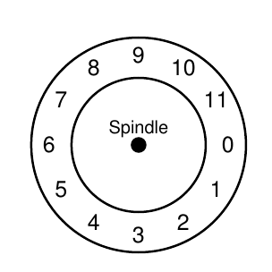
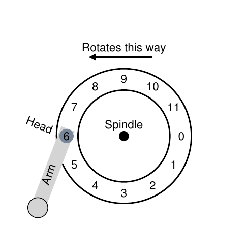
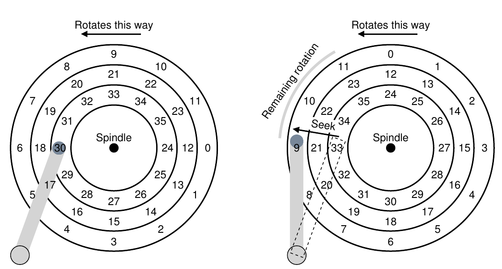
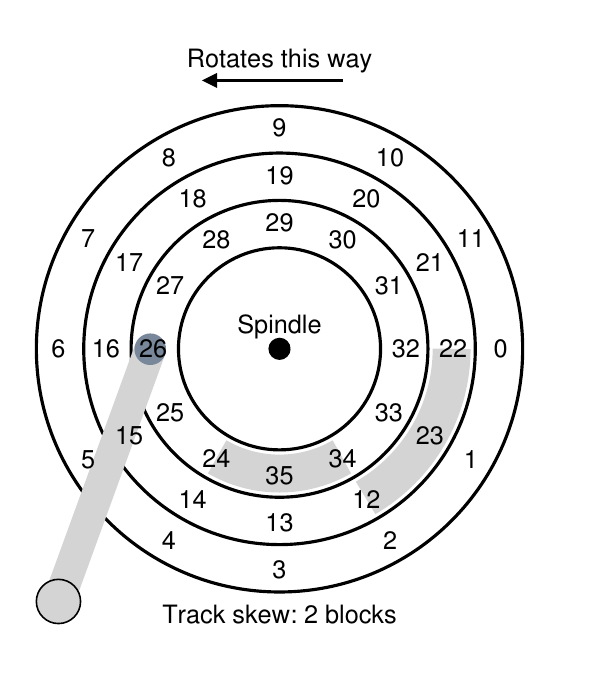
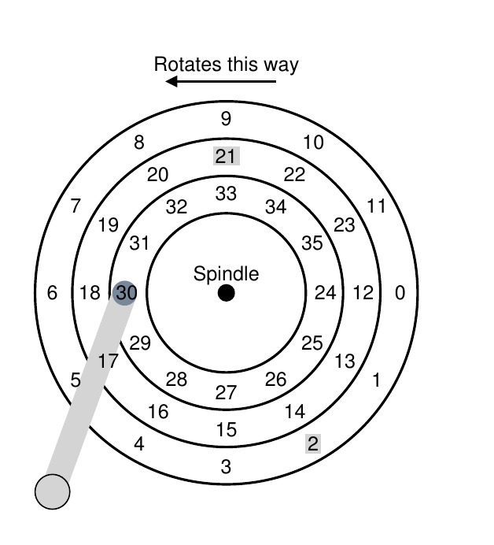
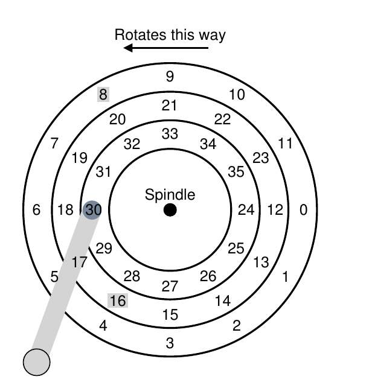

# 第 37 章 硬盘驱动器

> 英文原题：*Hard Disk Drives*

上一章介绍了 I/O 设备的一般概念，也展示了操作系统怎样同这种家伙打交道。本章把镜头拉近，只研究一种设备：**硬盘驱动器(hard disk drive)**。几十年来，硬盘一直是计算机系统持久保存数据的主要方式；后面即将登场的大量文件系统技术，也都建立在硬盘行为之上。因此，在编写管理硬盘的文件系统软件之前，值得先把它的工作细节弄明白。Ruemmler 与 Wilkes [RW92]、Anderson、Dykes 与 Riedel [ADR03] 的优秀论文给出了更多资料。

!!! danger "问题核心：怎样在磁盘上存取数据"
    现代硬盘怎样存储数据？它提供什么接口？数据究竟怎样布局和访问？磁盘调度又怎样提高性能？

## 37.1 接口

现代硬盘的基本接口很直白。硬盘包含大量**扇区(sector)**，也就是可读写的 512 字节块。拥有 $n$ 个扇区的磁盘把它们编号为 $0$ 到 $n-1$；因此可以把磁盘看成一个扇区数组，$0$ 到 $n-1$ 便是驱动器的地址空间。

接口支持多扇区操作，文件系统也常常一次读写 4 KB 或更多数据。不过更新磁盘时，制造商通常只保证单次 512 字节写入具有原子性：它要么完整完成，要么完全不完成。若写入更大范围时突然断电，可能只有一部分落盘，这叫作**撕裂写入(torn write)**。

*图 37.1：只有一条磁道的磁盘。*

硬盘客户通常还依赖一些接口没有明说的假设；Schlosser 与 Ganger 称之为硬盘的“未成文契约” [SG04]。具体而言，访问地址空间中相邻的两个块通常比访问相距很远的两个块更快；连续读取或写入一大片块，通常也是最快的访问方式，远快于随机访问。

## 37.2 基本几何结构

先认识现代硬盘的几个部件。**盘片(platter)**是持久保存数据的圆形硬质表面，数据以磁性变化记录其上。一块硬盘可以有一张或多张盘片；每张盘片有两个**盘面(surface)**。盘片通常由铝等硬质材料制成，再覆盖一层薄薄的磁性材料，使驱动器断电后仍能保存比特。

所有盘片围绕**主轴(spindle)**固定在一起，由电机以恒定速度旋转。转速常以每分钟转数(RPM)衡量，典型值为 7200～15000 RPM。我们经常关心转一圈需要多久；例如 10000 RPM 的驱动器每圈大约需要 6 ms。

数据编码在盘面上一圈圈同心的扇区中，每个同心圆称为一条**磁道(track)**。一个盘面上有成千上万条紧密排列的磁道，人类头发宽度内就能塞下数百条。

要读取或写入盘面，得有机构感知或改变磁性图案，这项工作由**磁头(disk head)**完成，每个盘面对应一个磁头。磁头安装在**磁臂(disk arm)**上，磁臂横跨盘面移动，把磁头定位到目标磁道。

> 本书和其他资料经常混用“块”和“扇区”，默认读者能按上下文判断具体含义。抱歉啦！

*图 37.2：单磁道与磁头。*

## 37.3 一个简单的硬盘

我们逐条增加磁道，搭出一个磁盘模型。先假设磁盘只有图 37.1 中的一条磁道，其中只有 12 个扇区，每个 512 字节，编号 0～11。盘片围绕主轴旋转；光有磁道没什么意思，要读写扇区还得添上连接磁臂的磁头（图 37.2）。图中磁头位于扇区 6 上方，盘面逆时针旋转。

### 单磁道延迟：旋转延迟

假设现在要读取块 0，磁盘该怎样服务？在这个简单模型里，它只需等目标扇区转到磁头下方。这种等待在现代驱动器中十分常见，也是 I/O 服务时间的重要组成部分，因此有个专门名字：**旋转延迟(rotational delay)**。

若转满一圈的延迟为 $R$，从扇区 6 开始等待扇区 0，约需 $R/2$。最坏的请求是读取扇区 5，它几乎要等一整圈。

### 多磁道：寻道时间

真实磁盘当然有数百万条磁道。图 37.3 左侧稍微现实一点，画了三条磁道。磁头当前位于最内圈，即扇区 24～35 所在磁道；中间磁道包含 12～23，最外圈包含 0～11。

*图 37.3：三条磁道与磁头；右图展示寻道。*

若要读取远处的扇区 11，磁臂必须先移到正确磁道——这里是最外圈——这个过程叫**寻道(seek)**。寻道和旋转都是磁盘代价最高的操作。

寻道分成多个阶段：磁臂先加速，再以全速滑行，然后减速，最后稳定下来，让磁头准确停在目标磁道上。稳定时间可能很可观，例如 0.5～2 ms；驱动器必须确信自己找对了磁道——“差不多到了”可不行。图 37.3 右侧展示了寻道过程。

寻道期间盘片仍在旋转，图中大约转过了三个扇区，因此寻道结束时扇区 9 即将经过磁头，只需再等一小段旋转延迟。扇区 11 到达磁头下方后，I/O 进入最后的**传输(transfer)**阶段，从盘面读取或向盘面写入数据。于是完整 I/O 时间由三部分组成：寻道、旋转等待，以及实际传输。

### 其他细节

许多驱动器会采用**磁道偏斜(track skew)**，让跨越磁道边界的顺序读取也能顺畅进行（图 37.4）。

*图 37.4：三条磁道，偏斜两个块。*

切换到相邻磁道时，磁头也需要重新定位。若扇区编号完全对齐，磁头刚移到下一条磁道，所需的下一个块可能已经从它下方转过去，只好再等几乎一整圈。把相邻磁道的扇区错开，就能补偿这段时间。

另一个现实是，外圈磁道空间更大，通常能容纳更多扇区。因此磁盘常被组织成多个连续的**区域(zone)**；同一区域内每条磁道的扇区数相同，越靠外的区域每磁道扇区越多。这类驱动器称为**多区域磁盘驱动器(multi-zoned disk drive)**。

现代硬盘还有缓存，历史上也叫**磁道缓冲区(track buffer)**，通常是 8 MB 或 16 MB 左右的内存。读取某个扇区时，驱动器可能顺手把整条磁道读进缓存，随后访问同一磁道便能快速响应。

写入时，驱动器可以在数据刚进入缓存时就宣称完成，也可以等数据真正写到盘面后再确认。前者叫**回写(write back)**或立即报告，后者叫**直写(write through)**。回写能让驱动器显得“更快”，却也危险：若文件系统或应用依赖特定落盘顺序来保证正确性，回写缓存可能带来麻烦。后面的文件系统日志章节会详细解释。

!!! note "边栏：量纲分析"
    还记得化学课上那种解题魔法吗？只要把单位摆好、互相消掉，答案便仿佛自己蹦了出来。它有个听起来很高深的名字：**量纲分析(dimensional analysis)**，分析计算机系统时同样好用。

    假设已知硬盘转速为 10000 RPM，要计算每圈多少毫秒。把目标单位写在左边，再依次换算：

    $$
    \frac{T_{\text{ime}}(\text{ms})}{1\ \text{rotation}}
    = \frac{1\ \text{minute}}{10000\ \text{rotations}}
      \times \frac{60\ \text{seconds}}{1\ \text{minute}}
      \times \frac{1000\ \text{ms}}{1\ \text{second}}
    = 6\ \text{ms/rotation}.
    $$

    同理，若传输率为 100 MB/s，传输 512 KB 的时间为：

    $$
    \frac{512\ \text{KB}}{1\ \text{request}}
      \times \frac{1\ \text{MB}}{1024\ \text{KB}}
      \times \frac{1\ \text{second}}{100\ \text{MB}}
      \times \frac{1000\ \text{ms}}{1\ \text{second}}
    = 5\ \text{ms/request}.
    $$

## 37.4 I/O 时间：算一算

有了磁盘的抽象模型，就能用简单分析理解性能。I/O 时间是三个主要部分之和：

$$
T_{I/O}=T_{\text{seek}}+T_{\text{rotation}}+T_{\text{transfer}}. \tag{37.1}
$$

I/O 速率更便于比较不同驱动器，它等于传输大小除以耗时：

$$
R_{I/O}=\frac{\text{Size}_{\text{transfer}}}{T_{I/O}}. \tag{37.2}
$$

考虑两种负载。**随机负载(random workload)**在磁盘随机位置发出小型读取，例如每次 4 KB；数据库管理系统中很常见。**顺序负载(sequential workload)**连续读取大量相邻扇区，也是常见而重要的访问模式。

下面比较 Seagate 的两款硬盘：Cheetah 15K.5 [S09b] 面向高性能，Barracuda [S09a] 面向大容量。

| 指标 | Cheetah 15K.5 | Barracuda |
|---|---:|---:|
| 容量 | 300 GB | 1 TB |
| 转速 | 15000 RPM | 7200 RPM |
| 平均寻道 | 4 ms | 9 ms |
| 最大传输率 | 125 MB/s | 105 MB/s |
| 盘片数 | 4 | 4 |
| 缓存 | 16 MB | 16/32 MB |
| 接口 | SCSI | SATA |

*图 37.5：SCSI 与 SATA 硬盘规格。*

两款硬盘恰好代表市场的两个方向：“高性能”硬盘尽可能提高转速、缩短寻道并加快传输；“大容量”硬盘更看重每字节成本，速度慢些，但在有限空间里塞入尽可能多的比特。

先计算随机读取。若 Cheetah 每次在随机位置读 4 KB：

$$
T_{\text{seek}}=4\ \text{ms},\quad
T_{\text{rotation}}=2\ \text{ms},\quad
T_{\text{transfer}}=30\ \mu\text{s}. \tag{37.3}
$$

平均寻道时间直接取制造商数据。15000 RPM 等于每秒 250 圈，每圈 4 ms；平均等半圈，所以旋转延迟为 2 ms。传输时间是传输大小除以峰值速率，只有 30 微秒——要 1000 微秒才凑够 1 ms 呢。

因此 Cheetah 的 $T_{I/O}$ 约为 6 ms，随机 I/O 速率约为 0.66 MB/s。对 Barracuda 做同样计算，$T_{I/O}$ 约为 13.2 ms，慢了一倍多，速率约为 0.31 MB/s。

再看顺序负载。假设传输 100 MB，开始前只需一次寻道和旋转，Cheetah 与 Barracuda 的 $T_{I/O}$ 分别约为 800 ms 和 950 ms，I/O 速率几乎达到各自的峰值：125 MB/s 与 105 MB/s。

| 负载 | Cheetah | Barracuda |
|---|---:|---:|
| 随机 I/O 速率 | 0.66 MB/s | 0.31 MB/s |
| 顺序 I/O 速率 | 125 MB/s | 105 MB/s |

*图 37.6：SCSI 与 SATA 硬盘性能。*

随机与顺序负载的差距极其夸张：Cheetah 接近 200 倍，Barracuda 超过 300 倍。于是，我们得到计算机史上最显而易见的一条设计建议。

!!! tip "尽量顺序使用磁盘"
    只要可能，就顺序地向磁盘传输数据。实在做不到，也至少使用大块传输——越大越好。把 I/O 切成零碎的随机小块，性能会惨不忍睹。用户会痛苦；而你想到这一切苦难都是自己粗心的随机 I/O 造成的，也会跟着痛苦。

还有一点不那么显眼：高端“性能盘”和低端“容量盘”的差距很大。因此人们愿意为前者付高价，却总想把后者压到尽可能便宜。

!!! note "边栏：计算“平均”寻道"
    书籍和论文常说平均寻道时间约为全程寻道的三分之一。它来自平均寻道**距离**的一项简单计算，而非直接计算时间。

    把磁道编号看成 $0$ 到 $N$。从 $x$ 到 $y$ 的寻道距离为 $|x-y|$。所有可能寻道距离之和为：

    $$
    \sum_{x=0}^{N}\sum_{y=0}^{N}|x-y|. \tag{37.4}
    $$

    再除以约 $N^2$ 种可能寻道。用积分计算总和：

    $$
    \int_0^N\int_0^N |x-y|\,dy\,dx. \tag{37.5}
    $$

    拆开绝对值：

    $$
    \int_0^x(x-y)\,dy+\int_x^N(y-x)\,dy. \tag{37.6}
    $$

    内层积分化简为 $x^2-Nx+\frac{1}{2}N^2$，再计算：

    $$
    \int_0^N\left(x^2-Nx+\frac{1}{2}N^2\right)dx, \tag{37.7}
    $$

    得到：

    $$
    \left(\frac{1}{3}x^3-\frac{N}{2}x^2+\frac{N^2}{2}x\right)_0^N
    =\frac{N^3}{3}. \tag{37.8}
    $$

    最后除以 $N^2$，平均寻道距离便是 $N/3$。下次再听到“平均寻道是全程寻道的三分之一”，你就知道它从哪儿冒出来了。

## 37.5 磁盘调度

I/O 代价很高，因此操作系统历来会决定请求发送到磁盘的顺序。给定一组 I/O 请求，**磁盘调度器(disk scheduler)**检查它们并选择下一项 [SCO90, JW91]。

作业调度通常不知道每项作业会运行多久；磁盘调度却可以根据寻道距离和旋转延迟，较好地估计一个请求需要多长时间，于是能贪心地先选最短者，尽量遵循最短作业优先(SJF)原则。

### SSTF：最短寻道时间优先

早期方案之一是**最短寻道时间优先(shortest-seek-time-first, SSTF)**，也叫 shortest-seek-first 或 SSF。SSTF 按磁道排列 I/O 队列，优先完成离当前磁头最近的请求。假设磁头位于内圈，同时收到扇区 21（中圈）和扇区 2（外圈）的请求，它会先服务 21，再服务 2（图 37.7）。

*图 37.7：SSTF 调度请求 21 和 2。*

不过 SSTF 并非万灵药。首先，主机操作系统看不到驱动器内部几何结构，只看到块数组。这个问题容易绕开：操作系统可以实现**最近块优先(nearest-block-first, NBF)**，改为调度块地址最近的请求。

第二个问题更根本：饥饿。若磁头停在内圈，而内圈请求源源不断，纯 SSTF 会永远忽略其他磁道。

!!! danger "问题核心：怎样处理磁盘饥饿"
    怎样实现类似 SSTF 的调度，同时避免饥饿？

### 电梯算法（SCAN 或 C-SCAN）

很早以前人们就给出了直接答案 [CKR72]。SCAN 算法让磁头在磁盘两端之间往返，按磁道次序服务请求。把从外圈到内圈或从内圈到外圈的一次经过称为一次**扫描(sweep)**。某条磁道在本轮扫描中已经经过后才到达的请求不会立刻处理，而是排队等下一轮反向扫描。

SCAN 有多种近亲。F-SCAN 在开始一轮扫描时冻结本轮服务队列 [CKR72]；扫描期间新来的请求放入另一个队列，留到以后处理。这样可以推迟那些来得晚但距离近的请求，避免远端请求饿死。

C-SCAN 是循环扫描(Circular SCAN)的缩写。它只从外圈扫向内圈，结束后直接回到外圈重新开始。这对内外磁道更公平；普通往返 SCAN 偏爱中部磁道，因为从外圈服务完再回到外圈，中间区域会经过两次。

SCAN 及其亲戚也叫**电梯算法**，因为它像一部只按当前上行或下行方向服务楼层的电梯，而不是哪个楼层近就奔向哪个。想象你正从 10 楼下到 1 楼，有人在 3 楼进来按了 4 楼，电梯却因为 4 楼“更近”就掉头向上——该有多气人！现实生活中的电梯算法能防止乘客打架；用在磁盘里，则只是防止饥饿。

可惜 SCAN 和 SSTF 都没有真正贴紧 SJF 原则：它们忽略了旋转。

!!! danger "问题核心：怎样计入磁盘旋转成本"
    怎样同时考虑寻道与旋转，实现一种更接近 SJF 的算法？

### SPTF：最短定位时间优先

图 37.8 展示了问题。磁头当前位于内圈扇区 30 上方，调度器要在中圈扇区 16 与外圈扇区 8 之间选择。该先服务谁？

*图 37.8：SSTF 有时还不够好。*

答案当然是“看情况”。工程世界里，取舍无处不在，“看情况”几乎总是正确答案；老板提问而你毫无头绪时，也不妨掏出这句宝贝。不过最好还是知道究竟看什么情况。

这里取决于寻道与旋转的相对耗时。若寻道远慢于旋转，SSTF 及其变体就很好。若寻道反而快得多，那么多走一点去外圈服务扇区 8，可能比短距离移到中圈后等扇区 16 几乎转一整圈更快。

**最短定位时间优先(shortest-positioning-time-first, SPTF)**——也叫最短访问时间优先(SATF)——正是同时估算寻道和旋转的方案。现代驱动器上，两项开销通常处于相近量级，因此 SPTF 很有用。但操作系统不知道磁道边界和磁头当前的精确旋转位置，很难自行实现；这项工作通常由驱动器内部完成。

!!! tip "凡事都要看情况（Livny 定律）"
    正如同事 Miron Livny 常说，几乎任何问题都能回答“看情况”。但要谨慎使用：这么回答太多次，别人便再也不问你了。比如有人问：“一起吃午饭吗？”你回答：“看情况——你也去吗？”

### 其他调度问题

现代系统里，磁盘可以同时接收多个未完成请求，内部也有精密的调度器；控制器掌握确切磁头位置和磁道布局，能准确执行 SPTF。操作系统通常挑出自认为最好的若干请求——比如 16 个——一起发给磁盘，再由磁盘内部按最佳顺序处理。过去的磁盘更简单，操作系统一次选一个请求；那时的人生似乎也简单些。

磁盘调度器还会执行 **I/O 合并(I/O merging)**。例如请求依次读取块 33、8、34，调度器应把 33 和 34 合成一个双块请求，再对合并后的请求重排。操作系统层的合并尤其重要，因为它减少了发给磁盘的请求数量和相应开销。

最后一个问题是：系统收到 I/O 后应该等多久再发给磁盘？直觉上，只要有请求就应立即发出；这种“有活绝不闲着”的方案叫**工作保守(work-conserving)**。然而，**预期磁盘调度(anticipatory disk scheduling)**的研究表明，有时稍等片刻反而更好 [ID01]：一个更合适的新请求也许马上就到，整体效率因而提高。这叫非工作保守方案。当然，决定何时等、等多久并不轻松；想了解细节可读论文，或者雄心勃勃地去翻 Linux 内核实现。

## 37.6 小结

本章概述了硬盘的工作方式。其实这已经是一份相当详细的功能模型，只是没有深入真实驱动器背后惊人的物理学、电子学和材料科学。若你对那些细节更感兴趣，我们建议换个专业——或者至少修个辅修；若这个模型已经让你满意，那就太好了。现在可以在这些不可思议的设备之上搭建更有趣的系统了。

## 参考文献

- [ADR03] “More Than an Interface: SCSI vs. ATA” by Dave Anderson, Jim Dykes, Erik Riedel. FAST '03, 2003. 介绍现代硬盘真实工作方式的优秀资料；真想深入了解的人必读。
- [CKR72] “Analysis of Scanning Policies for Reducing Disk Seek Times” by E.G. Coffman, L.A. Klimko, B. Ryan. *SIAM Journal of Computing*, September 1972, Vol. 1, No. 3. 磁盘调度领域的早期工作。
- [HK+17] “The Unwritten Contract of Solid State Drives” by Jun He, Sudarsun Kannan, Andrea C. Arpaci-Dusseau, Remzi H. Arpaci-Dusseau. EuroSys '17, Belgrade, Serbia, April 2017. 把“未成文契约”扩展到 SSD；把 SSD 用好似乎不比硬盘简单，有时反而更复杂。
- [ID01] “Anticipatory Scheduling: A Disk-scheduling Framework To Overcome Deceptive Idleness In Synchronous I/O” by Sitaram Iyer, Peter Druschel. SOSP '01, October 2001. 一篇很酷的论文，说明等待怎样改善磁盘调度：更好的请求也许正在路上！
- [JW91] “Disk Scheduling Algorithms Based On Rotational Position” by D. Jacobson, J. Wilkes. Technical Report HPL-CSP-91-7rev1, Hewlett-Packard, February 1991. 对磁盘调度更现代的研究；它一直只是技术报告，因为作者被 Seltzer 等人 [S90] 抢先发表了。
- [RW92] “An Introduction to Disk Drive Modeling” by C. Ruemmler, J. Wilkes. *IEEE Computer*, 27:3, March 1994. 磁盘工作基础的绝佳导论；少数内容已经过时，大部分基础仍然有效。
- [SCO90] “Disk Scheduling Revisited” by Margo Seltzer, Peter Chen, John Ousterhout. USENIX 1990. 讨论磁盘调度世界中旋转为何也很重要。
- [SG04] “MEMS-based storage devices and standard disk interfaces: A square peg in a round hole?” by Steven W. Schlosser, Gregory R. Ganger. FAST '04, pp. 87–100, 2004. MEMS 部分尚未造成多大影响，但关于文件系统与磁盘契约的讨论非常精彩，贡献经久不衰；后来我们在 [HK+17] 中沿用了这一思想。
- [S09a] “Barracuda ES.2 data sheet” by Seagate, Inc. <http://www.seagate.com/docs/pdf/datasheet/disc/ds_barracuda_es.pdf>. 一份数据表，阅读风险自负。风险是什么？无聊。
- [S09b] “Cheetah 15K.5” by Seagate, Inc. <http://www.seagate.com/docs/pdf/datasheet/disc/ds-cheetah-15k-5-us.pdf>. 同上，关于数据表的评价不再重复。

## 作业（模拟器）

本作业使用 `disk.py` 帮你熟悉现代硬盘。它的选项很多，还带图形动画，能直观展示磁盘运行时究竟发生什么。详情见 README。

1. 对以下请求分别计算寻道、旋转和传输时间：`-a 0`、`-a 6`、`-a 30`、`-a 7,30,8`，最后是 `-a 10,11,12,13`。
2. 对同一组请求改变寻道速率：`-S 2`、`-S 4`、`-S 8`、`-S 10`、`-S 40`、`-S 0.1`。时间怎样变化？
3. 再改变旋转速率：`-R 0.1`、`-R 0.5`、`-R 0.01`。时间怎样变化？
4. FIFO 并非总是最佳。对于请求流 `-a 7,30,8`，怎样安排顺序更好？用 `-p SSTF` 运行 SSTF；每个请求的寻道、旋转和传输分别应耗时多久？
5. 改用 `-p SATF`。对 `-a 7,30,8` 有区别吗？找一组 SATF 胜过 SSTF 的请求；一般而言，SATF 什么时候更好？
6. 尝试请求流 `-a 10,11,12,13`。哪里表现很差？加入磁道偏斜 `-o skew`。默认寻道速率下，偏斜多少性能最佳？寻道速率改成 `-S 2` 或 `-S 4` 呢？能否写出计算偏斜的通用公式？
7. 用 `-z 10,20,30` 指定外、中、内磁道每块所占角度，建立分区密度不同的磁盘。用不同随机种子运行随机请求，例如 `-a -1 -A 5,-1,0`；计算寻道、旋转和传输时间。外、中、内磁道的带宽各是多少扇区/单位时间？
8. 调度窗口决定磁盘一次能检查多少请求。生成随机负载，例如用不同种子的 `-A 1000,-1,0`，把 SATF 的窗口从 1 改到全部请求数。多大的窗口才能最大化性能？提示：用 `-c` 并以 `-G` 关闭图形可快速运行。窗口为 1 时，策略还有区别吗？
9. 假设采用 SATF，构造一组请求让其中某个请求饿死。再改用有界 SATF（BSATF），例如 `-w 4`；只有当前窗口中所有请求完成后，调度器才进入下一窗口。它解决饥饿了吗？与 SATF 相比性能如何？磁盘一般应怎样权衡性能与避免饥饿？
10. 目前所有策略都很贪心：只挑眼前最佳选项，不寻找全局最优日程。能否构造一组请求，让贪心结果不是最优？
