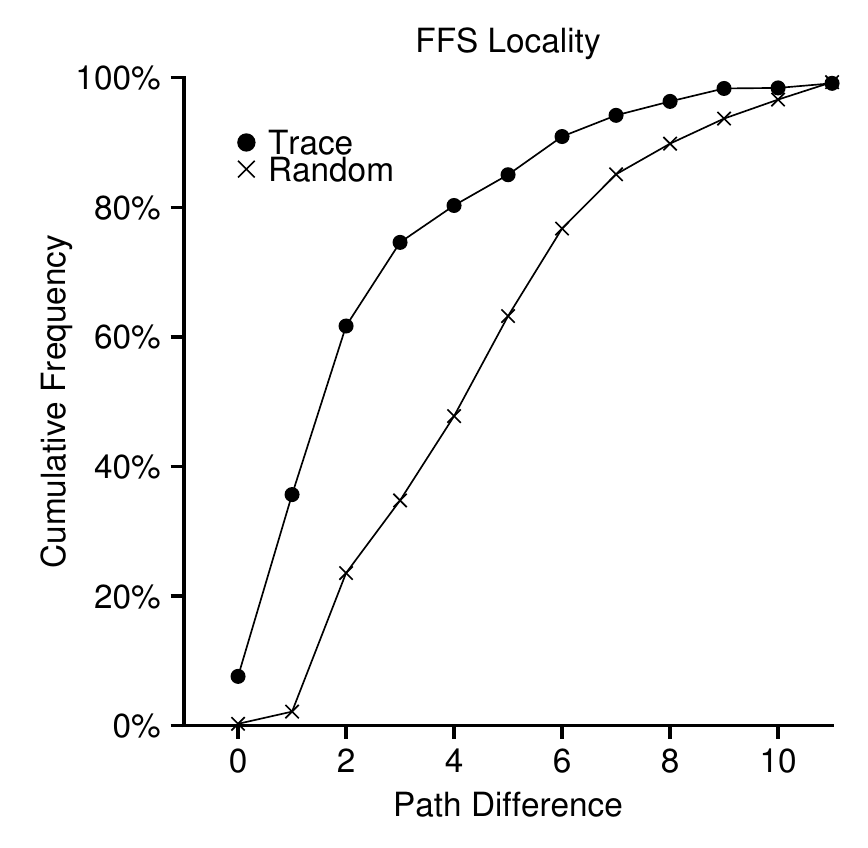
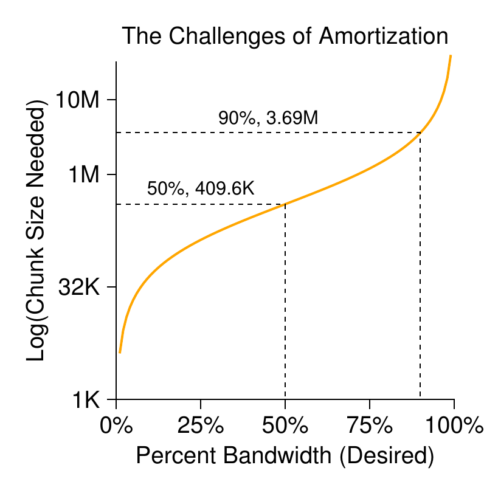

# 第 41 章 局部性与快速文件系统

> 英文原题：*Locality and the Fast File System*

UNIX 初次问世时，UNIX 大巫师 Ken Thompson 亲手写了第一个文件系统。我们称它为“旧 UNIX 文件系统”。它非常简单，磁盘布局基本如下：

```text
┌──────────┬──────────────────┬─────────────────────────────────┐
│ 超级块 S │      Inodes      │              Data               │
└──────────┴──────────────────┴─────────────────────────────────┘
```

超级块保存整个文件系统的信息，例如卷大小、inode 数量和空闲块链表表头；inode 区保存全部 inode；磁盘大部分则是数据块。

它的优点是简单，并成功提供文件与目录层次这两种基本抽象。相比过去笨拙的、基于记录的存储系统，这个易用系统是一大进步；目录树也远胜早期系统的单层目录。

## 41.1 问题：性能糟糕

问题也很直接：性能惨不忍睹。Berkeley 的 Kirk McKusick 等人测得 [MJLF84]，它一开始就慢，后来还越用越慢，最终只能提供磁盘总带宽的 2%。其余 98% 大概都在路上寻道。

根本原因是旧 UNIX 文件系统把磁盘当随机存取内存使用，随意散布数据，完全不理会磁盘定位既真实又昂贵。文件数据块常离 inode 很远，于是先读 inode 再读数据这种常见操作，也要付出一次昂贵寻道。

空闲空间没有精心管理，文件系统还会严重碎片化。空闲链表逐渐指向散布全盘的块，新文件只管依次取走表头；逻辑上连续的文件，物理上却让磁头在磁盘两端来回跑。

假设数据区中有四个各占两块的文件：

```text
A1 A2 | B1 B2 | C1 C2 | D1 D2
```

删除 B 与 D 后：

```text
A1 A2 | -- -- | C1 C2 | -- --
```

空闲空间变成两段各两块，而不是一段四块。此时创建四块文件 E：

```text
A1 A2 | E1 E2 | C1 C2 | E3 E4
```

顺序访问 E 时，要先读 E1、E2，寻道，再读 E3、E4，得不到磁盘峰值顺序性能。这类碎片在旧系统中反复出现。磁盘碎片整理工具正是为此服务：搬动磁盘数据，让文件连续、空闲空间集中，再改写 inode 等结构以反映新位置。

另一个问题是原始块太小，只有 512 字节。小块减少**内部碎片(internal fragmentation)**，即块内浪费，却让传输效率低下，因为每块都可能支付一次定位开销。

!!! danger "问题核心：怎样组织磁盘数据以提高性能"
    怎样组织文件系统数据结构才能改善性能？在这些结构之上需要什么分配策略？怎样让文件系统“理解磁盘”？

## 41.2 FFS：理解磁盘就是答案

Berkeley 的研究团队决定构建一个更好、更快的文件系统，并机智地称之为 **快速文件系统(Fast File System, FFS)**。核心是让数据结构和分配策略具备“磁盘意识”，从而提高性能；他们也确实做到了。

FFS 开启了文件系统研究的新时期。它保留 `open()`、`read()`、`write()`、`close()` 等接口，只改变内部实现，既与现有应用兼容，又为新设计铺路。今天几乎所有现代文件系统仍遵守既有接口，只在内部为性能、可靠性或其他目标各显神通。

## 41.3 组织结构：柱面组

第一步是改变磁盘结构。FFS 把磁盘划分为多个**柱面组(cylinder group)**。一个柱面由硬盘不同盘面上、距中心相同的各条磁道组成；它看起来确实像几何里的圆柱，所以名字并没有偷偷耍花招。FFS 把连续的 $N$ 个柱面聚成一组，整块磁盘便成为柱面组的集合。

现代磁盘隐藏几何细节，只向客户暴露逻辑块地址空间 [AD14a]，文件系统无法真正知道某个柱面是否在用。因此 Linux ext2/ext3/ext4 等现代文件系统改用**块组(block group)**：每组只是逻辑地址空间中的一段连续区域。

```text
逻辑块地址空间： [  Group 0  ][  Group 1  ][  Group 2  ] ...
```

叫柱面组还是块组并不重要；它们是 FFS 改善性能的核心机制。把两个文件放在同一组，连续访问时便不必横跨磁盘长途寻道。

每组都包含存放文件和目录所需的完整结构：

```text
┌───┬────┬────┬─────────────────┬────────────────────────────┐
│ S │ ib │ db │     Inodes      │            Data            │
└───┴────┴────┴─────────────────┴────────────────────────────┘
```

- 每组保存一份超级块 `S`，提高可靠性。一份损坏后，仍可用其他副本挂载并访问文件系统。
- 每组的 inode 位图 `ib` 与数据位图 `db` 跟踪本组对象是否已分配。位图很适合寻找大段连续空闲空间，可以避开旧式空闲链表的一些碎片问题。
- inode 区和数据区与上一章的 vsfs 类似；照例，大部分空间属于数据块。

!!! note "边栏：FFS 创建文件"
    假设创建一块大小的 `/foo/bar.txt`。新文件需要 inode，所以要写 inode 位图和新 inode；它还有数据，因此最终要写数据位图和数据块——当前柱面组至少四次写入，且这些写入可能先在内存中缓冲。

    还没完。系统必须把文件放进目录层次，向父目录 `foo` 加入 `bar.txt` 条目。更新可能装进原有目录块，也可能需要分配新块并修改数据位图；`foo` 的 inode 也要更新目录长度与修改时间。创建一个文件竟要做这么多事！下次新建文件时，不妨心存感激，至少也该惊讶它居然一直运作得不错。

## 41.4 策略：怎样分配文件和目录

有了组结构，FFS 还要决定文件、目录及其元数据放在哪里。基本咒语很简单：**相关的东西放一起；不相关的东西分开**。

目录的放置策略是：寻找已分配目录较少、空闲 inode 较多的柱面组，把目录 inode 和数据放进去。前者让目录在组间均衡，后者让该目录未来还能容纳许多文件。也可以使用考虑空闲数据块数量等其他启发式方法。

普通文件有两条规则：

1. 尽量把文件数据块与 inode 放在同一组，避免旧文件系统中 inode 与数据之间的长寻道。
2. 把同一目录中的文件放进该目录所在的柱面组。因此 `/a/b`、`/a/c`、`/a/d` 会彼此靠近，而 `/b/f` 放在另一组。

假设每组只有 10 个 inode 与 10 个数据块，目录 `/`、`/a`、`/b` 各占一块，文件 `/a/c`、`/a/d`、`/a/e`、`/b/f` 各占两块。FFS 可能得到：

```text
组    inode       数据
0     /---------  /---------
1     acde------  accddee---
2     bf--------  bff-------
3     ----------  ----------
...
```

每个文件的数据靠近 inode；同目录文件也靠近彼此。若只为避免单组 inode 表过快填满，而把 inode 机械地轮流摊开，布局可能变成：

```text
组    inode       数据
0     /---------  /---------
1     a---------  a---------
2     b---------  b---------
3     c---------  cc--------
4     d---------  dd--------
5     e---------  ee--------
6     f---------  ff--------
```

此时文件数据仍靠近各自 inode，但 `/a/c`、`/a/d`、`/a/e` 横跨三组，基于名称空间的局部性没了。

FFS 的启发式并非来自什么精雕细琢的大规模研究，而是老派常识——毕竟 CS 不就是 *common sense* 的缩写吗？同一目录中的文件往往一起访问，例如编译一批源文件再链接成一个程序。FFS 利用这种名称空间局部性，把相关文件之间的寻道缩短。

有人把 common sense 称为 horse sense，尤其是天天与马打交道的人。不过随着“机械马”——也就是汽车——越来越流行，这个说法可能会消失。人类下一步还能发明什么？飞行机器吗？？！！

## 41.5 测量文件局部性

为检验这些启发式是否合理，我们分析 SEER 文件系统访问轨迹 [K94]，测量相邻两次文件访问在目录树中“相距多远”。

- 同一个文件连续两次打开，距离为 0。
- `dir/f` 之后打开同目录的 `dir/g`，距离为 1。
- 一般而言，该指标表示需要沿目录树向上走多远，才能找到两个文件的共同祖先；树上越近，数值越小。



*图 41.1：SEER 轨迹中的 FFS 局部性。横轴为路径差异，纵轴为文件打开的累计比例；Trace 是真实轨迹，Random 是随机重排基线。*

在 SEER 全部工作站和完整轨迹中，约 7% 的访问再次打开前一个文件；接近 40% 访问的是同一文件或同一目录中的文件，即距离为 0 或 1。至少对这些轨迹，FFS 的局部性假设相当合理。

还有约 25% 的访问距离为 2。这常发生在用户把相关目录组织成多级结构时。例如 `proj/src/foo.c` 后访问 `proj/obj/foo.o`，共同祖先是 `proj`，距离为 2。FFS 策略捕捉不到这种局部性，因此两次访问之间可能产生更多寻道。

图中随机轨迹来自把已有 SEER 轨迹的文件随机重排后计算距离。它的名称空间局部性如预期更弱；不过所有文件最终都共享某个祖先（至少是根），所以仍会表现出一点局部性，可作为比较基线。

## 41.6 大文件例外

FFS 对一般放置策略有一项重要例外：大文件。若始终把文件放在一组，大文件会填满最初的块组，甚至继续填满其他组；后来创建的相关文件就挤不进来，访问局部性反而受损。

因此，FFS 在第一组中分配一定数量的块——例如 12 块，也就是 inode 的直接指针数——然后把下一大段（例如第一个间接块所指的所有数据）放进另一利用率较低的组，再把下一段放进又一组。

假设 `/a` 有 30 块，每组 10 个 inode、40 个数据块。不使用大文件例外时：

```text
组    inode       数据（每段 10 格）
0     /a--------  /aaaaaaaaa aaaaaaaaaa aaaaaaaaaa a---------
1     ----------  ---------- ---------- ---------- ----------
2     ----------  ---------- ---------- ---------- ----------
```

组 0 几乎被占满，根目录后来创建的其他文件没有多少落脚之地。若例外策略每段取 5 块：

```text
组    inode       数据
0     /a--------  /aaaaa---- ---------- ---------- ----------
1     ----------  aaaaa----- ---------- ---------- ----------
2     ----------  aaaaa----- ---------- ---------- ----------
3     ----------  aaaaa----- ---------- ---------- ----------
4     ----------  aaaaa----- ---------- ---------- ----------
5     ----------  aaaaa----- ---------- ---------- ----------
```

敏锐的读者（就是你）会发现，把同一文件摊到全盘会损害顺序访问性能。你又对了，我们敏锐的读者！解决办法是谨慎选择分段大小。段足够大时，大部分时间花在传输数据，段间寻道只占一小部分。这种“每付一次固定开销，就多做些工作”的方法叫**摊销(amortization)**，在计算机系统中极其常见。

假设平均定位时间（寻道加旋转）为 10 ms，磁盘传输速率 40 MB/s。若希望一半时间定位、一半时间传输，即达到峰值带宽 50%，每次定位后就应传输 10 ms：

$$
40\frac{\text{MB}}{\text{s}}
\times\frac{1024\text{ KB}}{1\text{ MB}}
\times\frac{1\text{ s}}{1000\text{ ms}}
\times10\text{ ms}
=409.6\text{ KB}. \tag{41.1}
$$

达到 90% 峰值需要约 3.69 MB，达到 99% 则要 40.6 MB。越逼近峰值，段大小增长得越凶。



*图 41.2：摊销——分段究竟要多大？纵轴为所需分段大小的对数，横轴为期望达到的峰值带宽比例。*

FFS 实际没有使用上述计算，而是借用 inode 结构：前 12 个直接块与 inode 同组；此后每个间接块及其指向的数据放进不同组。4 KB 块、32 位地址下，每 1024 块（4 MB）换一组，只有直接指针覆盖的最初 48 KB 例外。

磁盘传输速率增长较快，因为厂商擅长把更多位塞进同一表面；机械寻道与转速却提升缓慢 [P98]。久而久之，机械成本相对越来越贵，于是每次寻道之间必须传输更多数据才能把它摊薄。

## 41.7 关于 FFS 的其他几件事

FFS 还引入了一些创新。

首先是小文件。当时许多文件约 2 KB；4 KB 块传输效率好，却可能浪费一半空间。FFS 引入 512 字节的**子块(sub-block)**。1 KB 文件只占两个子块；文件增长时继续分配子块，直到积累满 4 KB，再寻找一个完整块，把子块内容复制进去并释放旧子块。

这显然需要额外复制和 I/O，效率不高。你又说对了！FFS 通常通过修改 `libc` 避免最坏情况：库先缓冲写入，再以 4 KB 为单位交给文件系统，多数时候根本不必启动子块特技。

其次，FFS 会按磁盘性能参数优化盘面布局。SCSI 等现代接口出现前，磁盘没那么聪明，主机 CPU 必须亲自控制更多细节。若文件放在连续扇区，顺序读完块 0、再发块 1 请求时，块 1 可能已经从磁头下转过去，只好等整整一圈。


*图 41.3：FFS 的标准布局与参数化布局。左图连续编号；右图交错放置，让系统来得及发出下一个请求。*

FFS 的办法是跳过一些物理块进行布局。图中每隔一块放置，系统读完当前块后有时间请求下一块，不会刚好错过。FFS 还能测量特定磁盘需要跳过多少块，这种按设备性能参数决定交错布局的技术叫**参数化(parameterization)**。

这种布局只能达到约 50% 峰值带宽，因为读完全部块要绕磁道两圈。幸好现代磁盘会把整条磁道读进内部**磁道缓冲区(track buffer)**，同磁道后续请求可直接从缓存返回，文件系统不用再操心这种超低层细节。设计得当时，抽象与高层接口确实是好东西。

FFS 还带来长文件名、符号链接和原子的 `rename()`。符号链接能指向任意文件或目录，不像硬链接那样不能指目录、也不能跨卷。这些基本技术之外的易用性改进，很可能也帮 FFS 赢得了用户。

!!! tip "让系统真正可用"
    FFS 的基本教训不只有“布局要理解磁盘”。长文件名、符号链接和原子重命名都让系统更实用。它们很难撑起一篇研究论文——试想读一篇 14 页的《符号链接：硬链接失散多年的表亲》——却可能比深奥的技术创新更能推动采用。让系统好用，往往同样重要，甚至更加重要。

## 41.8 小结

FFS 的出现是文件系统史上的分水岭。它表明文件管理是操作系统中极有意思的问题，也展示了怎样开始认真对待那件最重要的设备——硬盘。

此后诞生了数百种文件系统，今天许多设计仍向 FFS 取经；Linux ext2、ext3 就是明显的思想后裔。所有现代系统都记住了 FFS 的主要教训：**磁盘是什么，就把它当什么；别再把它假装成内存。**

## 参考文献

- [AD14a] “Operating Systems: Three Easy Pieces” (Chapter: Hard Disk Drives) by Remzi and Andrea Arpaci-Dusseau. 不了解硬盘就来读 FFS，实在说不过去。若你坚持，请直接进监狱；不要经过起点，尤其不要领取那急需的 200 块大洋。
- [AD14b] “Operating Systems: Three Easy Pieces” (Chapter: File System Implementation) by Remzi and Andrea Arpaci-Dusseau. 同理，不先理解文件系统实现，本章抛出 inode、间接块时你只会“啊？”——对你我都没有乐趣。
- [K94] “The Design of the SEER Predictive Caching System” by G. H. Kuenning. MOBICOMM '94. 据 Kuenning 所言，这是 SEER 项目的最佳概述；该项目还收集了本章使用的轨迹。
- [MJLF84] “A Fast File System for UNIX” by Marshall K. McKusick et al. *ACM TOCS* 2:3, August 1984. McKusick 因文件系统贡献获得 IEEE Reynold B. Johnson 奖，其中许多成果来自 FFS。最初实现只有 1200 行代码；现代 BSD 后裔稍微复杂了一点——大约 5 万行。
- [P98] “Hardware Technology Trends and Database Opportunities” by David A. Patterson. SIGMOD '98 keynote. 对磁盘技术趋势及其变化的优秀而简明的概述。

## 作业（模拟器）

使用 `ffs.py` 理解 FFS 如何分配文件和目录。运行细节见 README。

1. 查看 `in.largefile`，用 `-f in.largefile -L 4` 运行模拟器；`-L 4` 把大文件例外阈值设为 4 块。预测布局，再用 `-c` 检查。
2. 改为 `-L 30`。你预计看到什么？再用 `-c` 验证；还可用 `-S` 查看文件 `/a` 究竟分到了哪些块。
3. **filespan** 是文件任意两个数据块之间，或 inode 与任一数据块之间的最大距离。计算 `/a` 的 filespan，再运行 `ffs.py -f in.largefile -L 4 -T -c` 检查。对 `-L 100` 重复。大文件例外参数从小变大时，filespan 怎样变化？
4. 查看新输入 `in.manyfiles`。FFS 会怎样跨组布局这些文件？可用 `-v` 查看创建了什么，或直接读取输入文件；再用 `-c` 验证。
5. **dirspan** 衡量一个目录中所有文件的 inode、数据块，以及目录自身 inode、数据块的最大跨度。对 `in.manyfiles` 加 `-T`，计算三个目录的 dirspan，再用 `-c` 检查。FFS 把它压得多好？
6. 用 `-I 5` 把每组 inode 表缩到 5 个。布局会怎样变化？用 `-c` 验证。dirspan 又如何？
7. 新目录 inode 应放进哪组？模拟器默认选空闲 inode 最多的组；`-A 2` 则成对考察组，并选择最佳的一对。运行 `./ffs.py -f in.manyfiles -I 5 -A 2 -c`，观察布局与 dirspan 的变化。这项策略为什么可能更好？
8. 运行 `./ffs.py -f in.fragmented -v`，预测最终保留文件的布局，再用 `-c` 验证。文件 `/i` 的数据布局有什么特别？为什么有问题？
9. 新的连续分配策略 `-C n` 要求组内至少有 $n$ 个连续空闲块才分配。运行 `./ffs.py -f in.fragmented -v -C 2 -c`。增大 `-C` 参数时布局怎样变化？它怎样影响 filespan 与 dirspan？
